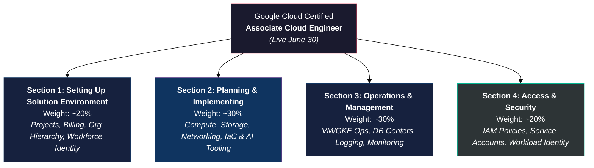

# Google Cloud Certified Associate Cloud Engineer — Exam Guide
### Official Standard Examination Scope, Technical Domains, and Service Competencies (Live June 30)

---

> [!IMPORTANT]
> **Release Notes & Effective Date:** This is the new version of the Associate Cloud Engineer standard examination guide, live on **June 30**. If you plan to take the Associate Cloud Engineer standard exam in English on or after June 30, prepare using this exam guide. If you plan to take the exam before June 30, review the preceding exam guide version.
>
> **Candidate Persona & Scope:** An Associate Cloud Engineer deploys and secures applications, services, and infrastructure, monitors the operations of multiple projects, and maintains enterprise solutions to meet target performance metrics. This individual has experience working with public clouds or on-premises solutions. They are able to perform common platform-based tasks, supported by AI tooling, to maintain and scale one or more deployed solutions that leverage Google-managed or self-managed services on Google Cloud.

---

## Table of Contents

1. [Exam Architecture & Domain Weighting](#exam-architecture)
2. [PART 1 — Section 1: Setting up a Cloud Solution Environment (~20%)](#part-1)
   - [1.1 Setting up Cloud Projects and Accounts](#section-1-1)
   - [1.2 Managing Billing Configuration](#section-1-2)
3. [PART 2 — Section 2: Planning and Implementing a Cloud Solution (~30%)](#part-2)
   - [2.1 Planning and Implementing Compute Resources](#section-2-1)
   - [2.2 Planning and Implementing Storage and Data Solutions](#section-2-2)
   - [2.3 Planning and Implementing Networking Resources](#section-2-3)
   - [2.4 Planning and Implementing Resources Using Tooling](#section-2-4)
4. [PART 3 — Section 3: Ensuring the Successful Operation of a Cloud Solution (~30%)](#part-3)
   - [3.1 Managing Compute Resources](#section-3-1)
   - [3.2 Managing Storage and Data Solutions](#section-3-2)
   - [3.3 Managing Networking Resources](#section-3-3)
   - [3.4 Monitoring and Logging](#section-3-4)
5. [PART 4 — Section 4: Configuring Access and Security (~20%)](#part-4)
   - [4.1 Managing IAM](#section-4-1)
   - [4.2 Managing Service Accounts](#section-4-2)
6. [PART 5 — High-Yield GCP Service Mapping Reference](#part-5)
7. [PART 6 — Comparative Architecture Frameworks](#part-6)
8. [PART 7 — Candidate Readiness & Verification Checklist](#part-7)

---

## Exam Architecture & Domain Weighting

The Associate Cloud Engineer examination evaluates practical engineering execution across four core lifecycle domains, reflecting modern cloud operations enhanced by AI-assisted workflows and managed infrastructure.

| Section | Domain Title | Exam Weight | Core Technical Focus |
|:--------|:-------------|:------------|:---------------------|
| **Section 1** | Setting up a cloud solution environment | **~20%** | Resource hierarchy, org policies, billing accounts, budgets, Cloud Identity, Workforce Identity Federation |
| **Section 2** | Planning and implementing a cloud solution | **~30%** | Compute Engine, GKE, Cloud Run, Storage, VPCs, Cloud NGFW, IaC (Terraform, Config Connector), AI tooling |
| **Section 3** | Ensuring the successful operation of a cloud solution | **~30%** | VM/GKE operations, DB maintenance, traffic splitting, Cloud Monitoring/Logging, Ops Agent, Cloud Hub |
| **Section 4** | Configuring access and security | **~20%** | IAM role assignment, custom roles, service accounts, short-lived tokens, Workload Identity Federation |

---

## PART 1 — Section 1: Setting up a Cloud Solution Environment (~20%)

This domain validates an engineer's ability to configure organizational boundaries, govern cloud tenancy, manage administrative hierarchies, enforce security baselines, and control financial accounting structures.

### 1.1 Setting up cloud projects and accounts
#### "Establishing the foundational cloud hierarchy, identity boundaries, and governance baseline"

Considerations include:

*   **Creating a resource hierarchy:**
    *   Deploying and structuring nodes across the canonical hierarchy: `Organization` $\rightarrow$ `Folders` (departments/environments) $\rightarrow$ `Projects` $\rightarrow$ `Resources`.
    *   Governing inheritance mechanics (IAM roles and policies propagate downwards; child nodes inherit parent permissions additively).
*   **Applying organizational policies to the resource hierarchy:**
    *   Enforcing constraints at folder or organization levels via Organization Policy Service (e.g., `constraints/compute.vmExternalIpAccess`, `constraints/gcp.resourceLocations`).
    *   Understanding policy evaluation, inheritance override rules, and dry-run policy enforcement.
*   **Granting members Identity and Access Management (IAM) roles within a project:**
    *   Binding predefined, primitive, or custom roles to user principals, Google Groups, and service accounts.
    *   Applying IAM Conditions (conditional role bindings based on resource tags, time-of-day, or request attributes).
*   **Managing users and groups in Cloud Identity (manually and automated):**
    *   User lifecycle management, 2-Step Verification (2SV) enforcement, and domain verification.
    *   Automating directory synchronization using Google Cloud Directory Sync (GCDS) with on-premises Active Directory or LDAP systems.
*   **Enabling APIs within projects:**
    *   Activating service APIs via Google Cloud Console, `gcloud services enable <service>`, and Service Usage API.
    *   Handling API dependencies and service enablement quotas.
*   **Provisioning and setting up products in Google Cloud Observability:**
    *   Initializing Google Cloud Observability (formerly Stackdriver) workspaces across multi-project environments.
    *   Setting up scoping projects and metrics collection boundaries.
*   **Assessing quotas and requesting increases:**
    *   Evaluating regional and global service quotas (rate quotas, allocation quotas) in Cloud Console.
    *   Submitting automated or human-reviewed quota increase requests for compute cores, IPs, and API calls.
*   **Setting up standalone organizations:**
    *   Establishing an Organization resource for Google Workspace or Cloud Identity tenants.
    *   Configuring Super Admin roles and bootstrapping root org level controls.
*   **Setting up cloud networking:**
    *   Configuring initial network constructs, Default vs. Custom VPC architectures, subnet IP allocation, and DNS configuration.
*   **Verifying product availability across geographical locations (e.g., regions, zones):**
    *   Evaluating service residency, regional vs. zonal failure domains, multi-region redundancy, and edge points of presence (PoPs).
*   **Configuring Cloud Asset Inventory and using Gemini Cloud Assist to analyze resources:**
    *   Exporting asset snapshots, analyzing real-time resource metadata, tracking temporal state changes, and querying resource relationships.
    *   Leveraging Gemini Cloud Assist natural language prompts to inspect topology, identify orphaned resources, and troubleshoot configurations.
*   **Configuring Workforce Identity Federation:**
    *   Enabling external identity providers (IdPs like Azure AD/Entra ID, Okta, Ping, SAML 2.0, OIDC) to access Google Cloud console and APIs without syncing user credentials to Cloud Identity.

---

### 1.2 Managing billing configuration
#### "Controlling cloud spend, account hierarchies, financial alerts, and cost export analytics"

Considerations include:

*   **Creating one or more billing accounts:**
    *   Establishing Cloud Billing accounts (Self-serve vs. Invoiced accounts), managing billing administrators, and structuring payment profiles.
*   **Linking projects to a billing account:**
    *   Associating one or multiple projects to designated billing accounts via console, `gcloud billing projects link`, and IAM delegation (`Billing Account User`).
*   **Establishing billing budgets and alerts:**
    *   Configuring budget scopes (project-level, service-level, label-based) with absolute or percentage thresholds (e.g., 50%, 90%, 100% of actual or forecasted spend).
    *   Wiring programmatic budget alerts to Cloud Pub/Sub topics to trigger automated remediation (e.g., disabling billing, spinning down test instances).
*   **Setting up billing exports:**
    *   Enabling daily cost data export and detailed usage cost data export to BigQuery datasets.
    *   Configuring pricing data export for enterprise dashboarding and analysis in Looker Studio.

---

## PART 2 — Section 2: Planning and Implementing a Cloud Solution (~30%)

This domain focuses on architecting and standing up production infrastructure across compute runtimes, scalable storage, enterprise databases, hybrid networks, and automated delivery pipelines.

### 2.1 Planning and implementing compute resources
#### "Selecting, provisioning, and scaling containerized, serverless, VM, and AI agent workloads"

Considerations include:

*   **Selecting appropriate compute choices for a given workload:**
    *   **Compute Engine:** Full OS control, custom kernels, legacy migrations, specialized hardware configurations.
    *   **Google Kubernetes Engine (GKE):** Complex microservices, stateful container sets, fine-grained orchestration.
    *   **Cloud Run:** Scalable stateless containers, microservices, web apps, HTTP-driven event processing.
    *   **Cloud Run functions:** Event-driven serverless code snippets executing on background triggers.
    *   **Agent Runtime on Gemini Enterprise Agent Platform** *(formerly Vertex AI Agent Engine)*: Managed runtime environment optimized for autonomous AI agents, tool-calling reasoning loops, and conversational grounding.
*   **Launching a compute instance:**
    *   Configuring availability policies (automatic restart, on-host maintenance behavior: Live Migration vs. Terminate).
    *   Managing SSH keys (project-wide metadata vs. instance-specific keys vs. OS Login).
*   **Choosing the appropriate storage for Compute Engine:**
    *   **Zonal Persistent Disk (pd-standard, pd-balanced, pd-ssd):** Single-zone block storage for general workloads.
    *   **Regional Persistent Disk:** Synchronous cross-zone replication for high-availability active-passive failover.
    *   **Google Cloud Hyperdisk:** Next-generation decoupled block storage with dynamically configurable IOPS and throughput (Hyperdisk Extreme, Hyperdisk Throughput, Hyperdisk Balanced).
*   **Creating an autoscaled managed instance group by using an instance template:**
    *   Authoring immutable instance templates with boot images, metadata, and startup scripts.
    *   Configuring Managed Instance Groups (MIGs) with autoscaling policies (CPU utilization, Cloud Monitoring metrics, load balancing capacity, schedule-based scaling) and autohealing health checks.
*   **Configuring OS Login:**
    *   Managing Linux user accounts through IAM permissions (`roles/compute.osLogin`, `roles/compute.osAdminLogin`) linked to 2FA rather than manual SSH key rotation.
*   **Configuring VM Manager:**
    *   Enabling OS Config API, deploying OS Config agent, applying automated OS patch management, compliance reporting, and software inventory management.
*   **Using Spot VM instances and custom machine types:**
    *   Leveraging Spot VMs (excess capacity at 60-91% discount, subject to 30-second preemption notice) for fault-tolerant batch workloads.
    *   Configuring custom vCPU and memory ratios to optimize compute spend without paying for unneeded pre-packaged machine sizes.
*   **Installing and configuring the command-line interface (CLI) for Kubernetes (kubectl):**
    *   Installing `kubectl` and configuring cluster access credentials via `gcloud container clusters get-credentials <cluster-name> --region/--zone`.
*   **Deploying a GKE cluster with different configurations:**
    *   **GKE Autopilot:** Fully managed node infrastructure, automated provisioning, per-Pod resource billing, built-in security hardening.
    *   **Regional clusters:** Multi-zone control plane and worker nodes providing 99.95% SLA and regional resilience.
    *   **Private clusters:** Isolated control plane and worker nodes with private IP addresses and authorized master networks.
*   **Deploying a containerized application to GKE:**
    *   Applying Kubernetes declarative manifests (Deployments, Services, ConfigMaps, Secrets, Ingress) against target namespaces.
*   **Deploying an application to serverless compute platforms, including for the processing of Google Cloud events:**
    *   Deploying container images to Cloud Run via `gcloud run deploy`.
    *   Ingesting asynchronous events via **Cloud Pub/Sub**, **Cloud Storage object change notifications**, and **Eventarc** routing.
*   **Identifying whether to use GPUs or TPUs:**
    *   **NVIDIA GPUs (L4, A100, H100):** General-purpose deep learning, PyTorch/TensorFlow training, fine-tuning, and LLM inference.
    *   **Google Cloud TPUs (v4, v5e, v5p):** Massive-scale matrix math, large-scale transformer foundation model pre-training, and high-throughput model execution.

---

### 2.2 Planning and implementing storage and data solutions
#### "Selecting, provisioning, and maintaining structured, unstructured, streaming, and analytical data stores"

Considerations include:

*   **Choosing and deploying data products:**
    *   **Cloud SQL:** Fully managed relational DB (PostgreSQL, MySQL, SQL Server) with automated backups and read replicas.
    *   **AlloyDB for PostgreSQL:** Enterprise-grade PostgreSQL-compatible database with decoupled compute/storage for high-transaction workloads.
    *   **Cloud Spanner:** Globally distributed, horizontally scalable relational database with external consistency (ACID) and 99.999% SLA.
    *   **Cloud Bigtable:** High-throughput, low-latency NoSQL database for real-time IoT, telemetry, and time-series data.
    *   **Firestore:** Serverless NoSQL document database with real-time sync, offline support, and automatic horizontal scaling.
    *   **Memorystore:** In-memory caching layer supporting Redis and Memcached.
    *   **BigQuery:** Serverless, highly scalable enterprise cloud data warehouse for petabyte-scale analytics and BigQuery ML.
    *   **Dataflow:** Fully managed Apache Beam execution engine for streaming and batch ETL data pipelines.
    *   **Pub/Sub & Google Cloud Managed Service for Apache Kafka:** Enterprise messaging backbones for decoupled real-time event streaming.
*   **Choosing and deploying storage products and Cloud Storage options:**
    *   **Cloud Storage Classes:**
        *   *Standard:* Frequent access, active data serving.
        *   *Nearline:* Infrequent access (read $\le$ once per 30 days).
        *   *Coldline:* Rare access (read $\le$ once per 90 days).
        *   *Archive:* Long-term compliance archiving (read $\le$ once per 365 days).
    *   **Specialized Storage Systems:**
        *   *Filestore:* Managed Network Attached Storage (NAS) providing shared POSIX NFSv3 file systems.
        *   *Google Cloud NetApp Volumes:* Enterprise multiprotocol file storage (NFS, SMB) with high throughput and instant snapshots.
        *   *Google Cloud Managed Lustre:* High-performance parallel file system designed for HPC and AI/ML model training IOPS.
*   **Loading data:**
    *   Uploading via command-line (`gcloud storage cp`, `gsutil`).
    *   Loading structured data into BigQuery from Cloud Storage buckets.
    *   Orchestrating large-scale data ingestion via **Storage Transfer Service** (from AWS S3, Azure Blob, POSIX file systems, or Cloud Storage buckets).
*   **Maintaining multi-region redundancy across data solutions:**
    *   Provisioning Dual-region and Multi-region Cloud Storage buckets.
    *   Setting up cross-region read replicas in Cloud SQL and multi-region instance configurations in Cloud Spanner.

---

### 2.3 Planning and implementing networking resources
#### "Constructing secure software-defined networks, perimeter defenses, and hybrid connectivity"

Considerations include:

*   **Creating a VPC with subnets:**
    *   Building Custom-mode VPC networks with non-overlapping RFC 1918 CIDR blocks.
    *   Designing **Shared VPC** (centralized host project managing networks while service projects attach resources).
    *   Deploying **VPC Network Peering** for direct, low-latency, private RFC 1918 interconnectivity without routing via public internet.
*   **Creating and applying VPC firewall rules and Cloud Next Generation Firewall (Cloud NGFW) policies:**
    *   Structuring ingress and egress rules with attributes: action (`allow`/`deny`), source/destination ranges, targets, protocols, and ports.
    *   Deploying Cloud NGFW policies (hierarchical firewall policies, regional/global network firewall policies).
*   **Using Tags (e.g., secure Tags) and service accounts in Cloud NGFW policy rules:**
    *   Binding secure Resource Manager Tags to instances for fine-grained, cryptographically validated firewall policy enforcement (preventing unauthorized tag manipulation by instance owners).
    *   Targeting firewall rules via source/target Service Accounts.
*   **Establishing network connectivity:**
    *   **Cloud VPN:** IPSec VPN tunnels (HA VPN with dynamic BGP routing providing 99.99% availability).
    *   **VPC Network Peering:** Direct, private connectivity across distinct VPCs without bandwidth throttling or gateway hops.
    *   **Cloud Interconnect:** Dedicated Interconnect (10G/100G physical circuits) or Partner Interconnect for mission-critical hybrid data center links.
*   **Choosing and deploying load balancers:**
    *   *Application Load Balancers (ALBs):* Layer 7 HTTP/HTTPS (Global external, Regional external, Regional internal).
    *   *Proxy Network Load Balancers:* Layer 4 TCP/SSL with global traffic director features.
    *   *Passthrough Network Load Balancers:* Layer 4 non-proxied high-performance direct server return (regional external/internal).
*   **Differentiating Network Service Tiers:**
    *   *Premium Tier:* Traffic enters Google's global fiber backbone at the edge PoP nearest to the client; delivers lower latency and higher reliability.
    *   *Standard Tier:* Traffic traverses the public internet until reaching the Google region hosting the service; optimized for lower egress cost.

---

### 2.4 Planning and implementing resources using tooling
#### "Automating cloud infrastructure delivery through Declarative IaC, Kubernetes operators, and AI engineering tools"

Considerations include:

*   **Infrastructure as Code tooling:**
    *   **Terraform:** HashiCorp HCL provisioning using the official `google` and `google-beta` providers; state management in Cloud Storage backends with object versioning.
    *   **Fabric FAST (Foundations and Solutions Templates):** Production-ready enterprise Google Cloud architecture blueprints and modules.
    *   **Config Connector:** Kubernetes Custom Resource Definitions (CRDs) enabling Google Cloud resource management directly via `kubectl` and GitOps pipelines.
    *   **Helm:** Packaging, versioning, and deploying Kubernetes application charts to GKE clusters.
*   **AI-assisted planning and implementation:**
    *   **Gemini CLI:** Terminal-native AI developer interface for synthesizing `gcloud` commands, scripts, and debugging output.
    *   **Google Antigravity:** Next-generation autonomous developer and operations tooling ecosystem within Google Cloud.
    *   **Gemini Cloud Assist:** Conversational cloud architect inside Google Cloud Console aiding architecture design, query synthesis, and configuration audits.
    *   **Application Design Center:** Visual, interactive cloud architecture canvas for planning, validating, and generating infrastructure templates.

---

## PART 3 — Section 3: Ensuring the Successful Operation of a Cloud Solution (~30%)

This domain validates operational excellence: managing running workloads, executing database maintenance, tuning traffic distribution, automating autoscaling, and performing root-cause telemetry troubleshooting.

### 3.1 Managing compute resources
#### "Operational lifecycle management across VMs, GKE clusters, serverless containers, and AI runtimes"

Considerations include:

*   **Remotely connecting to a Compute Engine instance:**
    *   Connecting via `gcloud compute ssh` with Identity-Aware Proxy (IAP) TCP forwarding (no public IP required on VM).
*   **Viewing current running Compute Engine instances:**
    *   Inspecting instance state, zones, internal/external IPs, and status flags via console and `gcloud compute instances list`.
*   **Working with snapshots and images:**
    *   Creating, viewing, and deleting disk snapshots and custom boot images; configuring automated snapshot schedules for disaster recovery.
*   **Viewing current running GKE cluster inventory:**
    *   Auditing cluster components: nodes, Pods, Services, Deployments, and DaemonSets via `kubectl get` and GKE console dashboards.
*   **Configuring GKE to access Artifact Registry:**
    *   Granting `roles/artifactregistry.reader` to the GKE node service account or configuring Workload Identity bindings for container image pulls.
*   **Working with GKE node pools:**
    *   Adding, editing, resizing, upgrading, and removing node pools; configuring cluster autoscaler minimum and maximum node limits per pool.
*   **Working with Kubernetes resources:**
    *   Managing Pods, Services (ClusterIP, NodePort, LoadBalancer), and StatefulSets (persistent volume claims, headless services).
*   **Managing horizontal and vertical Pod autoscaling configurations:**
    *   Deploying Horizontal Pod Autoscaler (HPA) based on CPU/memory utilization or custom metrics.
    *   Configuring Vertical Pod Autoscaler (VPA) for automated container resource request/limit recommendations.
*   **Managing GKE Autopilot Pod resource requests:**
    *   Defining container resource requests (`cpu`, `memory`, `ephemeral-storage`) which govern Autopilot scheduling and per-Pod billing.
*   **Deploying new versions of a Cloud Run application:**
    *   Deploying immutable Cloud Run revisions via `gcloud run deploy --image` or source repository triggers.
*   **Adjusting application traffic splitting parameters:**
    *   Directing percentage-based canary traffic (e.g., 90% stable, 10% canary) across Cloud Run revisions, Cloud Run functions, and GKE Ingress/Gateway APIs.
*   **Configuring autoscaling for a Cloud Run application:**
    *   Configuring minimum and maximum container instance counts (`--min-instances`, `--max-instances`), concurrency limits, and request timeouts.
*   **Attaching GPUs and TPUs:**
    *   Provisioning accelerated Compute Engine and GKE node pool hardware with NVIDIA drivers and TPU topologies.
*   **Deploying an agent to Agent Runtime on Gemini Enterprise Agent Platform:**
    *   Managing agent deployment packages, reasoning engine parameters, and live endpoint connections on Gemini Enterprise Agent Platform *(formerly Vertex AI Agent Engine)*.
*   **Managing notebooks in Gemini Enterprise Agent Platform Workbench and BigQuery:**
    *   Provisioning, stopping, and scheduling managed Jupyter notebooks in Workbench *(formerly Vertex AI Workbench)* and running SQL/Python queries in BigQuery Studio.
*   **Managing developer environments:**
    *   Standing up and securing cloud-based developer workstations using **Cloud Workstations** (containerized development environments with corporate VPC access and security controls).

---

### 3.2 Managing storage and data solutions
#### "Administering object lifecycles, database operations, query performance, and cryptographic keys"

Considerations include:

*   **Managing and securing objects in Cloud Storage buckets:**
    *   Applying Uniform bucket-level access, object versioning, retention policies, and Bucket Lock for WORM compliance.
*   **Setting object lifecycle management policies for Cloud Storage buckets:**
    *   Configuring JSON lifecycle rules to transition objects across tiers (`Nearline` after 30 days, `Coldline` after 90 days, `Archive` after 365 days) and delete expired objects.
*   **Executing queries to retrieve data from data instances:**
    *   Running operational SQL/NoSQL queries and inspecting execution trees across Cloud SQL, BigQuery, Bigtable, Spanner, Firestore, and AlloyDB.
*   **Estimating costs of data storage resources:**
    *   Calculating storage at-rest pricing, network egress costs, and query scan pricing via Google Cloud Pricing Calculator and BigQuery dry-run queries.
*   **Backing up and restoring database instances:**
    *   Executing on-demand and automated backups, point-in-time recovery (PITR), and instance restoration workflows for Cloud SQL, Firestore, Spanner, AlloyDB, and Bigtable.
*   **Reviewing job status:**
    *   Monitoring pipeline execution graphs, worker autoscaling, and backpressure in **Dataflow**; tracking query execution phases and slot usage in **BigQuery**.
*   **Using Database Center to manage the Google Cloud database fleet:**
    *   Centralized management, health auditing, security compliance, and backup coverage assessment across the enterprise database fleet.
*   **Configuring customer-managed encryption keys (CMEK):**
    *   Generating symmetric cryptographic keys in **Cloud Key Management Service (Cloud KMS)** and associating key rings with Storage buckets, Compute disks, and Database instances.

---

### 3.3 Managing networking resources
#### "Network topology modifications, IP management, routing tables, and perimeter enforcement"

Considerations include:

*   **Resizing a subnet’s IPv4 address range:**
    *   Expanding CIDR blocks in-place without instance downtime via `gcloud compute networks subnets expand-ip-range` (subnets can only be expanded, never shrunk).
*   **Reserving static external or internal IP addresses:**
    *   Allocating and binding regional and global static IPs to load balancers and Compute Engine instances via `gcloud compute addresses create`.
*   **Adding custom static routes in a VPC:**
    *   Configuring custom route tables with destination IP ranges, next hops (default internet gateway, internal load balancer IP, or VPN tunnel), and route priority values.
*   **Using Cloud DNS and Cloud NAT:**
    *   Configuring managed public and private DNS zones and record sets in Cloud DNS.
    *   Deploying Cloud NAT gateways to allow private VPC instances outbound internet access without exposing public IPs.
*   **Managing VPC firewall rules and Cloud NGFW policies:**
    *   Auditing active firewall rules, adjusting priority hierarchies (0-65535), and modifying Cloud NGFW intrusion prevention profiles.

---

### 3.4 Monitoring and logging
#### "Full-stack observability: metric collection, structured log routing, distributed tracing, and AI diagnostics"

Considerations include:

*   **Creating Cloud Monitoring alerts based on resource metrics:**
    *   Configuring alerting policies, notification channels (email, Slack, PagerDuty, Webhooks), metric thresholds, and alert incidence duration windows.
*   **Creating and ingesting Cloud Monitoring custom metrics:**
    *   Publishing application-level metrics via OpenTelemetry, Cloud Monitoring API, or log-based metrics synthesized from structured log entries.
*   **Configuring audit logs:**
    *   Enabling and analyzing Admin Activity, Data Access, System Event, and Policy Denied audit logs; configuring **VPC Flow Logs** and firewall rule logging.
*   **Exporting logs to external systems:**
    *   Streaming logs to BigQuery for long-term analytical queries, Cloud Storage for archival compliance, Pub/Sub for SIEM integration (Splunk, Datadog), or on-premises systems.
*   **Configuring log buckets, log analytics, and log routers:**
    *   Managing default `_Default` and `_Required` sinks, creating custom log routers, provisioning regional Log Buckets, and querying logs using **Log Analytics** (SQL queries powered by BigQuery engine).
*   **Viewing and filtering logs in Cloud Logging:**
    *   Constructing targeted queries using the Logging query language (filtering by resource type, log name, timestamp, and severity level).
*   **Viewing specific log message details in Cloud Logging:**
    *   Inspecting JSON payload structures, traceback call-stacks, HTTP request metadata, and correlation trace IDs.
*   **Using cloud diagnostic tools to investigate an application issue:**
    *   **Cloud Trace:** Analyzing distributed latency waterfalls and identifying downstream service bottlenecks.
    *   **Cloud Profiler:** Continuous CPU and memory heap profiling of production code with low overhead.
    *   **Query Insights:** Diagnosing database performance, execution plans, and locking issues in Cloud SQL.
    *   **Index Advisor:** Recommending missing database indexes to optimize query latency.
*   **Viewing the Personalized Service Health dashboard:**
    *   Tracking Google Cloud infrastructure incidents, outages, and planned maintenance schedules specifically impacting the project's utilized products and regions.
*   **Configuring and deploying Ops Agent:**
    *   Installing and configuring the unified Google Cloud Ops Agent (Fluent Bit + OpenTelemetry Collector) on Linux/Windows VMs for detailed host telemetry and application log harvesting.
*   **Deploying Google Cloud Managed Service for Prometheus:**
    *   Deploying managed collectors and evaluating PromQL alerts and dashboards without managing Prometheus infrastructure.
*   **Using Gemini Cloud Assist for Cloud Monitoring:**
    *   Leveraging generative AI to summarize incident root causes, analyze error log spikes, and suggest diagnostic troubleshooting steps.
*   **Using Active Assist to optimize resource utilization:**
    *   Auditing Recommender insights for idle VMs, over-provisioned machine types, unutilized IP addresses, and IAM least-privilege role recommendations.
*   **Using Cloud Hub to monitor active events and application health data:**
    *   Centralized operational dashboard tracking enterprise event streams, deployment health, and cross-project system reliability.

---

## PART 4 — Section 4: Configuring Access and Security (~20%)

This domain validates an engineer's ability to enforce the principle of least privilege, govern service-to-service authentication, manage programmatic keys, and integrate federated identity systems.

### 4.1 Managing IAM
#### "Enforcing identity boundaries, role inheritance, and customized access control"

Considerations include:

*   **Viewing and creating IAM policies:**
    *   Inspecting IAM policy bindings at Organization, Folder, and Project levels using console and `gcloud projects get-iam-policy`.
    *   Authoring declarative JSON/YAML policy bindings and applying them safely.
*   **Attaching roles and policy inheritance in the Organization hierarchy:**
    *   Understanding the hierarchical model: permissions inherited from parent folders/org cannot be restricted by child projects (additive inheritance).
    *   Assigning role bindings to appropriate administrative principals at the highest logical scope.
*   **Managing the various role types and defining custom IAM roles:**
    *   *Primitive roles:* `Viewer`, `Editor`, `Owner` (broad, legacy; prohibited in production environments).
    *   *Predefined roles:* Granular service-specific roles maintained by Google (e.g., `roles/storage.objectViewer`).
    *   *Custom roles:* User-curated sets of individual permissions (e.g., `compute.instances.start`) created at project or organization levels to fulfill strict least-privilege requirements.

---

### 4.2 Managing service accounts
#### "Securing machine-to-machine identity, credential lifecycle, and federated workload authentication"

Considerations include:

*   **Creating service accounts, including Google-managed service accounts:**
    *   Provisioning User-managed service accounts (`sa-name@project-id.iam.gserviceaccount.com`).
    *   Recognizing Google-managed service accounts and Service Agents (e.g., `service-[PROJECT_NUMBER]@compute-system.iam.gserviceaccount.com`) used by GCP services to act on user resources.
*   **Using service accounts in IAM policies with minimum permissions:**
    *   Treating service accounts both as **identities** (granting the SA access to resources) and as **resources** (granting users permission to manage or impersonate the SA).
*   **Assigning service accounts to resources:**
    *   Attaching custom service accounts to Compute Engine instances, GKE node pools, and Cloud Run revisions rather than relying on the default Compute Engine service account.
*   **Managing IAM permissions of a service account:**
    *   Auditing and pruning excessive role assignments using IAM Recommender.
*   **Managing service account impersonation:**
    *   Allowing authorized engineers to generate short-lived tokens on behalf of a service account via `roles/iam.serviceAccountTokenCreator`, eliminating static exportable JSON keys.
*   **Creating and managing short-lived service account credentials:**
    *   Minting temporary OAuth 2.0 access tokens, OIDC ID tokens, and self-signed JWTs via the IAM Credentials API.
*   **Using a Google Cloud service account with a GKE application:**
    *   Binding Kubernetes Service Accounts (KSA) to Google Service Accounts (GSA) using **Workload Identity**, enabling Pods to securely access Google Cloud APIs without local credential files.
*   **Provisioning Workload Identity Federation:**
    *   Configuring external workloads (GitHub Actions, AWS, Azure, on-premises CI/CD pipelines) to exchange their native OIDC/SAML tokens for temporary Google Cloud credentials, entirely eliminating long-lived service account keys.

---

## PART 5 — High-Yield GCP Service Mapping Reference

The following reference table maps every core examination objective to its concrete Google Cloud services, primary tools, and high-yield architectural scenarios tested on the exam.

| Functional Objective | Primary Google Cloud Services & Tooling | Core Mechanics & Architectural Keywords | High-Yield Exam Scenarios |
|:---------------------|:----------------------------------------|:----------------------------------------|:--------------------------|
| **Project & Resource Governance** | Resource Manager, Org Policy Service, Cloud Identity | Hierarchy (`Org > Folder > Project`), Policy Constraints, GCDS sync, 2SV | Enforcing resource location restrictions across all departmental folders. |
| **Enterprise Identity** | Workforce Identity Federation, Cloud Identity | External IdP (Entra ID, Okta), SAML 2.0, OIDC, Console single sign-on | Enabling corporate employees to access Google Cloud Console without syncing passwords. |
| **Financial Operations** | Cloud Billing, BigQuery Billing Export, Pub/Sub | Billing Accounts, Billing Budgets, Budget Alerts, Looker Studio | Triggering Cloud Run functions via Pub/Sub budget alerts to stop test VMs upon budget overrun. |
| **General Compute** | Compute Engine, OS Login, VM Manager | Availability Policies, Spot VMs, Custom Machine Types, Patch Management | Migrating legacy web apps; configuring non-root SSH access via OS Login; patching fleets. |
| **Container Orchestration** | GKE, GKE Autopilot, Artifact Registry | Regional/Private Clusters, Pod Resource Requests, Node Pools, HPA, VPA | Deploying enterprise microservices with automated node scaling and private control planes. |
| **Serverless Execution** | Cloud Run, Cloud Run functions, Eventarc | Request Concurrency, Min/Max Instances, Traffic Splitting, Cloud Events | Running event-driven microservices responding to Cloud Storage uploads with zero idle cost. |
| **AI Agents & Workstations** | Agent Runtime on Gemini Enterprise Agent Platform, Cloud Workstations | Reasoning Engine, Agent Tools, Managed Containers, Cloud Workstations | Deploying enterprise generative AI reasoning agents; providing locked-down developer environments. |
| **Relational Databases** | Cloud SQL, AlloyDB, Cloud Spanner | Read Replicas, Point-In-Time Recovery (PITR), Cross-region replication, 99.999% SLA | High-throughput OLTP workloads; choosing Spanner for global multi-region transactional consistency. |
| **NoSQL & Analytics** | BigQuery, Firestore, Cloud Bigtable | Petabyte Scale, Slot Reservation, Real-time Sync, Time-Series telemetry | Ingesting millions of IoT telemetry events/sec into Bigtable; running analytics in BigQuery. |
| **Object & File Storage** | Cloud Storage, Filestore, NetApp Volumes, Managed Lustre | Storage Classes (Standard, Nearline, Coldline, Archive), Lifecycle JSON, NFS | Transitioning regulatory log files to Archive tier after 365 days; mounting shared POSIX storage. |
| **Core Networking** | VPC, Shared VPC, VPC Peering | RFC 1918, Subnet expansion, Host/Service Projects, non-transitive peering | Centralizing network management in a Shared VPC host project while isolating business units. |
| **Perimeter Security** | Cloud NGFW, Secure Tags, Firewall Policies | Secure Tags, Service Account targeting, Ingress/Egress rules, IPS | Dynamically allowing traffic between microservices using cryptographically secure tags. |
| **Hybrid Connectivity** | Cloud VPN, Cloud Interconnect, Network Service Tiers | HA VPN (99.99%), BGP Routing, Dedicated/Partner Interconnect, Premium vs. Standard Tier | Establishing resilient hybrid connectivity between corporate on-premises DC and Google Cloud. |
| **Infrastructure Delivery** | Terraform, Fabric FAST, Config Connector, Helm | Declarative HCL, State Locking in GCS, Kubernetes CRDs, Chart versioning | Managing cloud infrastructure as code; managing Google Cloud storage buckets via `kubectl`. |
| **AI Cloud Tooling** | Gemini CLI, Google Antigravity, Gemini Cloud Assist, Application Design Center | AI Command Generation, Visual Architecture Canvas, Config Auditing | Synthesizing complex `gcloud` filter syntax; evaluating architecture diagrams in Design Center. |
| **Fleet Monitoring** | Cloud Monitoring, Ops Agent, Managed Service for Prometheus | Metric Thresholds, Notification Channels, PromQL, Alert Policies | Collecting system-level memory and disk metrics from VMs using Ops Agent; monitoring GKE with PromQL. |
| **Log Management** | Cloud Logging, Log Routers, Log Buckets, Log Analytics | `_Default` / `_Required` sinks, SQL Log Analytics, SIEM export to Pub/Sub | Exporting security audit logs to BigQuery for SQL compliance auditing and to Pub/Sub for Splunk. |
| **Application Diagnostics** | Cloud Trace, Cloud Profiler, Query Insights, Index Advisor | Distributed Latency Spans, CPU Flame Graphs, Slow Query Analysis | Investigating latency bottlenecks in microservices; identifying missing relational database indexes. |
| **Identity & Access** | Cloud IAM, Custom Roles, IAM Conditions | Role Bindings, Predefined vs. Custom Roles, Least Privilege, Additive Inheritance | Creating custom roles with exact permissions when predefined roles grant excessive authority. |
| **Machine Identity** | Service Accounts, Workload Identity, Cloud KMS | Google-managed vs User-managed SAs, Key Impersonation, Short-lived tokens, CMEK | Enabling GKE Pods to query BigQuery without hardcoded JSON keys using Workload Identity. |

---

## PART 6 — Comparative Architecture Frameworks

### 6.1 Compute Decision Matrix

| Dimension | Compute Engine | GKE (Autopilot) | Cloud Run | Agent Runtime (Gemini Platform) |
|:----------|:---------------|:----------------|:----------|:--------------------------------|
| **Management Model** | IaaS (Full OS Control) | Managed Kubernetes (CaaS) | Serverless Container (PaaS) | Managed AI Agent Runtime |
| **Scaling Velocity** | Minutes (MIG autoscaling) | Seconds (Pod HPA + Node scaler) | Sub-second (0 to N instances) | Managed elastic scaling |
| **Pricing Unit** | Per-second VM instance | Per-Pod vCPU, memory, storage | Per-millisecond request compute | Per-agent invocation / compute |
| **Primary Workload** | Legacy apps, custom OS/kernels | Complex microservices, stateful sets | Web APIs, event microservices | Autonomous AI reasoning agents |

### 6.2 Cloud Storage Class Lifecycle

| Class | Minimum Storage Duration | Typical Retrieval Time | Target Access Frequency | Typical Use Case |
|:------|:-------------------------|:-----------------------|:------------------------|:-----------------|
| **Standard** | None | Milliseconds | Multiple times per day/month | Active websites, video serving, direct analytics |
| **Nearline** | 30 Days | Milliseconds | $\le$ Once per 30 days | Monthly backups, quarterly compliance reports |
| **Coldline** | 90 Days | Milliseconds | $\le$ Once per 90 days | Disaster recovery images, annual audit data |
| **Archive** | 365 Days | Milliseconds | $\le$ Once per year | Regulatory multi-year data preservation |

### 6.3 Modern Identity Federation Models Compared

| Dimension | Workforce Identity Federation | Workload Identity Federation | GKE Workload Identity |
|:----------|:------------------------------|:-----------------------------|:----------------------|
| **Subject Identity** | Human Users (Employees/Partners) | External Applications / CI Pipelines | Kubernetes Pods in GKE |
| **Identity Provider** | Corporate IdP (Azure AD, Okta, Ping) | AWS STS, Azure AD, GitHub Actions | GKE Cluster OIDC Provider |
| **Target Google Resource** | Google Cloud Console & APIs | Google Cloud APIs / Service Accounts | Google Cloud APIs (Cloud Storage, BigQuery) |
| **Key Elimination** | Eliminates syncing passwords to Cloud Identity | Eliminates exportable Service Account JSON keys | Eliminates storing SA keys inside Kubernetes Secrets |

---

## PART 7 — Candidate Readiness & Verification Checklist

Before taking the Google Cloud Certified Associate Cloud Engineer examination, verify hands-on fluency across the following key operational commands and workflows:

- [ ] **Resource Hierarchy & Policies:** Configure an organization folder structure and attach organizational policy constraints via `gcloud org-policies set-policy`.
- [ ] **Billing & Alerts:** Establish a budget alert linked to a Cloud Pub/Sub topic and verify BigQuery export schema.
- [ ] **Compute Engine Operations:** Provision an autoscaled Managed Instance Group using an instance template; configure OS Login and connect via `gcloud compute ssh --tunnel-through-iap`.
- [ ] **GKE Management:** Deploy a private GKE Autopilot cluster; configure `kubectl` context; deploy an application manifest with resource requests; configure HPA.
- [ ] **Serverless Delivery:** Deploy a containerized microservice to Cloud Run; split traffic across revisions (`--set-traffic`); wire Eventarc triggers.
- [ ] **Storage & CMEK:** Create a multi-region Cloud Storage bucket; configure JSON lifecycle transition rules; encrypt bucket with a Cloud KMS key.
- [ ] **Database Administration:** Provision a Cloud SQL instance with automated backups and read replicas; execute point-in-time recovery (PITR).
- [ ] **VPC Networking:** Create a custom VPC with multiple subnets; expand an IPv4 subnet range; configure Cloud NAT for private subnet internet egress.
- [ ] **Perimeter Defense:** Define Cloud NGFW rules using secure Resource Manager Tags and service account targets.
- [ ] **Observability & Diagnostics:** Deploy the Ops Agent to a VM instance; create a Cloud Monitoring alerting policy; execute a Log Analytics SQL query in Cloud Logging.
- [ ] **IAM Security:** Define a custom IAM role with least-privilege permissions; audit permissions using IAM Recommender.
- [ ] **Federated Machine Auth:** Bind a Kubernetes Service Account to a Google Service Account using GKE Workload Identity; configure external CI/CD via Workload Identity Federation.

---

*Scope: Official Google Cloud Certified Associate Cloud Engineer Standard Exam Guide (Version Live June 30) · Complete Syllabus Extraction, Architectural Service Mapping, and Engineering Competencies.*
