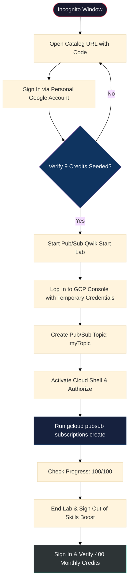

# Google Skills — 400 Monthly Credits Activation Guide
### Step-by-Step Practical Manual for Google Cloud Certification Cohort

> **Document Metadata:**
> * **Cohort ID:** `ACE07-GETCERT/2026.11.02`
> * **Access Code:** `1p-gcsgsc-67`
> * **Strict Hard Deadline:** November 21, 2026 *(Zero Extensions)*
> * **Support Lead:** Damini Chouhan (`daminichouhan@xwf.google.com`)
> * **Target Modality:** Google Cloud Skills Boost / Qwiklabs Incognito Flow

---

## Table of Contents
* [Executive Overview & Critical Prerequisites](#executive-overview--critical-prerequisites)
* [Step-by-Step Credit Activation Protocol](#step-by-step-credit-activation-protocol)
  * [Phase 1: Initial Code Redemption & 9-Credit Seed](#phase-1-initial-code-redemption--9-credit-seed)
  * [Phase 2: Temporal Console Lab Execution (Pub/Sub Qwik Start)](#phase-2-temporal-console-lab-execution-pubsub-qwik-start)
  * [Phase 3: Lab Wrap-Up & 400-Credit Validation](#phase-3-lab-wrap-up--400-credit-validation)
* [Troubleshooting & Support Escalation](#troubleshooting--support-escalation)

---

## Executive Overview & Critical Prerequisites

This document provides end-to-end instructions for redeeming your 400 monthly Google Cloud Skills Boost credits allocated under the `ACE07-GETCERT/2026.11.02` cohort. Follow every single instruction in sequence without skipping intermediate validation gates.

### Critical Rules & Anti-Failure Policies

> [!IMPORTANT]
> **1. Hard Deadline — November 21, 2026:**
> You must execute this activation immediately. There are **strictly zero extensions** granted beyond this cutoff.

> [!WARNING]
> **2. Corporate Email Restrictions & Account Type:**
> If you encounter corporate single sign-on (SSO) or security restrictions, you **must use a personal Google account**. When authenticating, select **"Sign in with Google"**. This bypasses security limitations enforced on enterprise corporate domains.

> [!NOTE]
> **3. Pure Incognito Environment:**
> Always execute all steps inside an **Incognito / Private Browsing Window** in Google Chrome with zero third-party browser extensions enabled.

---

## Step-by-Step Credit Activation Protocol



---

### Phase 1: Initial Code Redemption & 9-Credit Seed

#### Step 1: Open Catalog Event Link in Incognito
* Ensure you are completely signed out of all Google Cloud Skills Boost sessions.
* Open an **Incognito Window** in Chrome and navigate to the catalog redemption URL:
  $$\text{URL: } \texttt{https://www.skills.google/catalog?event=Your}$$
* When prompted to enter a code, enter the cohort promo code:
  ```text
  1p-gcsgsc-67
  ```
* Ensure there are no leading or trailing whitespace characters, then click **Submit**.

---

#### Step 2: Authenticate with Google
* Sign in to Google Skills using your personal account to bypass corporate domain firewalls and policies.
* Click **Sign in with Google**.

---

#### Step 3: Verify the Initial 9 Credits
* Click on your avatar / profile picture in the top-right corner.
* Verify that you see **9 credits** available.
* If your profile indicates "Starter", click on **Starter** to display the detailed credit balance.

> [!CAUTION]
> **Activation Gate:** If you do not see 9 credits, you **must repeat Steps 1 and 2**. Do not proceed to Phase 2 until your 9 credits are visible.

---

### Phase 2: Temporal Console Lab Execution (Pub/Sub Qwik Start)

#### Step 4: Open the Recommended Fast Lab
* Navigate to the lab **"Pub/Sub: Qwik Start - Command Line"** (estimated completion time: $< 5$ minutes).
* Right-click the link and select **Open link in incognito window**.

> [!IMPORTANT]
> Keep the lab interface set to **English**. Do not switch languages, as translations may desynchronize step names and command syntax.

---

#### Step 5: Start Lab & Launch Cloud Console
* Click the green **Start Lab** button.
* Click **Open Google Cloud Console** to launch the GCP portal in an Incognito session.

---

#### Step 6: Authenticate with Temporary Student Credentials
* You will be prompted for a Google Username and Password.
* Copy the **Student Username** (`googlestudent@...`) and **Temporary Password** directly from the left lab panel.

> [!WARNING]
> **Zero Enterprise Account Leaks:** Never sign into the Cloud Console using your personal or corporate email address; the lab sandbox permissions will reject it.

---

#### Step 7: Accept Terms of Service & View Products
* Accept the Google Cloud Terms of Service when prompted.
* In the Navigation Menu or Welcome screen, click **View all products**.

---

#### Step 8: Navigate to Pub/Sub
* Under the **Analytics** category, locate and click **Pub/Sub**.

---

#### Step 9: Create Topic `myTopic`
* At the top-center of the Pub/Sub interface, click **Create topic**.
* In the Topic ID field, input:
  ```text
  myTopic
  ```
* Scroll down and click **Create**.

---

#### Step 10: Activate Cloud Shell
* In the upper-right toolbar of the Google Cloud Console, click the **Activate Cloud Shell** icon (`>_`).

---

#### Step 11: Pass Information Dialog
* Review the Cloud Shell terms/information window and click **Continue**.

---

#### Step 12: Authorize Cloud Shell
* When prompted by the authorization modal, click **Authorize** to grant Cloud Shell permission to make API calls using your temporal credentials.

---

#### Step 13: Execute Subscription Command & Verify Progress
* In the Cloud Shell terminal, paste and execute the following gcloud command:

```bash
gcloud pubsub subscriptions create --topic myTopic mySubscription
```

* Return to the Skills Boost lab tab and click **Check my progress** for both tasks.
* Confirm that both tasks turn green with **100/100** points awarded.

---

### Phase 3: Lab Wrap-Up & 400-Credit Validation

#### Step 14: End the Lab
* Click the red **End Lab** button and submit the star rating dialog.

---

#### Step 15: Sign Out of Google Skills Boost
* Click your profile icon in the top right of the Google Skills Boost interface and click **Sign Out**.

---

#### Step 16: Sign Back In & Verify 400 Credits
* Re-authenticate into your Google Cloud Skills Boost account via **Sign in with Google**.
* Click your profile picture in the top-right corner.
* Confirm that your credit balance now reflects **400 Monthly Credits** (or click **Starter** to expose the 400 credits balance).

---

## Troubleshooting & Support Escalation

If you followed every step precisely but the 400 credits do not reflect in your account profile:

1. **Incognito Session Hygiene:** Clear browser cookies and cache, launch a fresh Incognito session, and re-login.
2. **Lab Completion Audit:** Ensure the lab received a full 100/100 score and that you clicked **End Lab** rather than allowing the timer to expire.
3. **Official Support Escalation:**
   * **Contact:** Damini Chouhan
   * **Email:** `daminichouhan@xwf.google.com`
   * **Subject Format:** `[ACE07-GETCERT] Credit Activation Issue - <Your Full Name>`
   * **Include:** Screenshot of your Google Skills profile page showing your email and credit count, plus confirmation of the date/time Step 13 was completed.

---
*Reference Document: ACE07-GETCERT_2026.11.02_Google_Skills_Credit_Activation_Guide.pdf*
