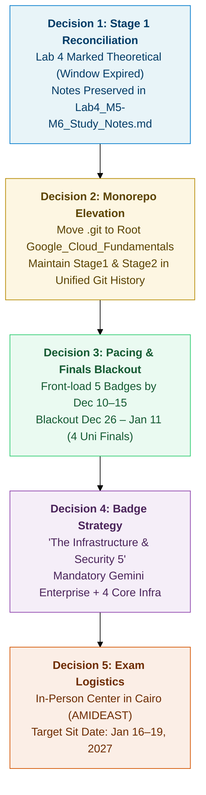

# Session 02: Stage 2 Transition, Program Deadlines & Monorepo Architecture

> **Date:** November 01, 2026  
> **Session Type:** Program Onboarding, Monorepo Elevation, Deadline Scheduling & Asset Conversion  
> **Target Certification:** Google Cloud Certified Associate Cloud Engineer (ACE)  
> **Cohort ID:** `ACE07-GETCERT/2026.11.02`  
> **Primary Interfaces:** Gemini CLI (Monorepo Architect & Local Workhorse) · Claude Web (Socratic ACE Examiner & Challenge Lab Coach)

---

## 1. Executive Summary

This session executed the transition from **Stage 1 (Google Cloud Fundamentals: Core Infrastructure)** to **Stage 2: The Get Certified Program — Associate Cloud Engineer (ACE)**. 

Through an intensive grilling and architectural alignment protocol (`wf-grill-me-v2`), we reconciled Stage 1 completion state (3 practical labs at 100% score + Lab 4 theoretical container architecture), elevated the Git repository to a unified monorepo root, established a front-loaded study schedule factoring in university final exams, structured the 5-badge curriculum, converted all official cohort PDFs into publication-grade Markdown reference manuals, generated an updated Program FAQ, and produced an upgraded system prompt to restore the deleted Claude Web project.

---

## 2. Key Decisions & Grilling Alignment Record (`wf-grill-me-v2`)



1. **Stage 1 & Lab 4 Reconciliation:**
   * Labs 1, 2, and 3 were completed with 100% scores in Google Skills Boost.
   * Lab 4 (*Hello Cloud Run*) sandbox window expired; its practical execution is closed. The theoretical containerization, Artifact Registry, Cloud Build, and Cloud Run architecture was thoroughly documented in `Stage1/study-notes/Lab4_M5-M6_Study_Notes.md` (409 lines) and recorded as **Completed Theoretically** across all roadmaps.
2. **Git Repository Elevation (Monorepo):**
   * Elevated Git tracking from `Stage1/.git` to `Google_Cloud_Fundamentals/.git`.
   * Preserved 100% file history across all Stage 1 files using Git rename detection.
   * Established root `README.md` and root `.gitignore`.
3. **Pacing vs. University Finals Blackout:**
   * **University Finals:** Run from **December 26, 2026 to January 11, 2027** (4 subjects), preceded by project deadlines and practical lab exams.
   * **Front-Loaded Strategy:** Complete all 5 required skill badges by **December 10–15, 2026** to claim the exam voucher early, beat the global voucher pool cap, and eliminate cloud obligations during finals.
4. **Skill Badge Curriculum Selection ("The Infrastructure & Security 5"):**
   * ★ **Create Your First Gemini Enterprise Application** *(MANDATORY per Google rules)*
   * ★ **Build Infrastructure with Terraform on Google Cloud**
   * ★ **Implement Load Balancing on Compute Engine**
   * ★ **Build a Secure Google Cloud Network**
   * ★ **Implement Cloud Security Fundamentals on Google Cloud**
5. **Exam Format & Booking Logistics:**
   * **Format:** In-Person Pearson VUE Testing Center in Cairo (e.g., AMIDEAST Egypt in Dokki, New Horizons). Avoids home network and proctor environment risks.
   * **Exam Window:** January 16 – 19, 2027 (immediately following university finals, prior to the January 20 program deadline).
   * **Booking Method:** Check test center availability via CertMetrics without voucher; apply voucher code upon receipt in mid-December.

---

## 3. Master Deadlines & Critical Milestone Gates

| Status | Milestone / Gate | Date & Time (Cairo / CET) | Type | Action Required & Rules |
| :---: | :--- | :--- | :---: | :--- |
| [ ] | **Cohort Kick-off & Session 1** | **Mon, Nov 02, 2026**<br>2:00 PM – 3:30 PM Cairo (1:00 PM CET) | **Fixed** | Attend live review session 1 (or review recording in Google Drive). |
| [ ] | **Skills Credit Activation** | **Sat, Nov 21, 2026** (23:59 CET) | **HARD** | Redeem 400 credits using promo code `1p-gcsgsc-67` via Pub/Sub lab. **Strict deadline (no extensions).** |
| [ ] | **Voucher Request Form Opens** | **Mon, Nov 23, 2026** (Week 4) | **Fixed** | Form unlocks once Week 4 begins. |
| [ ] | **Target 5-Badge Completion** | **Thu, Dec 10, 2026** | **Target** | Complete 5 of 7 skill badges (including mandatory Gemini Enterprise). |
| [ ] | **Target Voucher Submission** | **Dec 10 – Dec 15, 2026** | **Target** | Submit public Skills Boost profile via form early. Beat the *first-come-first-served* voucher pool limit and account for 24–72h processing delay. |
| [ ] | **Pearson VUE Booking** | **Dec 15 – Dec 20, 2026** | **Target** | Apply voucher code and reserve an **In-Person** exam seat in Cairo for Jan 16–19 before university finals start. |
| [ ] | **University Finals Blackout** | **Dec 26, 2026 – Jan 11, 2027** | **Locked** | **Zero GCP stress.** 100% focus on 4 university final exams. |
| [ ] | **Voucher Form Hard Close** | **Tue, Dec 29, 2026** (23:59 CET) | **HARD** | Final cutoff to submit voucher request form. No late requests accepted. |
| [ ] | **Post-Finals Full-Time Cram** | **Jan 12 – Jan 15/18, 2027** | **Sprint** | Intensive mock exams, Claude grilling, and diagnostic review. |
| [ ] | **Target Exam Window** | **Jan 16 – Jan 19, 2027** | **Target** | Sit for official ACE in-person exam at authorized Cairo test center. |
| [ ] | **Final Exam Hard Deadline** | **Wed, Jan 20, 2027** (23:59 CET) | **HARD** | Google's absolute program cutoff to attempt the exam. |

---

## 4. Monorepo Topology & Modular Workspace Structure

The workspace has been unified under a single monorepo root tracking both Stage 1 and Stage 2, with `Stage2/ReferenceDocs` refactored into dedicated modular directories mirroring `Stage1/modules/`:

```text
Google_Cloud_Fundamentals/
├── .gitignore                                                 # Monorepo git ignore rules
├── README.md                                                  # Master Certification Hub
│
├── Stage1/                                                    # Stage 1: Google Cloud Fundamentals (Core Infra)
│   ├── labs/                                                  # Labs 1–3 (100% score) & Lab 4 manual
│   ├── modules/                                               # M0 to M7 slides and v2 study guides
│   ├── study-notes/                                           # Lab 1–4 study notes & grill logs
│   ├── scripts/                                               # Stage 1 shell automation
│   ├── raw_materials/                                         # Original PDFs & lab HTML exports
│   ├── sessions/                                              # Session 01 retrospective
│   └── ROADMAP.md                                             # Stage 1 sprint roadmap
│
└── Stage2/                                                    # Stage 2: Associate Cloud Engineer (ACE)
    ├── ReferenceDocs/                                         # Modular Official Google Reference Guides
    │   ├── 00_Program_Info_and_FAQ/                           # FAQ.md, Stage2Emails.txt, Sample_questions.txt
    │   ├── 01_Associate_Cloud_Engineer_Exam_Guide/            # 4-Domain syllabus markdown & source PDF
    │   ├── 02_Learning_Plan_and_Program_Details/              # Program details markdown, source PDF & media/
    │   ├── 03_Google_Skills_Credit_Activation_Guide/          # 16-step activation markdown, source PDF & media/
    │   └── 04_PearsonVUE_Exam_Registration_Guide/             # Exam booking markdown, source PDF & media/
    ├── courses/                                               # 6 On-Demand course study notes (planned)
    ├── skill-badges/                                          # 5 Target badge challenge lab scripts (planned)
    ├── practice-exams/                                        # Scenario question logs & drills (planned)
    ├── study-notes/                                           # Architecture deep-dives (merc-v3 styled)
    ├── scripts/
    │   └── claude_ace_project_prompt.md                       # Upgraded Claude Web System Prompt
    ├── sessions/                                              # Session 02 retrospective
    └── ROADMAP.md                                             # Stage 2 Master Milestone Roadmap
```

---

## 5. Converted Reference Guides & Program FAQ

All 4 official Google Cloud PDFs in `Stage2/ReferenceDocs/` were converted into publication-grade Markdown manuals following the `convert-pptx-pdf2md-v1` and `doc-merc-v3` aesthetic standards:

1. **`01_Associate_Cloud_Engineer_Exam_Guide/`:** Comprehensive 4-domain exam syllabus covering all 94 objectives, domain weighting (20%/30%/30%/20%), Compute decision trees, Storage class lifecycles, and Identity Federation architectures.
2. **`02_Learning_Plan_and_Program_Details/`:** Complete 6-week cohort calendar, live review sessions syllabus, 7 on-demand courses, 7 skill badges, and voucher pool rules with 31 harvested presentation visuals.
3. **`03_Google_Skills_Credit_Activation_Guide/`:** Step-by-step 16-step procedure for claiming the 400 monthly credits with promo code `1p-gcsgsc-67` via the Pub/Sub lab in Chrome Incognito.
4. **`04_PearsonVUE_Exam_Registration_Guide/`:** Complete 28-slide registration manual covering CertMetrics account setup, Onsite Test Center search in Cairo, OnVUE Online Proctored rules, 24-hour rescheduling policy, and 46 harvested portal UI screenshots.
5. **`00_Program_Info_and_FAQ/FAQ.md`:** Concise Q&A reference addressing attendance recording policies, skill badge mechanics (3–5 guided labs + 1 challenge lab), total lab volume ($\sim 20\text{–}25$ labs), official badge authenticity, and mentoring purposes.

---

## 6. Claude Web Restoration & Operating Model

To restore the deleted Claude Web project, [`Stage2/scripts/claude_ace_project_prompt.md`](../scripts/claude_ace_project_prompt.md) was created:
* **Persona:** Senior Google Cloud Solutions Architect & ACE Mock Examiner / Challenge Lab Coach.
* **Dual-Agent Contract:** Claude Web drives interactive grilling on scenario questions from [GCP Study Hub](https://gcpstudyhub.com/) and challenge lab debugging, while Gemini CLI manages offline git operations, script generation, and structured notes formatting.
* **Knowledge Bundle:** Ready to upload `Stage2/ROADMAP.md`, `Stage2/ReferenceDocs/` markdown files, and `Stage1/study-notes/Lab4_M5-M6_Study_Notes.md` into the Claude Web project knowledge base.

---

## 7. Next Actions for Monday, Nov 02, 2026
1. Fill out Google Access Form for Google Drive and Google Groups access.
2. Redeem 400 credits using code `1p-gcsgsc-67` via Pub/Sub lab in Incognito.
3. Attend (or review recording of) Live Review Session 1 at 2:00 PM Cairo.
4. Begin Skill Badge 1: *Create Your First Gemini Enterprise Application*.
