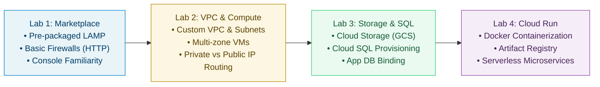

# Google Cloud Fundamentals — Hands-on Lab Progression Roadmap

> **Target Certification:** Google Cloud Certified Associate Cloud Engineer (ACE)
> **Execution Strategy:** Progressive complexity ramp-up (Rank 1: Starter -> Rank 4: Serverless/Containers)
> **Execution Environment:** Google Cloud Skills Boost / Qwiklabs sandbox + Cloud Shell

---

## 🗺️ Lab Sequence & Difficulty Matrix

| Rank | Lab Title | Module Mapping | Difficulty | Estimated Time | Key Services | Primary Interface |
| :---: | :--- | :--- | :---: | :---: | :--- | :--- |
| **1** | [01_Cloud_Marketplace.md](01_Cloud_Marketplace.md) | M1 & M2: Intro / IAM | **Starter** | 30 min | Compute Engine, Marketplace, Firewall | GCP Console |
| **2** | [02_VPC_and_Compute_Engine.md](02_VPC_and_Compute_Engine.md) | M3: VMs & Networks | **Easy-Med** | 40 min | VPC Networks, Subnets, Compute VMs, ICMP/SSH | Cloud Shell + Console |
| **3** | [03_Storage_and_Cloud_SQL.md](03_Storage_and_Cloud_SQL.md) | M4: Storage | **Medium** | 45 min | Cloud Storage, Cloud SQL (MySQL), App Server | gcloud CLI + Console |
| **4** | [04_Hello_Cloud_Run.md](04_Hello_Cloud_Run.md) | M5 & M6: Containers & Apps | **Med-Hard** | 45 min | Docker, Artifact Registry, Cloud Run | Cloud Shell (gcloud + docker) |

---

## 🎯 Architectural Progression Breakdown

---

## 📋 Progression Checklist

- [ ] **Rank 1:** `01_Cloud_Marketplace.md`
  - *Focus:* Deploy pre-packaged LAMP stack, verify Apache web server, review Compute Engine VM instance.
- [ ] **Rank 2:** `02_VPC_and_Compute_Engine.md`
  - *Focus:* Build custom VPC network, define firewall rules with target tags, deploy multi-zone VMs, test internal DNS & ICMP reachability.
- [ ] **Rank 3:** `03_Storage_and_Cloud_SQL.md`
  - *Focus:* Provision GCS bucket via `gcloud storage`, deploy Cloud SQL instance, configure Compute Engine web server to connect to SQL database and serve static assets from GCS.
- [ ] **Rank 4:** `04_Hello_Cloud_Run.md`
  - *Focus:* Write Dockerfile & Node.js app, package container image, upload to Artifact Registry, deploy serverless service to Cloud Run with public access.

---

## 💡 Best Practices for Sandbox Execution

1. **Incognito / Private Browsing:** Always open the Qwiklabs console link in an Incognito tab to prevent accidental account switching with your personal Google accounts.
2. **Copy-Paste into Cloud Shell:** Use the pre-built `⚡ Cloud Shell Quick-Reference Script` in each lab guide to save time and prevent manual typing mistakes.
3. **Verify Before Scoring:** Always run the verification commands listed in each lab guide before clicking **Check my progress** in Qwiklabs.
4. **Clean End:** Always click **End Lab** once you achieve 100% to ensure resources are torn down cleanly.
