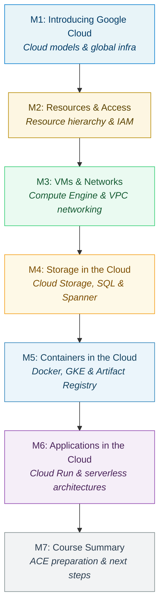

# Google Cloud — Fundamentals:

### Comprehensive Technical Presentation & Study Guide

> **Course / Domain:** Computer Science & Engineering · **Academic Term:** Academic Lecture Series
> **Lecturer / Author:** Course Instructor · **Source:** Official Lecture Presentation Slides
> **Documentation Standard:** DTCM-v3 Clean Architecture (No-Photo / Mermaid Edition)

---

## Table of Contents

* [Slide 1: Google Cloud  Fundamentals:  Core Infrastructure](#slide-1-google-cloud-fundamentals-core-infrastructure)
* [Slide 2: 00](#slide-2-00)
* [Slide 3: Etiquette](#slide-3-etiquette)
* [Slide 4: Etiquette](#slide-4-etiquette)
* [Slide 5: Google Cloud offerings](#slide-5-google-cloud-offerings)
* [Slide 6: Course format](#slide-6-course-format)
* [Slide 7: Target audience](#slide-7-target-audience)
* [Slide 8: Helpful knowledge](#slide-8-helpful-knowledge)
* [Slide 9: Helpful knowledge](#slide-9-helpful-knowledge)
* [Slide 10: cloud.google.com/training](#slide-10-cloudgooglecomtraining)
* [Slide 11: Today's  agenda](#slide-11-todays-agenda)
* [Slide 12: Objectives](#slide-12-objectives)
* [Slide 13: Hands-on labs](#slide-13-hands-on-labs)
* [Slide 14: Any questions before we begin?](#slide-14-any-questions-before-we-begin)

---

---

### Slide 1: Google Cloud  Fundamentals:  Core Infrastructure

* Proprietary + Confidential

<!-- INJECT_START: slide_01_img_02 -->
 [Slide 1] Google Cloud  Fundamentals:  Core Infrastructure — Visual Illustration & Context Reference
<!-- INJECT_END: slide_01_img_02 -->

<!-- INJECT_START: slide_01_img_03 -->
 [Slide 1] Google Cloud  Fundamentals:  Core Infrastructure — Visual Illustration & Context Reference
<!-- INJECT_END: slide_01_img_03 -->

* Google Cloud
* **Fundamentals:**
* Core Infrastructure
* Instructor-led training

<!-- INJECT_START: slide_01_img_01 -->
 [Slide 1] Google Cloud  Fundamentals:  Core Infrastructure — Visual Illustration & Context Reference
<!-- INJECT_END: slide_01_img_01 -->

---

### Slide 2: 00

* Proprietary + Confidential
* Welcome

<!-- INJECT_START: slide_02_img_02 -->
 [Slide 2] 00 — Visual Illustration & Context Reference
<!-- INJECT_END: slide_02_img_02 -->

<!-- INJECT_START: slide_02_img_01 -->
 [Slide 2] 00 — Visual Illustration & Context Reference
<!-- INJECT_END: slide_02_img_01 -->

* Good morning and welcome to the Google Cloud Fundamentals: Core Infrastructure
* training course.

---

### Slide 3: Etiquette

<!-- INJECT_START: slide_03_img_02 -->
 [Slide 3] Etiquette — Visual Illustration & Context Reference
<!-- INJECT_END: slide_03_img_02 -->

<!-- INJECT_START: slide_03_img_01 -->
 [Slide 3] Etiquette — Visual Illustration & Context Reference
<!-- INJECT_END: slide_03_img_01 -->

* Use this slide for in-person facilitations.
* Share information on parking, restrooms, refreshments, and fire safety.
* To ensure an effective and respectful learning environment for everyone here today:
* ●
* Please silence your phone and take calls outside the classroom.
* ●
* Refrain from recording this class. It's prohibited.
* ●
* Ask questions when you have them.

---

### Slide 4: Etiquette

<!-- INJECT_START: slide_04_img_02 -->
 [Slide 4] Etiquette — Visual Illustration & Context Reference
<!-- INJECT_END: slide_04_img_02 -->

<!-- INJECT_START: slide_04_img_01 -->
 [Slide 4] Etiquette — Visual Illustration & Context Reference
<!-- INJECT_END: slide_04_img_01 -->

* Use this slide for virtual facilitations.
* To ensure an effective and respectful learning environment for everyone here today:
* ●
* Mute your microphone.
* ●
* Refrain from recording this class. It's prohibited.
* ●
* Ask questions via the chat.

---

### Slide 5: Google Cloud offerings

<!-- INJECT_START: slide_05_img_02 -->
 [Slide 5] Google Cloud offerings — Visual Illustration & Context Reference
<!-- INJECT_END: slide_05_img_02 -->

<!-- INJECT_START: slide_05_img_01 -->
 [Slide 5] Google Cloud offerings — Visual Illustration & Context Reference
<!-- INJECT_END: slide_05_img_01 -->

* Google Cloud offerings can be broadly categorized as compute, storage, big data,
* machine learning and application services for web, mobile, analytics, and back-end
* solutions.

---

### Slide 6: Course format

<!-- INJECT_START: slide_06_img_02 -->
 [Slide 6] Course format — Visual Illustration & Context Reference
<!-- INJECT_END: slide_06_img_02 -->

<!-- INJECT_START: slide_06_img_01 -->
 [Slide 6] Course format — Visual Illustration & Context Reference
<!-- INJECT_END: slide_06_img_01 -->

* This one day, instructor-led class will provide you with an overview of Google Cloud.
* Through a combination of presentations, quizzes, and hands-on labs, you'll learn the
* value of Google Cloud and how cloud solutions factor into business strategies.

---

### Slide 7: Target audience

<!-- INJECT_START: slide_07_img_03 -->
 [Slide 7] Target audience — Visual Illustration & Context Reference
<!-- INJECT_END: slide_07_img_03 -->

<!-- INJECT_START: slide_07_img_02 -->
 [Slide 7] Target audience — Visual Illustration & Context Reference
<!-- INJECT_END: slide_07_img_02 -->

<!-- INJECT_START: slide_07_img_01 -->
 [Slide 7] Target audience — Visual Illustration & Context Reference
<!-- INJECT_END: slide_07_img_01 -->

* The intended target audience of today's course consists of solutions developers,
* systems operations professionals, and solution architects planning to deploy
* applications and create application environments on Google Cloud.
* The course will also be useful for business decision makers evaluating Google Cloud.

---

### Slide 8: Helpful knowledge

* Proprietary + Confidential

<!-- INJECT_START: slide_08_img_02 -->
 [Slide 8] Helpful knowledge — Visual Illustration & Context Reference
<!-- INJECT_END: slide_08_img_02 -->

<!-- INJECT_START: slide_08_img_03 -->
 [Slide 8] Helpful knowledge — Visual Illustration & Context Reference
<!-- INJECT_END: slide_08_img_03 -->

<!-- INJECT_START: slide_08_img_01 -->
 [Slide 8] Helpful knowledge — Visual Illustration & Context Reference
<!-- INJECT_END: slide_08_img_01 -->

* While you should all be happy to hear that we'll be finding out about services and
* concepts that are specific to Google Cloud in today's course, do keep in mind that, as
* a 'fundamentals' level course, some content will be geared towards learners who are
* entirely new to cloud technologies.

---

### Slide 9: Helpful knowledge

* Proprietary + Confidential

<!-- INJECT_START: slide_09_img_02 -->
 [Slide 9] Helpful knowledge — Visual Illustration & Context Reference
<!-- INJECT_END: slide_09_img_02 -->

<!-- INJECT_START: slide_09_img_03 -->
 [Slide 9] Helpful knowledge — Visual Illustration & Context Reference
<!-- INJECT_END: slide_09_img_03 -->

<!-- INJECT_START: slide_09_img_01 -->
 [Slide 9] Helpful knowledge — Visual Illustration & Context Reference
<!-- INJECT_END: slide_09_img_01 -->

* The course has no prerequisites, although familiarity with application development,
* Linux operating, Windows operating systems, systems operations, and data
* analytics/machine learning will be helpful in understanding the technologies covered.

---

### Slide 10: cloud.google.com/training

* Proprietary + Confidential

<!-- INJECT_START: slide_10_img_01 -->
 [Slide 10] cloud.google.com/training — Visual Illustration & Context Reference
<!-- INJECT_END: slide_10_img_01 -->

* You can learn more about where this course fits into the learning path for your
* specific role, and all the training courses offered by Google Cloud, by heading to
* cloud.google.com/training. At the end of today's course we'll speak a little more about
* the different learning paths offered for each role.

---

### Slide 11: Today's  agenda

<!-- INJECT_START: slide_11_img_02 -->
 [Slide 11] Today's  agenda — Visual Illustration & Context Reference
<!-- INJECT_END: slide_11_img_02 -->

<!-- INJECT_START: slide_11_img_01 -->
 [Slide 11] Today's  agenda — Visual Illustration & Context Reference
<!-- INJECT_END: slide_11_img_01 -->

* There are 6 modules in today's course, rounded off with a short summary and review
* session.
* **Here's our agenda:**
* 1.
* Introducing Google Cloud
* 2.
* Resources and Access in the Cloud
* 3.
* Virtual Machines and Networks in the Cloud
* 4.
* Storage in the Cloud
* 5.
* Containers in the Cloud
* 6.
* Applications in the Cloud

---

### Slide 12: Objectives

* Proprietary + Confidential

<!-- INJECT_START: slide_12_img_02 -->
 [Slide 12] Objectives — Visual Illustration & Context Reference
<!-- INJECT_END: slide_12_img_02 -->

* Identify the purpose and value of Google Cloud products
* and services.
* 01
* Define how infrastructure is organized and controlled in
* Google Cloud.
* 02
* 03
* Explain how to create basic infrastructure in Google Cloud.
* Select and use Google Cloud storage options.
* 04
* Describe the purpose and value of Google Kubernetes
* Engine.
* 05
* 06
* Identify the use cases for serverless Google Cloud services.

<!-- INJECT_START: slide_12_img_01 -->
 [Slide 12] Objectives — Visual Illustration & Context Reference
<!-- INJECT_END: slide_12_img_01 -->

* Through covering these modules, there are six key learning objectives that we're
* hoping to achieve today, and they are to:
* 1.
* Identify the purpose and value of Google Cloud products and services.
* 2.
* Define how infrastructure is organized and controlled in Google Cloud.
* 3.
* Explain how to create basic infrastructure in Google Cloud.
* 4.
* Select and use Google Cloud storage options.
* 5.
* Describe the purpose and value of Google Kubernetes Engine.
* 6.
* Identify the use cases for serverless Google Cloud services.

---

### Slide 13: Hands-on labs

<!-- INJECT_START: slide_13_img_02 -->
 [Slide 13] Hands-on labs — Visual Illustration & Context Reference
<!-- INJECT_END: slide_13_img_02 -->

* A set of resources for a fixed amount of time
* A clean environment with permissions

<!-- INJECT_START: slide_13_img_01 -->
 [Slide 13] Hands-on labs — Visual Illustration & Context Reference
<!-- INJECT_END: slide_13_img_01 -->

* During each module today we'll be putting what we've learned into practice through
* hands-on labs. These are run through the Google Skills platform. For each lab, Google
* Skills offers a free set of resources for a fixed amount of time and a clean
* environment with permissions.
* I'll let you know when it's time to launch a lab. Once you start a lab, you won't be able
* to pause and restart it, so you'll need a continuous block of time to complete the
* work.
* For those of you who aren't familiar with labs, we'll explain more about them when we
* reach one in the course.

---

### Slide 14: Any questions before we begin?

<!-- INJECT_START: slide_14_img_02 -->
 [Slide 14] Any questions before we begin? — Visual Illustration & Context Reference
<!-- INJECT_END: slide_14_img_02 -->

<!-- INJECT_START: slide_14_img_01 -->
 [Slide 14] Any questions before we begin? — Visual Illustration & Context Reference
<!-- INJECT_END: slide_14_img_01 -->

* Skip this for large-scale VILTs
* OK, does anyone have any questions before we begin?

---
