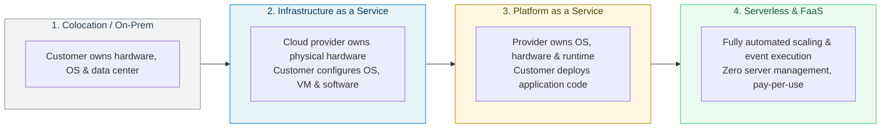
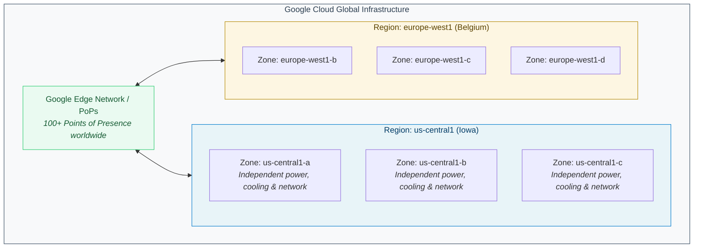
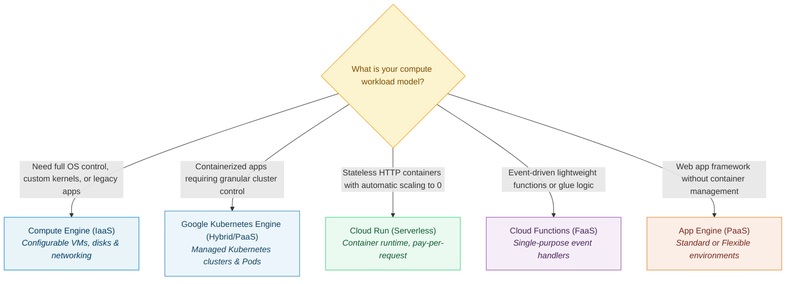

# Google Cloud — Fundamentals:

### Comprehensive Technical Presentation & Study Guide

> **Course / Domain:** Computer Science & Engineering · **Academic Term:** Academic Lecture Series
> **Lecturer / Author:** Course Instructor · **Source:** Official Lecture Presentation Slides
> **Documentation Standard:** DTCM-v3 Clean Architecture (No-Photo / Mermaid Edition)

---

## Table of Contents

* [Slide 1: Google Cloud  Fundamentals:  Core Infrastructure](#slide-1-google-cloud-fundamentals-core-infrastructure)
* [Slide 2: Introducing Google Cloud 01](#slide-2-introducing-google-cloud-01)
* [Slide 3: Introducing Google Cloud](#slide-3-introducing-google-cloud)
* [Slide 4: What is Cloud Computing?](#slide-4-what-is-cloud-computing)
* [Slide 5: 01](#slide-5-01)
* [Slide 6: 01](#slide-6-01)
* [Slide 7: 03](#slide-7-03)
* [Slide 8: 01](#slide-8-01)
* [Slide 9: 01](#slide-9-01)
* [Slide 10: 01](#slide-10-01)
* [Slide 11: The history of cloud computing](#slide-11-the-history-of-cloud-computing)
* [Slide 12: The history of cloud computing](#slide-12-the-history-of-cloud-computing)
* [Slide 13: Enterprises still maintain the infrastructure](#slide-13-enterprises-still-maintain-the-infrastructure)
* [Slide 14: The history of cloud computing](#slide-14-the-history-of-cloud-computing)
* [Slide 15: Third-wave cloud is available to Google customers](#slide-15-third-wave-cloud-is-available-to-google-customers)
* [Slide 16: Introducing Google Cloud](#slide-16-introducing-google-cloud)
* [Slide 17: Cloud service offerings](#slide-17-cloud-service-offerings)
* [Slide 18: Infrastructure as a Service (IaaS)](#slide-18-infrastructure-as-a-service-iaas)
* [Slide 19: Platform as a Service (PaaS)](#slide-19-platform-as-a-service-paas)
* [Slide 20: Payment models](#slide-20-payment-models)
* [Slide 21: The evolution of cloud computing](#slide-21-the-evolution-of-cloud-computing)
* [Slide 22: What about SaaS?](#slide-22-what-about-saas)
* [Slide 23: Introducing Google Cloud](#slide-23-introducing-google-cloud)
* [Slide 24: Largest network of its kind](#slide-24-largest-network-of-its-kind)
* [Slide 25: Designed for high throughput](#slide-25-designed-for-high-throughput)
* [Slide 26: Infrastructure locations](#slide-26-infrastructure-locations)
* [Slide 27: Geographic locations contain regions and zones](#slide-27-geographic-locations-contain-regions-and-zones)
* [Slide 28: Regions contain multiple zones](#slide-28-regions-contain-multiple-zones)
* [Slide 29: Zones are where Cloud resources are deployed](#slide-29-zones-are-where-cloud-resources-are-deployed)
* [Slide 30: Resources can run in different regions](#slide-30-resources-can-run-in-different-regions)
* [Slide 31: Some services can run in multiple geographic locations](#slide-31-some-services-can-run-in-multiple-geographic-locations)
* [Slide 32: cloud.google.com/about/locations 130 43](#slide-32-cloudgooglecomaboutlocations-130-43)
* [Slide 33: Introducing Google Cloud](#slide-33-introducing-google-cloud)
* [Slide 34: 2%](#slide-34-2)
* [Slide 35: Google aims to improve efficiency and reduce waste](#slide-35-google-aims-to-improve-efficiency-and-reduce-waste)
* [Slide 36: Google's data center in Hamina, Finland](#slide-36-googles-data-center-in-hamina-finland)
* [Slide 37: Google's commitment to sustainability](#slide-37-googles-commitment-to-sustainability)
* [Slide 38: Introducing Google Cloud](#slide-38-introducing-google-cloud)
* [Slide 39: Google Cloud is  designed with  security in mind](#slide-39-google-cloud-is-designed-with-security-in-mind)
* [Slide 40: Hardware  infrastructure level](#slide-40-hardware-infrastructure-level)
* [Slide 41: Hardware  infrastructure level](#slide-41-hardware-infrastructure-level)
* [Slide 42: Service  Deployment level](#slide-42-service-deployment-level)
* [Slide 43: Service  deployment level](#slide-43-service-deployment-level)
* [Slide 44: User identity level](#slide-44-user-identity-level)
* [Slide 45: User  identity level](#slide-45-user-identity-level)
* [Slide 46: Storage  services level](#slide-46-storage-services-level)
* [Slide 47: Storage  services level](#slide-47-storage-services-level)
* [Slide 48: Internet  communication level](#slide-48-internet-communication-level)
* [Slide 49: Denial of Service ("DoS") protection Internet  communication level](#slide-49-denial-of-service-dos-protection-internet-communication-level)
* [Slide 50: Operational  security level](#slide-50-operational-security-level)
* [Slide 51: Operational  security level](#slide-51-operational-security-level)
* [Slide 52: cloud.google.com/security/security-design](#slide-52-cloudgooglecomsecuritysecurity-design)
* [Slide 53: Introducing Google Cloud](#slide-53-introducing-google-cloud)
* [Slide 54: Google Cloud is open-source friendly](#slide-54-google-cloud-is-open-source-friendly)
* [Slide 55: Open-source TensorFlow works with Google Cloud](#slide-55-open-source-tensorflow-works-with-google-cloud)
* [Slide 56: Interoperability at multiple layers of the stack](#slide-56-interoperability-at-multiple-layers-of-the-stack)
* [Slide 57: Introducing Google Cloud](#slide-57-introducing-google-cloud)
* [Slide 58: Google Compute products are billed per-second](#slide-58-google-compute-products-are-billed-per-second)
* [Slide 59: Compute Engine offers billing flexibility](#slide-59-compute-engine-offers-billing-flexibility)
* [Slide 60: Google Cloud Pricing Calculator](#slide-60-google-cloud-pricing-calculator)
* [Slide 61: Billing tools help to budget and monitor usage](#slide-61-billing-tools-help-to-budget-and-monitor-usage)
* [Slide 62: Quotas are allocated at project-level](#slide-62-quotas-are-allocated-at-project-level)
* [Slide 63: Module Quiz](#slide-63-module-quiz)
* [Slide 64: Quiz | Question 1](#slide-64-quiz-question-1)
* [Slide 65: Quiz | Question 1](#slide-65-quiz-question-1)
* [Slide 66: Quiz | Question 2](#slide-66-quiz-question-2)
* [Slide 67: Quiz | Question 2](#slide-67-quiz-question-2)
* [Slide 68: Feedback: Incorrect. While virtualization is a technology that powers cloud  computing, it is not a cloud service model. This describes a physical infrastructure  setup, often on-premises.](#slide-68-feedback-incorrect-while-virtualization-is-a-technology-that-powers-cloud-computing-it-is-not-a-cloud-service-model-this-describes-a-physical-infrastructure-setup-often-on-premises)
* [Slide 69: Quiz | Question 3](#slide-69-quiz-question-3)
* [Slide 70: Quiz | Question 3](#slide-70-quiz-question-3)

---

---

### Slide 1: Google Cloud  Fundamentals:  Core Infrastructure

* Proprietary + Confidential

<!-- INJECT_START: slide_01_img_02 -->
 [Slide 1] Google Cloud  Fundamentals:  Core Infrastructure — Visual Illustration & Context Reference
<!-- INJECT_END: slide_01_img_02 -->

<!-- INJECT_START: slide_01_img_03 -->
 [Slide 1] Google Cloud  Fundamentals:  Core Infrastructure — Visual Illustration & Context Reference
<!-- INJECT_END: slide_01_img_03 -->

* Google Cloud
* **Fundamentals:**
* Core Infrastructure
* Instructor-led training

<!-- INJECT_START: slide_01_img_01 -->
 [Slide 1] Google Cloud  Fundamentals:  Core Infrastructure — Visual Illustration & Context Reference
<!-- INJECT_END: slide_01_img_01 -->

---

### Slide 2: Introducing Google Cloud 01

* Proprietary + Confidential

<!-- INJECT_START: slide_02_img_02 -->
 [Slide 2] Introducing Google Cloud 01 — Visual Illustration & Context Reference
<!-- INJECT_END: slide_02_img_02 -->

* Introducing
* Google Cloud
* 01

<!-- INJECT_START: slide_02_img_01 -->
 [Slide 2] Introducing Google Cloud 01 — Visual Illustration & Context Reference
<!-- INJECT_END: slide_02_img_01 -->

---

### Slide 3: Introducing Google Cloud

<!-- INJECT_START: slide_03_img_02 -->
 [Slide 3] Introducing Google Cloud — Visual Illustration & Context Reference
<!-- INJECT_END: slide_03_img_02 -->

* 01
* 02
* An overview of cloud computing
* IaaS and PaaS
* 03
* 04
* The Google Cloud network
* Environmental impact
* 05
* 06
* 07
* Security
* Open APIs and open source
* Pricing and billing

<!-- INJECT_START: slide_03_img_01 -->
 [Slide 3] Introducing Google Cloud — Visual Illustration & Context Reference
<!-- INJECT_END: slide_03_img_01 -->

* Let's start at the beginning with an overview of cloud computing. Some of you might
* **be wondering about the basics:** What exactly is Google Cloud? How is it organized?
* And what makes it unique?
* In this module, we'll answer those questions.

---

### Slide 4: What is Cloud Computing?

* Proprietary + Confidential

<!-- INJECT_START: slide_04_img_02 -->
 [Slide 4] What is Cloud Computing? — Visual Illustration & Context Reference
<!-- INJECT_END: slide_04_img_02 -->

<!-- INJECT_START: slide_04_img_01 -->
 [Slide 4] What is Cloud Computing? — Visual Illustration & Context Reference
<!-- INJECT_END: slide_04_img_01 -->

* The cloud is a hot topic these days, but what exactly is it?
* The US National Institute of Standards and Technology created the term cloud
* computing, although, there is nothing US-specific about it.

---

### Slide 5: 01

* Proprietary + Confidential
* Five traits of cloud
* computing
* Customers get computing resources that
* are on-demand and self-service
* 02
* Customers get access to those resources
* over the internet, from anywhere
* Cloud computing is a way of
* using information technology
* that has these five equally
* important traits.
* 03
* The provider of those resources allocates
* them to users out of that pool
* 04
  * The resources are elasticwhich means
  * they're flexible, so customers can be
* 05
* Customers pay only for what they use,
* or reserve as they go

<!-- INJECT_START: slide_05_img_01 -->
 [Slide 5] 01 — Visual Illustration & Context Reference
<!-- INJECT_END: slide_05_img_01 -->

* Cloud computing is a way of using information technology (IT) that has these five
* equally important traits.

---

### Slide 6: 01

* Proprietary + Confidential
* Five traits of cloud
* computing
* Customers get computing resources that
* are on-demand and self-service
* 02
* Customers get access to those resources
* over the internet, from anywhere
* Cloud computing is a way of
* using information technology
* that has these five equally
* important traits.
* 03
* The provider of those resources allocates
* them to users out of that pool
* 04
  * The resources are elasticwhich means
  * they're flexible, so customers can be
* 05
* Customers pay only for what they use,
* or reserve as they go

<!-- INJECT_START: slide_06_img_01 -->
 [Slide 6] 01 — Visual Illustration & Context Reference
<!-- INJECT_END: slide_06_img_01 -->

* First, customers get computing resources that are on-demand and self-service.
* Through a web interface, users get the processing power, storage, and network they
* need with no need for human intervention.

---

### Slide 7: 03

* Proprietary + Confidential
* Five traits of cloud
* computing
* Customers get computing resources that
* are on-demand and self-service
* 01
* Customers get access to those resources
* over the internet, from anywhere
* 02
* Cloud computing is a way of
* using information technology
* that has these five equally
* important traits.
* The provider of those resources allocates
* them to users out of that pool
* 04
  * The resources are elasticwhich means
  * they're flexible, so customers can be
* 05
* Customers pay only for what they use,
* or reserve as they go

<!-- INJECT_START: slide_07_img_01 -->
 [Slide 7] 03 — Visual Illustration & Context Reference
<!-- INJECT_END: slide_07_img_01 -->

* Second, customers get access to those resources over the internet, from anywhere
* they have a connection.

---

### Slide 8: 01

* Proprietary + Confidential
* Five traits of cloud
* computing
* Customers get computing resources that
* are on-demand and self-service
* 02
* Customers get access to those resources
* over the internet, from anywhere
* Cloud computing is a way of
* using information technology
* that has these five equally
* important traits.
* The provider of those resources allocates
* them to users out of that pool
* 03
* 04
  * The resources are elasticwhich means
  * they're flexible, so customers can be
* 05
* Customers pay only for what they use,
* or reserve as they go

<!-- INJECT_START: slide_08_img_01 -->
 [Slide 8] 01 — Visual Illustration & Context Reference
<!-- INJECT_END: slide_08_img_01 -->

* Third, the provider of those resources has a big pool of them, and allocates them to
* users out of that pool. That allows the provider to buy in bulk and pass the savings on
* to the customers. Customers don't have to know or care about the exact physical
* location of those resources.

---

### Slide 9: 01

* Proprietary + Confidential
* Five traits of cloud
* computing
* Customers get computing resources that
* are on-demand and self-service
* 02
* Customers get access to those resources
* over the internet, from anywhere
* Cloud computing is a way of
* using information technology
* that has these five equally
* important traits.
* 03
* The provider of those resources allocates
* them to users out of that pool
  * The resources are elasticwhich means
  * they're flexible, so customers can be
  * 04
* 05
* Customers pay only for what they use,
* or reserve as they go

<!-- INJECT_START: slide_09_img_01 -->
 [Slide 9] 01 — Visual Illustration & Context Reference
<!-- INJECT_END: slide_09_img_01 -->

  * Fourth, the resources are elasticwhich means they're flexible, so customers can be.
  * If they need more resources they can get more, and quickly. If they need less, they can
  * scale back.

---

### Slide 10: 01

* Proprietary + Confidential
* Five traits of cloud
* computing
* Customers get computing resources that
* are on-demand and self-service
* 02
* Customers get access to those resources
* over the internet, from anywhere
* Cloud computing is a way of
* using information technology
* that has these five equally
* important traits.
* 03
* The provider of those resources allocates
* them to users out of that pool
* 04
  * The resources are elasticwhich means
  * they're flexible, so customers can be
* Customers pay only for what they use,
* or reserve as they go
* 05

<!-- INJECT_START: slide_10_img_01 -->
 [Slide 10] 01 — Visual Illustration & Context Reference
<!-- INJECT_END: slide_10_img_01 -->

* And finally, the customers pay only for what they use, or reserve as they go. If they
* stop using resources, they stop paying.
* That's it. That's the definition of cloud.

---

### Slide 11: The history of cloud computing

* Proprietary + Confidential

<!-- INJECT_START: slide_11_img_02 -->
 [Slide 11] The history of cloud computing — Visual Illustration & Context Reference
<!-- INJECT_END: slide_11_img_02 -->

<!-- INJECT_START: slide_11_img_01 -->
 [Slide 11] The history of cloud computing — Visual Illustration & Context Reference
<!-- INJECT_END: slide_11_img_01 -->

* But why is the cloud model so compelling nowadays? To understand why, we need to
* look at some history.
* The trend towards cloud computing started with a first wave with something called
* colocation. Colocation gave users the financial efficiency of renting physical space,
* instead of investing in data center real estate.

---

### Slide 12: The history of cloud computing

* Proprietary + Confidential

<!-- INJECT_START: slide_12_img_02 -->
 [Slide 12] The history of cloud computing — Visual Illustration & Context Reference
<!-- INJECT_END: slide_12_img_02 -->

<!-- INJECT_START: slide_12_img_01 -->
 [Slide 12] The history of cloud computing — Visual Illustration & Context Reference
<!-- INJECT_END: slide_12_img_01 -->

  * Virtualized data centers of today, which is the second wave, share similarities with the
  * private data centers and colocation facilities of decades past. The components of
  * virtualized data centers match the physical building blocks of hosted
  * computingservers, CPUs, disks, load balancers, and so onbut now they're virtual
  * devices.

---

### Slide 13: Enterprises still maintain the infrastructure

* Proprietary + Confidential

<!-- INJECT_START: slide_13_img_02 -->
 [Slide 13] Enterprises still maintain the infrastructure — Visual Illustration & Context Reference
<!-- INJECT_END: slide_13_img_02 -->

<!-- INJECT_START: slide_13_img_03 -->
 [Slide 13] Enterprises still maintain the infrastructure — Visual Illustration & Context Reference
<!-- INJECT_END: slide_13_img_03 -->

<!-- INJECT_START: slide_13_img_01 -->
 [Slide 13] Enterprises still maintain the infrastructure — Visual Illustration & Context Reference
<!-- INJECT_END: slide_13_img_01 -->

* With virtualization, enterprises still maintained the infrastructure; it's still a
* user-controlled and user-configured environment.

---

### Slide 14: The history of cloud computing

* Proprietary + Confidential

<!-- INJECT_START: slide_14_img_02 -->
 [Slide 14] The history of cloud computing — Visual Illustration & Context Reference
<!-- INJECT_END: slide_14_img_02 -->

<!-- INJECT_START: slide_14_img_01 -->
 [Slide 14] The history of cloud computing — Visual Illustration & Context Reference
<!-- INJECT_END: slide_14_img_01 -->

  * Several years ago, Google realized that its business couldn't move fast enough within
  * the confines of the virtualization model. So Google switched to a container-based
  * architecturea fully automated, elastic third-wave cloud that consists of a
  * combination of automated services and scalable data. Services automatically
  * provision and configure the infrastructure used to run applications.

---

### Slide 15: Third-wave cloud is available to Google customers

* Proprietary + Confidential

<!-- INJECT_START: slide_15_img_02 -->
 [Slide 15] Third-wave cloud is available to Google customers — Visual Illustration & Context Reference
<!-- INJECT_END: slide_15_img_02 -->

<!-- INJECT_START: slide_15_img_01 -->
 [Slide 15] Third-wave cloud is available to Google customers — Visual Illustration & Context Reference
<!-- INJECT_END: slide_15_img_01 -->

* Today, Google Cloud makes this third-wave cloud available to Google customers.
  * Google believes that, in the future, every companyregardless of size or industrywill
  * differentiate itself from its competitors through technology. Increasingly, that
  * technology will be in the form of software. Great software is based on high-quality
  * data. This means that every company is, or will eventually become, a data company.

---

### Slide 16: Introducing Google Cloud

<!-- INJECT_START: slide_16_img_02 -->
 [Slide 16] Introducing Google Cloud — Visual Illustration & Context Reference
<!-- INJECT_END: slide_16_img_02 -->

* 01
* 02
* An overview of cloud computing
* IaaS and PaaS
* 03
* 04
* The Google Cloud network
* Environmental impact
* 05
* 06
* 07
* Security
* Open APIs and open source
* Pricing and billing

<!-- INJECT_START: slide_16_img_01 -->
 [Slide 16] Introducing Google Cloud — Visual Illustration & Context Reference
<!-- INJECT_END: slide_16_img_01 -->

---

### Slide 17: Cloud service offerings

<!-- INJECT_START: slide_17_img_02 -->
 [Slide 17] Cloud service offerings — Visual Illustration & Context Reference
<!-- INJECT_END: slide_17_img_02 -->

<!-- INJECT_START: slide_17_img_03 -->
 [Slide 17] Cloud service offerings — Visual Illustration & Context Reference
<!-- INJECT_END: slide_17_img_03 -->

<!-- INJECT_START: slide_17_img_01 -->
 [Slide 17] Cloud service offerings — Visual Illustration & Context Reference
<!-- INJECT_END: slide_17_img_01 -->

* This move to virtualized data centers introduced customers to two new types of
* **offerings:** infrastructure as a service, commonly referred to as IaaS, and platform as a
* service, or PaaS.

---

### Slide 18: Infrastructure as a Service (IaaS)

<!-- INJECT_START: slide_18_img_06 -->
 [Slide 18] Infrastructure as a Service (IaaS) — Visual Illustration & Context Reference
<!-- INJECT_END: slide_18_img_06 -->

<!-- INJECT_START: slide_18_img_05 -->
 [Slide 18] Infrastructure as a Service (IaaS) — Visual Illustration & Context Reference
<!-- INJECT_END: slide_18_img_05 -->

<!-- INJECT_START: slide_18_img_02 -->
 [Slide 18] Infrastructure as a Service (IaaS) — Visual Illustration & Context Reference
<!-- INJECT_END: slide_18_img_02 -->

<!-- INJECT_START: slide_18_img_04 -->
 [Slide 18] Infrastructure as a Service (IaaS) — Visual Illustration & Context Reference
<!-- INJECT_END: slide_18_img_04 -->

<!-- INJECT_START: slide_18_img_03 -->
 [Slide 18] Infrastructure as a Service (IaaS) — Visual Illustration & Context Reference
<!-- INJECT_END: slide_18_img_03 -->

<!-- INJECT_START: slide_18_img_01 -->
 [Slide 18] Infrastructure as a Service (IaaS) — Visual Illustration & Context Reference
<!-- INJECT_END: slide_18_img_01 -->

* IaaS offerings provide raw compute, storage, and network capabilities, organized
* virtually into resources that are similar to physical data centers.
* Compute Engine is an example of a Google Cloud IaaS service.

---

### Slide 19: Platform as a Service (PaaS)

* Proprietary + Confidential

<!-- INJECT_START: slide_19_img_02 -->
 [Slide 19] Platform as a Service (PaaS) — Visual Illustration & Context Reference
<!-- INJECT_END: slide_19_img_02 -->

<!-- INJECT_START: slide_19_img_01 -->
 [Slide 19] Platform as a Service (PaaS) — Visual Illustration & Context Reference
<!-- INJECT_END: slide_19_img_01 -->

* PaaS offerings, on the other hand, bind code to libraries that provide access to the
* infrastructure application needs. This allows more resources to be focused on
* application logic.
* App Engine is an example of a Google Cloud PaaS service.

---

### Slide 20: Payment models

<!-- INJECT_START: slide_20_img_02 -->
 [Slide 20] Payment models — Visual Illustration & Context Reference
<!-- INJECT_END: slide_20_img_02 -->

<!-- INJECT_START: slide_20_img_01 -->
 [Slide 20] Payment models — Visual Illustration & Context Reference
<!-- INJECT_END: slide_20_img_01 -->

* In the IaaS model, customers pay for the resources they allocate ahead of time; in the
* PaaS model, customers pay for the resources they actually use.

---

### Slide 21: The evolution of cloud computing

* Proprietary + Confidential

<!-- INJECT_START: slide_21_img_02 -->
 [Slide 21] The evolution of cloud computing — Visual Illustration & Context Reference
<!-- INJECT_END: slide_21_img_02 -->

<!-- INJECT_START: slide_21_img_03 -->
 [Slide 21] The evolution of cloud computing — Visual Illustration & Context Reference
<!-- INJECT_END: slide_21_img_03 -->

<!-- INJECT_START: slide_21_img_01 -->
 [Slide 21] The evolution of cloud computing — Visual Illustration & Context Reference
<!-- INJECT_END: slide_21_img_01 -->

* As cloud computing has evolved, the momentum has shifted toward managed
* infrastructure and managed services.
* Leveraging managed resources and services allows companies to concentrate more
* on their business goals and spend less time and money on creating and maintaining
* their technical infrastructure. It allows companies to deliver products and services to
* their customers more quickly and reliably.
* Although not shown on this slide, serverless is yet another step in the evolution of
* cloud computing.  Serverless computing allows developers to concentrate on their
* code, rather than on server configuration, by eliminating the need for any
* infrastructure management.  Serverless technologies offered by Google include Cloud
* Run, which allows customers to deploy their containerized microservices based
* application in a fully-managed environment, and Cloud Run functions, which manages
* event-driven code as a pay-as-you-go service.

---

### Slide 22: What about SaaS?

* Proprietary + Confidential

<!-- INJECT_START: slide_22_img_02 -->
 [Slide 22] What about SaaS? — Visual Illustration & Context Reference
<!-- INJECT_END: slide_22_img_02 -->

<!-- INJECT_START: slide_22_img_01 -->
 [Slide 22] What about SaaS? — Visual Illustration & Context Reference
<!-- INJECT_END: slide_22_img_01 -->

* You might have heard about Software as a Service (SaaS) and wondered what it is
* and how it fits into the Cloud ecosphere.
* Software as a Service applications are not installed on your local computer - they run
* in the cloud as a service and are consumed directly over the internet by end users.
* Google's popular applications like Gmail, Docs, and Drive, collectively known as
* Google Workspace, are all classified as SaaS.
* You can learn more about these products or our other course offerings, but they are
* outside the scope of this particular course.

---

### Slide 23: Introducing Google Cloud

<!-- INJECT_START: slide_23_img_02 -->
 [Slide 23] Introducing Google Cloud — Visual Illustration & Context Reference
<!-- INJECT_END: slide_23_img_02 -->

* 01
* 02
* An overview of cloud computing
* IaaS and PaaS
* 03
* 04
* The Google Cloud network
* Environmental impact
* 05
* 06
* 07
* Security
* Open APIs and open source
* Pricing and billing

<!-- INJECT_START: slide_23_img_01 -->
 [Slide 23] Introducing Google Cloud — Visual Illustration & Context Reference
<!-- INJECT_END: slide_23_img_01 -->

* Now that we've learned about or had a refresher on the basics of cloud computing,
* let's explore Google's own network that Google Cloud runs on.

---

### Slide 24: Largest network of its kind

* Proprietary + Confidential

<!-- INJECT_START: slide_24_img_02 -->
 [Slide 24] Largest network of its kind — Visual Illustration & Context Reference
<!-- INJECT_END: slide_24_img_02 -->

<!-- INJECT_START: slide_24_img_01 -->
 [Slide 24] Largest network of its kind — Visual Illustration & Context Reference
<!-- INJECT_END: slide_24_img_01 -->

* Google's network is the largest network of its kind, and Google has invested billions of
* dollars over the years to build it.

---

### Slide 25: Designed for high throughput

* Proprietary + Confidential

<!-- INJECT_START: slide_25_img_02 -->
 [Slide 25] Designed for high throughput — Visual Illustration & Context Reference
<!-- INJECT_END: slide_25_img_02 -->

<!-- INJECT_START: slide_25_img_01 -->
 [Slide 25] Designed for high throughput — Visual Illustration & Context Reference
<!-- INJECT_END: slide_25_img_01 -->

  * Google's global network is designed to give customers the highest possible
  * throughput and lowest possible latencies for their applications by leveraging more
  * than 100 content caching nodes worldwidewhich are locations where high demand
  * content is cached for quicker accessto respond to user requests from the location
  * that will provide the quickest response time.
* Google Cloud's locations underpin all of the important work we do for our customers.
* From redundant cloud regions to high-bandwidth connectivity via subsea cables,
* every aspect of our infrastructure is designed to deliver your services to your users, no
* matter where they are around the world.

---

### Slide 26: Infrastructure locations

* Proprietary + Confidential

<!-- INJECT_START: slide_26_img_02 -->
 [Slide 26] Infrastructure locations — Visual Illustration & Context Reference
<!-- INJECT_END: slide_26_img_02 -->

<!-- INJECT_START: slide_26_img_06 -->
 [Slide 26] Infrastructure locations — Visual Illustration & Context Reference
<!-- INJECT_END: slide_26_img_06 -->

<!-- INJECT_START: slide_26_img_03 -->
 [Slide 26] Infrastructure locations — Visual Illustration & Context Reference
<!-- INJECT_END: slide_26_img_03 -->

<!-- INJECT_START: slide_26_img_05 -->
 [Slide 26] Infrastructure locations — Visual Illustration & Context Reference
<!-- INJECT_END: slide_26_img_05 -->

<!-- INJECT_START: slide_26_img_08 -->
 [Slide 26] Infrastructure locations — Visual Illustration & Context Reference
<!-- INJECT_END: slide_26_img_08 -->

<!-- INJECT_START: slide_26_img_04 -->
 [Slide 26] Infrastructure locations — Visual Illustration & Context Reference
<!-- INJECT_END: slide_26_img_04 -->

<!-- INJECT_START: slide_26_img_09 -->
 [Slide 26] Infrastructure locations — Visual Illustration & Context Reference
<!-- INJECT_END: slide_26_img_09 -->

<!-- INJECT_START: slide_26_img_07 -->
 [Slide 26] Infrastructure locations — Visual Illustration & Context Reference
<!-- INJECT_END: slide_26_img_07 -->

<!-- INJECT_START: slide_26_img_01 -->
 [Slide 26] Infrastructure locations — Visual Illustration & Context Reference
<!-- INJECT_END: slide_26_img_01 -->

* Google Cloud's infrastructure is based in seven major geographic locations: North
* America, South America, Europe, Africa, the Middle East, Asia, and Australia. Having
* multiple service locations is important because choosing where to locate applications
* affects qualities like availability, durability, and latency, the latter of which measures
* the time a packet of information takes to travel from its source to its destination.

---

### Slide 27: Geographic locations contain regions and zones

* Proprietary + Confidential

<!-- INJECT_START: slide_27_img_02 -->
 [Slide 27] Geographic locations contain regions and zones — Visual Illustration & Context Reference
<!-- INJECT_END: slide_27_img_02 -->

* Zones
* Regions
* Location

<!-- INJECT_START: slide_27_img_01 -->
 [Slide 27] Geographic locations contain regions and zones — Visual Illustration & Context Reference
<!-- INJECT_END: slide_27_img_01 -->

* Each of these locations are divided into a number of different regions and zones.

---

### Slide 28: Regions contain multiple zones

<!-- INJECT_START: slide_28_img_06 -->
 [Slide 28] Regions contain multiple zones — Visual Illustration & Context Reference
<!-- INJECT_END: slide_28_img_06 -->

<!-- INJECT_START: slide_28_img_02 -->
 [Slide 28] Regions contain multiple zones — Visual Illustration & Context Reference
<!-- INJECT_END: slide_28_img_02 -->

<!-- INJECT_START: slide_28_img_03 -->
 [Slide 28] Regions contain multiple zones — Visual Illustration & Context Reference
<!-- INJECT_END: slide_28_img_03 -->

<!-- INJECT_START: slide_28_img_04 -->
 [Slide 28] Regions contain multiple zones — Visual Illustration & Context Reference
<!-- INJECT_END: slide_28_img_04 -->

<!-- INJECT_START: slide_28_img_05 -->
 [Slide 28] Regions contain multiple zones — Visual Illustration & Context Reference
<!-- INJECT_END: slide_28_img_05 -->

<!-- INJECT_START: slide_28_img_01 -->
 [Slide 28] Regions contain multiple zones — Visual Illustration & Context Reference
<!-- INJECT_END: slide_28_img_01 -->

---

### Slide 29: Zones are where Cloud resources are deployed

<!-- INJECT_START: slide_29_img_03 -->
 [Slide 29] Zones are where Cloud resources are deployed — Visual Illustration & Context Reference
<!-- INJECT_END: slide_29_img_03 -->

<!-- INJECT_START: slide_29_img_02 -->
 [Slide 29] Zones are where Cloud resources are deployed — Visual Illustration & Context Reference
<!-- INJECT_END: slide_29_img_02 -->

<!-- INJECT_START: slide_29_img_05 -->
 [Slide 29] Zones are where Cloud resources are deployed — Visual Illustration & Context Reference
<!-- INJECT_END: slide_29_img_05 -->

<!-- INJECT_START: slide_29_img_04 -->
 [Slide 29] Zones are where Cloud resources are deployed — Visual Illustration & Context Reference
<!-- INJECT_END: slide_29_img_04 -->

<!-- INJECT_START: slide_29_img_06 -->
 [Slide 29] Zones are where Cloud resources are deployed — Visual Illustration & Context Reference
<!-- INJECT_END: slide_29_img_06 -->

<!-- INJECT_START: slide_29_img_07 -->
 [Slide 29] Zones are where Cloud resources are deployed — Visual Illustration & Context Reference
<!-- INJECT_END: slide_29_img_07 -->

<!-- INJECT_START: slide_29_img_01 -->
 [Slide 29] Zones are where Cloud resources are deployed — Visual Illustration & Context Reference
<!-- INJECT_END: slide_29_img_01 -->

  * A zone is an area where Google Cloud resources get deployed. For example, let's say
  * you launch a virtual machine using Compute Enginemore about Compute Engine in
  * a bitit will run in the zone that you specify to ensure resource redundancy.

---

### Slide 30: Resources can run in different regions

<!-- INJECT_START: slide_30_img_06 -->
 [Slide 30] Resources can run in different regions — Visual Illustration & Context Reference
<!-- INJECT_END: slide_30_img_06 -->

<!-- INJECT_START: slide_30_img_05 -->
 [Slide 30] Resources can run in different regions — Visual Illustration & Context Reference
<!-- INJECT_END: slide_30_img_05 -->

<!-- INJECT_START: slide_30_img_04 -->
 [Slide 30] Resources can run in different regions — Visual Illustration & Context Reference
<!-- INJECT_END: slide_30_img_04 -->

<!-- INJECT_START: slide_30_img_02 -->
 [Slide 30] Resources can run in different regions — Visual Illustration & Context Reference
<!-- INJECT_END: slide_30_img_02 -->

<!-- INJECT_START: slide_30_img_03 -->
 [Slide 30] Resources can run in different regions — Visual Illustration & Context Reference
<!-- INJECT_END: slide_30_img_03 -->

<!-- INJECT_START: slide_30_img_01 -->
 [Slide 30] Resources can run in different regions — Visual Illustration & Context Reference
<!-- INJECT_END: slide_30_img_01 -->

* You can run resources in different regions. This is useful for bringing applications
* closer to users around the world, and also for protection in case there are issues with
* an entire region, say, due to a natural disaster.

---

### Slide 31: Some services can run in multiple geographic locations

<!-- INJECT_START: slide_31_img_03 -->
 [Slide 31] Some services can run in multiple geographic locations — Visual Illustration & Context Reference
<!-- INJECT_END: slide_31_img_03 -->

<!-- INJECT_START: slide_31_img_04 -->
 [Slide 31] Some services can run in multiple geographic locations — Visual Illustration & Context Reference
<!-- INJECT_END: slide_31_img_04 -->

<!-- INJECT_START: slide_31_img_02 -->
 [Slide 31] Some services can run in multiple geographic locations — Visual Illustration & Context Reference
<!-- INJECT_END: slide_31_img_02 -->

<!-- INJECT_START: slide_31_img_01 -->
 [Slide 31] Some services can run in multiple geographic locations — Visual Illustration & Context Reference
<!-- INJECT_END: slide_31_img_01 -->

---

### Slide 32: cloud.google.com/about/locations 130 43

* Proprietary + Confidential
* Zones and regions supported
* cloud.google.com/about/locations
* 130
* 43

<!-- INJECT_START: slide_32_img_03 -->
 [Slide 32] cloud.google.com/about/locations 130 43 — Visual Illustration & Context Reference
<!-- INJECT_END: slide_32_img_03 -->

<!-- INJECT_START: slide_32_img_02 -->
 [Slide 32] cloud.google.com/about/locations 130 43 — Visual Illustration & Context Reference
<!-- INJECT_END: slide_32_img_02 -->

* Zones
* Regions

<!-- INJECT_START: slide_32_img_01 -->
 [Slide 32] cloud.google.com/about/locations 130 43 — Visual Illustration & Context Reference
<!-- INJECT_END: slide_32_img_01 -->

* The number of zones and regions Google Cloud supports is increasing all the time.
* The most up to date info can be found at cloud.google.com/about/locations.

---

### Slide 33: Introducing Google Cloud

<!-- INJECT_START: slide_33_img_02 -->
 [Slide 33] Introducing Google Cloud — Visual Illustration & Context Reference
<!-- INJECT_END: slide_33_img_02 -->

* 01
* 02
* An overview of cloud computing
* IaaS and PaaS
* 03
* 04
* The Google Cloud network
* Environmental impact
* 05
* 06
* 07
* Security
* Open APIs and open source
* Pricing and billing

<!-- INJECT_START: slide_33_img_01 -->
 [Slide 33] Introducing Google Cloud — Visual Illustration & Context Reference
<!-- INJECT_END: slide_33_img_01 -->

---

### Slide 34: 2%

* Proprietary + Confidential

<!-- INJECT_START: slide_34_img_02 -->
 [Slide 34] 2% — Visual Illustration & Context Reference
<!-- INJECT_END: slide_34_img_02 -->

<!-- INJECT_START: slide_34_img_01 -->
 [Slide 34] 2% — Visual Illustration & Context Reference
<!-- INJECT_END: slide_34_img_01 -->

* The virtual world, which includes Google Cloud's network, is built on physical
* infrastructure, and all those racks of humming servers use huge amounts of energy.
* Together, all existing data centers use roughly 2% of the world's electricity. So, Google
* works to make data centers run as efficiently as possible.

---

### Slide 35: Google aims to improve efficiency and reduce waste

<!-- INJECT_START: slide_35_img_02 -->
 [Slide 35] Google aims to improve efficiency and reduce waste — Visual Illustration & Context Reference
<!-- INJECT_END: slide_35_img_02 -->

<!-- INJECT_START: slide_35_img_01 -->
 [Slide 35] Google aims to improve efficiency and reduce waste — Visual Illustration & Context Reference
<!-- INJECT_END: slide_35_img_01 -->

* Just like our customers, Google is trying to do the right things for the planet. We
* understand that Google Cloud customers have environmental goals of their own, and
* running their workloads in Google Cloud can be a part of meeting them.
* Therefore, it's important to note that Google's data centers were the first to achieve
* ISO 14001 certification, which is a standard that maps out a framework for improving
* resource efficiency and reducing waste.

---

### Slide 36: Google's data center in Hamina, Finland

* Proprietary + Confidential

<!-- INJECT_START: slide_36_img_02 -->
 [Slide 36] Google's data center in Hamina, Finland — Visual Illustration & Context Reference
<!-- INJECT_END: slide_36_img_02 -->

<!-- INJECT_START: slide_36_img_01 -->
 [Slide 36] Google's data center in Hamina, Finland — Visual Illustration & Context Reference
<!-- INJECT_END: slide_36_img_01 -->

---

### Slide 37: Google's commitment to sustainability

<!-- INJECT_START: slide_37_img_02 -->
 [Slide 37] Google's commitment to sustainability — Visual Illustration & Context Reference
<!-- INJECT_END: slide_37_img_02 -->

<!-- INJECT_START: slide_37_img_01 -->
 [Slide 37] Google's commitment to sustainability — Visual Illustration & Context Reference
<!-- INJECT_END: slide_37_img_01 -->

* In our founding decade, Google became the first major company to be carbon neutral.
* In our second decade, we were the first company to achieve 100% renewable energy.
* By 2030, we aim to be the first major company to operate on carbon-free energy, 24
* hours a day, 7 days a week, 365 days a year.

---

### Slide 38: Introducing Google Cloud

<!-- INJECT_START: slide_38_img_02 -->
 [Slide 38] Introducing Google Cloud — Visual Illustration & Context Reference
<!-- INJECT_END: slide_38_img_02 -->

* 01
* 02
* An overview of cloud computing
* IaaS and PaaS
* 03
* 04
* The Google Cloud network
* Environmental impact
* 05
* 06
* 07
* Security
* Open APIs and open source
* Pricing and billing

<!-- INJECT_START: slide_38_img_01 -->
 [Slide 38] Introducing Google Cloud — Visual Illustration & Context Reference
<!-- INJECT_END: slide_38_img_01 -->

---

### Slide 39: Google Cloud is  designed with  security in mind

<!-- INJECT_START: slide_39_img_02 -->
 [Slide 39] Google Cloud is  designed with  security in mind — Visual Illustration & Context Reference
<!-- INJECT_END: slide_39_img_02 -->

<!-- INJECT_START: slide_39_img_04 -->
 [Slide 39] Google Cloud is  designed with  security in mind — Visual Illustration & Context Reference
<!-- INJECT_END: slide_39_img_04 -->

<!-- INJECT_START: slide_39_img_05 -->
 [Slide 39] Google Cloud is  designed with  security in mind — Visual Illustration & Context Reference
<!-- INJECT_END: slide_39_img_05 -->

<!-- INJECT_START: slide_39_img_06 -->
 [Slide 39] Google Cloud is  designed with  security in mind — Visual Illustration & Context Reference
<!-- INJECT_END: slide_39_img_06 -->

<!-- INJECT_START: slide_39_img_03 -->
 [Slide 39] Google Cloud is  designed with  security in mind — Visual Illustration & Context Reference
<!-- INJECT_END: slide_39_img_03 -->

* Google Cloud is
* designed with
* security in mind

<!-- INJECT_START: slide_39_img_10 -->
 [Slide 39] Google Cloud is  designed with  security in mind — Visual Illustration & Context Reference
<!-- INJECT_END: slide_39_img_10 -->

<!-- INJECT_START: slide_39_img_07 -->
 [Slide 39] Google Cloud is  designed with  security in mind — Visual Illustration & Context Reference
<!-- INJECT_END: slide_39_img_07 -->

<!-- INJECT_START: slide_39_img_09 -->
 [Slide 39] Google Cloud is  designed with  security in mind — Visual Illustration & Context Reference
<!-- INJECT_END: slide_39_img_09 -->

<!-- INJECT_START: slide_39_img_08 -->
 [Slide 39] Google Cloud is  designed with  security in mind — Visual Illustration & Context Reference
<!-- INJECT_END: slide_39_img_08 -->

<!-- INJECT_START: slide_39_img_01 -->
 [Slide 39] Google Cloud is  designed with  security in mind — Visual Illustration & Context Reference
<!-- INJECT_END: slide_39_img_01 -->

* Because Google has nine* services with more than a billion users, you can bet
* security is always on the minds of Google's employees. Design for security is
* prevalent, throughout the infrastructure, that Google Cloud and Google services
* run-on.
* Let's talk about a few ways Google works to keep customers' data safe.
* *[Android, Chrome, Gmail, Drive, Maps, Photos, Search, Play Store, YouTube]

---

### Slide 40: Hardware  infrastructure level

* Proprietary + Confidential
* Hardware
* infrastructure level

<!-- INJECT_START: slide_40_img_03 -->
 [Slide 40] Hardware  infrastructure level — Visual Illustration & Context Reference
<!-- INJECT_END: slide_40_img_03 -->

<!-- INJECT_START: slide_40_img_02 -->
 [Slide 40] Hardware  infrastructure level — Visual Illustration & Context Reference
<!-- INJECT_END: slide_40_img_02 -->

<!-- INJECT_START: slide_40_img_04 -->
 [Slide 40] Hardware  infrastructure level — Visual Illustration & Context Reference
<!-- INJECT_END: slide_40_img_04 -->

<!-- INJECT_START: slide_40_img_05 -->
 [Slide 40] Hardware  infrastructure level — Visual Illustration & Context Reference
<!-- INJECT_END: slide_40_img_05 -->

<!-- INJECT_START: slide_40_img_06 -->
 [Slide 40] Hardware  infrastructure level — Visual Illustration & Context Reference
<!-- INJECT_END: slide_40_img_06 -->

<!-- INJECT_START: slide_40_img_07 -->
 [Slide 40] Hardware  infrastructure level — Visual Illustration & Context Reference
<!-- INJECT_END: slide_40_img_07 -->

<!-- INJECT_START: slide_40_img_01 -->
 [Slide 40] Hardware  infrastructure level — Visual Illustration & Context Reference
<!-- INJECT_END: slide_40_img_01 -->

* **At the Hardware infrastructure level:**

---

### Slide 41: Hardware  infrastructure level

* Proprietary + Confidential
* Hardware design and provenance
* Server boards, chips, and the networking
* equipment in Google data centers custom
* designed by Google.

<!-- INJECT_START: slide_41_img_02 -->
 [Slide 41] Hardware  infrastructure level — Visual Illustration & Context Reference
<!-- INJECT_END: slide_41_img_02 -->

* Secure boot stack
* Hardware
* infrastructure level
* Google's server machines ensure that they are
* booting the correct software stack.
* Premises security
* Google data centers  incorporate multiple layers
* of physical security protections.

<!-- INJECT_START: slide_41_img_01 -->
 [Slide 41] Hardware  infrastructure level — Visual Illustration & Context Reference
<!-- INJECT_END: slide_41_img_01 -->

* **Hardware design and provenance:** Both the server boards and the networking
* equipment in Google data centers are custom designed by Google. Google also
* designs custom chips, including a hardware security chip that's currently being
* deployed on both servers and peripherals.
* **Secure boot stack:** Google server machines use a variety of technologies to ensure
* that they are booting the correct software stack, such as cryptographic signatures
* over the BIOS, bootloader, kernel, and base operating system image.
* **Premises security:** Google designs and builds its own data centers, which incorporate
* multiple layers of physical security protections. Access to these data centers is
* limited to only a very small fraction of Google employees. Google additionally hosts
* some servers in third-party data centers, where we ensure that there are
* Google-controlled physical security measures on top of the security layers provided
* by the data center operator.

---

### Slide 42: Service  Deployment level

* Proprietary + Confidential
* Service
* Deployment level

<!-- INJECT_START: slide_42_img_03 -->
 [Slide 42] Service  Deployment level — Visual Illustration & Context Reference
<!-- INJECT_END: slide_42_img_03 -->

<!-- INJECT_START: slide_42_img_02 -->
 [Slide 42] Service  Deployment level — Visual Illustration & Context Reference
<!-- INJECT_END: slide_42_img_02 -->

<!-- INJECT_START: slide_42_img_04 -->
 [Slide 42] Service  Deployment level — Visual Illustration & Context Reference
<!-- INJECT_END: slide_42_img_04 -->

<!-- INJECT_START: slide_42_img_05 -->
 [Slide 42] Service  Deployment level — Visual Illustration & Context Reference
<!-- INJECT_END: slide_42_img_05 -->

<!-- INJECT_START: slide_42_img_06 -->
 [Slide 42] Service  Deployment level — Visual Illustration & Context Reference
<!-- INJECT_END: slide_42_img_06 -->

<!-- INJECT_START: slide_42_img_07 -->
 [Slide 42] Service  Deployment level — Visual Illustration & Context Reference
<!-- INJECT_END: slide_42_img_07 -->

<!-- INJECT_START: slide_42_img_01 -->
 [Slide 42] Service  Deployment level — Visual Illustration & Context Reference
<!-- INJECT_END: slide_42_img_01 -->

* **At the Service deployment level:**

---

### Slide 43: Service  deployment level

* Proprietary + Confidential

<!-- INJECT_START: slide_43_img_02 -->
 [Slide 43] Service  deployment level — Visual Illustration & Context Reference
<!-- INJECT_END: slide_43_img_02 -->

* Encryption of inter-service communication
* Services communicate with each other using
* remote procedure calls ("RPCs").
* Service
* deployment level
* Google's infrastructure encrypts all
* infrastructure RPC traffic between data
* centers.

<!-- INJECT_START: slide_43_img_01 -->
 [Slide 43] Service  deployment level — Visual Illustration & Context Reference
<!-- INJECT_END: slide_43_img_01 -->

* **Encryption of inter-service communication:** Google's infrastructure provides
* cryptographic privacy and integrity for remote procedure call ("RPC") data on the
* network. Google's services communicate with each other using RPC calls. The
* infrastructure automatically encrypts all infrastructure RPC traffic which goes
* between data centers. Google has started to deploy hardware cryptographic
* accelerators that will allow it to extend this default encryption to all infrastructure RPC
* traffic inside Google data centers.

---

### Slide 44: User identity level

* Proprietary + Confidential

<!-- INJECT_START: slide_44_img_03 -->
 [Slide 44] User identity level — Visual Illustration & Context Reference
<!-- INJECT_END: slide_44_img_03 -->

<!-- INJECT_START: slide_44_img_02 -->
 [Slide 44] User identity level — Visual Illustration & Context Reference
<!-- INJECT_END: slide_44_img_02 -->

<!-- INJECT_START: slide_44_img_04 -->
 [Slide 44] User identity level — Visual Illustration & Context Reference
<!-- INJECT_END: slide_44_img_04 -->

<!-- INJECT_START: slide_44_img_05 -->
 [Slide 44] User identity level — Visual Illustration & Context Reference
<!-- INJECT_END: slide_44_img_05 -->

<!-- INJECT_START: slide_44_img_06 -->
 [Slide 44] User identity level — Visual Illustration & Context Reference
<!-- INJECT_END: slide_44_img_06 -->

<!-- INJECT_START: slide_44_img_07 -->
 [Slide 44] User identity level — Visual Illustration & Context Reference
<!-- INJECT_END: slide_44_img_07 -->

<!-- INJECT_START: slide_44_img_01 -->
 [Slide 44] User identity level — Visual Illustration & Context Reference
<!-- INJECT_END: slide_44_img_01 -->

* **At the User identity level:**

---

### Slide 45: User  identity level

* Proprietary + Confidential

<!-- INJECT_START: slide_45_img_02 -->
 [Slide 45] User  identity level — Visual Illustration & Context Reference
<!-- INJECT_END: slide_45_img_02 -->

* User identity
* Intelligently challenges users for additional
* information based on certain risk factors.
* User
* identity level
* Users can use secondary factors when signing in,
* including Factor (U2F) open standard.

<!-- INJECT_START: slide_45_img_01 -->
 [Slide 45] User  identity level — Visual Illustration & Context Reference
<!-- INJECT_END: slide_45_img_01 -->

* **User identity:** Google's central identity service, which usually manifests to end users
* as the Google login page, goes beyond asking for a simple username and password.
* The service also intelligently challenges users for additional information based on risk
* factors such as whether they have logged in from the same device or a similar
* location in the past. Users also have the option of employing secondary factors when
* signing in, including devices based on the Universal 2nd Factor (U2F) open standard.

---

### Slide 46: Storage  services level

* Proprietary + Confidential
* Storage
* services level

<!-- INJECT_START: slide_46_img_03 -->
 [Slide 46] Storage  services level — Visual Illustration & Context Reference
<!-- INJECT_END: slide_46_img_03 -->

<!-- INJECT_START: slide_46_img_02 -->
 [Slide 46] Storage  services level — Visual Illustration & Context Reference
<!-- INJECT_END: slide_46_img_02 -->

<!-- INJECT_START: slide_46_img_04 -->
 [Slide 46] Storage  services level — Visual Illustration & Context Reference
<!-- INJECT_END: slide_46_img_04 -->

<!-- INJECT_START: slide_46_img_05 -->
 [Slide 46] Storage  services level — Visual Illustration & Context Reference
<!-- INJECT_END: slide_46_img_05 -->

<!-- INJECT_START: slide_46_img_06 -->
 [Slide 46] Storage  services level — Visual Illustration & Context Reference
<!-- INJECT_END: slide_46_img_06 -->

<!-- INJECT_START: slide_46_img_07 -->
 [Slide 46] Storage  services level — Visual Illustration & Context Reference
<!-- INJECT_END: slide_46_img_07 -->

<!-- INJECT_START: slide_46_img_01 -->
 [Slide 46] Storage  services level — Visual Illustration & Context Reference
<!-- INJECT_END: slide_46_img_01 -->

* **At the Storage services level:**

---

### Slide 47: Storage  services level

* Proprietary + Confidential

<!-- INJECT_START: slide_47_img_02 -->
 [Slide 47] Storage  services level — Visual Illustration & Context Reference
<!-- INJECT_END: slide_47_img_02 -->

* Encryption at rest
* Most Google applications access file storage
* indirectly via storage services and encryption.
* Storage
* services level
* Using centrally managed keys, encryption is
* applied at the layer of these storage services.
* Google also enables hardware encryption support
* in hard drives and SSDs.

<!-- INJECT_START: slide_47_img_01 -->
 [Slide 47] Storage  services level — Visual Illustration & Context Reference
<!-- INJECT_END: slide_47_img_01 -->

* **Encryption at rest:** Most applications at Google access physical storage (in other
* words, "file storage") indirectly via storage services, and encryption (using centrally
* managed keys) is applied at the  layer of these storage services. Google also enables
* hardware encryption support in hard drives and SSDs.

---

### Slide 48: Internet  communication level

* Proprietary + Confidential
* Internet
* communication level

<!-- INJECT_START: slide_48_img_03 -->
 [Slide 48] Internet  communication level — Visual Illustration & Context Reference
<!-- INJECT_END: slide_48_img_03 -->

<!-- INJECT_START: slide_48_img_02 -->
 [Slide 48] Internet  communication level — Visual Illustration & Context Reference
<!-- INJECT_END: slide_48_img_02 -->

<!-- INJECT_START: slide_48_img_04 -->
 [Slide 48] Internet  communication level — Visual Illustration & Context Reference
<!-- INJECT_END: slide_48_img_04 -->

<!-- INJECT_START: slide_48_img_05 -->
 [Slide 48] Internet  communication level — Visual Illustration & Context Reference
<!-- INJECT_END: slide_48_img_05 -->

<!-- INJECT_START: slide_48_img_06 -->
 [Slide 48] Internet  communication level — Visual Illustration & Context Reference
<!-- INJECT_END: slide_48_img_06 -->

<!-- INJECT_START: slide_48_img_07 -->
 [Slide 48] Internet  communication level — Visual Illustration & Context Reference
<!-- INJECT_END: slide_48_img_07 -->

<!-- INJECT_START: slide_48_img_01 -->
 [Slide 48] Internet  communication level — Visual Illustration & Context Reference
<!-- INJECT_END: slide_48_img_01 -->

* **At the Internet communication level:**

---

### Slide 49: Denial of Service ("DoS") protection Internet  communication level

* Proprietary + Confidential
* Google Front End ("GFE")

<!-- INJECT_START: slide_49_img_02 -->
 [Slide 49] Denial of Service ("DoS") protection Internet  communication level — Visual Illustration & Context Reference
<!-- INJECT_END: slide_49_img_02 -->

* Google Front End ensures that all registered
* services use TLS connections incorporating the
* correct certificates and following best practices.
* Denial of Service ("DoS") protection
* Internet
* communication level
* Google has multi-tier, multi-layer DoS protections
* that reduce the risk of any DoS impact on
* a service running behind a GFE.

<!-- INJECT_START: slide_49_img_01 -->
 [Slide 49] Denial of Service ("DoS") protection Internet  communication level — Visual Illustration & Context Reference
<!-- INJECT_END: slide_49_img_01 -->

* **Google Front End ("GFE"):** Google services that want to make themselves available on
* the Internet register themselves with an infrastructure service called the Google Front
* End, which ensures that all TLS connections are ended using a public-private key pair
* and an X.509 certificate from a Certified Authority (CA) as well as following best
* practices such as supporting perfect forward secrecy. The GFE additionally applies
* protections against Denial of Service attacks.
* **Denial of Service ("DoS") protection:** The sheer scale of its infrastructure enables
* Google to simply absorb many DoS attacks. Google also has multi-tier, multi-layer DoS
* protections that further reduce the risk of any DoS impact on a service running behind
* a GFE.

---

### Slide 50: Operational  security level

* Proprietary + Confidential
* Operational
* security level

<!-- INJECT_START: slide_50_img_03 -->
 [Slide 50] Operational  security level — Visual Illustration & Context Reference
<!-- INJECT_END: slide_50_img_03 -->

<!-- INJECT_START: slide_50_img_02 -->
 [Slide 50] Operational  security level — Visual Illustration & Context Reference
<!-- INJECT_END: slide_50_img_02 -->

<!-- INJECT_START: slide_50_img_04 -->
 [Slide 50] Operational  security level — Visual Illustration & Context Reference
<!-- INJECT_END: slide_50_img_04 -->

<!-- INJECT_START: slide_50_img_05 -->
 [Slide 50] Operational  security level — Visual Illustration & Context Reference
<!-- INJECT_END: slide_50_img_05 -->

<!-- INJECT_START: slide_50_img_06 -->
 [Slide 50] Operational  security level — Visual Illustration & Context Reference
<!-- INJECT_END: slide_50_img_06 -->

<!-- INJECT_START: slide_50_img_07 -->
 [Slide 50] Operational  security level — Visual Illustration & Context Reference
<!-- INJECT_END: slide_50_img_07 -->

<!-- INJECT_START: slide_50_img_01 -->
 [Slide 50] Operational  security level — Visual Illustration & Context Reference
<!-- INJECT_END: slide_50_img_01 -->

* **Finally, at Google's Operational security level:**

---

### Slide 51: Operational  security level

* Proprietary + Confidential
* Intrusion detection
* Rules and machine intelligence give operational
* security engineers warnings of possible incidents.

<!-- INJECT_START: slide_51_img_02 -->
 [Slide 51] Operational  security level — Visual Illustration & Context Reference
<!-- INJECT_END: slide_51_img_02 -->

* Reducing insider risk
* Google limits and monitors the activities of
* employees who have access to the infrastructure.
* Operational
* security level
* Employee Universal Second Factor (U2F) use
* All Google employee accounts require use of
* U2F-compatible Security Keys.
* Software development practices
* Google employs central source control and requires
* two-party review of any new code.

<!-- INJECT_START: slide_51_img_01 -->
 [Slide 51] Operational  security level — Visual Illustration & Context Reference
<!-- INJECT_END: slide_51_img_01 -->

* **Intrusion detection:** Rules and machine intelligence give Google's operational security
* teams warnings of possible incidents. Google conducts Red Team exercises to
* measure and improve the effectiveness of its detection and response mechanisms.
* **Reducing insider risk:** Google aggressively limits and actively monitors the activities
* of employees who have been granted administrative access to the infrastructure.
* **Employee U2F use:** To guard against phishing attacks against Google employees,
* employee accounts require use of U2F-compatible Security Keys.
* **Software development practices:** Google employs central source control and requires
* two-party review of new code. Google also provides its developers libraries that
* prevent them from introducing certain classes of security bugs. Google also runs a
* Vulnerability Rewards Program where we pay anyone who is able to discover and
* inform us of bugs in our infrastructure or applications.

---

### Slide 52: cloud.google.com/security/security-design

* Proprietary + Confidential

<!-- INJECT_START: slide_52_img_01 -->
 [Slide 52] cloud.google.com/security/security-design — Visual Illustration & Context Reference
<!-- INJECT_END: slide_52_img_01 -->

* You can learn more about Google's technical-infrastructure security at
* cloud.google.com/security/security-design.

---

### Slide 53: Introducing Google Cloud

<!-- INJECT_START: slide_53_img_02 -->
 [Slide 53] Introducing Google Cloud — Visual Illustration & Context Reference
<!-- INJECT_END: slide_53_img_02 -->

* 01
* 02
* An overview of cloud computing
* IaaS and PaaS
* 03
* 04
* The Google Cloud network
* Environmental impact
* 05
* 06
* 07
* Security
* Open APIs and open source
* Pricing and billing

<!-- INJECT_START: slide_53_img_01 -->
 [Slide 53] Introducing Google Cloud — Visual Illustration & Context Reference
<!-- INJECT_END: slide_53_img_01 -->

---

### Slide 54: Google Cloud is open-source friendly

* Proprietary + Confidential

<!-- INJECT_START: slide_54_img_02 -->
 [Slide 54] Google Cloud is open-source friendly — Visual Illustration & Context Reference
<!-- INJECT_END: slide_54_img_02 -->

<!-- INJECT_START: slide_54_img_01 -->
 [Slide 54] Google Cloud is open-source friendly — Visual Illustration & Context Reference
<!-- INJECT_END: slide_54_img_01 -->

* Some people are afraid to bring their workloads to the cloud because they're afraid
* they'll get locked into a particular vendor.
* But if, for whatever reason, a customer decides that Google is no longer the best
* provider for their needs, we give customers the ability to run their applications
* elsewhere.
* Google publishes key elements of technology using open source licenses to create
* ecosystems that provide customers with options other than Google.

---

### Slide 55: Open-source TensorFlow works with Google Cloud

* Proprietary + Confidential

<!-- INJECT_START: slide_55_img_02 -->
 [Slide 55] Open-source TensorFlow works with Google Cloud — Visual Illustration & Context Reference
<!-- INJECT_END: slide_55_img_02 -->

* TensorFlow is an open source
* library for machine learning
* TensorFlow is at the heart of
* a strong open source ecosystem

<!-- INJECT_START: slide_55_img_01 -->
 [Slide 55] Open-source TensorFlow works with Google Cloud — Visual Illustration & Context Reference
<!-- INJECT_END: slide_55_img_01 -->

* For example, TensorFlow, an open source software library for machine learning
* developed inside Google, is at the heart of a strong open source ecosystem.

---

### Slide 56: Interoperability at multiple layers of the stack

* Proprietary + Confidential
* Kubernetes
* GKE
* Google Cloud Observability

<!-- INJECT_START: slide_56_img_04 -->
 [Slide 56] Interoperability at multiple layers of the stack — Visual Illustration & Context Reference
<!-- INJECT_END: slide_56_img_04 -->

<!-- INJECT_START: slide_56_img_02 -->
 [Slide 56] Interoperability at multiple layers of the stack — Visual Illustration & Context Reference
<!-- INJECT_END: slide_56_img_02 -->

<!-- INJECT_START: slide_56_img_03 -->
 [Slide 56] Interoperability at multiple layers of the stack — Visual Illustration & Context Reference
<!-- INJECT_END: slide_56_img_03 -->

* Mix and match microservices
* running across different clouds
* Monitor workloads across
* multiple cloud providers

<!-- INJECT_START: slide_56_img_01 -->
 [Slide 56] Interoperability at multiple layers of the stack — Visual Illustration & Context Reference
<!-- INJECT_END: slide_56_img_01 -->

* Google provides interoperability at multiple layers of the stack. Kubernetes and
* Google Kubernetes Engine give customers the ability to mix and match microservices
* running across different clouds. Google Cloud Observability lets customers monitor
* workloads across multiple cloud providers.

---

### Slide 57: Introducing Google Cloud

<!-- INJECT_START: slide_57_img_02 -->
 [Slide 57] Introducing Google Cloud — Visual Illustration & Context Reference
<!-- INJECT_END: slide_57_img_02 -->

* 01
* 02
* An overview of cloud computing
* IaaS and PaaS
* 03
* 04
* The Google Cloud network
* Environmental impact
* 05
* 06
* 07
* Security
* Open APIs and open source
* Pricing and billing

<!-- INJECT_START: slide_57_img_01 -->
 [Slide 57] Introducing Google Cloud — Visual Illustration & Context Reference
<!-- INJECT_END: slide_57_img_01 -->

* Now a word on Google Cloud's pricing structure.

---

### Slide 58: Google Compute products are billed per-second

<!-- INJECT_START: slide_58_img_02 -->
 [Slide 58] Google Compute products are billed per-second — Visual Illustration & Context Reference
<!-- INJECT_END: slide_58_img_02 -->

<!-- INJECT_START: slide_58_img_03 -->
 [Slide 58] Google Compute products are billed per-second — Visual Illustration & Context Reference
<!-- INJECT_END: slide_58_img_03 -->

<!-- INJECT_START: slide_58_img_04 -->
 [Slide 58] Google Compute products are billed per-second — Visual Illustration & Context Reference
<!-- INJECT_END: slide_58_img_04 -->

<!-- INJECT_START: slide_58_img_05 -->
 [Slide 58] Google Compute products are billed per-second — Visual Illustration & Context Reference
<!-- INJECT_END: slide_58_img_05 -->

<!-- INJECT_START: slide_58_img_06 -->
 [Slide 58] Google Compute products are billed per-second — Visual Illustration & Context Reference
<!-- INJECT_END: slide_58_img_06 -->

<!-- INJECT_START: slide_58_img_01 -->
 [Slide 58] Google Compute products are billed per-second — Visual Illustration & Context Reference
<!-- INJECT_END: slide_58_img_01 -->

* Google was the first major cloud provider to deliver per-second billing for its
* Infrastructure-as-a-Service compute offering, Compute Engine.
* We'll explore these products and services later in this course, but per-second billing is
* offered for users of Compute Engine, Google Kubernetes Engine (container
* infrastructure as a service), Managed Service for Apache Spark (which is the
* equivalent of the big data system Hadoop, but operating as a service), and App
* Engine flexible environment VMs (a platform as a service).

---

### Slide 59: Compute Engine offers billing flexibility

<!-- INJECT_START: slide_59_img_02 -->
 [Slide 59] Compute Engine offers billing flexibility — Visual Illustration & Context Reference
<!-- INJECT_END: slide_59_img_02 -->

<!-- INJECT_START: slide_59_img_03 -->
 [Slide 59] Compute Engine offers billing flexibility — Visual Illustration & Context Reference
<!-- INJECT_END: slide_59_img_03 -->

<!-- INJECT_START: slide_59_img_01 -->
 [Slide 59] Compute Engine offers billing flexibility — Visual Illustration & Context Reference
<!-- INJECT_END: slide_59_img_01 -->

* Compute Engine offers automatically applied sustained-use discounts, which are
* automatic discounts that you get for running a virtual-machine instance for a
* significant portion of the billing month. Specifically, when you run an instance for
* more than 25% of a month, Compute Engine automatically gives you a discount for
* every incremental minute you use for that instance.
* Custom virtual machine types allow Compute Engine virtual machines to be
* fine-tuned with optimal amounts of vCPU and memory for their applications, so that
* you can tailor your pricing for your workloads.

---

### Slide 60: Google Cloud Pricing Calculator

<!-- INJECT_START: slide_60_img_02 -->
 [Slide 60] Google Cloud Pricing Calculator — Visual Illustration & Context Reference
<!-- INJECT_END: slide_60_img_02 -->

<!-- INJECT_START: slide_60_img_01 -->
 [Slide 60] Google Cloud Pricing Calculator — Visual Illustration & Context Reference
<!-- INJECT_END: slide_60_img_01 -->

* Our online pricing calculator can help estimate your costs.
* Visit cloud.google.com/products/calculator to try it out.

---

### Slide 61: Billing tools help to budget and monitor usage

<!-- INJECT_START: slide_61_img_02 -->
 [Slide 61] Billing tools help to budget and monitor usage — Visual Illustration & Context Reference
<!-- INJECT_END: slide_61_img_02 -->

<!-- INJECT_START: slide_61_img_01 -->
 [Slide 61] Billing tools help to budget and monitor usage — Visual Illustration & Context Reference
<!-- INJECT_END: slide_61_img_01 -->

* You're probably thinking, "How can I make sure I don't accidentally run up a big
* Google Cloud bill?"
* We provide a few tools to help.
* 1.
* You can define budgets at the billing account level or at the project level. A
* budget can be a fixed limit, or it can be tied to another metric - for example, a
* percentage of the previous month's spend.
* 2.
* To be notified when costs approach your budget limit, you can create an alert.
* For example, with a budget limit of $20,000 and an alert set at 90%, you'll
* receive a notification alert when your expenses reach $18,000. Alerts are
* generally set at 50%, 90% and 100%, but can also be customized.
* 3.
* Reports is a visual tool in the Google Cloud console that allows you to monitor
* expenditure based on a project or services.
* 4.
* Finally, Google Cloud also implements quotas, which are designed to prevent
* the over-consumption of resources because of an error or a malicious attack,
* protecting both account owners and the Google Cloud community as a whole.
* It's worth noting that quotas are actually part of Google's Identity and Access
* Management (IAM) tools, but they do help with cost control.

---

### Slide 62: Quotas are allocated at project-level

<!-- INJECT_START: slide_62_img_02 -->
 [Slide 62] Quotas are allocated at project-level — Visual Illustration & Context Reference
<!-- INJECT_END: slide_62_img_02 -->

<!-- INJECT_START: slide_62_img_01 -->
 [Slide 62] Quotas are allocated at project-level — Visual Illustration & Context Reference
<!-- INJECT_END: slide_62_img_01 -->

* **There are two types of quotas:** rate quotas and allocation quotas. Both are applied at
* the project level.
* 1.
* Rate quotas reset after a specific time. For example, by default, the GKE
* service implements a quota of 3,000 calls to its API from each Google Cloud
* project every 100 seconds. After that 100 seconds, the limit is reset.
* 2.
* Allocation quotas govern the number of resources you can have in your
* projects. For example, by default, each Google Cloud project has a quota
* allowing it no more than 15 Virtual Private Cloud networks.
* Although projects all start with the same quotas, you can change some of them by
* requesting an increase from Google Cloud Support.

---

### Slide 63: Module Quiz

<!-- INJECT_START: slide_63_img_02 -->
 [Slide 63] Module Quiz — Visual Illustration & Context Reference
<!-- INJECT_END: slide_63_img_02 -->

<!-- INJECT_START: slide_63_img_01 -->
 [Slide 63] Module Quiz — Visual Illustration & Context Reference
<!-- INJECT_END: slide_63_img_01 -->

---

### Slide 64: Quiz | Question 1

* Proprietary + Confidential
* Question
* What is the primary benefit to a Google Cloud customer of using resources in several
* zones within a region?
* A.
* For improved fault tolerance
* B.
* For better performance
* C.
* For expanding services to customers in new areas
* D.
* For getting discounts on other zones

<!-- INJECT_START: slide_64_img_01 -->
 [Slide 64] Quiz | Question 1 — Visual Illustration & Context Reference
<!-- INJECT_END: slide_64_img_01 -->

---

### Slide 65: Quiz | Question 1

* Proprietary + Confidential
* Answer
* What is the primary benefit to a Google Cloud customer of using resources in several
* zones within a region?

<!-- INJECT_START: slide_65_img_02 -->
 [Slide 65] Quiz | Question 1 — Visual Illustration & Context Reference
<!-- INJECT_END: slide_65_img_02 -->

* A.
* For improved fault tolerance
* B.
* For better performance
* C.
* For expanding services to customers in new areas
* D.
* For getting discounts on other zones

<!-- INJECT_START: slide_65_img_01 -->
 [Slide 65] Quiz | Question 1 — Visual Illustration & Context Reference
<!-- INJECT_END: slide_65_img_01 -->

* Why might a Google Cloud customer use resources in several zones within a region?
* ***A:** For improved fault tolerance
* **Feedback:** Correct. As part of building a fault-tolerant application, you can spread your
* resources across multiple zones in a region.
* **B:** For better performance
* **Feedback:** That is not correct. The primary benefit of spreading your resources across
* multiple zones in a region is protection against failure.
* **C:** For expanding services to customers in new areas
* **Feedback:** That is not correct. The primary benefit of spreading your resources across
* multiple zones in a region is protection against failure.
* **D:** For getting discounts on other zones
* **Feedback:** That is not correct. The primary benefit of spreading your resources across
* multiple zones in a region is protection against failure.

---

### Slide 66: Quiz | Question 2

* Proprietary + Confidential
* Question
* What type of cloud computing service lets you bind your application code to libraries that
* give access to the infrastructure your application needs?
* A.
* Hybrid Cloud
* B.
* Infrastructure as a Service
* C.
* Software as a Service
* D.
* Platform as a Service
* E.
* Virtualized data centers

<!-- INJECT_START: slide_66_img_01 -->
 [Slide 66] Quiz | Question 2 — Visual Illustration & Context Reference
<!-- INJECT_END: slide_66_img_01 -->

---

### Slide 67: Quiz | Question 2

* Proprietary + Confidential
* Answer
* What type of cloud computing service lets you bind your application code to libraries that
* give access to the infrastructure your application needs?
* A.
* Hybrid Cloud
* B.
* Infrastructure as a Service
* C.
* Software as a Service

<!-- INJECT_START: slide_67_img_02 -->
 [Slide 67] Quiz | Question 2 — Visual Illustration & Context Reference
<!-- INJECT_END: slide_67_img_02 -->

* D.
* Platform as a Service
* E.
* Virtualized data centers

<!-- INJECT_START: slide_67_img_01 -->
 [Slide 67] Quiz | Question 2 — Visual Illustration & Context Reference
<!-- INJECT_END: slide_67_img_01 -->

* What type of cloud computing service lets you bind your application code to libraries
* that give access to the infrastructure your application needs?
* **A:** Hybrid cloud
* **Feedback:** Incorrect. This refers to a cloud deployment model (combining private and
* public clouds) rather than a service category. It describes where the cloud is, not how
* you interact with the code.
* **B:** Infrastructure as a Service
* **Feedback:** Incorrect. IaaS provides raw resources like VMs and storage. In IaaS, you
* are responsible for managing the OS and middleware yourself, rather than binding
* code to provided libraries.
* **C:** Software as a Service
* **Feedback:** Incorrect. SaaS provides a finished product managed by the vendor. You
* generally consume the application via a web browser rather than writing or binding
* your own application code to it.
* **D:** Platform as a Service
* **Feedback:** Correct! PaaS is designed for developers. It provides the SDKs, libraries,
* and runtime environments needed to build and deploy applications without managing
* the underlying hardware or OS.
* **E:** Virtualized data centers

---

### Slide 68: Feedback: Incorrect. While virtualization is a technology that powers cloud  computing, it is not a cloud service model. This describes a physical infrastructure  setup, often on-premises.

* **Feedback:** Incorrect. While virtualization is a technology that powers cloud
* computing, it is not a cloud service model. This describes a physical infrastructure
* setup, often on-premises.

---

### Slide 69: Quiz | Question 3

* Proprietary + Confidential
* Question
* Why might a Google Cloud customer use resources in several regions around the world?
* A.
* To improve security
* B.
* To earn discounts
* C.
* To offer localized application versions in different regions
* D.
* To bring their applications closer to users around the world, and for improved fault
* tolerance

<!-- INJECT_START: slide_69_img_01 -->
 [Slide 69] Quiz | Question 3 — Visual Illustration & Context Reference
<!-- INJECT_END: slide_69_img_01 -->

---

### Slide 70: Quiz | Question 3

* Proprietary + Confidential
* Answer
* Why might a Google Cloud customer use resources in several regions around the world?
* A.
* To improve security
* B.
* To earn discounts
* C.
* To offer localized application versions in different regions
* D.
* To bring their applications closer to users around the world, and for improved fault
* tolerance

<!-- INJECT_START: slide_70_img_02 -->
 [Slide 70] Quiz | Question 3 — Visual Illustration & Context Reference
<!-- INJECT_END: slide_70_img_02 -->

<!-- INJECT_START: slide_70_img_01 -->
 [Slide 70] Quiz | Question 3 — Visual Illustration & Context Reference
<!-- INJECT_END: slide_70_img_01 -->

* Why might a Google Cloud customer use resources in several regions around the
* world?
* **A:** To improve security
* **Feedback:** Running an application in several regions does not necessarily improve
* security. Instead, using resources in multiple regions may give better performance for
* global users, and it also can protect against failures of entire regions.
* **B:** To earn discounts
* **Feedback:** Running an application in several regions does not necessarily earn
* discounts. Instead, using resources in multiple regions may give better performance
* for global users, and it also can protect against failures of entire regions.
* **C:** To offer localized application versions in different regions.
* **Feedback:** Google Cloud allows you to develop different localized versions of your
* application even if your application is based in a single region.  Running an application
* in several regions has no impact on the localized versions of your application.
* ***D:** To bring their applications closer to users around the world, and for improved
* fault tolerance
* **Feedback:** That is correct.

---
