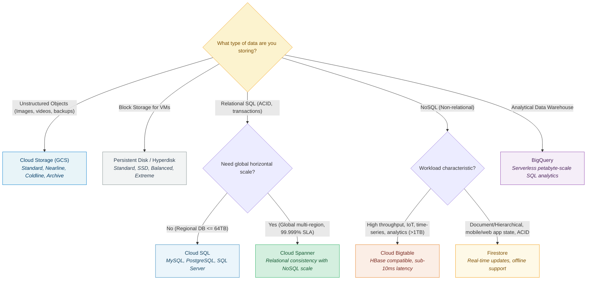

# 04

### Comprehensive Technical Presentation & Study Guide

> **Course / Domain:** Computer Science & Engineering · **Academic Term:** Academic Lecture Series
> **Lecturer / Author:** Course Instructor · **Source:** Official Lecture Presentation Slides
> **Documentation Standard:** DTCM-v3 Clean Architecture (No-Photo / Mermaid Edition)

---

## Table of Contents

* [Slide 1: Storage in  the Cloud 04](#slide-1-storage-in-the-cloud-04)
* [Slide 2: Applications need to store data](#slide-2-applications-need-to-store-data)
* [Slide 3: Google has many options for storing data](#slide-3-google-has-many-options-for-storing-data)
* [Slide 4: Storage in the Cloud](#slide-4-storage-in-the-cloud)
* [Slide 5: Storage in the Cloud](#slide-5-storage-in-the-cloud)
* [Slide 6: Types of file storage](#slide-6-types-of-file-storage)
* [Slide 7: Cloud Storage is a fully managed  scalable service](#slide-7-cloud-storage-is-a-fully-managed-scalable-service)
* [Slide 8: Cloud Storage's common object storage use cases](#slide-8-cloud-storages-common-object-storage-use-cases)
* [Slide 9: Cloud Storage files are organized into buckets](#slide-9-cloud-storage-files-are-organized-into-buckets)
* [Slide 10: Cloud Storage objects are immutable](#slide-10-cloud-storage-objects-are-immutable)
* [Slide 11: Object versioning keeps a record of modifications](#slide-11-object-versioning-keeps-a-record-of-modifications)
* [Slide 12: Object versioning allows reversion to an older state](#slide-12-object-versioning-allows-reversion-to-an-older-state)
* [Slide 13: For most purposes, IAM  is sufficient 01](#slide-13-for-most-purposes-iam-is-sufficient-01)
* [Slide 14: Cloud Storage can also be used like a file system](#slide-14-cloud-storage-can-also-be-used-like-a-file-system)
* [Slide 15: Lifecycle management policies save money](#slide-15-lifecycle-management-policies-save-money)
* [Slide 16: There are four basic Cloud Storage classes](#slide-16-there-are-four-basic-cloud-storage-classes)
* [Slide 17: Each storage class has some common features](#slide-17-each-storage-class-has-some-common-features)
* [Slide 18: Autoclass automatically transitions  objects to appropriate storage classes](#slide-18-autoclass-automatically-transitions-objects-to-appropriate-storage-classes)
* [Slide 19: Additional Cloud Storage features include encryption](#slide-19-additional-cloud-storage-features-include-encryption)
* [Slide 20: Bringing data into Cloud Storage](#slide-20-bringing-data-into-cloud-storage)
* [Slide 21: Bringing data into Cloud Storage](#slide-21-bringing-data-into-cloud-storage)
* [Slide 22: Bringing data into Cloud Storage](#slide-22-bringing-data-into-cloud-storage)
* [Slide 23: Integration with other Google Cloud products](#slide-23-integration-with-other-google-cloud-products)
* [Slide 24: Storage in the Cloud](#slide-24-storage-in-the-cloud)
* [Slide 25: Cloud SQL lets you focus on building great applications](#slide-25-cloud-sql-lets-you-focus-on-building-great-applications)
* [Slide 26: There are many reasons to use Cloud SQL](#slide-26-there-are-many-reasons-to-use-cloud-sql)
* [Slide 27: Cloud SQL instances are  accessible by other Google  Cloud and external services.](#slide-27-cloud-sql-instances-are-accessible-by-other-google-cloud-and-external-services)
* [Slide 28: Compute Engine accesses Cloud SQL instances and tools](#slide-28-compute-engine-accesses-cloud-sql-instances-and-tools)
* [Slide 29: Storage in the Cloud](#slide-29-storage-in-the-cloud)
* [Slide 30: $400B](#slide-30-400b)
* [Slide 31: Applications that Spanner is especially suited for](#slide-31-applications-that-spanner-is-especially-suited-for)
* [Slide 32: Storage in the Cloud](#slide-32-storage-in-the-cloud)
* [Slide 33: Firestore is ideal for mobile and web development](#slide-33-firestore-is-ideal-for-mobile-and-web-development)
* [Slide 34: Firestore stores data as "documents"](#slide-34-firestore-stores-data-as-documents)
* [Slide 35: Firestore NoSQL queries connect apps with data](#slide-35-firestore-nosql-queries-connect-apps-with-data)
* [Slide 36: Firestore uses online and offline data synchronization](#slide-36-firestore-uses-online-and-offline-data-synchronization)
* [Slide 37: Firestore leverages Google Cloud's infrastructure](#slide-37-firestore-leverages-google-clouds-infrastructure)
* [Slide 38: Storage in the Cloud](#slide-38-storage-in-the-cloud)
* [Slide 39: Bigtable](#slide-39-bigtable)
* [Slide 40: Why customers often choose Bigtable](#slide-40-why-customers-often-choose-bigtable)
* [Slide 41: Using APIs to read and write data](#slide-41-using-apis-to-read-and-write-data)
* [Slide 42: Streaming data into Bigtable](#slide-42-streaming-data-into-bigtable)
* [Slide 43: Using batch processes to read and write data](#slide-43-using-batch-processes-to-read-and-write-data)
* [Slide 44: BigQuery and Bigtable are different products with different uses](#slide-44-bigquery-and-bigtable-are-different-products-with-different-uses)
* [Slide 45: Storage in the Cloud](#slide-45-storage-in-the-cloud)
* [Slide 46: Comparing storage options](#slide-46-comparing-storage-options)
* [Slide 47: Option Best for Capacity](#slide-47-option-best-for-capacity)
* [Slide 48: Option Best for Capacity](#slide-48-option-best-for-capacity)
* [Slide 49: Option Best for Capacity](#slide-49-option-best-for-capacity)
* [Slide 50: Option Best for Capacity](#slide-50-option-best-for-capacity)
* [Slide 51: Option Best for Capacity](#slide-51-option-best-for-capacity)
* [Slide 52: Option Best for Capacity](#slide-52-option-best-for-capacity)
* [Slide 53: Module Quiz](#slide-53-module-quiz)
* [Slide 54: Quiz | Question 1](#slide-54-quiz-question-1)
* [Slide 55: Quiz | Question 1](#slide-55-quiz-question-1)
* [Slide 56: Quiz | Question 2](#slide-56-quiz-question-2)
* [Slide 57: Quiz | Question 2](#slide-57-quiz-question-2)
* [Slide 58: Quiz | Question 3](#slide-58-quiz-question-3)
* [Slide 59: Quiz | Question 3](#slide-59-quiz-question-3)
* [Slide 60: Lab Intro](#slide-60-lab-intro)

---

---

### Slide 1: Storage in  the Cloud 04

* Proprietary + Confidential
* Storage in
* the Cloud
* 04

<!-- INJECT_START: slide_01_img_02 -->
 [Slide 1] Storage in  the Cloud 04 — Visual Illustration & Context Reference
<!-- INJECT_END: slide_01_img_02 -->

<!-- INJECT_START: slide_01_img_01 -->
 [Slide 1] Storage in  the Cloud 04 — Visual Illustration & Context Reference
<!-- INJECT_END: slide_01_img_01 -->

---

### Slide 2: Applications need to store data

<!-- INJECT_START: slide_02_img_02 -->
 [Slide 2] Applications need to store data — Visual Illustration & Context Reference
<!-- INJECT_END: slide_02_img_02 -->

<!-- INJECT_START: slide_02_img_01 -->
 [Slide 2] Applications need to store data — Visual Illustration & Context Reference
<!-- INJECT_END: slide_02_img_01 -->

* Every application needs to store data - for example, media to be streamed or perhaps
* **even sensor data from devices:** and different applications and workloads require
* different storage database solutions.

---

### Slide 3: Google has many options for storing data

<!-- INJECT_START: slide_03_img_02 -->
 [Slide 3] Google has many options for storing data — Visual Illustration & Context Reference
<!-- INJECT_END: slide_03_img_02 -->

<!-- INJECT_START: slide_03_img_01 -->
 [Slide 3] Google has many options for storing data — Visual Illustration & Context Reference
<!-- INJECT_END: slide_03_img_01 -->

* Google Cloud has storage options for structured, unstructured, transactional, and
* relational data.

---

### Slide 4: Storage in the Cloud

<!-- INJECT_START: slide_04_img_02 -->
 [Slide 4] Storage in the Cloud — Visual Illustration & Context Reference
<!-- INJECT_END: slide_04_img_02 -->

* 01
* 02
* Cloud Storage
* Cloud SQL
* 03
* 04
* Spanner
* Firestore
* 05
* 06
* Bigtable
* Comparing storage options

<!-- INJECT_START: slide_04_img_01 -->
 [Slide 4] Storage in the Cloud — Visual Illustration & Context Reference
<!-- INJECT_END: slide_04_img_01 -->

* In this module, we'll explore Google Cloud's five core storage products: Cloud Storage,
* Bigtable, Cloud SQL, Spanner, and Firestore. Depending on your application, you might
* use one or several of these services to do the job.

---

### Slide 5: Storage in the Cloud

<!-- INJECT_START: slide_05_img_02 -->
 [Slide 5] Storage in the Cloud — Visual Illustration & Context Reference
<!-- INJECT_END: slide_05_img_02 -->

* 01
* 02
* Cloud Storage
* Cloud SQL
* 03
* 04
* Spanner
* Firestore
* 05
* 06
* Bigtable
* Comparing storage options

<!-- INJECT_START: slide_05_img_01 -->
 [Slide 5] Storage in the Cloud — Visual Illustration & Context Reference
<!-- INJECT_END: slide_05_img_01 -->

* Let's begin with Cloud Storage, which is a service that offers developers and IT
* organizations durable and highly available object storage.

---

### Slide 6: Types of file storage

<!-- INJECT_START: slide_06_img_02 -->
 [Slide 6] Types of file storage — Visual Illustration & Context Reference
<!-- INJECT_END: slide_06_img_02 -->

<!-- INJECT_START: slide_06_img_01 -->
 [Slide 6] Types of file storage — Visual Illustration & Context Reference
<!-- INJECT_END: slide_06_img_01 -->

* But what is object storage?  Object storage is a computer data storage architecture
* that manages data as "objects" and not as a file and folder hierarchy (file storage), or
* as chunks of a disk (block storage).  These objects are stored in a packaged format
* which contains the binary form of the actual data itself, as well as relevant associated
* meta-data (such as date created, author, resource type, permissions, etc), and a
* globally unique identifier.  These unique keys are in the form of URLs, which means
* object storage interacts well with web technologies. Data commonly stored as
* objects include video, pictures, and audio recordings.
* Cloud Storage is Google's object storage product.  It allows customers to store any
* amount of data, and to retrieve it as often as needed.  In this lesson, we'll learn more
* about Cloud Storage use cases, features, and pricing.

---

### Slide 7: Cloud Storage is a fully managed  scalable service

<!-- INJECT_START: slide_07_img_02 -->
 [Slide 7] Cloud Storage is a fully managed  scalable service — Visual Illustration & Context Reference
<!-- INJECT_END: slide_07_img_02 -->

<!-- INJECT_START: slide_07_img_03 -->
 [Slide 7] Cloud Storage is a fully managed  scalable service — Visual Illustration & Context Reference
<!-- INJECT_END: slide_07_img_03 -->

<!-- INJECT_START: slide_07_img_01 -->
 [Slide 7] Cloud Storage is a fully managed  scalable service — Visual Illustration & Context Reference
<!-- INJECT_END: slide_07_img_01 -->

* Cloud Storage is a fully managed scalable service that has a wide variety of uses. A
* few examples include serving website content, storing data for archival and disaster
* recovery, and distributing large data objects to end users via Direct Download.

---

### Slide 8: Cloud Storage's common object storage use cases

<!-- INJECT_START: slide_08_img_02 -->
 [Slide 8] Cloud Storage's common object storage use cases — Visual Illustration & Context Reference
<!-- INJECT_END: slide_08_img_02 -->

<!-- INJECT_START: slide_08_img_03 -->
 [Slide 8] Cloud Storage's common object storage use cases — Visual Illustration & Context Reference
<!-- INJECT_END: slide_08_img_03 -->

<!-- INJECT_START: slide_08_img_04 -->
 [Slide 8] Cloud Storage's common object storage use cases — Visual Illustration & Context Reference
<!-- INJECT_END: slide_08_img_04 -->

<!-- INJECT_START: slide_08_img_01 -->
 [Slide 8] Cloud Storage's common object storage use cases — Visual Illustration & Context Reference
<!-- INJECT_END: slide_08_img_01 -->

* Cloud Storage's primary use is whenever binary large-object storage (also known as a
* "BLOB") is needed for online content such as videos and photos, for backup and
* archived data, and for storage of intermediate results in processing workflows.

---

### Slide 9: Cloud Storage files are organized into buckets

<!-- INJECT_START: slide_09_img_02 -->
 [Slide 9] Cloud Storage files are organized into buckets — Visual Illustration & Context Reference
<!-- INJECT_END: slide_09_img_02 -->

<!-- INJECT_START: slide_09_img_01 -->
 [Slide 9] Cloud Storage files are organized into buckets — Visual Illustration & Context Reference
<!-- INJECT_END: slide_09_img_01 -->

* Cloud Storage files are organized into buckets. A bucket needs a globally-unique
* name and a specific geographic location for where it should be stored, and an ideal
* location for a bucket is where latency is minimized. For example, if most of your users
* are in Europe, you probably want to pick a European location so either a specific
* Google Cloud region in Europe, or else the EU multi-region.

---

### Slide 10: Cloud Storage objects are immutable

<!-- INJECT_START: slide_10_img_02 -->
 [Slide 10] Cloud Storage objects are immutable — Visual Illustration & Context Reference
<!-- INJECT_END: slide_10_img_02 -->

<!-- INJECT_START: slide_10_img_01 -->
 [Slide 10] Cloud Storage objects are immutable — Visual Illustration & Context Reference
<!-- INJECT_END: slide_10_img_01 -->

* The storage objects offered by Cloud Storage are "immutable," which means that you
* do not edit them, but instead a new version is created with every change made.

---

### Slide 11: Object versioning keeps a record of modifications

<!-- INJECT_START: slide_11_img_02 -->
 [Slide 11] Object versioning keeps a record of modifications — Visual Illustration & Context Reference
<!-- INJECT_END: slide_11_img_02 -->

<!-- INJECT_START: slide_11_img_03 -->
 [Slide 11] Object versioning keeps a record of modifications — Visual Illustration & Context Reference
<!-- INJECT_END: slide_11_img_03 -->

<!-- INJECT_START: slide_11_img_04 -->
 [Slide 11] Object versioning keeps a record of modifications — Visual Illustration & Context Reference
<!-- INJECT_END: slide_11_img_04 -->

<!-- INJECT_START: slide_11_img_05 -->
 [Slide 11] Object versioning keeps a record of modifications — Visual Illustration & Context Reference
<!-- INJECT_END: slide_11_img_05 -->

<!-- INJECT_START: slide_11_img_06 -->
 [Slide 11] Object versioning keeps a record of modifications — Visual Illustration & Context Reference
<!-- INJECT_END: slide_11_img_06 -->

<!-- INJECT_START: slide_11_img_01 -->
 [Slide 11] Object versioning keeps a record of modifications — Visual Illustration & Context Reference
<!-- INJECT_END: slide_11_img_01 -->

* Administrators have the option to either allow each new version to completely
* overwrite the older one, or to keep track of each change made to a particular object by
* enabling "versioning" within a bucket. If you choose to use versioning, Cloud Storage
* will keep a detailed history of modifications -- that is, overwrites or deletes -- of all
* objects contained in that bucket.

---

### Slide 12: Object versioning allows reversion to an older state

<!-- INJECT_START: slide_12_img_02 -->
 [Slide 12] Object versioning allows reversion to an older state — Visual Illustration & Context Reference
<!-- INJECT_END: slide_12_img_02 -->

<!-- INJECT_START: slide_12_img_03 -->
 [Slide 12] Object versioning allows reversion to an older state — Visual Illustration & Context Reference
<!-- INJECT_END: slide_12_img_03 -->

<!-- INJECT_START: slide_12_img_05 -->
 [Slide 12] Object versioning allows reversion to an older state — Visual Illustration & Context Reference
<!-- INJECT_END: slide_12_img_05 -->

<!-- INJECT_START: slide_12_img_04 -->
 [Slide 12] Object versioning allows reversion to an older state — Visual Illustration & Context Reference
<!-- INJECT_END: slide_12_img_04 -->

<!-- INJECT_START: slide_12_img_06 -->
 [Slide 12] Object versioning allows reversion to an older state — Visual Illustration & Context Reference
<!-- INJECT_END: slide_12_img_06 -->

<!-- INJECT_START: slide_12_img_07 -->
 [Slide 12] Object versioning allows reversion to an older state — Visual Illustration & Context Reference
<!-- INJECT_END: slide_12_img_07 -->

<!-- INJECT_START: slide_12_img_01 -->
 [Slide 12] Object versioning allows reversion to an older state — Visual Illustration & Context Reference
<!-- INJECT_END: slide_12_img_01 -->

* If you don't turn on object versioning, by default new versions will always overwrite
* older versions.
* With object versioning enabled, you can list the archived versions of an object, restore
* an object to an older state, or permanently delete a version of an object, as needed.
* Cloud Storage also offers lifecycle management policies for your objects. For
* example, you could tell Cloud Storage to delete objects older than 365 days, or to
* delete objects created before January 1, 2013, or to keep only the 3 most recent
* versions of each object in a bucket that has versioning enabled.  We'll look more
* closely at object lifecycle management in just a few minutes.

---

### Slide 13: For most purposes, IAM  is sufficient 01

* Proprietary + Confidential

<!-- INJECT_START: slide_13_img_02 -->
 [Slide 13] For most purposes, IAM  is sufficient 01 — Visual Illustration & Context Reference
<!-- INJECT_END: slide_13_img_02 -->

<!-- INJECT_START: slide_13_img_01 -->
 [Slide 13] For most purposes, IAM  is sufficient 01 — Visual Illustration & Context Reference
<!-- INJECT_END: slide_13_img_01 -->

* In many cases, personally identifiable information may be contained in data objects,
* so controlling access to stored data is essential to ensuring security and privacy are
* maintained.  Using IAM roles and, where needed, access control lists (ACLs),
* companies can conform to security best practices, which require each user have
* access and permissions to only what they need to do their jobs, but no more than
* that.
* There are a couple of options to control user access to objects and buckets.
* 1.
* For most purposes, IAM is sufficient. Roles are inherited from project to
* bucket to object.
* 2.
* If you need finer control, you can create access control lists. Each access
* control list consists of two pieces of information. The first is a scope, which
* defines who can access and perform an action. This can be a specific user or
* group of users. The second is a permission, which defines what actions can
* be performed, like read or write.

---

### Slide 14: Cloud Storage can also be used like a file system

<!-- INJECT_START: slide_14_img_02 -->
 [Slide 14] Cloud Storage can also be used like a file system — Visual Illustration & Context Reference
<!-- INJECT_END: slide_14_img_02 -->

<!-- INJECT_START: slide_14_img_01 -->
 [Slide 14] Cloud Storage can also be used like a file system — Visual Illustration & Context Reference
<!-- INJECT_END: slide_14_img_01 -->

* Although Cloud Storage is not a file system, it can be accessed as one via third-party
* tools that can "mount" the bucket and allow it to be used as if it were a typical Linux
* or MacOS directory.

---

### Slide 15: Lifecycle management policies save money

<!-- INJECT_START: slide_15_img_02 -->
 [Slide 15] Lifecycle management policies save money — Visual Illustration & Context Reference
<!-- INJECT_END: slide_15_img_02 -->

<!-- INJECT_START: slide_15_img_03 -->
 [Slide 15] Lifecycle management policies save money — Visual Illustration & Context Reference
<!-- INJECT_END: slide_15_img_03 -->

<!-- INJECT_START: slide_15_img_04 -->
 [Slide 15] Lifecycle management policies save money — Visual Illustration & Context Reference
<!-- INJECT_END: slide_15_img_04 -->

<!-- INJECT_START: slide_15_img_01 -->
 [Slide 15] Lifecycle management policies save money — Visual Illustration & Context Reference
<!-- INJECT_END: slide_15_img_01 -->

* Because storing and retrieving large amounts of object data can quickly become
* expensive, Cloud Storage also offers lifecycle management policies. For example, you
* could tell Cloud Storage to delete objects older than 365 days, or to delete objects
* created before January 1, 2013; or to keep only the 3 most recent versions of each
* object in a bucket that has versioning enabled.  Having this control ensures that you
* are not paying for more than you actually need.

---

### Slide 16: There are four basic Cloud Storage classes

```mermaid
flowchart LR
    Standard["Standard Storage<br/><i>Frequent access<br/>Web content, streaming</i>"]
    -->|"30+ days without access"| Nearline["Nearline Storage<br/><i>Infrequent access (monthly)<br/>Data backups</i>"]
    -->|"90+ days without access"| Coldline["Coldline Storage<br/><i>Rare access (quarterly)<br/>Disaster recovery</i>"]
    -->|"365+ days without access"| Archive["Archive Storage<br/><i>Long-term archival (yearly)<br/>Regulatory compliance</i>"]

    style Standard fill:#d4efdf,stroke:#27ae60,color:#145a32
    style Nearline fill:#d6eaf8,stroke:#2980b9,color:#154360
    style Coldline fill:#fcf3cf,stroke:#f39c12,color:#7d4e00
    style Archive fill:#f2f3f4,stroke:#7f8c8d,color:#2c3e50
```

<!-- INJECT_START: slide_16_img_02 -->
 [Slide 16] There are four basic Cloud Storage classes — Visual Illustration & Context Reference
<!-- INJECT_END: slide_16_img_02 -->

<!-- INJECT_START: slide_16_img_01 -->
 [Slide 16] There are four basic Cloud Storage classes — Visual Illustration & Context Reference
<!-- INJECT_END: slide_16_img_01 -->

* There are four primary storage classes in Cloud Storage and stored data is managed
* and billed according to which "class" it belongs.
* 1.
* The first is Standard Storage. Standard Storage is considered best for
* frequently accessed, or "hot," data. It's also great for data that is stored for
* only brief periods of time.
* 2.
* The second storage class is Nearline Storage. This is best for storing
* infrequently accessed data, like reading or modifying data once per month or
* less, on average. Examples might include data backups, long-tail multimedia
* content, or data archiving.
* 3.
* The third storage class is Coldline Storage. This is also a low-cost option for
* storing infrequently accessed data. However, as compared to Nearline
* Storage, Coldline Storage is meant for reading or modifying data, at most,
* once every 90 days.
* 4.
* The fourth storage class is Archive Storage. This is the lowest-cost option,
* used ideally for data archiving, online backup, and disaster recovery. It's the
* best choice for data that you plan to access less than once a year, because it
* has higher costs for data access and operations and a 365-day minimum
* storage duration.

---

### Slide 17: Each storage class has some common features

* Proprietary + Confidential

<!-- INJECT_START: slide_17_img_02 -->
 [Slide 17] Each storage class has some common features — Visual Illustration & Context Reference
<!-- INJECT_END: slide_17_img_02 -->

<!-- INJECT_START: slide_17_img_03 -->
 [Slide 17] Each storage class has some common features — Visual Illustration & Context Reference
<!-- INJECT_END: slide_17_img_03 -->

* Unlimited storage (no min object size)
* Archive Storage
* Worldwide accessibility and locations

<!-- INJECT_START: slide_17_img_04 -->
 [Slide 17] Each storage class has some common features — Visual Illustration & Context Reference
<!-- INJECT_END: slide_17_img_04 -->

* Coldline Storage
* Low latency and high durability
* Nearline Storage
* A uniform experience
* Standard Storage
* Geo-redundancy

<!-- INJECT_START: slide_17_img_01 -->
 [Slide 17] Each storage class has some common features — Visual Illustration & Context Reference
<!-- INJECT_END: slide_17_img_01 -->

* Although each of these four classes has differences, it's worth noting that several
* characteristics apply across all these storage classes.
* **These include:**
* ●
* Unlimited storage with no minimum object size requirement,
* ●
* Worldwide accessibility and locations,
* ●
* Low latency and high durability,
* ●
* A uniform experience, which extends to security, tools, and APIs, and
* ●
* Geo-redundancy if data is stored in a multi-region or dual-region. So this
* means placing physical servers in geographically diverse data centers to
* protect against catastrophic events and natural disasters, and load-balancing
* traffic for optimal performance.

---

### Slide 18: Autoclass automatically transitions  objects to appropriate storage classes

* Proprietary + Confidential

<!-- INJECT_START: slide_18_img_03 -->
 [Slide 18] Autoclass automatically transitions  objects to appropriate storage classes — Visual Illustration & Context Reference
<!-- INJECT_END: slide_18_img_03 -->

<!-- INJECT_START: slide_18_img_02 -->
 [Slide 18] Autoclass automatically transitions  objects to appropriate storage classes — Visual Illustration & Context Reference
<!-- INJECT_END: slide_18_img_02 -->

<!-- INJECT_START: slide_18_img_01 -->
 [Slide 18] Autoclass automatically transitions  objects to appropriate storage classes — Visual Illustration & Context Reference
<!-- INJECT_END: slide_18_img_01 -->

* Cloud Storage also provides a feature called Autoclass, which automatically
* transitions objects to appropriate storage classes based on each object's access
* pattern.
* The feature moves data that is not accessed to colder storage classes to reduce
* storage cost and moves data that is accessed to Standard storage to optimize future
* accesses.
* Autoclass simplifies and automates cost saving for your Cloud Storage data.

---

### Slide 19: Additional Cloud Storage features include encryption

<!-- INJECT_START: slide_19_img_05 -->
 [Slide 19] Additional Cloud Storage features include encryption — Visual Illustration & Context Reference
<!-- INJECT_END: slide_19_img_05 -->

<!-- INJECT_START: slide_19_img_02 -->
 [Slide 19] Additional Cloud Storage features include encryption — Visual Illustration & Context Reference
<!-- INJECT_END: slide_19_img_02 -->

<!-- INJECT_START: slide_19_img_03 -->
 [Slide 19] Additional Cloud Storage features include encryption — Visual Illustration & Context Reference
<!-- INJECT_END: slide_19_img_03 -->

<!-- INJECT_START: slide_19_img_04 -->
 [Slide 19] Additional Cloud Storage features include encryption — Visual Illustration & Context Reference
<!-- INJECT_END: slide_19_img_04 -->

<!-- INJECT_START: slide_19_img_06 -->
 [Slide 19] Additional Cloud Storage features include encryption — Visual Illustration & Context Reference
<!-- INJECT_END: slide_19_img_06 -->

<!-- INJECT_START: slide_19_img_01 -->
 [Slide 19] Additional Cloud Storage features include encryption — Visual Illustration & Context Reference
<!-- INJECT_END: slide_19_img_01 -->

* Cloud Storage has no minimum fee because you pay only for what you use, and prior
* provisioning of capacity isn't necessary.
* And from a security perspective, Cloud Storage always encrypts data on the server
* side, before it's written to disk, at no additional charge. Data traveling between a
* customer's device and Google is encrypted by default using HTTPS/TLS (Transport
* Layer Security).

---

### Slide 20: Bringing data into Cloud Storage

<!-- INJECT_START: slide_20_img_02 -->
 [Slide 20] Bringing data into Cloud Storage — Visual Illustration & Context Reference
<!-- INJECT_END: slide_20_img_02 -->

<!-- INJECT_START: slide_20_img_01 -->
 [Slide 20] Bringing data into Cloud Storage — Visual Illustration & Context Reference
<!-- INJECT_END: slide_20_img_01 -->

* Regardless of which storage class you choose, there are several ways to bring your
* data into Cloud Storage.
* Many customers simply carry out their own online transfer using gcloud storage,
* which is the Cloud Storage command from the Google Cloud SDK. Data can also be
* moved in by using a drag and drop option in the Google Cloud console, if accessed
* through the Google Chrome web browser.

---

### Slide 21: Bringing data into Cloud Storage

<!-- INJECT_START: slide_21_img_02 -->
 [Slide 21] Bringing data into Cloud Storage — Visual Illustration & Context Reference
<!-- INJECT_END: slide_21_img_02 -->

<!-- INJECT_START: slide_21_img_01 -->
 [Slide 21] Bringing data into Cloud Storage — Visual Illustration & Context Reference
<!-- INJECT_END: slide_21_img_01 -->

* But what if you have to upload terabytes or even petabytes of data? Storage Transfer
* Service enables you to import large amounts of online data into Cloud Storage quickly
* and cost-effectively. The Storage Transfer Service lets you schedule and manage
* batch transfers to Cloud Storage from another cloud provider, from a different Cloud
* Storage region, or from an HTTP(S) endpoint.

---

### Slide 22: Bringing data into Cloud Storage

<!-- INJECT_START: slide_22_img_02 -->
 [Slide 22] Bringing data into Cloud Storage — Visual Illustration & Context Reference
<!-- INJECT_END: slide_22_img_02 -->

<!-- INJECT_START: slide_22_img_01 -->
 [Slide 22] Bringing data into Cloud Storage — Visual Illustration & Context Reference
<!-- INJECT_END: slide_22_img_01 -->

* And then there is the Transfer Appliance, which is a rackable, high-capacity storage
* server that you lease from Google Cloud. You connect it to your network, load it with
* data, and then ship it to an upload facility where the data is uploaded to Cloud
* Storage. You can transfer up to a petabyte of data on a single appliance.

---

### Slide 23: Integration with other Google Cloud products

<!-- INJECT_START: slide_23_img_02 -->
 [Slide 23] Integration with other Google Cloud products — Visual Illustration & Context Reference
<!-- INJECT_END: slide_23_img_02 -->

<!-- INJECT_START: slide_23_img_08 -->
 [Slide 23] Integration with other Google Cloud products — Visual Illustration & Context Reference
<!-- INJECT_END: slide_23_img_08 -->

<!-- INJECT_START: slide_23_img_04 -->
 [Slide 23] Integration with other Google Cloud products — Visual Illustration & Context Reference
<!-- INJECT_END: slide_23_img_04 -->

<!-- INJECT_START: slide_23_img_03 -->
 [Slide 23] Integration with other Google Cloud products — Visual Illustration & Context Reference
<!-- INJECT_END: slide_23_img_03 -->

<!-- INJECT_START: slide_23_img_06 -->
 [Slide 23] Integration with other Google Cloud products — Visual Illustration & Context Reference
<!-- INJECT_END: slide_23_img_06 -->

<!-- INJECT_START: slide_23_img_05 -->
 [Slide 23] Integration with other Google Cloud products — Visual Illustration & Context Reference
<!-- INJECT_END: slide_23_img_05 -->

<!-- INJECT_START: slide_23_img_07 -->
 [Slide 23] Integration with other Google Cloud products — Visual Illustration & Context Reference
<!-- INJECT_END: slide_23_img_07 -->

<!-- INJECT_START: slide_23_img_01 -->
 [Slide 23] Integration with other Google Cloud products — Visual Illustration & Context Reference
<!-- INJECT_END: slide_23_img_01 -->

* Cloud Storage's tight integration with other Google Cloud products and services
* means that there are many additional ways to move data into the service. For
* example, you can import and export tables to and from both BigQuery and Cloud SQL.
* You can also store App Engine logs, Firestore backups, and objects used by App
* Engine applications like images. Cloud Storage can also store instance startup
* scripts, Compute Engine images, and objects used by Compute Engine applications.

---

### Slide 24: Storage in the Cloud

<!-- INJECT_START: slide_24_img_02 -->
 [Slide 24] Storage in the Cloud — Visual Illustration & Context Reference
<!-- INJECT_END: slide_24_img_02 -->

* 01
* 02
* Cloud Storage
* Cloud SQL
* 03
* 04
* Spanner
* Firestore
* 05
* 06
* Bigtable
* Comparing storage options

<!-- INJECT_START: slide_24_img_01 -->
 [Slide 24] Storage in the Cloud — Visual Illustration & Context Reference
<!-- INJECT_END: slide_24_img_01 -->

* The second core storage option is Cloud SQL.

---

### Slide 25: Cloud SQL lets you focus on building great applications

* Proprietary + Confidential
* Mundane tasks
* Relational databases
* Cloud SQL
* for MySQL

<!-- INJECT_START: slide_25_img_02 -->
 [Slide 25] Cloud SQL lets you focus on building great applications — Visual Illustration & Context Reference
<!-- INJECT_END: slide_25_img_02 -->

<!-- INJECT_START: slide_25_img_03 -->
 [Slide 25] Cloud SQL lets you focus on building great applications — Visual Illustration & Context Reference
<!-- INJECT_END: slide_25_img_03 -->

* Applying patches/updates

<!-- INJECT_START: slide_25_img_06 -->
 [Slide 25] Cloud SQL lets you focus on building great applications — Visual Illustration & Context Reference
<!-- INJECT_END: slide_25_img_06 -->

* Cloud SQL
* for PostgreSQL

<!-- INJECT_START: slide_25_img_04 -->
 [Slide 25] Cloud SQL lets you focus on building great applications — Architectural Diagram / Flowchart
<!-- INJECT_END: slide_25_img_04 -->

<!-- INJECT_START: slide_25_img_05 -->
 [Slide 25] Cloud SQL lets you focus on building great applications — Visual Illustration & Context Reference
<!-- INJECT_END: slide_25_img_05 -->

* Managing backups
* Cloud SQL
* for SQL Server
* Configuring replications

<!-- INJECT_START: slide_25_img_01 -->
 [Slide 25] Cloud SQL lets you focus on building great applications — Visual Illustration & Context Reference
<!-- INJECT_END: slide_25_img_01 -->

  * Cloud SQL offers fully managed relational databases, including Cloud SQL for MySQL,
  * Cloud SQL for PostgreSQL, and Cloud SQL for SQL Server as a service. It's designed to
  * hand off mundane, but necessary and often time-consuming, tasks to Googlelike
  * applying patches and updates, managing backups, and configuring replicationsso
  * your focus can be on building great applications.

---

### Slide 26: There are many reasons to use Cloud SQL

* Proprietary + Confidential
* Doesn't require any software installation or maintenance
* Currently can scale up to 128 processor cores, 864 GB of RAM, and 64 TB of
* storage

<!-- INJECT_START: slide_26_img_02 -->
 [Slide 26] There are many reasons to use Cloud SQL — Visual Illustration & Context Reference
<!-- INJECT_END: slide_26_img_02 -->

* Supports automatic replication scenarios
  * Supports managed backups  The cost of an instance covers 7 backups
* Encrypts customer data when on Google's internal networks and  when stored
* in database tables, temporary files, and backups
* Includes a network firewall

<!-- INJECT_START: slide_26_img_01 -->
 [Slide 26] There are many reasons to use Cloud SQL — Visual Illustration & Context Reference
<!-- INJECT_END: slide_26_img_01 -->

* **Cloud SQL:**
* ●
* Doesn't require any software installation or maintenance.
* ●
* Currently can scale up to 128 processor cores, 864 GB of RAM, and 64 TB of
* storage.
* ●
* Supports automatic replication scenarios, such as from a Cloud SQL primary
* instance, an external primary instance, and external MySQL instances.
* ●
* Supports managed backups, so backed-up data is securely stored and
* accessible if a restore is required. The cost of an instance covers seven
* backups.
* ●
* Encrypts customer data when on Google's internal networks and  when stored
* in database tables, temporary files, and backups.
* ●
* Includes a network firewall, which controls network access to each database
* instance.

---

### Slide 27: Cloud SQL instances are  accessible by other Google  Cloud and external services.

<!-- INJECT_START: slide_27_img_02 -->
 [Slide 27] Cloud SQL instances are  accessible by other Google  Cloud and external services. — Visual Illustration & Context Reference
<!-- INJECT_END: slide_27_img_02 -->

<!-- INJECT_START: slide_27_img_01 -->
 [Slide 27] Cloud SQL instances are  accessible by other Google  Cloud and external services. — Visual Illustration & Context Reference
<!-- INJECT_END: slide_27_img_01 -->

* A benefit of Cloud SQL instances is that they are accessible by other Google Cloud
* services, and even external services. Cloud SQL can be used with App Engine using
* standard drivers like Connector/J for Java or MySQLdb for Python.

---

### Slide 28: Compute Engine accesses Cloud SQL instances and tools

* Proprietary + Confidential
* Other external
* applications that

<!-- INJECT_START: slide_28_img_02 -->
 [Slide 28] Compute Engine accesses Cloud SQL instances and tools — Visual Illustration & Context Reference
<!-- INJECT_END: slide_28_img_02 -->

<!-- INJECT_START: slide_28_img_03 -->
 [Slide 28] Compute Engine accesses Cloud SQL instances and tools — Visual Illustration & Context Reference
<!-- INJECT_END: slide_28_img_03 -->

<!-- INJECT_START: slide_28_img_04 -->
 [Slide 28] Compute Engine accesses Cloud SQL instances and tools — Visual Illustration & Context Reference
<!-- INJECT_END: slide_28_img_04 -->

* Workbench
* use standard
* MySQL drivers
* Toad

<!-- INJECT_START: slide_28_img_01 -->
 [Slide 28] Compute Engine accesses Cloud SQL instances and tools — Visual Illustration & Context Reference
<!-- INJECT_END: slide_28_img_01 -->

* Compute Engine instances can be authorized to access Cloud SQL instances and
* configure the Cloud SQL instance to be in the same zone as your virtual machine.
* Cloud SQL also supports other applications and tools that you might use, like SQL
* Workbench, Toad, and other external applications using standard MySQL drivers.

---

### Slide 29: Storage in the Cloud

<!-- INJECT_START: slide_29_img_02 -->
 [Slide 29] Storage in the Cloud — Visual Illustration & Context Reference
<!-- INJECT_END: slide_29_img_02 -->

* 01
* 02
* Cloud Storage
* Cloud SQL
* 03
* 04
* Spanner
* Firestore
* 05
* 06
* Bigtable
* Comparing storage options

<!-- INJECT_START: slide_29_img_01 -->
 [Slide 29] Storage in the Cloud — Visual Illustration & Context Reference
<!-- INJECT_END: slide_29_img_01 -->

* The third core storage option is Spanner.

---

### Slide 30: $400B

<!-- INJECT_START: slide_30_img_02 -->
 [Slide 30] $400B — Visual Illustration & Context Reference
<!-- INJECT_END: slide_30_img_02 -->

<!-- INJECT_START: slide_30_img_04 -->
 [Slide 30] $400B — Visual Illustration & Context Reference
<!-- INJECT_END: slide_30_img_04 -->

<!-- INJECT_START: slide_30_img_05 -->
 [Slide 30] $400B — Visual Illustration & Context Reference
<!-- INJECT_END: slide_30_img_05 -->

<!-- INJECT_START: slide_30_img_03 -->
 [Slide 30] $400B — Visual Illustration & Context Reference
<!-- INJECT_END: slide_30_img_03 -->

<!-- INJECT_START: slide_30_img_01 -->
 [Slide 30] $400B — Visual Illustration & Context Reference
<!-- INJECT_END: slide_30_img_01 -->

* Spanner is a fully managed relational database service that scales horizontally, is
* strongly consistent, and speaks SQL. Battle tested by Google's own mission-critical
* applications and services, Spanner is the service that powers Google's $400 billion
* business.

---

### Slide 31: Applications that Spanner is especially suited for

* Proprietary + Confidential
* **Applications that require:**
* SQL relational database management system with joins and secondary indexes

<!-- INJECT_START: slide_31_img_02 -->
 [Slide 31] Applications that Spanner is especially suited for — Visual Illustration & Context Reference
<!-- INJECT_END: slide_31_img_02 -->

* Built-in high availability
* External consistency
* And high numbers of input/output operations per second. We're talking tens
* of thousands of reads/writes per second or more

<!-- INJECT_START: slide_31_img_01 -->
 [Slide 31] Applications that Spanner is especially suited for — Visual Illustration & Context Reference
<!-- INJECT_END: slide_31_img_01 -->

* Spanner is especially suited for applications that require:
* ●
* An SQL relational database management system with joins and secondary
* indexes.
* ●
* Built-in high availability.
* ●
* External consistency.
* ●
* And high numbers of input/output operations per second. We're talking tens of
* thousands of reads/writes per second or more.

---

### Slide 32: Storage in the Cloud

<!-- INJECT_START: slide_32_img_02 -->
 [Slide 32] Storage in the Cloud — Visual Illustration & Context Reference
<!-- INJECT_END: slide_32_img_02 -->

* 01
* 02
* Cloud Storage
* Cloud SQL
* 03
* 04
* Spanner
* Firestore
* 05
* 06
* Bigtable
* Comparing storage options

<!-- INJECT_START: slide_32_img_01 -->
 [Slide 32] Storage in the Cloud — Visual Illustration & Context Reference
<!-- INJECT_END: slide_32_img_01 -->

* The fourth core storage option is Firestore.

---

### Slide 33: Firestore is ideal for mobile and web development

<!-- INJECT_START: slide_33_img_02 -->
 [Slide 33] Firestore is ideal for mobile and web development — Visual Illustration & Context Reference
<!-- INJECT_END: slide_33_img_02 -->

<!-- INJECT_START: slide_33_img_04 -->
 [Slide 33] Firestore is ideal for mobile and web development — Visual Illustration & Context Reference
<!-- INJECT_END: slide_33_img_04 -->

<!-- INJECT_START: slide_33_img_05 -->
 [Slide 33] Firestore is ideal for mobile and web development — Visual Illustration & Context Reference
<!-- INJECT_END: slide_33_img_05 -->

<!-- INJECT_START: slide_33_img_03 -->
 [Slide 33] Firestore is ideal for mobile and web development — Visual Illustration & Context Reference
<!-- INJECT_END: slide_33_img_03 -->

<!-- INJECT_START: slide_33_img_01 -->
 [Slide 33] Firestore is ideal for mobile and web development — Visual Illustration & Context Reference
<!-- INJECT_END: slide_33_img_01 -->

* Firestore is a flexible, horizontally scalable, NoSQL cloud database for mobile, web,
* and server development.

---

### Slide 34: Firestore stores data as "documents"

<!-- INJECT_START: slide_34_img_02 -->
 [Slide 34] Firestore stores data as "documents" — Visual Illustration & Context Reference
<!-- INJECT_END: slide_34_img_02 -->

<!-- INJECT_START: slide_34_img_01 -->
 [Slide 34] Firestore stores data as "documents" — Visual Illustration & Context Reference
<!-- INJECT_END: slide_34_img_01 -->

* With Firestore, incoming data is stored in a document structure and these documents
* are then organized into collections. Documents can contain complex nested objects
* in addition to subcollections.
* Each document contains a set of key-value pairs. For example, a document to
* represent a user has the keys for the firstname and lastname with the associated
* values.
* More information about Firestore data model can be found at
* https://cloud.google.com/firestore/docs/data-model

---

### Slide 35: Firestore NoSQL queries connect apps with data

* Proprietary + Confidential

<!-- INJECT_START: slide_35_img_02 -->
 [Slide 35] Firestore NoSQL queries connect apps with data — Visual Illustration & Context Reference
<!-- INJECT_END: slide_35_img_02 -->

<!-- INJECT_START: slide_35_img_03 -->
 [Slide 35] Firestore NoSQL queries connect apps with data — Visual Illustration & Context Reference
<!-- INJECT_END: slide_35_img_03 -->

<!-- INJECT_START: slide_35_img_04 -->
 [Slide 35] Firestore NoSQL queries connect apps with data — Visual Illustration & Context Reference
<!-- INJECT_END: slide_35_img_04 -->

<!-- INJECT_START: slide_35_img_05 -->
 [Slide 35] Firestore NoSQL queries connect apps with data — Visual Illustration & Context Reference
<!-- INJECT_END: slide_35_img_05 -->

<!-- INJECT_START: slide_35_img_01 -->
 [Slide 35] Firestore NoSQL queries connect apps with data — Visual Illustration & Context Reference
<!-- INJECT_END: slide_35_img_01 -->

* Firestore's NoSQL queries can then be used to retrieve individual, specific documents
* or to retrieve all the documents in a collection that match your query parameters.
* Queries can include multiple, chained filters and combine filtering and sorting options.
* They're also indexed by default, so query performance is proportional to the size of
* the result set, not the dataset.

---

### Slide 36: Firestore uses online and offline data synchronization

<!-- INJECT_START: slide_36_img_02 -->
 [Slide 36] Firestore uses online and offline data synchronization — Visual Illustration & Context Reference
<!-- INJECT_END: slide_36_img_02 -->

<!-- INJECT_START: slide_36_img_03 -->
 [Slide 36] Firestore uses online and offline data synchronization — Visual Illustration & Context Reference
<!-- INJECT_END: slide_36_img_03 -->

<!-- INJECT_START: slide_36_img_01 -->
 [Slide 36] Firestore uses online and offline data synchronization — Visual Illustration & Context Reference
<!-- INJECT_END: slide_36_img_01 -->

* Firestore uses data synchronization to update data on any connected device.
* However, it's also designed to make simple, one-time fetch queries efficiently. It
* caches data that an app is actively using, so the app can write, read, listen to, and
* query data even if the device is offline. When the device comes back online, Firestore
* synchronizes any local changes back to Firestore.

---

### Slide 37: Firestore leverages Google Cloud's infrastructure

<!-- INJECT_START: slide_37_img_02 -->
 [Slide 37] Firestore leverages Google Cloud's infrastructure — Visual Illustration & Context Reference
<!-- INJECT_END: slide_37_img_02 -->

<!-- INJECT_START: slide_37_img_05 -->
 [Slide 37] Firestore leverages Google Cloud's infrastructure — Visual Illustration & Context Reference
<!-- INJECT_END: slide_37_img_05 -->

<!-- INJECT_START: slide_37_img_03 -->
 [Slide 37] Firestore leverages Google Cloud's infrastructure — Visual Illustration & Context Reference
<!-- INJECT_END: slide_37_img_03 -->

<!-- INJECT_START: slide_37_img_04 -->
 [Slide 37] Firestore leverages Google Cloud's infrastructure — Visual Illustration & Context Reference
<!-- INJECT_END: slide_37_img_04 -->

<!-- INJECT_START: slide_37_img_01 -->
 [Slide 37] Firestore leverages Google Cloud's infrastructure — Visual Illustration & Context Reference
<!-- INJECT_END: slide_37_img_01 -->

* **Firestore leverages Google Cloud's powerful infrastructure:** automatic multi-region
* data replication, strong consistency guarantees, atomic batch operations, and real
* transaction support.

---

### Slide 38: Storage in the Cloud

<!-- INJECT_START: slide_38_img_02 -->
 [Slide 38] Storage in the Cloud — Visual Illustration & Context Reference
<!-- INJECT_END: slide_38_img_02 -->

* 01
* 02
* Cloud Storage
* Cloud SQL
* 03
* 04
* Spanner
* Firestore
* 05
* 06
* Bigtable
* Comparing storage options

<!-- INJECT_START: slide_38_img_01 -->
 [Slide 38] Storage in the Cloud — Visual Illustration & Context Reference
<!-- INJECT_END: slide_38_img_01 -->

* And the final core storage option we're going to explore is Bigtable.

---

### Slide 39: Bigtable

* Proprietary + Confidential

<!-- INJECT_START: slide_39_img_03 -->
 [Slide 39] Bigtable — Visual Illustration & Context Reference
<!-- INJECT_END: slide_39_img_03 -->

<!-- INJECT_START: slide_39_img_04 -->
 [Slide 39] Bigtable — Visual Illustration & Context Reference
<!-- INJECT_END: slide_39_img_04 -->

* Handle massive workloads
* Consistent low latency
* High throughput

<!-- INJECT_START: slide_39_img_02 -->
 [Slide 39] Bigtable — Visual Illustration & Context Reference
<!-- INJECT_END: slide_39_img_02 -->

* Bigtable
* Google's NoSQL big
* data database service

<!-- INJECT_START: slide_39_img_05 -->
 [Slide 39] Bigtable — Visual Illustration & Context Reference
<!-- INJECT_END: slide_39_img_05 -->

* **Great choice for:**
* Operational applications
* Analytical applications

<!-- INJECT_START: slide_39_img_01 -->
 [Slide 39] Bigtable — Visual Illustration & Context Reference
<!-- INJECT_END: slide_39_img_01 -->

* Bigtable is Google's NoSQL big data database service. It's the same database that
* powers many core Google services, including Search, Analytics, Maps, and Gmail.
* Bigtable is designed to handle massive workloads at consistent low latency and high
* throughput, so it's a great choice for both operational and analytical applications,
* including Internet of Things, user analytics, and financial data analysis.

---

### Slide 40: Why customers often choose Bigtable

* Proprietary + Confidential
* Work with more than 1TB of semi-structured or structured data
* Data is fast with high throughput, or it's rapidly changing

<!-- INJECT_START: slide_40_img_02 -->
 [Slide 40] Why customers often choose Bigtable — Visual Illustration & Context Reference
<!-- INJECT_END: slide_40_img_02 -->

* Work with NoSQL data
* Data is a time-series or has natural semantic ordering
* Work with big data, running asynchronous batch or synchronous real-time
* processing on the data
* Run machine learning algorithms on the data

<!-- INJECT_START: slide_40_img_01 -->
 [Slide 40] Why customers often choose Bigtable — Visual Illustration & Context Reference
<!-- INJECT_END: slide_40_img_01 -->

* When deciding which storage option is best, customers often choose Bigtable if:
* ●
* They're working with more than 1TB of semi-structured or structured data.
* ●
* Data is fast with high throughput, or it's rapidly changing.
* ●
* They're working with NoSQL data. This usually means transactions where
* strong relational semantics are not required.
* ●
* Data is a time-series or has natural semantic ordering.
* ●
* They're working with big data, running asynchronous batch or synchronous
* real-time processing on the data.
* ●
* Or they're running machine learning algorithms on the data.

---

### Slide 41: Using APIs to read and write data

<!-- INJECT_START: slide_41_img_02 -->
 [Slide 41] Using APIs to read and write data — Visual Illustration & Context Reference
<!-- INJECT_END: slide_41_img_02 -->

<!-- INJECT_START: slide_41_img_03 -->
 [Slide 41] Using APIs to read and write data — Visual Illustration & Context Reference
<!-- INJECT_END: slide_41_img_03 -->

<!-- INJECT_START: slide_41_img_01 -->
 [Slide 41] Using APIs to read and write data — Visual Illustration & Context Reference
<!-- INJECT_END: slide_41_img_01 -->

* Bigtable can interact with other Google Cloud services and third-party clients.
* Using APIs, data can be read from and written to Bigtable through a data service layer
* like Managed VMs, the HBase REST Server, or a Java Server using the HBase client.
* Typically this is used to serve data to applications, dashboards, and data services.

---

### Slide 42: Streaming data into Bigtable

<!-- INJECT_START: slide_42_img_02 -->
 [Slide 42] Streaming data into Bigtable — Visual Illustration & Context Reference
<!-- INJECT_END: slide_42_img_02 -->

<!-- INJECT_START: slide_42_img_03 -->
 [Slide 42] Streaming data into Bigtable — Visual Illustration & Context Reference
<!-- INJECT_END: slide_42_img_03 -->

<!-- INJECT_START: slide_42_img_01 -->
 [Slide 42] Streaming data into Bigtable — Visual Illustration & Context Reference
<!-- INJECT_END: slide_42_img_01 -->

* Data can also be streamed in through a variety of popular stream processing
* frameworks like Dataflow Streaming, Spark Streaming, and Storm.

---

### Slide 43: Using batch processes to read and write data

<!-- INJECT_START: slide_43_img_02 -->
 [Slide 43] Using batch processes to read and write data — Visual Illustration & Context Reference
<!-- INJECT_END: slide_43_img_02 -->

<!-- INJECT_START: slide_43_img_03 -->
 [Slide 43] Using batch processes to read and write data — Visual Illustration & Context Reference
<!-- INJECT_END: slide_43_img_03 -->

<!-- INJECT_START: slide_43_img_01 -->
 [Slide 43] Using batch processes to read and write data — Visual Illustration & Context Reference
<!-- INJECT_END: slide_43_img_01 -->

* And if streaming is not an option, data can also be read from and written to Bigtable
* through batch processes like Hadoop MapReduce, Dataflow, or Spark. Often,
* summarized or newly calculated data is written back to Bigtable or to a downstream
* database.

---

### Slide 44: BigQuery and Bigtable are different products with different uses

<!-- INJECT_START: slide_44_img_02 -->
 [Slide 44] BigQuery and Bigtable are different products with different uses — Visual Illustration & Context Reference
<!-- INJECT_END: slide_44_img_02 -->

<!-- INJECT_START: slide_44_img_03 -->
 [Slide 44] BigQuery and Bigtable are different products with different uses — Visual Illustration & Context Reference
<!-- INJECT_END: slide_44_img_03 -->

<!-- INJECT_START: slide_44_img_01 -->
 [Slide 44] BigQuery and Bigtable are different products with different uses — Visual Illustration & Context Reference
<!-- INJECT_END: slide_44_img_01 -->

* BigQuery is not mentioned in this module, because it sits on the edge between data
* storage and data processing, and is covered in more depth in other courses. The
* usual reason to store data in BigQuery is so you can use its big data analysis and
* interactive querying capabilities. It is not purely a data storage product.

---

### Slide 45: Storage in the Cloud

<!-- INJECT_START: slide_45_img_02 -->
 [Slide 45] Storage in the Cloud — Visual Illustration & Context Reference
<!-- INJECT_END: slide_45_img_02 -->

* 01
* 02
* Cloud Storage
* Cloud SQL
* 03
* 04
* Spanner
* Firestore
* 05
* 06
* Bigtable
* Comparing storage options

<!-- INJECT_START: slide_45_img_01 -->
 [Slide 45] Storage in the Cloud — Visual Illustration & Context Reference
<!-- INJECT_END: slide_45_img_01 -->

---

### Slide 46: Comparing storage options

* Proprietary + Confidential

<!-- INJECT_START: slide_46_img_02 -->
 [Slide 46] Comparing storage options — Visual Illustration & Context Reference
<!-- INJECT_END: slide_46_img_02 -->

<!-- INJECT_START: slide_46_img_03 -->
 [Slide 46] Comparing storage options — Visual Illustration & Context Reference
<!-- INJECT_END: slide_46_img_03 -->

<!-- INJECT_START: slide_46_img_06 -->
 [Slide 46] Comparing storage options — Visual Illustration & Context Reference
<!-- INJECT_END: slide_46_img_06 -->

<!-- INJECT_START: slide_46_img_04 -->
 [Slide 46] Comparing storage options — Visual Illustration & Context Reference
<!-- INJECT_END: slide_46_img_04 -->

<!-- INJECT_START: slide_46_img_05 -->
 [Slide 46] Comparing storage options — Visual Illustration & Context Reference
<!-- INJECT_END: slide_46_img_05 -->

* Cloud Storage
* Bigtable
* Cloud SQL
* Spanner
* Firestore

<!-- INJECT_START: slide_46_img_01 -->
 [Slide 46] Comparing storage options — Visual Illustration & Context Reference
<!-- INJECT_END: slide_46_img_01 -->

* Now that we've covered Google Cloud's core storage options, let's do a comparison to
* help highlight the most suitable service for a specific application or workflow.

---

### Slide 47: Option Best for Capacity

* Proprietary + Confidential
* Option
* Best for
* Capacity
* Cloud
* Storage
* Storing immutable blobs larger than 10 MB
* Petabytes
* **Max unit size:** 5 TB per object
* Cloud
* SQL
* ●Full SQL support for an online transaction processing system
* ●Web frameworks and existing applications
* Up to 64 TB
* Spanner
* ●Full SQL support for an online transaction processing system
* ●Horizontal scalability
* Petabytes
* Firestore
* Massive scaling and predictability together with real time query
* results and offline query support
* Terabytes.
* **Max unit size:** 1 MB per entity
* ●Storing large amount of structured objects
* ●Does not support SQL queries and multi-row transactions
* ●Analytical data with heavy read and write events
* Petabytes.
* **Max unit size:** 10 MB p/cell, 100 MB
* p/row
* Bigtable

<!-- INJECT_START: slide_47_img_01 -->
 [Slide 47] Option Best for Capacity — Visual Illustration & Context Reference
<!-- INJECT_END: slide_47_img_01 -->

* Consider using Cloud Storage if you need to store immutable blobs larger than 10 MB,
* such as large images or movies. This storage service provides petabytes of capacity
* with a maximum unit size of 5 TB per object.

---

### Slide 48: Option Best for Capacity

* Proprietary + Confidential
* Option
* Best for
* Capacity
* Cloud
* Storage
* Storing immutable blobs larger than 10 MB
* Petabytes
* **Max unit size:** 5 TB per object
* Cloud
* SQL
* ●Full SQL support for an online transaction processing system
* ●Web frameworks and existing applications
* Up to 64 TB
* Spanner
* ●Full SQL support for an online transaction processing system
* ●Horizontal scalability
* Petabytes
* Firestore
* Massive scaling and predictability together with real time query
* results and offline query support
* Terabytes.
* **Max unit size:** 1 MB per entity
* ●Storing large amount of structured objects
* ●Does not support SQL queries and multi-row transactions
* ●Analytical data with heavy read and write events
* Petabytes.
* **Max unit size:** 10 MB p/cell, 100 MB
* p/row
* Bigtable

<!-- INJECT_START: slide_48_img_01 -->
 [Slide 48] Option Best for Capacity — Visual Illustration & Context Reference
<!-- INJECT_END: slide_48_img_01 -->

* Consider using Cloud SQL or Spanner if you need full SQL support for an online
* transaction processing system. Cloud SQL provides up to 64 TB, depending on
* machine type, and Spanner provides petabytes. Cloud SQL is best for web
* frameworks and existing applications, like storing user credentials and customer
* orders.

---

### Slide 49: Option Best for Capacity

* Proprietary + Confidential
* Option
* Best for
* Capacity
* Cloud
* Storage
* Storing immutable blobs larger than 10 MB
* Petabytes
* **Max unit size:** 5 TB per object
* Cloud
* SQL
* ●Full SQL support for an online transaction processing system
* ●Web frameworks and existing applications
* Up to 64 TB
* Spanner
* ●Full SQL support for an online transaction processing system
* ●Horizontal scalability
* Petabytes
* Firestore
* Massive scaling and predictability together with real time query
* results and offline query support
* Terabytes.
* **Max unit size:** 1 MB per entity
* ●Storing large amount of structured objects
* ●Does not support SQL queries and multi-row transactions
* ●Analytical data with heavy read and write events
* Petabytes.
* **Max unit size:** 10 MB p/cell, 100 MB
* p/row
* Bigtable

<!-- INJECT_START: slide_49_img_01 -->
 [Slide 49] Option Best for Capacity — Visual Illustration & Context Reference
<!-- INJECT_END: slide_49_img_01 -->

* If Cloud SQL does not fit your requirements because you need horizontal scalability,
* not just through read replicas, consider using Spanner.

---

### Slide 50: Option Best for Capacity

* Proprietary + Confidential
* Option
* Best for
* Capacity
* Cloud
* Storage
* Storing immutable blobs larger than 10 MB
* Petabytes
* **Max unit size:** 5 TB per object
* Cloud
* SQL
* ●Full SQL support for an online transaction processing system
* ●Web frameworks and existing applications
* Up to 64 TB
* Spanner
* ●Full SQL support for an online transaction processing system
* ●Horizontal scalability
* Petabytes
* Firestore
* Massive scaling and predictability together with real time query
* results and offline query support
* Terabytes.
* **Max unit size:** 1 MB per entity
* ●Storing large amount of structured objects
* ●Does not support SQL queries and multi-row transactions
* ●Analytical data with heavy read and write events
* Petabytes.
* **Max unit size:** 10 MB p/cell, 100 MB
* p/row
* Bigtable

<!-- INJECT_START: slide_50_img_01 -->
 [Slide 50] Option Best for Capacity — Visual Illustration & Context Reference
<!-- INJECT_END: slide_50_img_01 -->

* Consider Firestore if you need massive scaling and predictability together with real
* time query results and offline query support. This storage service provides terabytes
* of capacity with a maximum unit size of 1 MB per entity. Firestore is best for storing,
* syncing, and querying data for mobile and web apps.

---

### Slide 51: Option Best for Capacity

* Proprietary + Confidential
* Option
* Best for
* Capacity
* Cloud
* Storage
* Storing immutable blobs larger than 10 MB
* Petabytes
* **Max unit size:** 5 TB per object
* Cloud
* SQL
* ●Full SQL support for an online transaction processing system
* ●Web frameworks and existing applications
* Up to 64 TB
* Spanner
* ●Full SQL support for an online transaction processing system
* ●Horizontal scalability
* Petabytes
* Firestore
* Massive scaling and predictability together with real time query
* results and offline query support
* Terabytes.
* **Max unit size:** 1 MB per entity
* ●Storing large amount of structured objects
* ●Does not support SQL queries and multi-row transactions
* ●Analytical data with heavy read and write events
* Petabytes.
* **Max unit size:** 10 MB p/cell, 100 MB
* p/row
* Bigtable

<!-- INJECT_START: slide_51_img_01 -->
 [Slide 51] Option Best for Capacity — Visual Illustration & Context Reference
<!-- INJECT_END: slide_51_img_01 -->

* Consider using Bigtable if you need to store a large number of structured objects.
* Bigtable does not support SQL queries, nor does it support multi-row transactions.
* This storage service provides petabytes of capacity with a maximum unit size of 10
* MB per cell and 100 MB per row. Bigtable is best for analytical data with heavy read
* and write events, like AdTech, financial, or IoT data.

---

### Slide 52: Option Best for Capacity

* Proprietary + Confidential
* Option
* Best for
* Capacity
* Cloud
* Storage
* Storing immutable blobs larger than 10 MB
* Petabytes
* **Max unit size:** 5 TB per object
* Cloud
* SQL
* ●Full SQL support for an online transaction processing system
* ●Web frameworks and existing applications
* Up to 64 TB
* Spanner
* ●Full SQL support for an online transaction processing system
* ●Horizontal scalability
* Petabytes
* Firestore
* Massive scaling and predictability together with real time query
* results and offline query support
* Terabytes.
* **Max unit size:** 1 MB per entity
* ●Storing large amount of structured objects
* ●Does not support SQL queries and multi-row transactions
* ●Analytical data with heavy read and write events
* Petabytes.
* **Max unit size:** 10 MB p/cell, 100 MB
* p/row
* Bigtable

<!-- INJECT_START: slide_52_img_01 -->
 [Slide 52] Option Best for Capacity — Visual Illustration & Context Reference
<!-- INJECT_END: slide_52_img_01 -->

* Depending on your application, it's possible that you might use one, or several, of
* these services to do the job.

---

### Slide 53: Module Quiz

<!-- INJECT_START: slide_53_img_02 -->
 [Slide 53] Module Quiz — Visual Illustration & Context Reference
<!-- INJECT_END: slide_53_img_02 -->

<!-- INJECT_START: slide_53_img_01 -->
 [Slide 53] Module Quiz — Visual Illustration & Context Reference
<!-- INJECT_END: slide_53_img_01 -->

---

### Slide 54: Quiz | Question 1

* Proprietary + Confidential
* Question
* Which storage use case is best suited for Google Cloud Storage?
* A.
* Hosting the root file system of a Compute Engine virtual machine instance.
* B.
* Storing unstructured data that requires high durability and availability.
* C.
* Serving as an enterprise data warehouse for complex SQL analytics.
* D.
* Running transactional relational database management system (RDBMS) workloads.

<!-- INJECT_START: slide_54_img_01 -->
 [Slide 54] Quiz | Question 1 — Visual Illustration & Context Reference
<!-- INJECT_END: slide_54_img_01 -->

---

### Slide 55: Quiz | Question 1

* Proprietary + Confidential
* Answer
* Which storage use case is best suited for Google Cloud Storage?
* A.
* Hosting the root file system of a Compute Engine virtual machine instance.

<!-- INJECT_START: slide_55_img_02 -->
 [Slide 55] Quiz | Question 1 — Visual Illustration & Context Reference
<!-- INJECT_END: slide_55_img_02 -->

* B.
* Storing unstructured data that requires high durability and availability.
* C.
* Serving as an enterprise data warehouse for complex SQL analytics.
* D.
* Running transactional relational database management system (RDBMS) workloads.

<!-- INJECT_START: slide_55_img_01 -->
 [Slide 55] Quiz | Question 1 — Visual Illustration & Context Reference
<!-- INJECT_END: slide_55_img_01 -->

* Which storage use case is best suited for Google Cloud Storage?
* **A:** Hosting the root file system of a Compute Engine virtual machine instance.
* **Feedback:** Incorrect. Cloud Storage is an object storage service designed for
* unstructured data, not a block device required for operating system boot drives.
* Compute Engine virtual machines use Persistent Disk or Hyperdisk for their root file
* systems.
* **B:** Storing unstructured data that requires high durability and availability.
* **Feedback:** Correct! Cloud Storage provides highly durable (99.999999999% / 11 9s)
* and available object storage designed for unstructured data like media files, backups,
* and logs.
* **C:** Serving as an enterprise data warehouse for complex SQL analytics.
* **Feedback:** Incorrect. Cloud Storage is object storage, not an analytical data
* warehouse. BigQuery is Google Cloud's fully managed enterprise data warehouse
* optimized for running fast SQL queries on massive datasets.
* **D:** Running transactional relational database management system (RDBMS)
* workloads.
* **Feedback:** Incorrect. Cloud Storage stores unstructured objects and does not support
* relational database features like ACID transactions or SQL indexing. Cloud SQL and
* Spanner are Google Cloud's managed RDBMS solutions.

---

### Slide 56: Quiz | Question 2

* Proprietary + Confidential
* Question
* A company requires a relational database service that can scale horizontally to petabytes
* of data while maintaining high availability. Which Google Cloud service meets this
* requirement?
* A.
* Spanner
* B.
* Cloud SQL
* C.
* Bigtable
* D.
* Firestore

<!-- INJECT_START: slide_56_img_01 -->
 [Slide 56] Quiz | Question 2 — Visual Illustration & Context Reference
<!-- INJECT_END: slide_56_img_01 -->

---

### Slide 57: Quiz | Question 2

* Proprietary + Confidential
* Answer
* A company requires a relational database service that can scale horizontally to petabytes
* of data while maintaining high availability. Which Google Cloud service meets this
* requirement?

<!-- INJECT_START: slide_57_img_02 -->
 [Slide 57] Quiz | Question 2 — Visual Illustration & Context Reference
<!-- INJECT_END: slide_57_img_02 -->

* A.
* Spanner
* B.
* Cloud SQL
* C.
* Bigtable
* D.
* Firestore

<!-- INJECT_START: slide_57_img_01 -->
 [Slide 57] Quiz | Question 2 — Visual Illustration & Context Reference
<!-- INJECT_END: slide_57_img_01 -->

* A company requires a relational database service that can scale horizontally to
* petabytes of data while maintaining high availability. Which Google Cloud service
* meets this requirement?
* **A:** Spanner.
* **Feedback:** Correct! Spanner is an enterprise-grade, horizontally scalable relational
* database that scales to petabytes of storage with strong consistency and up to
* 99.999% availability.
* **B:** Cloud SQL.
* **Feedback:** Incorrect. Cloud SQL is a fully managed relational database service for
* MySQL, PostgreSQL, and SQL Server. However, it scales vertically and is capped at
* regional limits (up to 64 TB per instance), making it unsuitable for petabyte-scale
* global workloads.
* **C:** Bigtable
* **Feedback:** Incorrect. Bigtable scales to petabytes with ultra-low latency, but it is a
* NoSQL wide-column key-value store, not a relational database.
* **D:** Firestore
* **Feedback:** Incorrect. Firestore is a flexible, horizontally scalable document database,
* but it is a NoSQL database designed for web and mobile apps rather than relational
* workloads.

---

### Slide 58: Quiz | Question 3

* Proprietary + Confidential
* Question
* For what primary use case should an organization choose the Coldline storage class in
* Cloud Storage?
* A.
* To minimize monthly storage costs for data accessed less than once a quarter.
* B.
* To minimize overall costs for data that is read and updated frequently.
* C.
* To apply stricter access control and encryption mechanisms to sensitive data.
* D.
* To execute faster data transfers using a dedicated storage API.

<!-- INJECT_START: slide_58_img_01 -->
 [Slide 58] Quiz | Question 3 — Visual Illustration & Context Reference
<!-- INJECT_END: slide_58_img_01 -->

---

### Slide 59: Quiz | Question 3

* Proprietary + Confidential
* Answer
* For what primary use case should an organization choose the Coldline storage class in
* Cloud Storage?

<!-- INJECT_START: slide_59_img_02 -->
 [Slide 59] Quiz | Question 3 — Visual Illustration & Context Reference
<!-- INJECT_END: slide_59_img_02 -->

* A.
* To minimize monthly storage costs for data accessed less than once a quarter.
* B.
* To minimize overall costs for data that is read and updated frequently.
* C.
* To apply stricter access control and encryption mechanisms to sensitive data.
* D.
* To execute faster data transfers using a dedicated storage API.

<!-- INJECT_START: slide_59_img_01 -->
 [Slide 59] Quiz | Question 3 — Visual Illustration & Context Reference
<!-- INJECT_END: slide_59_img_01 -->

* For what primary use case should an organization choose the Coldline storage class
* in Cloud Storage?
* **A:** To minimize monthly storage costs for data accessed less than once a quarter.
* **Feedback:** Correct! Coldline storage offers significantly lower monthly at-rest storage
* rates compared to Standard and Nearline classes, making it ideal for data accessed
* infrequently (at most once every 90 days).
* **B:** To minimize overall costs for data that is read and updated frequently.
* **Feedback:** Incorrect. While Coldline offers low storage costs, it incurs data retrieval
* fees per gigabyte. Storing frequently accessed data in Coldline results in higher
* overall costs than using the Standard storage class.
  * **C:** To apply stricter access control and encryption mechanisms to sensitive data.
  * **Feedback:** Incorrect. Security configurationssuch as Identity and Access
  * Management (IAM), Customer-Managed Encryption Keys (CMEK), and uniform
  * bucket-level accessare identical across all Cloud Storage classes.
* **D:** To execute faster data transfers using a dedicated storage API.
* **Feedback:** Incorrect. All Cloud Storage classes (Standard, Nearline, Coldline, Archive)
* utilize the exact same Cloud Storage API, tools, and command-line interfaces (gcloud
* storage, client libraries).

---

### Slide 60: Lab Intro

* Proprietary + Confidential

<!-- INJECT_START: slide_60_img_02 -->
 [Slide 60] Lab Intro — Visual Illustration & Context Reference
<!-- INJECT_END: slide_60_img_02 -->

* **Google Cloud Fundamentals:** Getting Started
* with Cloud Storage and Cloud SQL
* In this lab, you create a Cloud Storage bucket
* and place an image in it. You'll also configure an
* application running in Compute Engine to use a
* database managed by Cloud SQL. For this lab,
* you will configure a web server with PHP, a web
* development environment that is the basis for
* popular blogging software.

<!-- INJECT_START: slide_60_img_01 -->
 [Slide 60] Lab Intro — Visual Illustration & Context Reference
<!-- INJECT_END: slide_60_img_01 -->

---
