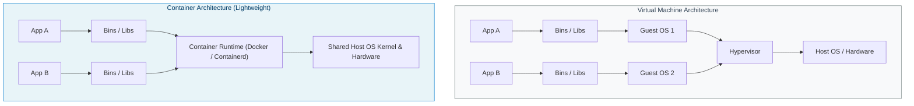
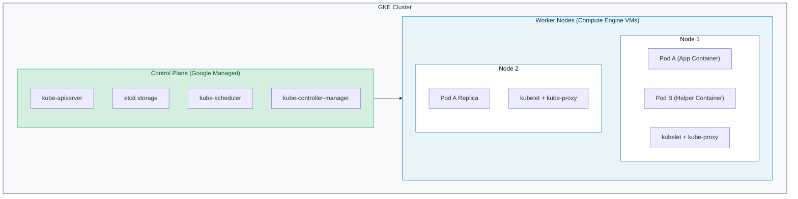

# 05

### Comprehensive Technical Presentation & Study Guide

> **Course / Domain:** Computer Science & Engineering · **Academic Term:** Academic Lecture Series
> **Lecturer / Author:** Course Instructor · **Source:** Official Lecture Presentation Slides
> **Documentation Standard:** DTCM-v3 Clean Architecture (No-Photo / Mermaid Edition)

---

## Table of Contents

* [Slide 1: Containers in the Cloud 05](#slide-1-containers-in-the-cloud-05)
* [Slide 2: Containers in the Cloud](#slide-2-containers-in-the-cloud)
* [Slide 3: Containers in the Cloud](#slide-3-containers-in-the-cloud)
* [Slide 4: Containers group your code and its dependencies](#slide-4-containers-group-your-code-and-its-dependencies)
* [Slide 5: You can scale by duplicating single containers](#slide-5-you-can-scale-by-duplicating-single-containers)
* [Slide 6: You can also scale an application with multiple containers](#slide-6-you-can-also-scale-an-application-with-multiple-containers)
* [Slide 7: Containers in the Cloud](#slide-7-containers-in-the-cloud)
* [Slide 8: Kubernetes manages containerized workloads](#slide-8-kubernetes-manages-containerized-workloads)
* [Slide 9: Containers run in groups called "pods"](#slide-9-containers-run-in-groups-called-pods)
* [Slide 10: Deployments are replicas of a specific pod](#slide-10-deployments-are-replicas-of-a-specific-pod)
* [Slide 11: Pods have fixed IPs to connect to services](#slide-11-pods-have-fixed-ips-to-connect-to-services)
* [Slide 12: Load balancers route  traffic to pods](#slide-12-load-balancers-route-traffic-to-pods)
* [Slide 13: Deployments can be scaled on command](#slide-13-deployments-can-be-scaled-on-command)
* [Slide 14: Configuration files describe how to  create and scale deployments](#slide-14-configuration-files-describe-how-to-create-and-scale-deployments)
* [Slide 15: Deployments can be modified by  changing configuration files](#slide-15-deployments-can-be-modified-by-changing-configuration-files)
* [Slide 16: Endpoints can be discovered using a kubectl command](#slide-16-endpoints-can-be-discovered-using-a-kubectl-command)
* [Slide 17: Rolling updates can be triggered on the command line or by updating the configuration file](#slide-17-rolling-updates-can-be-triggered-on-the-command-line-or-by-updating-the-configuration-file)
* [Slide 18: GKE is Google's managed Kubernetes service](#slide-18-gke-is-googles-managed-kubernetes-service)
* [Slide 19: Node configuration and management](#slide-19-node-configuration-and-management)
* [Slide 20: Autopilot](#slide-20-autopilot)
* [Slide 21: Standard mode](#slide-21-standard-mode)
* [Slide 22: GKE can create customized Kubernetes clusters](#slide-22-gke-can-create-customized-kubernetes-clusters)
* [Slide 23: Benefits of running GKE clusters](#slide-23-benefits-of-running-gke-clusters)
* [Slide 24: Start up Kubernetes on a cluster in GKE](#slide-24-start-up-kubernetes-on-a-cluster-in-gke)
* [Slide 25: Module Quiz](#slide-25-module-quiz)
* [Slide 26: Quiz | Question 1](#slide-26-quiz-question-1)
* [Slide 27: Quiz | Question 1](#slide-27-quiz-question-1)
* [Slide 28: Slide 28](#slide-28-slide-28)
* [Slide 29: Quiz | Question 2](#slide-29-quiz-question-2)
* [Slide 30: Quiz | Question 2](#slide-30-quiz-question-2)

---

---

### Slide 1: Containers in the Cloud 05

<!-- INJECT_START: slide_01_img_02 -->
 [Slide 1] Containers in the Cloud 05 — Visual Illustration & Context Reference
<!-- INJECT_END: slide_01_img_02 -->

* Proprietary + Confidential
* Containers in
* the Cloud
* 05

<!-- INJECT_START: slide_01_img_01 -->
 [Slide 1] Containers in the Cloud 05 — Visual Illustration & Context Reference
<!-- INJECT_END: slide_01_img_01 -->

---

### Slide 2: Containers in the Cloud

<!-- INJECT_START: slide_02_img_02 -->
 [Slide 2] Containers in the Cloud — Visual Illustration & Context Reference
<!-- INJECT_END: slide_02_img_02 -->

* Kubernetes and Google Kubernetes Engine
* 01
* 02
* Introduction to containers

<!-- INJECT_START: slide_02_img_01 -->
 [Slide 2] Containers in the Cloud — Visual Illustration & Context Reference
<!-- INJECT_END: slide_02_img_01 -->

  * We've already explored Compute Enginewhich is Google Cloud's infrastructure as a
  * service offering, with access to servers, file systems, and networkingand App
  * Engine, which is Google Cloud's platform as a service offering.

---

### Slide 3: Containers in the Cloud

<!-- INJECT_START: slide_03_img_02 -->
 [Slide 3] Containers in the Cloud — Visual Illustration & Context Reference
<!-- INJECT_END: slide_03_img_02 -->

* Kubernetes and Google Kubernetes Engine
* 01
* 02
* Introduction to containers

<!-- INJECT_START: slide_03_img_01 -->
 [Slide 3] Containers in the Cloud — Visual Illustration & Context Reference
<!-- INJECT_END: slide_03_img_01 -->

* In this section of the course, we'll explore containers and help you understand how
* they are used.

---

### Slide 4: Containers group your code and its dependencies

<!-- INJECT_START: slide_04_img_02 -->
 [Slide 4] Containers group your code and its dependencies — Visual Illustration & Context Reference
<!-- INJECT_END: slide_04_img_02 -->

<!-- INJECT_START: slide_04_img_01 -->
 [Slide 4] Containers group your code and its dependencies — Visual Illustration & Context Reference
<!-- INJECT_END: slide_04_img_01 -->

* What are containers?
* A container is an invisible box around your code and its dependencies with limited
* access to its own partition of the file system and hardware. It only requires a few
* system calls to create and it starts as quickly as a process. All that's needed on each
* host is an OS kernel that supports containers and a container runtime.
* In essence, the OS and dependencies are being virtualized. A container gives you the
* **best of two worlds:** it scales like Platform as a Service (PaaS) but gives you nearly
* the same flexibility as Infrastructure as a Service (IaaS.) This makes your code ultra
* portable, and the OS and hardware can be treated as a black box. So you can go from
* development, to staging, to production, or from your laptop to the cloud, without
* changing or rebuilding anything.
* Google Kubernetes Engine (GKE) acts as a bridge between these models, providing
* the automation of a PaaS with the granular control of IaaS.
* In short, containers are portable, loosely coupled boxes of application code and
* dependencies that allow you to "code once, and run anywhere."

---

### Slide 5: You can scale by duplicating single containers

<!-- INJECT_START: slide_05_img_02 -->
 [Slide 5] You can scale by duplicating single containers — Visual Illustration & Context Reference
<!-- INJECT_END: slide_05_img_02 -->

<!-- INJECT_START: slide_05_img_01 -->
 [Slide 5] You can scale by duplicating single containers — Visual Illustration & Context Reference
<!-- INJECT_END: slide_05_img_01 -->

* As an example, let's say you want to launch and then scale a web server. With a
* container, you can do this in seconds and deploy dozens or hundreds of them,
* depending on the size or your workload, on a single host.  This is because containers
* can be easily "scaled" to meet demand.
* This is just a simple example of scaling one container which is running your whole
* application on a single host.

---

### Slide 6: You can also scale an application with multiple containers

<!-- INJECT_START: slide_06_img_02 -->
 [Slide 6] You can also scale an application with multiple containers — Visual Illustration & Context Reference
<!-- INJECT_END: slide_06_img_02 -->

<!-- INJECT_START: slide_06_img_01 -->
 [Slide 6] You can also scale an application with multiple containers — Visual Illustration & Context Reference
<!-- INJECT_END: slide_06_img_01 -->

* However, in practice you'll probably want to build your applications using lots of
* containers, each performing their own function, as is done when using a
* microservices architecture.
* If you build applications this way and connect them with network connections, you
* can make them modular, easily deployable, and able to be scaled independently
* across a group of hosts.
* The hosts can scale up and down and start and stop containers as demand for your
* application changes, or as hosts fail.

---

### Slide 7: Containers in the Cloud

<!-- INJECT_START: slide_07_img_02 -->
 [Slide 7] Containers in the Cloud — Visual Illustration & Context Reference
<!-- INJECT_END: slide_07_img_02 -->

* Kubernetes and Google Kubernetes Engine
* 01
* 02
* Introduction to containers

<!-- INJECT_START: slide_07_img_01 -->
 [Slide 7] Containers in the Cloud — Visual Illustration & Context Reference
<!-- INJECT_END: slide_07_img_01 -->

* A product that helps manage and scale containerized applications is Kubernetes.  So
* to save time and effort when scaling applications and workloads, Kubernetes can be
* bootstrapped using Google Kubernetes Engine or GKE.

---

### Slide 8: Kubernetes manages containerized workloads

* Proprietary + Confidential
* It's an open-source platform for managing containerized workloads and
* services.
* It makes it easy to orchestrate many containers on many hosts, scale them
* as microservices, and deploy rollouts and rollbacks.

<!-- INJECT_START: slide_08_img_02 -->
 [Slide 8] Kubernetes manages containerized workloads — Visual Illustration & Context Reference
<!-- INJECT_END: slide_08_img_02 -->

* At the highest level, it's a set of APIs to deploy containers on a set of nodes
* called a cluster.
* It's divided into a set of primary components that run as the control plane
* and a set of nodes that run containers.
* You can describe a set of applications and how they should interact with
* each other and Kubernetes figures how to make that happen.

<!-- INJECT_START: slide_08_img_01 -->
 [Slide 8] Kubernetes manages containerized workloads — Visual Illustration & Context Reference
<!-- INJECT_END: slide_08_img_01 -->

* So, what is Kubernetes?  Kubernetes is an open-source platform for managing
* containerized workloads and services. It makes it easy to orchestrate many
* containers on many hosts, scale them as microservices, and easily deploy rollouts
* and rollbacks.
* At the highest level, Kubernetes is a set of APIs that you can use to deploy containers
* on a set of nodes called a cluster.
* The system is divided into a set of primary components that run as the control plane
* and a set of nodes that run containers. In Kubernetes, a node represents a computing
* instance, like a machine. Note that this is different from a node on Google Cloud
* which is a virtual machine running in Compute Engine.
* You can describe a set of applications and how they should interact with each other,
* and Kubernetes determines how to make that happen.

---

### Slide 9: Containers run in groups called "pods"

<!-- INJECT_START: slide_09_img_02 -->
 [Slide 9] Containers run in groups called "pods" — Visual Illustration & Context Reference
<!-- INJECT_END: slide_09_img_02 -->

<!-- INJECT_START: slide_09_img_01 -->
 [Slide 9] Containers run in groups called "pods" — Visual Illustration & Context Reference
<!-- INJECT_END: slide_09_img_01 -->

* Deploying containers on nodes by using a wrapper around one or more containers is
* what defines a Pod. A Pod is the smallest unit in Kubernetes that you create or
* deploy. It represents a running process on your cluster as either a component of your
* application or an entire app.
* Generally, you only have one container per pod, but if you have multiple containers
* with a hard dependency, you can package them into a single pod and share
* networking and storage resources between them. The Pod provides a unique network
* IP and set of ports for your containers and configurable options that govern how your
* containers should run.
* One way to run a container in a Pod in Kubernetes is to use the kubectl run
* command, which starts a Deployment with a container running inside a Pod.

---

### Slide 10: Deployments are replicas of a specific pod

<!-- INJECT_START: slide_10_img_02 -->
 [Slide 10] Deployments are replicas of a specific pod — Visual Illustration & Context Reference
<!-- INJECT_END: slide_10_img_02 -->

<!-- INJECT_START: slide_10_img_01 -->
 [Slide 10] Deployments are replicas of a specific pod — Visual Illustration & Context Reference
<!-- INJECT_END: slide_10_img_01 -->

* A Deployment represents a group of replicas of the same Pod and keeps your Pods
* running even when the nodes they run on fail. A Deployment could represent a
* component of an application or even an entire app.
* To see a list of the running Pods in your project, run the command:
* $ kubectl get pods

---

### Slide 11: Pods have fixed IPs to connect to services

<!-- INJECT_START: slide_11_img_02 -->
 [Slide 11] Pods have fixed IPs to connect to services — Visual Illustration & Context Reference
<!-- INJECT_END: slide_11_img_02 -->

<!-- INJECT_START: slide_11_img_03 -->
 [Slide 11] Pods have fixed IPs to connect to services — Visual Illustration & Context Reference
<!-- INJECT_END: slide_11_img_03 -->

<!-- INJECT_START: slide_11_img_01 -->
 [Slide 11] Pods have fixed IPs to connect to services — Visual Illustration & Context Reference
<!-- INJECT_END: slide_11_img_01 -->

* Kubernetes creates a Service with a fixed IP address for your Pods, and a controller
* says "I need to attach an external load balancer with a public IP address to that
* Service so others outside the cluster can access it".
* In GKE, the load balancer is created as a network load balancer.

---

### Slide 12: Load balancers route  traffic to pods

<!-- INJECT_START: slide_12_img_02 -->
 [Slide 12] Load balancers route  traffic to pods — Visual Illustration & Context Reference
<!-- INJECT_END: slide_12_img_02 -->

<!-- INJECT_START: slide_12_img_04 -->
 [Slide 12] Load balancers route  traffic to pods — Visual Illustration & Context Reference
<!-- INJECT_END: slide_12_img_04 -->

<!-- INJECT_START: slide_12_img_03 -->
 [Slide 12] Load balancers route  traffic to pods — Architectural Diagram / Flowchart
<!-- INJECT_END: slide_12_img_03 -->

<!-- INJECT_START: slide_12_img_01 -->
 [Slide 12] Load balancers route  traffic to pods — Visual Illustration & Context Reference
<!-- INJECT_END: slide_12_img_01 -->

* Any client that reaches that IP address will be routed to a Pod behind the Service. A
* Service is an abstraction which defines a logical set of Pods and a policy by which to
* access them.
* As Deployments create and destroy Pods, Pods will be assigned their own IP
* addresses, but those addresses don't remain stable over time.
* A Service group is a set of Pods and provides a stable endpoint (or fixed IP address)
* for them.
* For example, if you create two sets of Pods called frontend and backend and put
* them behind their own Services, the backend Pods might change, but frontend Pods
* are not aware of this. They simply refer to the backend Service.

---

### Slide 13: Deployments can be scaled on command

<!-- INJECT_START: slide_13_img_02 -->
 [Slide 13] Deployments can be scaled on command — Visual Illustration & Context Reference
<!-- INJECT_END: slide_13_img_02 -->

<!-- INJECT_START: slide_13_img_01 -->
 [Slide 13] Deployments can be scaled on command — Visual Illustration & Context Reference
<!-- INJECT_END: slide_13_img_01 -->

* To scale a Deployment, run the kubectl scale command.
* In this example, three Pods are created in your Deployment, and they're placed behind
* the Service and share one fixed IP address.
* You could also use autoscaling with other kinds of parameters; for example, you can
* specify that the number of pods should increase when CPU utilization reaches a
* certain limit.

---

### Slide 14: Configuration files describe how to  create and scale deployments

<!-- INJECT_START: slide_14_img_02 -->
 [Slide 14] Configuration files describe how to  create and scale deployments — Visual Illustration & Context Reference
<!-- INJECT_END: slide_14_img_02 -->

<!-- INJECT_START: slide_14_img_01 -->
 [Slide 14] Configuration files describe how to  create and scale deployments — Visual Illustration & Context Reference
<!-- INJECT_END: slide_14_img_01 -->

* So far, we've seen how to run imperative commands like expose and scale. This works
* well to learn and test Kubernetes step-by-step.
* But the real strength of Kubernetes comes when you work in a declarative way.
* Instead of issuing commands, you provide a configuration file that tells Kubernetes
* what you want your desired state to look like, and Kubernetes determines how to do it.
* You accomplish this by using a Deployment config file.

---

### Slide 15: Deployments can be modified by  changing configuration files

<!-- INJECT_START: slide_15_img_02 -->
 [Slide 15] Deployments can be modified by  changing configuration files — Visual Illustration & Context Reference
<!-- INJECT_END: slide_15_img_02 -->

<!-- INJECT_START: slide_15_img_01 -->
 [Slide 15] Deployments can be modified by  changing configuration files — Visual Illustration & Context Reference
<!-- INJECT_END: slide_15_img_01 -->

* You can check your Deployment to make sure the proper number of replicas is
* running by using either kubectl get deployments or kubectl describe
* deployments.  To run five replicas instead of three, all you do is update the
* Deployment config file and run the kubectl apply command to use the updated
* config file.

---

### Slide 16: Endpoints can be discovered using a kubectl command

<!-- INJECT_START: slide_16_img_02 -->
 [Slide 16] Endpoints can be discovered using a kubectl command — Visual Illustration & Context Reference
<!-- INJECT_END: slide_16_img_02 -->

<!-- INJECT_START: slide_16_img_01 -->
 [Slide 16] Endpoints can be discovered using a kubectl command — Visual Illustration & Context Reference
<!-- INJECT_END: slide_16_img_01 -->

* You can still reach your endpoint as before by using kubectl get services to get
* the external IP of the Service and reach the public IP address from a client.

---

### Slide 17: Rolling updates can be triggered on the command line or by updating the configuration file

<!-- INJECT_START: slide_17_img_02 -->
 [Slide 17] Rolling updates can be triggered on the command line or by updating the configuration file — Visual Illustration & Context Reference
<!-- INJECT_END: slide_17_img_02 -->

<!-- INJECT_START: slide_17_img_01 -->
 [Slide 17] Rolling updates can be triggered on the command line or by updating the configuration file — Visual Illustration & Context Reference
<!-- INJECT_END: slide_17_img_01 -->

* The last question is, what happens when you want to update a new version of your
* app?
* Well, you want to update your container to get new code in front of users, but rolling
* out all those changes at one time would be risky.
* So in this case, you would use kubectl rollout or change your deployment
* configuration file and then apply the change using kubectl apply.
* New Pods will then be created according to your new update strategy.  Here is an
* example configuration that will create new version Pods individually and wait for a
* new Pod to be available before destroying one of the old Pods.

---

### Slide 18: GKE is Google's managed Kubernetes service

* Proprietary + Confidential
* Cluster

<!-- INJECT_START: slide_18_img_02 -->
 [Slide 18] GKE is Google's managed Kubernetes service — Visual Illustration & Context Reference
<!-- INJECT_END: slide_18_img_02 -->

<!-- INJECT_START: slide_18_img_03 -->
 [Slide 18] GKE is Google's managed Kubernetes service — Visual Illustration & Context Reference
<!-- INJECT_END: slide_18_img_03 -->

<!-- INJECT_START: slide_18_img_04 -->
 [Slide 18] GKE is Google's managed Kubernetes service — Visual Illustration & Context Reference
<!-- INJECT_END: slide_18_img_04 -->

<!-- INJECT_START: slide_18_img_05 -->
 [Slide 18] GKE is Google's managed Kubernetes service — Visual Illustration & Context Reference
<!-- INJECT_END: slide_18_img_05 -->

<!-- INJECT_START: slide_18_img_06 -->
 [Slide 18] GKE is Google's managed Kubernetes service — Visual Illustration & Context Reference
<!-- INJECT_END: slide_18_img_06 -->

<!-- INJECT_START: slide_18_img_01 -->
 [Slide 18] GKE is Google's managed Kubernetes service — Visual Illustration & Context Reference
<!-- INJECT_END: slide_18_img_01 -->

* So now that we have a basic understanding of containers and Kubernetes, let's talk
* about Google Kubernetes Engine, or GKE.
* GKE is a Google-hosted managed Kubernetes service in the cloud. The GKE
* environment consists of multiple machines, specifically Compute Engine instances,
* grouped together to form a cluster.

---

### Slide 19: Node configuration and management

* Proprietary + Confidential

<!-- INJECT_START: slide_19_img_02 -->
 [Slide 19] Node configuration and management — Visual Illustration & Context Reference
<!-- INJECT_END: slide_19_img_02 -->

<!-- INJECT_START: slide_19_img_03 -->
 [Slide 19] Node configuration and management — Visual Illustration & Context Reference
<!-- INJECT_END: slide_19_img_03 -->

<!-- INJECT_START: slide_19_img_07 -->
 [Slide 19] Node configuration and management — Visual Illustration & Context Reference
<!-- INJECT_END: slide_19_img_07 -->

<!-- INJECT_START: slide_19_img_04 -->
 [Slide 19] Node configuration and management — Visual Illustration & Context Reference
<!-- INJECT_END: slide_19_img_04 -->

<!-- INJECT_START: slide_19_img_06 -->
 [Slide 19] Node configuration and management — Visual Illustration & Context Reference
<!-- INJECT_END: slide_19_img_06 -->

<!-- INJECT_START: slide_19_img_05 -->
 [Slide 19] Node configuration and management — Visual Illustration & Context Reference
<!-- INJECT_END: slide_19_img_05 -->

<!-- INJECT_START: slide_19_img_01 -->
 [Slide 19] Node configuration and management — Visual Illustration & Context Reference
<!-- INJECT_END: slide_19_img_01 -->

* But how is GKE different from Kubernetes? From the user's perspective, it's a lot
* simpler. GKE manages all the control plane components for us. It still exposes an IP
* address to which we send all of our Kubernetes API requests, but GKE is responsible
* for provisioning and managing all the control plane infrastructure behind it. It also
* eliminates the need for a separate control plane.
* Node configuration and management depends on the type of GKE mode you use.
* With the Autopilot mode, which is recommended, GKE manages the underlying
* infrastructure such as node configuration, autoscaling, auto-upgrades, baseline
* security configurations, and baseline networking configuration.
* With the Standard mode, you manage the underlying infrastructure, including
* configuring the individual nodes.

---

### Slide 20: Autopilot

* Proprietary + Confidential

<!-- INJECT_START: slide_20_img_02 -->
 [Slide 20] Autopilot — Visual Illustration & Context Reference
<!-- INJECT_END: slide_20_img_02 -->

<!-- INJECT_START: slide_20_img_03 -->
 [Slide 20] Autopilot — Visual Illustration & Context Reference
<!-- INJECT_END: slide_20_img_03 -->

<!-- INJECT_START: slide_20_img_04 -->
 [Slide 20] Autopilot — Visual Illustration & Context Reference
<!-- INJECT_END: slide_20_img_04 -->

* Optimized for production
* Strong security posture
* Promotes operational efficiency

<!-- INJECT_START: slide_20_img_01 -->
 [Slide 20] Autopilot — Visual Illustration & Context Reference
<!-- INJECT_END: slide_20_img_01 -->

* These are some benefits and functionality of Autopilot:
* ●
* It's optimized for production.
* ●
* Helps produce a strong security posture.
* ●
* Promotes operational efficiency.

---

### Slide 21: Standard mode

* Proprietary + Confidential

<!-- INJECT_START: slide_21_img_03 -->
 [Slide 21] Standard mode — Visual Illustration & Context Reference
<!-- INJECT_END: slide_21_img_03 -->

<!-- INJECT_START: slide_21_img_04 -->
 [Slide 21] Standard mode — Visual Illustration & Context Reference
<!-- INJECT_END: slide_21_img_04 -->

* Cluster configuration

<!-- INJECT_START: slide_21_img_02 -->
 [Slide 21] Standard mode — Visual Illustration & Context Reference
<!-- INJECT_END: slide_21_img_02 -->

* Cluster management
* Cluster optimization

<!-- INJECT_START: slide_21_img_05 -->
 [Slide 21] Standard mode — Visual Illustration & Context Reference
<!-- INJECT_END: slide_21_img_05 -->

<!-- INJECT_START: slide_21_img_06 -->
 [Slide 21] Standard mode — Visual Illustration & Context Reference
<!-- INJECT_END: slide_21_img_06 -->

<!-- INJECT_START: slide_21_img_01 -->
 [Slide 21] Standard mode — Visual Illustration & Context Reference
<!-- INJECT_END: slide_21_img_01 -->

* The GKE Standard mode has the same functionality as Autopilot, but you're
* responsible for the configuration, management, and optimization of the cluster.
* Unless you require the specific level of configuration control offered by GKE standard,
* it's recommended that you use Autopilot mode.

---

### Slide 22: GKE can create customized Kubernetes clusters

<!-- INJECT_START: slide_22_img_02 -->
 [Slide 22] GKE can create customized Kubernetes clusters — Visual Illustration & Context Reference
<!-- INJECT_END: slide_22_img_02 -->

* Proprietary + Confidential

<!-- INJECT_START: slide_22_img_04 -->
 [Slide 22] GKE can create customized Kubernetes clusters — Visual Illustration & Context Reference
<!-- INJECT_END: slide_22_img_04 -->

<!-- INJECT_START: slide_22_img_05 -->
 [Slide 22] GKE can create customized Kubernetes clusters — Visual Illustration & Context Reference
<!-- INJECT_END: slide_22_img_05 -->

<!-- INJECT_START: slide_22_img_06 -->
 [Slide 22] GKE can create customized Kubernetes clusters — Visual Illustration & Context Reference
<!-- INJECT_END: slide_22_img_06 -->

<!-- INJECT_START: slide_22_img_07 -->
 [Slide 22] GKE can create customized Kubernetes clusters — Visual Illustration & Context Reference
<!-- INJECT_END: slide_22_img_07 -->

<!-- INJECT_START: slide_22_img_03 -->
 [Slide 22] GKE can create customized Kubernetes clusters — Architectural Diagram / Flowchart
<!-- INJECT_END: slide_22_img_03 -->

<!-- INJECT_START: slide_22_img_01 -->
 [Slide 22] GKE can create customized Kubernetes clusters — Visual Illustration & Context Reference
<!-- INJECT_END: slide_22_img_01 -->

* You can create a Kubernetes cluster with Google Kubernetes Engine by using the
* Google Cloud console or the gcloud command that's provided by the Google Cloud
* SDK. GKE clusters can be customized, and they support different machine types,
* number of nodes, and network settings.
* Kubernetes provides the mechanisms through which you interact with your cluster.
* Kubernetes commands and resources are used to deploy and manage applications,
* perform administration tasks, set policies, and monitor the health of deployed
* workloads.

---

### Slide 23: Benefits of running GKE clusters

* Proprietary + Confidential
* Google Cloud's load-balancing for Compute Engine instances
* Node pools to designate subsets of nodes within a cluster

<!-- INJECT_START: slide_23_img_02 -->
 [Slide 23] Benefits of running GKE clusters — Visual Illustration & Context Reference
<!-- INJECT_END: slide_23_img_02 -->

* Automatic scaling of your cluster's node instance count
* Automatic upgrades for your cluster's node software
* Node auto-repair to maintain node health and availability
* Logging and monitoring with Google Cloud Observability

<!-- INJECT_START: slide_23_img_01 -->
 [Slide 23] Benefits of running GKE clusters — Visual Illustration & Context Reference
<!-- INJECT_END: slide_23_img_01 -->

* Running a GKE cluster comes with the benefit of advanced cluster management
* features that Google Cloud provides. These include:
* ●
* Google Cloud's load-balancing for Compute Engine instances.
* ●
* Node pools to designate subsets of nodes within a cluster for additional
* flexibility.
* ●
* Automatic scaling of your cluster's node instance count.
* ●
* Automatic upgrades for your cluster's node software.
* ●
* Node auto-repair to maintain node health and availability.
* ●
* Logging and monitoring with Google Cloud Observability for visibility into your
* cluster.

---

### Slide 24: Start up Kubernetes on a cluster in GKE

<!-- INJECT_START: slide_24_img_02 -->
 [Slide 24] Start up Kubernetes on a cluster in GKE — Visual Illustration & Context Reference
<!-- INJECT_END: slide_24_img_02 -->

<!-- INJECT_START: slide_24_img_03 -->
 [Slide 24] Start up Kubernetes on a cluster in GKE — Visual Illustration & Context Reference
<!-- INJECT_END: slide_24_img_03 -->

<!-- INJECT_START: slide_24_img_01 -->
 [Slide 24] Start up Kubernetes on a cluster in GKE — Visual Illustration & Context Reference
<!-- INJECT_END: slide_24_img_01 -->

* To start up Kubernetes on a cluster in GKE, all you do is run this command:
* $> gcloud container clusters create-auto k1 --region $CLUSTER_REGION

---

### Slide 25: Module Quiz

<!-- INJECT_START: slide_25_img_02 -->
 [Slide 25] Module Quiz — Visual Illustration & Context Reference
<!-- INJECT_END: slide_25_img_02 -->

<!-- INJECT_START: slide_25_img_01 -->
 [Slide 25] Module Quiz — Visual Illustration & Context Reference
<!-- INJECT_END: slide_25_img_01 -->

---

### Slide 26: Quiz | Question 1

* Proprietary + Confidential
* Question
* What is a Kubernetes pod?
* A.
* A group of clusters
* B.
* A group of nodes
* C.
* A group of VMs
* D.
* A group of containers

<!-- INJECT_START: slide_26_img_01 -->
 [Slide 26] Quiz | Question 1 — Visual Illustration & Context Reference
<!-- INJECT_END: slide_26_img_01 -->

---

### Slide 27: Quiz | Question 1

* Proprietary + Confidential
* Answer
* What is a Kubernetes pod?
* A.
* A group of clusters
* B.
* A group of nodes
* C.
* A group of VMs

<!-- INJECT_START: slide_27_img_02 -->
 [Slide 27] Quiz | Question 1 — Visual Illustration & Context Reference
<!-- INJECT_END: slide_27_img_02 -->

* D.
* A group of containers

<!-- INJECT_START: slide_27_img_01 -->
 [Slide 27] Quiz | Question 1 — Visual Illustration & Context Reference
<!-- INJECT_END: slide_27_img_01 -->

* What is a Kubernetes pod?
* **A:** A group of clusters
* **Feedback:** Sorry, that's not correct. In Kubernetes, a group of one or more containers
* is called a pod. Containers in a pod are deployed together. They are started, stopped,
* and replicated as a group.
* The simplest workload that Kubernetes can deploy is a pod that consists only of a
* single container.
* **B:** A group of nodes
* **Feedback:** Sorry, that's not correct. In Kubernetes, a group of one or more containers
* is called a pod. Containers in a pod are deployed together. They are started, stopped,
* and replicated as a group.
* The simplest workload that Kubernetes can deploy is a pod that consists only of a
* single container.
* **C:** A group of VMs
* **Feedback:** Sorry, that's not correct. In Kubernetes, a group of one or more containers
* is called a pod. Containers in a pod are deployed together. They are started, stopped,
* and replicated as a group.
* The simplest workload that Kubernetes can deploy is a pod that consists only of a
* single container.
* **D:** A group of containers

---

### Slide 28: Slide 28

* **Feedback:** That's correct. In Kubernetes, a group of one or more containers is called a
* pod. Containers in a pod are deployed together. They are started, stopped, and
* replicated as a group.
* The simplest workload that Kubernetes can deploy is a pod that consists only of a
* single container.

---

### Slide 29: Quiz | Question 2

* Proprietary + Confidential
* Question
* Where do the resources used to build Google Kubernetes Engine clusters come from?
* A.
* Compute Engine
* B.
* App Engine
* C.
* Bare-metal servers
* D.
* Cloud Storage

<!-- INJECT_START: slide_29_img_01 -->
 [Slide 29] Quiz | Question 2 — Visual Illustration & Context Reference
<!-- INJECT_END: slide_29_img_01 -->

---

### Slide 30: Quiz | Question 2

* Proprietary + Confidential
* Answer
* Where do the resources used to build Google Kubernetes Engine clusters come from?

<!-- INJECT_START: slide_30_img_02 -->
 [Slide 30] Quiz | Question 2 — Visual Illustration & Context Reference
<!-- INJECT_END: slide_30_img_02 -->

* A.
* Compute Engine
* B.
* App Engine
* C.
* Bare-metal servers
* D.
* Cloud Storage

<!-- INJECT_START: slide_30_img_01 -->
 [Slide 30] Quiz | Question 2 — Visual Illustration & Context Reference
<!-- INJECT_END: slide_30_img_01 -->

* Where do the resources used to build Google Kubernetes Engine clusters come from?
* **A:** Compute Engine
* **Feedback:** Correct! Because the resources used to build Google Kubernetes Engine
* clusters come from Compute Engine, Google Kubernetes Engine gets to take
* advantage of Compute Engine's and Google VPC's capabilities.
* **B:** App Engine
* **Feedback:** Sorry, that's not correct. Because the resources used to build Google
* Kubernetes Engine clusters come from Compute Engine, Google Kubernetes Engine
* gets to take advantage of Compute Engine's and Google VPC's capabilities.
* **C:** Bare-metal servers
* **Feedback:** Sorry, that's not correct. Because the resources used to build Google
* Kubernetes Engine clusters come from Compute Engine, Google Kubernetes Engine
* gets to take advantage of Compute Engine's and Google VPC's capabilities.
* **D:** Cloud Storage
* **Feedback:** Sorry, that's not correct. Because the resources used to build Google
* Kubernetes Engine clusters come from Compute Engine, Google Kubernetes Engine
* gets to take advantage of Compute Engine's and Google VPC's capabilities.

---
