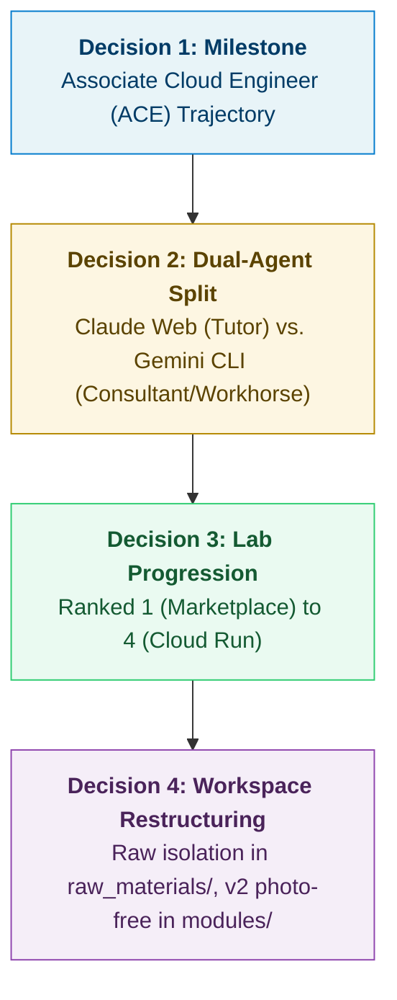

# Session 01: Workspace Setup, Asset Conversion & Operating Model

> **Date:** October 17, 2026  
> **Session Type:** Workspace Setup, Curriculum Alignment & Technical Asset Ingestion  
> **Target Trajectory:** Google Cloud Certified Associate Cloud Engineer (ACE)  
> **Primary Interfaces:** Gemini CLI (Local Consultant / Workhorse) · Claude Web (Primary Tutor / Driver)

---

## 1. Executive Summary

This inaugural session established the complete local engineering and consultation environment for the **Google Cloud Fundamentals: Core Infrastructure** course, configured as the direct launchpad toward the **Google Cloud Certified Associate Cloud Engineer (ACE)** certification.

Through an iterative grilling and alignment protocol (`wf-grill-me`), we established a dual-agent operating model dividing responsibilities between Claude Web and Gemini CLI, surveyed and ranked the hands-on labs from easiest to hardest, converted 8 ILT PDF lecture decks into both high-fidelity and photo-free Mermaid-synthesized Markdown guides, parsed 4 Skills Boost labs into interactive manuals, isolated raw source assets, and established workspace governance via a concise `GEMINI.md`.

---

## 2. Key Decisions & Grilling Alignment Record



1. **Certification Milestone:** The course serves as the foundational technical core for the ACE exam. Conceptual takeaways are anchored directly to exam objectives.
2. **Dual-Agent Workflow:**
   * **Claude (Web):** Leads interactive discussions, concept lectures, Socratic lab pacing, and prompt-driven walkthroughs.
   * **Gemini (CLI):** Acts as the offline consultant, local document converter, Docker build engine, and validator of `gcloud`/bash scripts before sandbox execution.
3. **Lab Ranking Strategy:** Progress from basic Console UI to advanced serverless containers:
   * **Rank 1 (Starter):** Lab 1 — Cloud Marketplace & LAMP Stack (~30 min)
   * **Rank 2 (Easy/Medium):** Lab 2 — VPC Networking & Multi-Zone Compute Engine VMs (~40 min)
   * **Rank 3 (Medium):** Lab 3 — Cloud Storage (GCS) & Cloud SQL Integration (~45 min)
   * **Rank 4 (Medium/Hard):** Lab 4 — Containerization, Artifact Registry & Hello Cloud Run (~45 min)
4. **Clean Asset Policy (`v2` Edition):** All loose raster slide screenshots were stripped from the primary study guides, replaced by 15 native, color-coded Mermaid architectural diagrams.

---

## 3. Deliverables & Directory Layout

The workspace root is structured cleanly:

```text
Google_Cloud_Fundamentals/
├── GEMINI.md                                  # Workspace governance & consultation contract (53 lines)
├── raw_materials/                             # Archived source materials (8 PDFs + 4 HTML files)
├── modules/                                   # Slide deck guides (M0 to M7)
│   ├── M0_Course_Introduction/                # M0_Course_Introduction.md & M0_Course_Introduction_v2.md
│   ├── M1_Introducing_Google_Cloud/           # M1_Introducing_Google_Cloud.md & M1_Introducing_Google_Cloud_v2.md
│   ├── M2_Resources_and_Access/               # M2_Resources_and_Access.md & M2_Resources_and_Access_v2.md
│   ├── M3_Virtual_Machines_and_Networks/      # M3_Virtual_Machines_and_Networks.md & M3_Virtual_Machines_and_Networks_v2.md
│   ├── M4_Storage_in_the_Cloud/               # M4_Storage_in_the_Cloud.md & M4_Storage_in_the_Cloud_v2.md
│   ├── M5_Containers_in_the_Cloud/            # M5_Containers_in_the_Cloud.md & M5_Containers_in_the_Cloud_v2.md
│   ├── M6_Applications_in_the_Cloud/          # M6_Applications_in_the_Cloud.md & M6_Applications_in_the_Cloud_v2.md
│   └── M7_Course_Summary/                     # M7_Course_Summary.md & M7_Course_Summary_v2.md
├── labs/                                      # Hands-on lab manuals & master roadmap
│   ├── 01_Cloud_Marketplace.md
│   ├── 02_VPC_and_Compute_Engine.md
│   ├── 03_Storage_and_Cloud_SQL.md
│   ├── 04_Hello_Cloud_Run.md
│   └── LAB_ROADMAP.md
├── scripts/                                   # Automation utilities & Cloud Shell execution scripts
│   ├── convert_modules.py                     # Initial PDF conversion batch runner
│   ├── generate_labs.py                       # HTML lab parser & roadmap builder
│   ├── generate_v2_modules.py                 # Photo-free Mermaid diagram synthesizer
│   ├── migrate_raw_materials.py               # Raw asset isolation utility
│   ├── claude_project_prompt.md               # Claude Web Custom Instructions prompt
│   ├── lab2_vpc_compute.sh                    # Lab 2 Cloud Shell execution script
│   ├── lab3_storage_sql.sh                    # Lab 3 Cloud Shell execution script
│   └── lab4_cloud_run.sh                      # Lab 4 Cloud Shell execution script
└── sessions/                                  # Session logs & milestone review archives
    └── 01_2026-10-17_workspace_setup_and_conversion.md
```

---

## 4. Synthesized Mermaid Architectural Diagrams (`v2`)

A total of 15 context-critical Mermaid diagrams were generated and injected into the `_v2.md` study guides:

| Module | Diagram Topics Synthesized |
| :--- | :--- |
| **M0** | Course syllabus flow & modular architecture |
| **M1** | Cloud evolution (Colo $\rightarrow$ IaaS $\rightarrow$ PaaS $\rightarrow$ Serverless); Global Regions & Zones topology; Compute workload decision tree |
| **M2** | Google Cloud resource hierarchy (Org $\rightarrow$ Folders $\rightarrow$ Projects); IAM Policy structure; Permissive Union inheritance |
| **M3** | Global VPC network with regional subnets & multi-zone VMs; Firewall rule priority & evaluation order |
| **M4** | GCP storage selection decision tree (Cloud SQL vs Spanner vs Bigtable vs Firestore vs GCS vs PD); GCS storage class lifecycle transitions |
| **M5** | VM vs Container architecture comparison; GKE Control Plane & Worker Node topology |
| **M6** | Cloud Run serverless build, Artifact Registry push, and automatic zero-scaling ($0 \rightarrow N$) lifecycle |
| **M7** | Core curriculum competencies mindmap for Associate Cloud Engineer |

---

## 5. Claude Web Handoff Package

* **Custom Instructions Source:** `scripts/claude_project_prompt.md`
* **Project Knowledge Files:**
  * `labs/LAB_ROADMAP.md`
  * All 8 `modules/*/*_v2.md` guides
  * All 4 `labs/0*.md` manuals
* **Next Action:** Launch Claude Web, initialize the project with the uploaded knowledge and prompt, and begin **Lab 1: Google Cloud Marketplace**.
