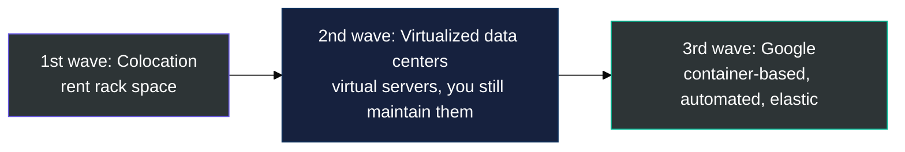
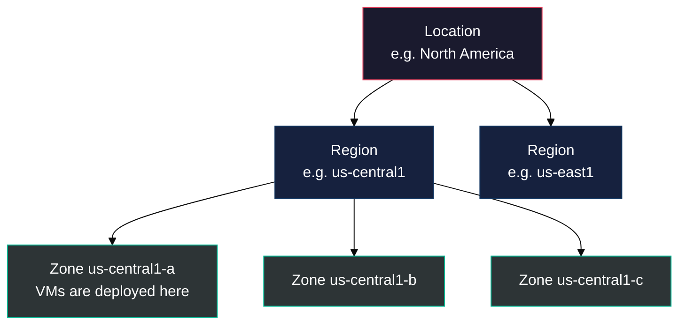
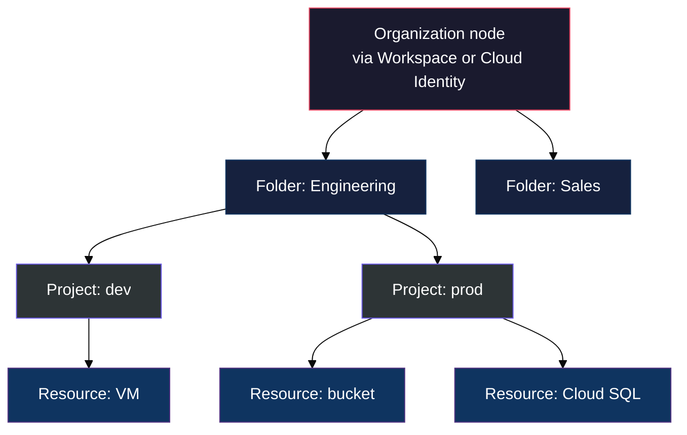
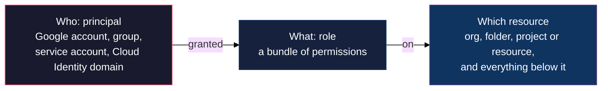

# Lab 1 Study Notes: M0 to M2

### Cloud basics, Google's infrastructure, and resources and access, condensed for Lab 1 and the ACE exam

> **As of:** 2026-10-17 · **Sources:** the M0, M1 and M2 `_v2.md` study guides in [modules/](../modules/) · **Synced with:** the Claude Doc of the same name, https://claude.ai/code/artifact/97e12c9e-19a1-46c4-aebb-2633255c7281

---

## Table of Contents

- [PART 0 — Course introduction (M0)](#part-0)
- [PART 1 — Introducing Google Cloud (M1)](#part-1)
  - [1.1 Cloud computing: the 5 traits](#part-1-1)
  - [1.2 Service models](#part-1-2)
  - [1.3 Global infrastructure](#part-1-3)
  - [1.4 Security: defense in depth](#part-1-4)
  - [1.5 Open APIs and open source](#part-1-5)
  - [1.6 Pricing and billing](#part-1-6)
  - [1.7 M1 self-check quiz](#part-1-7)
- [PART 2 — Resources and Access (M2)](#part-2)
  - [2.1 Resource hierarchy](#part-2-1)
  - [2.2 Projects](#part-2-2)
  - [2.3 Identity and Access Management (IAM)](#part-2-3)
  - [2.4 The three kinds of IAM roles](#part-2-4)
  - [2.5 Service accounts](#part-2-5)
  - [2.6 Cloud Identity](#part-2-6)
  - [2.7 Four ways to work with Google Cloud](#part-2-7)
  - [2.8 M2 self-check quiz](#part-2-8)
- [PART 3 — Bridge to Lab 1: Cloud Marketplace LAMP](#part-3)

---

## PART 0 — Course introduction (M0)

> [!IMPORTANT]
> A lab gives you a temporary project and student account for a fixed time, and **it cannot be paused**. Start a lab only when you have a continuous block of time.

Everything below keeps what Lab 1 or the Associate Cloud Engineer (ACE) exam needs. Cut: etiquette and agenda slides, repeated section dividers, product history detail, sustainability marketing, TensorFlow, and the mobile app's feature list.

---

## PART 1 — Introducing Google Cloud (M1)

### 1.1 Cloud computing: the 5 traits
#### "The NIST definition: what makes something cloud"

NIST is the US National Institute of Standards and Technology; its definition is the standard one, and nothing in it is US-specific.

| # | Trait | What it means |
| :---: | :--- | :--- |
| 1 | **On-demand self-service** | Compute, storage and network through a web interface, with no human in the loop |
| 2 | **Broad network access** | Over the internet, from anywhere |
| 3 | **Resource pooling** | Provider allocates from a big shared pool, buys in bulk, passes savings on; you don't care where the hardware is |
| 4 | **Rapid elasticity** | Scale up or down quickly |
| 5 | **Measured service** | Pay only for what you use, or reserve; stop using and you stop paying |

How we got here:

### 1.2 Service models

| Model | You manage | Provider manages | Google example | You pay for |
| :--- | :--- | :--- | :--- | :--- |
| **IaaS** | OS, runtime, app | Hardware, network, virtualization | Compute Engine | Resources you allocate |
| **PaaS** | App code (bound to provided libraries) | OS, runtime, infrastructure | App Engine | Resources you use |
| **Serverless** | Code or container only | Everything else, including scaling | Cloud Run, Cloud Run functions | Per request or event |
| **SaaS** | Nothing, you just use it | Everything | Gmail, Docs, Drive (Google Workspace) | Subscription |

> **Key Idea:** The trend is toward managed services: less time on infrastructure, more on the product.

### 1.3 Global infrastructure

- **Location → Region → Zone.** A zone is where resources such as a VM are actually deployed. A region holds several zones.
- Some services run **multi-region** (for example Cloud Storage `US`, `EU`, `ASIA`, used in Lab 3).
- 100+ edge caching nodes serve popular content from the nearest location to cut latency (the time a packet takes from source to destination).
- Live counts of regions and zones: cloud.google.com/about/locations.

| Spread across | What you gain |
| :--- | :--- |
| **Several zones in one region** | Fault tolerance |
| **Several regions** | Closer to users worldwide, and you survive a whole-region outage |

### 1.4 Security: defense in depth, layer by layer

| Layer | What Google does |
| :--- | :--- |
| **Hardware infrastructure** | Custom-designed server boards, network gear and a hardware security chip; secure boot stack (signed BIOS, bootloader, kernel, OS image); layered physical premises security |
| **Service deployment** | RPC traffic between data centers is encrypted |
| **User identity** | Login page challenges on risk signals (new device or location); second factor with U2F security keys |
| **Storage services** | **Encryption at rest by default**, with centrally managed keys; hardware encryption on drives and SSDs |
| **Internet communication** | Google Front End (GFE) terminates TLS with proper certificates and perfect forward secrecy; multi-layer DoS protection |
| **Operational security** | Intrusion detection and Red Team exercises; limited and monitored admin access; U2F keys for all employees; central source control with two-party code review; bug bounty |

**Analogy:** a bank doesn't rely on one wall. It has guards at the door, ID checks, a vault and cameras, so getting past one layer still leaves the others.

**Worked example:** you open your Lab 3 blog, which shows an image stored in Cloud Storage. The request meets every layer:

```mermaid
%%{init: {'theme':'base'}}%%
flowchart LR
    U["You<br/>browser"] --> G["1. Internet communication<br/>GFE: TLS + DoS absorbed"]
    G --> I["2. User identity<br/>risk checks, security key"]
    I --> S["3. Service deployment<br/>encrypted RPC between services"]
    S --> D["4. Storage services<br/>image encrypted at rest"]
    D --> H["5. Hardware<br/>secure boot, guarded building"]
    H -.-> O["6. Operational security<br/>monitored staff, two-person code review"]
    style U fill:#1a1a2e,stroke:#e94560,color:#ffffff
    style G fill:#16213e,stroke:#0f3460,color:#ffffff
    style I fill:#16213e,stroke:#0f3460,color:#ffffff
    style S fill:#16213e,stroke:#0f3460,color:#ffffff
    style D fill:#0f3460,stroke:#533483,color:#ffffff
    style H fill:#2d3436,stroke:#6c5ce7,color:#ffffff
    style O fill:#2d3436,stroke:#6c5ce7,color:#ffffff
```

1. **Internet communication:** your browser reaches the Google Front End first; it handles HTTPS and soaks up DoS floods before anything reaches the app.
2. **User identity:** signing in to the console, Google checks risk signals (new device or country) and can ask for a second factor such as a security key.
3. **Service deployment:** as Google's services pass your request between data centers, that internal RPC traffic is encrypted.
4. **Storage services:** the image sits on disk encrypted at rest by default, with nothing for you to turn on.
5. **Hardware:** the server runs Google-designed chips and a secure boot stack, so tampered software won't boot; the building has layered physical security.
6. **Operational security:** staff who could touch that server have limited, monitored access and use security keys; changes to its code need two-person review.

> [!IMPORTANT]
> **What the ACE exam tests here:**
> - Encryption at rest and in transit is **on by default**. An answer like "enable encryption on the bucket" as an extra step is usually a trap.
> - **Shared responsibility:** Google secures these six layers; you secure yours: IAM roles, firewall rules, patching your VM's OS, and keys if you choose to manage them.
> - You won't be asked to recite the six layers in order; know that each exists.

### 1.5 Open APIs and open source

Google publishes key technology as open source so you are not locked in. Kubernetes and GKE let you mix microservices across clouds, and Google Cloud Observability monitors workloads across multiple providers.

### 1.6 Pricing and billing

| Feature | What it does |
| :--- | :--- |
| **Per-second billing** | Compute Engine, GKE, Managed Service for Apache Spark (Dataproc), App Engine flexible environment |
| **Sustained use discounts** | Applied automatically when a VM runs more than 25% of the month, for every extra minute |
| **Custom machine types** | Choose the exact vCPU and memory, so you pay only for what the workload needs |
| **Pricing calculator** | Estimate costs: cloud.google.com/products/calculator |

Tools to avoid surprise bills:

1. **Budgets** at billing-account or project level, fixed or tied to a metric such as a % of last month's spend.
2. **Alerts** when spend nears the budget, typically at 50%, 90% and 100%.
3. **Reports** in the console, by project or service.
4. **Quotas**, which cap consumption to stop errors or attacks from running away.

> [!IMPORTANT]
> A budget alerts you; it does not stop spending.

Quotas apply **per project** and come in two types:

| Quota type | Behaviour | Example |
| :--- | :--- | :--- |
| **Rate quota** | Resets after a time window | GKE API, 3,000 calls per project every 100 seconds |
| **Allocation quota** | Caps how many resources you can have | 15 VPC networks per project |

Some quotas can be raised by requesting an increase from Google Cloud.

### 1.7 M1 self-check quiz

1. Why use resources in several zones within one region?
2. Which service model binds your code to libraries that give access to the infrastructure it needs?
3. Why use resources in several regions?
4. Name the 5 traits of cloud computing.
5. In IaaS do you pay for resources allocated or resources used? And in PaaS?
6. A VM runs all month. What discount do you get without doing anything?
7. What is the difference between a rate quota and an allocation quota? At what level do both apply?
8. Your budget is \$1,000 with an alert at 90%. What happens when spend reaches \$900, and what happens at \$1,100?
9. Which layer of Google's security model covers encryption at rest?

<strong>Click to expand: M1 answers</strong>

1. Fault tolerance.
2. PaaS.
3. Closer to users around the world, and protection against a whole-region failure.
4. On-demand self-service, broad network access, resource pooling, rapid elasticity, measured service.
5. IaaS: allocated. PaaS: used.
6. A sustained use discount (it applies past 25% of the month).
7. A rate quota resets after a time window; an allocation quota caps a count of resources. Both are per project.
8. At \$900 you get an alert. At \$1,100 you get another alert if one is set at 100%, but nothing stops: budgets don't cap spend.
9. Storage services.

---

## PART 2 — Resources and Access (M2)

### 2.1 Resource hierarchy
#### "Four levels, and policies flow downward"

| Level | What it is |
| :--- | :--- |
| **Resources** | VMs, buckets, VPC networks, BigQuery tables, anything you create |
| **Projects** | Every resource belongs to exactly one project |
| **Folders** | Group projects (for example per department) and can nest; they let teams delegate admin rights. Folders need an organization node |
| **Organization node** | The top. You get one through Google Workspace or Cloud Identity. A new org node still lets everyone in the domain create projects and billing accounts, to avoid disruption. Special roles live here, such as **Organization Policy Administrator** and **Project Creator** (controls who can create projects and so spend money) |

> **Key Idea:** Policies can be set at the organization, folder and project levels (and on some individual resources) and are **inherited downward**. Effective access on a resource is the **union** of everything granted at and above it. Example: Viewer at org + Editor at folder + Storage Admin at project = all three on a bucket in that project.

### 2.2 Projects

The project is where you **enable APIs and services**, link billing, and add or remove collaborators. Projects are billed and managed separately.

| Attribute | Globally unique? | Set by | Changeable? |
| :--- | :--- | :--- | :--- |
| **Project ID** | Yes | You at creation (Google suggests one) | **No, immutable after creation** |
| **Project name** | No | You | Yes, any time |
| **Project number** | Yes | Google | No |

- The project ID is what you pass to tools to say which project to work on (Cloud Shell's `$DEVSHELL_PROJECT_ID`, `gcloud config set project`).
- **Resource Manager** is the API to list, create, update, delete and recover projects (RPC and REST).

### 2.3 Identity and Access Management (IAM)
#### "Who can do what on which resource"

- **Who (principal):** a Google account, a Google group, a service account, or a Cloud Identity domain, each identified by an email address.
- **What (role):** a collection of permissions. Granting a role grants all its permissions.
- **Which resource:** the level of the hierarchy where you grant it; it applies there and to everything below.

> [!IMPORTANT]
> **Deny policies** block specific permissions whatever roles say. IAM checks deny before allow, and deny policies are inherited too.

### 2.4 The three kinds of IAM roles (broadest to finest)

| Kind | What it is | Example | Notes |
| :--- | :--- | :--- | :--- |
| **Basic** | Owner, Editor, Viewer; apply to every resource in the project | Viewer: look. Editor: look and change. Owner: also manage roles and set up billing | Too broad when several people share a project with sensitive data |
| **Predefined** | Curated per service | `roles/compute.instanceAdmin` on a project, folder or organization | Matches typical job needs |
| **Custom** | Your own permission set, for least privilege | "instanceOperator": start and stop VMs, not reconfigure them | Project or organization level only, **never folder** |

A project-level custom role can't include org- or folder-only permissions such as `resourcemanager.organizations.get`.

> [!NOTE]
> Billing without resource access is a separate role, Billing Account Administrator. The slides list a "billing administrator" next to the basic roles; on the exam the basic roles are Owner, Editor and Viewer.

### 2.5 Service accounts
#### "An identity for software, not a person"

**The problem it solves:** an app on a VM needs to call other services regularly, and nobody should have to grant access by hand each time.

**What a service account does:**
- Acts as an identity for an application or VM, so it can call other services without a human.
- Is named with an email address, and authenticates with **cryptographic keys instead of a password**.
- Gets roles like any principal. Example: a VM whose service account has Instance Admin can create, modify and delete other VMs.

**Analogy:** a staff badge issued to a machine instead of a person.

> **Key Idea:** A service account is also a **resource**, so people get roles on it: Alice can be Editor of the service account, Bob only Viewer.

### 2.6 Cloud Identity

- Manages users and groups centrally in the Google Admin console instead of loose Gmail accounts and groups.
- Lets admins use existing Active Directory or LDAP usernames and passwords.
- When someone leaves, disable the account and remove them from groups in one place.
- Free edition, and a premium edition that adds mobile device management. Google Workspace customers already have it.

### 2.7 Four ways to work with Google Cloud

| Way | What it gives you |
| :--- | :--- |
| **Google Cloud console** | Web GUI to deploy, scale and diagnose; search resources; SSH to VMs in the browser; set budgets |
| **Google Cloud SDK and Cloud Shell** | SDK includes the `gcloud` CLI and tools like `bq` for BigQuery. **Cloud Shell** is a browser terminal: Debian-based, **5 GB persistent home directory**, pre-authenticated, SDK preinstalled. This is where you run lab commands |
| **APIs** | Every service has one; the APIs Explorer lets you try them; client libraries for Java, Python, PHP, C#, Go, Node.js, Ruby and C++ |
| **Google Cloud app (mobile)** | Start, stop and SSH to VMs, start and stop Cloud SQL, see billing alerts and key metrics |

### 2.8 M2 self-check quiz

1. Services and APIs are enabled on a per-what basis?
2. Order the IAM role types from broadest to finest-grained.
3. Which value is globally unique and unchangeable after creation, but chosen by you during creation?
4. Name the four levels of the resource hierarchy from the top.
5. Bob has Viewer on the organization and Editor on a folder. What can he do on a project inside that folder?
6. Bob has an allow policy granting Editor, and a deny policy denying `compute.instances.delete`. Can he delete a VM?
7. At which levels can you create a custom role, and where can't you?
8. How does a service account authenticate, and why can it also have IAM policies attached to it?
9. An employee leaves. Which tool lets an admin remove their access in one place?
10. Name Cloud Shell's two key properties for running lab commands.

<strong>Click to expand: M2 answers</strong>

1. Per project.
2. Basic, predefined, custom.
3. The project ID.
4. Organization node, folders, projects, resources.
5. Edit: he gets the union of Viewer and Editor, inherited down to the project.
6. No. Deny policies are checked first and win.
7. Project or organization level. Never at folder level.
8. With cryptographic keys, not a password. It is also a resource, so people can be granted roles to use or manage it.
9. Cloud Identity, through the Google Admin console.
10. Pre-authenticated with the SDK preinstalled, and a persistent 5 GB home directory.

---

## PART 3 — Bridge to Lab 1: Cloud Marketplace LAMP

| In the lab you... | The theory behind it |
| :--- | :--- |
| Deploy from **Marketplace** with Click to Deploy | Pre-packaged solution that builds a **Compute Engine VM** (IaaS) running Linux, Apache, MySQL and PHP |
| Pick a **zone** and machine type (`e2-medium`) | The zone decides where the VM lives |
| **Enable the Compute Engine API** when asked | APIs are enabled **per project** |
| See `qwiklabs-gcp-...` in the console | That is the globally unique project ID |
| Sign in as a student account | That account holds an IAM role on the project |
| Open the Site URL | A **firewall rule allows HTTP (tcp:80)** to the VM's external IP |

> **Key Idea:** Patching the VM's OS and software is your job, not Google's: that is the IaaS side of shared responsibility.

---
*Scope: Google Cloud Fundamentals: Core Infrastructure, modules M0 to M2 · Mirrors the Claude Doc linked at the top; changes go into both.*
