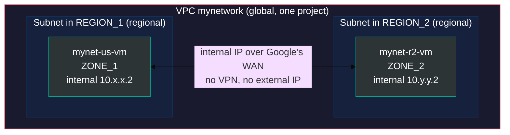
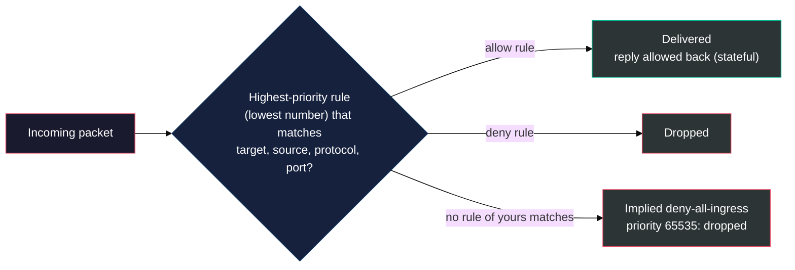
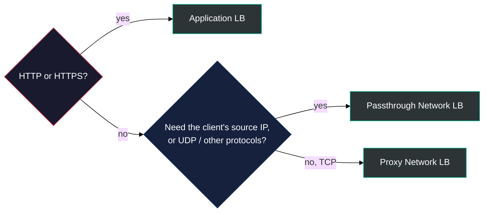
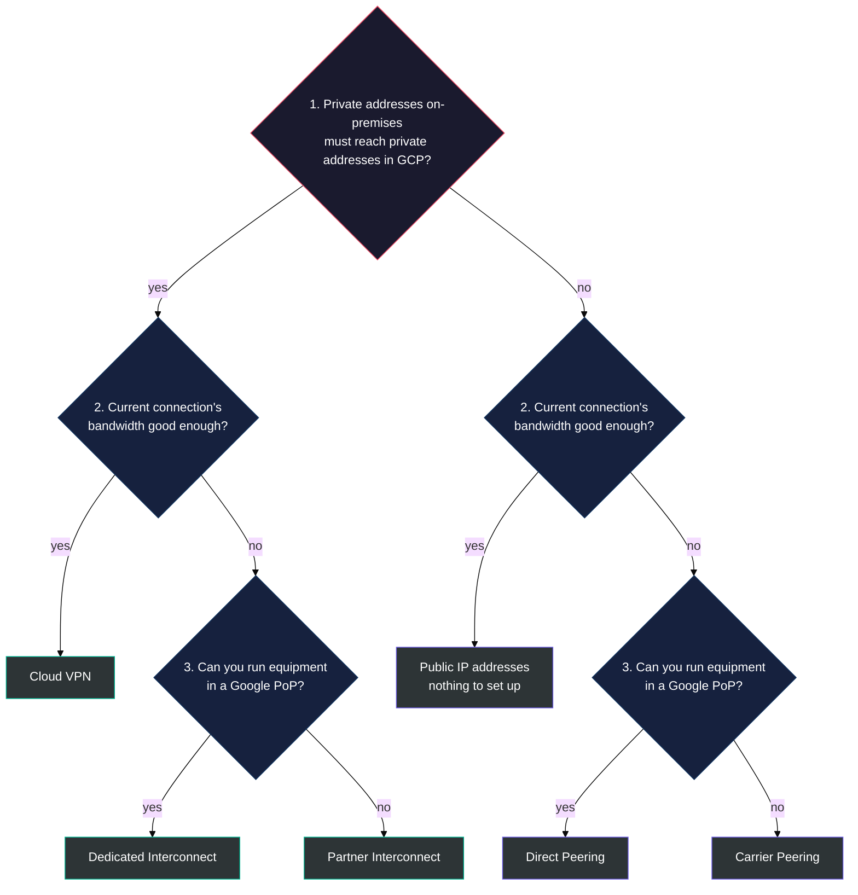
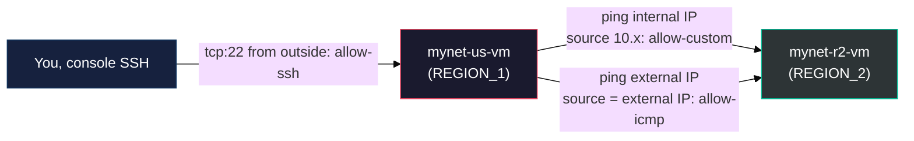

# Lab 2 Study Notes: M3 Virtual Machines and Networks

### VPC networking, Compute Engine and hybrid connectivity, condensed for Lab 2 and the ACE exam

> **As of:** 2026-10-17 · **Sources:** the M3 `_v2.md` study guide in [modules/](../modules/M3_Virtual_Machines_and_Networks/M3_Virtual_Machines_and_Networks_v2.md) and the [Lab 2 manual](../labs/02_VPC_and_Compute_Engine.md) · **Synced with:** the Claude Doc of the same name, https://claude.ai/code/artifact/fee6d350-29e9-44ed-98b7-6433bf631efa

---

## Table of Contents

- [PART 0 — What Lab 2 covers](#part-0)
- [What each service does (M3)](#part-aws)
- [PART 1 — VPC networking](#part-1)
  - [1.1 Global network, regional subnets](#part-1-1)
  - [1.2 Auto mode vs custom mode](#part-1-2)
  - [1.3 The default network](#part-1-3)
  - [1.4 Routes](#part-1-4)
  - [1.5 Firewall rules](#part-1-5)
  - [1.6 IP addresses and internal DNS](#part-1-6)
- [PART 2 — Compute Engine (≈ EC2)](#part-2)
  - [2.1 Creating VMs](#part-2-1)
  - [2.2 Machine types](#part-2-2)
  - [2.3 Pricing and discounts](#part-2-3)
  - [2.4 Storage options for a VM](#part-2-4)
- [PART 3 — Scaling VMs, VPC Peering and Shared VPC](#part-3)
- [PART 4 — Cloud Load Balancing, Cloud DNS and Cloud CDN](#part-4)
- [PART 5 — Connecting other networks to a Google VPC](#part-5)
  - [5.1 The decision tree](#part-5-1)
- [PART 6 — M3 self-check quiz](#part-6)
- [PART 7 — Bridge to Lab 2: VPC Networking and Compute Engine](#part-7)
  - [7.1 What each step teaches](#part-7-1)
  - [7.2 Checklist](#part-7-2)
  - [7.3 Expected results](#part-7-3)
  - [7.4 Commands for the Gemini CLI agent](#part-7-4)

---

<a id="part-0"></a>
## PART 0 — What Lab 2 covers

Lab 2 builds a VPC network by hand, puts two VMs in different regions on it, and proves that firewall rules alone decide which traffic gets through.

Everything below keeps what Lab 2 or the Associate Cloud Engineer (ACE) exam needs. **Cut:** the agenda slides, the VPC marketing intro, the full load balancer product grid (kept as one table), and CDN partner programme detail. **Kept:** pricing and discounts, firewall rule mechanics, IP addressing, SLAs, and the hybrid connectivity decision tree.

> [!IMPORTANT]
> **Lab 1 lesson that carries over:** if a step fails with a permission error right after an API was enabled, wait a minute or two and retry before changing anything.

---

<a id="part-aws"></a>
## What each service does (M3)

Each row says what the service is for and the role it plays. **≈ AWS** appears only where it matches one of the services you already know: EC2, S3, Lambda, a CDN, Postgres or a NoSQL database. Everything else is described on its own terms.

| Service | Role it plays | Familiar? |
| :--- | :--- | :--- |
| **VPC network** | Your private network inside Google Cloud. One VPC is **global** and spans every region; you don't set up one per region | |
| **Subnet** | A slice of the VPC's IP space, tied to **one region** and shared by all its zones. A VM gets its internal IP from it | |
| **Firewall rules** | Allow or deny traffic to and from VMs. Defined once per VPC and enforced at each VM; VMs are picked by network tag | |
| **Routes** | Tell traffic where to go. Built in, nothing to provision | |
| **Compute Engine** | Virtual machines you configure and patch yourself. The service Lab 2 uses | ≈ **EC2** |
| **Persistent disk, Local SSD** | Block storage for a VM. Persistent disks outlive the VM; Local SSD is fast but lost when the VM stops | |
| **Cloud Storage** | Object storage for files of any size, used from VMs and apps (Lab 3) | ≈ **S3** |
| **Cloud SQL** | Managed relational database (MySQL, PostgreSQL, SQL Server), so you don't run the database server (Lab 3) | ≈ **Postgres** |
| **Firestore, Bigtable** | Managed NoSQL databases for documents and wide-column data (ACE material, later) | ≈ **NoSQL** |
| **Cloud Run functions** | Run a single function when an event or request arrives, with no server to manage | ≈ **Lambda** |
| **Cloud CDN** | Caches content at Google's edge so users get it from a nearby location. One checkbox on an Application Load Balancer | ≈ **CDN** |
| **Managed instance group** | A group of identical VMs built from one template that **autoscales** with load | |
| **Cloud Load Balancing** | One managed front door that spreads traffic across VMs, even across regions. Nothing to run or pre-warm | |
| **Cloud DNS** | Managed DNS for your own domain names | |
| **VPC Network Peering** | Joins two separately managed VPCs so they talk over internal IPs | |
| **Shared VPC** | One host project shares its VPC with other projects, with IAM deciding who can use which subnet | |
| **Cloud VPN, Interconnect** | Private links between your on-premises network (or another cloud) and your VPC | |

> **Key Idea:** the one design difference worth remembering from AWS: a Google Cloud VPC is **global** and its subnets are **regional**.

---

<a id="part-1"></a>
## PART 1 — VPC networking

A VPC network is a global resource made of regional subnets, all joined by Google's private WAN. Without one you cannot create a VM, a GKE cluster or an App Engine flexible app, which is exactly what Lab 2 Task 1 proves.

<a id="part-1-1"></a>
### 1.1 Global network, regional subnets
#### "One network, every region, no VPN between them"



- A **VPC** belongs to one project and is **global**: one network can have subnets in any region.
- A **subnet** is **regional**: it spans every zone in its region, so VMs in `us-central1-a` and `us-central1-b` can share a subnet. Fault tolerance without a more complex network.
- VMs on the same VPC reach each other by **internal IP across regions** with no VPN and no external IP.
- VPC networks are **isolated from each other** by default, even in the same project.
- A subnet has a primary IPv4 range (RFC 1918, for example `10.128.0.0/20`) and a gateway. You can **expand** a range later but never shrink it, and ranges in one VPC must not overlap.

<a id="part-1-2"></a>
### 1.2 Auto mode vs custom mode

| | Auto mode | Custom mode |
| :--- | :--- | :--- |
| **Subnets** | One per region, created for you; new regions get one automatically | None until you create them, where you choose, with ranges you choose |
| **IP ranges** | Fixed: each a `/20` inside `10.128.0.0/9` | Any RFC 1918 range you pick |
| **Use for** | Labs, quick starts (the `default` network is auto mode) | Production; anything that will peer or connect to on-premises |
| **Switch** | Can be converted to custom mode | Cannot go back to auto mode |

> **Key Idea:** auto mode ranges overlap between every auto mode network, so two auto mode VPCs cannot be peered. That is why production uses custom mode.

<a id="part-1-3"></a>
### 1.3 The default network

Every new project starts with a `default` auto mode network and four ingress firewall rules, all at priority 65534:

| Rule | Allows | From |
| :--- | :--- | :--- |
| `default-allow-internal` | All TCP, UDP and ICMP | `10.128.0.0/9` (inside the network) |
| `default-allow-ssh` | `tcp:22` | `0.0.0.0/0` (anywhere) |
| `default-allow-rdp` | `tcp:3389` | `0.0.0.0/0` |
| `default-allow-icmp` | ICMP (ping) | `0.0.0.0/0` |

> [!NOTE]
> When you re-create it as an auto mode network in the console (Lab 2 Task 2), the internal rule is called `<network>-allow-custom` instead of `allow-internal`.

<a id="part-1-4"></a>
### 1.4 Routes

- Every VPC has **built-in routing**; there is no router to provision. A **subnet route** is created for each subnet, so traffic flows between subnets and zones without an external IP.
- A **default route** (`0.0.0.0/0`) sends traffic to the default internet gateway, for VMs that have an external IP.
- You can add **custom static routes**, for example to send all outbound traffic through a VM acting as a NAT gateway. **Cloud Router** adds dynamic routes learned over BGP ([Part 5](#part-5)).
- Delete a VPC and its routes and firewall rules go with it. In the lab the Routes and Firewall pages are empty afterwards.

<a id="part-1-5"></a>
### 1.5 Firewall rules
#### "A distributed firewall enforced at every VM"

| Part of a rule | Values |
| :--- | :--- |
| **Direction** | Ingress (in) or egress (out) |
| **Action** | Allow or deny |
| **Priority** | 0 to 65535; **lower number wins**; default 1000 |
| **Targets** | All instances in the network, VMs with a **network tag**, or VMs running as a **service account** |
| **Source** (ingress) | IP ranges, source tags or source service accounts |
| **Protocols and ports** | For example `tcp:22`, `tcp:80,443`, `icmp`, or all |



- Two **implied rules** exist in every VPC at priority 65535, the lowest: **deny all ingress** and **allow all egress**. You cannot delete them, only override them with higher-priority rules.
- Rules are **stateful**: once a connection is allowed in, its replies are allowed out.
- **Network tags** are the everyday way to target: tag web servers `web`, then one rule allows `tcp:80,443` to every VM with that tag, whatever its IP.

> [!IMPORTANT]
> Traffic sent to a VM's **external IP** is not "internal" traffic, even when both VMs are in the same VPC: its source is the sender's external IP, outside `10.128.0.0/9`. That is why deleting `allow-icmp` breaks the external ping in Lab 2 while the internal ping keeps working.

<a id="part-1-6"></a>
### 1.6 IP addresses and internal DNS

| Address | Comes from | Lifetime |
| :--- | :--- | :--- |
| **Internal IP** | The subnet's range for the VM's region | Kept while the VM exists |
| **Ephemeral external IP** | Google's pool | **Released when the VM stops**; a new one on start |
| **Static external IP** | Reserved in your project | Kept until you release it (billed while unused) |

- Picking a **region and zone** for a VM picks its subnet, which picks its internal IP.
- **Internal DNS:** VMs on the same VPC resolve each other by name, for example `ping mynet-r2-vm`. The full name is `VM_NAME.ZONE.c.PROJECT_ID.internal`.

---

<a id="part-2"></a>
## PART 2 — Compute Engine (≈ EC2)

Compute Engine is Google Cloud's IaaS: VMs on Google's infrastructure, configured like a physical server (vCPUs, memory, disks, OS), with no upfront cost.

<a id="part-2-1"></a>
### 2.1 Creating VMs

- Create a VM, or a group of managed instances, through the **console**, the **gcloud CLI** (`gcloud compute instances create`) or the **Compute Engine API**.
- Images: Linux and Windows Server images from Google, your own customised versions of them, or images of other operating systems you build.
- **Cloud Marketplace** (Lab 1) deploys ready-made VM solutions. Most cost nothing beyond the resources; some third-party images add licence fees and show the monthly estimate before launch.

<a id="part-2-2"></a>
### 2.2 Machine types

- **Predefined machine types** come in families. Lab 2 uses `e2-micro` (2 shared vCPUs, 1 GB memory) from the E2 cost-optimised series; Lab 1 used `e2-medium`.
- **Custom machine types** let you choose the exact vCPUs and memory, so you pay only for what the workload needs.
- The maximum vCPUs per VM depends on the machine family and on your **zonal quota**.
- Very large VMs suit in-memory databases and CPU-heavy analytics, but most customers **scale out** (more VMs) rather than **up** (bigger VMs).

<a id="part-2-3"></a>
### 2.3 Pricing and discounts

| Option | How it works | Saving |
| :--- | :--- | :--- |
| **Per-second billing** | Charged by the second, **1-minute minimum** | Pay only while it runs |
| **Sustained use discount** | Automatic once a VM runs more than **25% of the month**, for every extra minute | Grows the longer it runs |
| **Committed use discount** | Commit to a set amount of vCPU and memory for **1 or 3 years** | Up to **57%** (the course figure) |
| **Spot VM** | Spare capacity Google can reclaim at any time; no maximum runtime | Up to **90%** |
| **Preemptible VM** (older) | Like Spot, but stopped after at most 24 hours | Similar to Spot |
| **Custom machine type** | Exact vCPU and memory | No paying for unused size |

- **Spot VMs** have the same performance as normal VMs. Use them for fault-tolerant batch jobs that can stop and restart without losing work. They do not discount premium OS licences.
- A stopped VM stops vCPU and memory charges, but its disks and any static IP are still billed.

<a id="part-2-4"></a>
### 2.4 Storage options for a VM

High throughput between a VM and its persistent disks is the default, at no extra cost.

| Option | What it is |
| :--- | :--- |
| **Zonal persistent disk** | Reliable network block storage in one zone; the common default |
| **Regional persistent disk** | Block storage replicated across **two zones** of a region |
| **Local SSD** | Very fast, physically attached, **data lost** when the VM stops |
| **Cloud Storage bucket** | Cheap object storage (Lab 3), ≈ S3 |
| **Filestore** | Managed high-performance file shares |

If unsure, add a persistent disk.

---

<a id="part-3"></a>
## PART 3 — Scaling VMs, VPC Peering and Shared VPC

- **Autoscaling** adds or removes VMs based on load metrics such as CPU. It works on a **managed instance group (MIG)**, built from an **instance template** .
- A load balancer ([Part 4](#part-4)) spreads incoming traffic across the VMs in the group.

| | VPC Network Peering | Shared VPC |
| :--- | :--- | :--- |
| **What** | Two VPCs exchange traffic over internal IPs | One **host project** shares its VPC with **service projects** |
| **Who controls the network** | Each side keeps its own VPC and admins | Central network team in the host project; service projects use only subnets they are granted |
| **Access control** | Both sides must configure the peering | **IAM** decides who in which project may use which subnet |
| **Across organizations** | Yes | No, same organization |
| **Rules** | No overlapping ranges; **not transitive** (A–B and B–C does not give A–C) | |

> **Key Idea:** pick Shared VPC for IAM-controlled, centrally managed networking inside one organization; pick peering to join two independently managed networks.

---

<a id="part-4"></a>
## PART 4 — Cloud Load Balancing, Cloud DNS and Cloud CDN

**Cloud Load Balancing**

- A fully distributed, software-defined, **managed** service: no VMs for you to run or scale.
- Handles HTTP(S), TCP, SSL and UDP traffic.
- Global load balancing gives **one front end (one IP) to the world** and balances across **multiple regions**, with automatic multi-region failover that shifts traffic gradually when backends become unhealthy.
- **No pre-warming:** you do not warn Google before a traffic spike.

| Load balancer | Layer | Traffic | Proxy or passthrough | Scope |
| :--- | :---: | :--- | :--- | :--- |
| **Application LB** | 7 | HTTP, HTTPS | Proxy (TLS termination, content-based routing) | External or internal; global, regional or cross-region |
| **Proxy Network LB** | 4 | TCP (optional SSL offload) | Proxy: ends the client connection, opens a new one to the backend | External or internal; global, regional or cross-region |
| **Passthrough Network LB** | 4 | TCP, UDP, ESP, ICMP and more | Passthrough: forwards packets, **keeps the client's source IP** | Regional, external or internal |



Clients inside the VPC only? Pick the **internal** variant of the same type.

**Cloud DNS**

- Google also runs the free public DNS resolver **8.8.8.8**.
- **Cloud DNS** is a managed, low-latency, highly available DNS service for your own domains, served from redundant locations worldwide.
- Programmable: manage millions of zones and records through the console, CLI or API.

**Cloud CDN** (≈ a CDN)

- Uses Google's global **edge caches** to serve content near users: lower latency, less load on your origin, lower cost.
- Turned on with **a single checkbox** once an Application Load Balancer is set up.
- An existing third-party CDN can usually keep working through the **CDN Interconnect** partner programme.

---

<a id="part-5"></a>
## PART 5 — Connecting other networks to a Google VPC

| Option | How it connects | Private access to the VPC? | SLA | Bandwidth |
| :--- | :--- | :--- | :--- | :--- |
| **Cloud VPN** | Encrypted IPsec tunnel over the internet; **Cloud Router** makes it dynamic with BGP | Yes | Yes (HA VPN up to 99.99%) | Limited by the internet link |
| **Direct Peering** | Your router in a Google **point of presence (PoP)**, 200+ worldwide | No, Google's public IPs only (Workspace, public APIs) | **No** | Your link |
| **Carrier Peering** | Through a service provider's network to Google | No, public IPs only | **No** | Provider's |
| **Dedicated Interconnect** | Your own physical circuit to Google in a colocation facility | Yes | **Up to 99.99%** with Google's recommended topology | 10 or 100 Gbps per link |
| **Partner Interconnect** | Through a supported service provider | Yes | **Up to 99.99%**; Google is not responsible for the provider's part | From 50 Mbps up |
| **Cross-Cloud Interconnect** | Google provisions a dedicated physical link to another cloud | Yes, VPC to the other cloud's network | Yes | 10 or 100 Gbps |

- **Cloud Router + BGP:** with dynamic routing, adding a subnet to the VPC automatically advertises it to the on-premises network.
- Interconnect links can be **backed up by a VPN** for extra reliability.
- Partner Interconnect fits when your data centre cannot reach a Dedicated Interconnect facility, or when you don't need a whole 10 Gbps link.

<a id="part-5-1"></a>
### 5.1 The decision tree



> **Key Idea:** peering (Direct or Carrier) has **no SLA** and reaches only public IPs. Interconnect and VPN reach your VPC's internal IPs, and Dedicated Interconnect is the answer when a question says "highest uptime".

---

<a id="part-6"></a>
## PART 6 — M3 self-check quiz

Q1 to Q5 are the course's own module quiz.

<details>
<summary><strong>Q1.</strong> In Google Cloud VPCs, what scope do subnets have: zonal, regional, global or multi-regional?</summary>

Regional. A subnet spans all the zones of its region.

</details>

<details>
<summary><strong>Q2.</strong> What is the main reason customers choose Spot VMs?</summary>

To reduce cost (up to about 90%). Performance is the same as a normal VM.

</details>

<details>
<summary><strong>Q3.</strong> Which has an SLA: Dedicated Interconnect, Standard Network Tier, Direct Peering or Carrier Peering?</summary>

Dedicated Interconnect. Peering has no SLA, and the Standard Network Tier is a pricing option, not a connection.

</details>

<details>
<summary><strong>Q4.</strong> Global Cloud Load Balancing balances HTTP traffic across what?</summary>

Across multiple Compute Engine regions, behind one front end.

</details>

<details>
<summary><strong>Q5.</strong> Which describes a VPC: a managed traffic distribution service, a service routing through a Google PoP, a secure private cloud network hosted in a public cloud, or a direct private connection to Google?</summary>

A secure, individual, private cloud network hosted within a public cloud.

</details>

<details>
<summary><strong>Q6.</strong> What are the two implied firewall rules in every VPC, and what is their priority?</summary>

Deny all ingress and allow all egress, at priority 65535, the lowest. They cannot be deleted.

</details>

<details>
<summary><strong>Q7.</strong> A rule at priority 1000 allows <code>tcp:22</code> and a rule at priority 500 denies <code>tcp:22</code> from the same source. Is SSH allowed?</summary>

No. The lower number (500) wins, so the deny applies.

</details>

<details>
<summary><strong>Q8.</strong> You stop and start a VM that had an ephemeral external IP. What happens to that IP, and how do you keep one?</summary>

The IP is released and the VM gets a new one on start. Reserve a static external IP to keep one.

</details>

<details>
<summary><strong>Q9.</strong> Two VMs in <code>us-central1</code> and <code>europe-west1</code> are on the same VPC. Can they talk over internal IPs, and do they need a VPN?</summary>

Yes over internal IPs, and no VPN: the VPC is global and Google's WAN routes between regions.

</details>

<details>
<summary><strong>Q10.</strong> Why can't you peer two auto mode VPC networks?</summary>

Every auto mode network uses the same ranges inside <code>10.128.0.0/9</code>, so they overlap, and peered networks must not overlap.

</details>

<details>
<summary><strong>Q11.</strong> A VM has run all month and you made no commitment. Which discount applies, and from what point?</summary>

The sustained use discount, automatic once the VM runs more than 25% of the month.

</details>

<details>
<summary><strong>Q12.</strong> Your company needs private, high-bandwidth access to Google Cloud but cannot put equipment in a Google PoP. Which option?</summary>

Partner Interconnect.

</details>

<details>
<summary><strong>Q13.</strong> Which load balancer do you pick for UDP game traffic when the backend must see the client's real IP?</summary>

A passthrough Network Load Balancer: layer 4, handles UDP, and keeps the source IP.

</details>

<details>
<summary><strong>Q14.</strong> In Lab 2 you delete <code>mynetwork-allow-icmp</code>. Which ping still works, and why?</summary>

The internal IP ping, because <code>allow-custom</code> allows all traffic from <code>10.128.0.0/9</code>. The external ping comes from outside that range, so only <code>allow-icmp</code> (<code>0.0.0.0/0</code>) allowed it.

</details>

---

<a id="part-7"></a>
## PART 7 — Bridge to Lab 2: VPC Networking and Compute Engine

About 40 minutes, Console-driven; the Console steps are what the lab grades. The lab gives you two regions and zones: `mynet-us-vm` goes in the first, `mynet-r2-vm` in the second.

<a id="part-7-1"></a>
### 7.1 What each step teaches

| In the lab you... | The theory behind it |
| :--- | :--- |
| Look at `default`'s subnets, one per region | Auto mode VPC: global network, regional subnets ([1.1](#part-1-1), [1.2](#part-1-2)) |
| See a route per subnet | Built-in routing, no router to provision ([1.4](#part-1-4)) |
| See 4 ingress rules on `default` | The default rules plus the 2 implied ones ([1.3](#part-1-3), [1.5](#part-1-5)) |
| Delete the rules, then the network | Rules must go before the network; routes go with it |
| Fail to create a VM | No VPC, no VM |
| Create auto mode `mynetwork` with all rules ticked | Re-creating the default network; `allow-internal` becomes `allow-custom` |
| Put two `e2-micro` VMs in two regions | Region and zone pick the subnet and internal IP ([1.6](#part-1-6)) |
| Ping across regions on internal IPs | Global VPC, no VPN needed ([1.1](#part-1-1)) |
| Delete rules one by one and watch traffic stop | Implied deny-all-ingress takes over ([1.5](#part-1-5)) |

<a id="part-7-2"></a>
### 7.2 Checklist

- [ ] Read this M3 section and the lab manual
- [ ] Start the lab, open the console in an incognito window with the lab student account
- [ ] Task 1: VPC network > VPC networks > `default` > Subnets; then Routes (Effective routes, network `default`, your lab region, View); then Firewall (4 ingress rules)
- [ ] Task 1: select all 4 default firewall rules > Delete; then select `default` > Delete VPC network; wait until it's gone
- [ ] Task 1: Routes and Firewall pages are now empty
- [ ] Task 1: Compute Engine > VM instances > Create instance > Create; see the "no network available" error in Networking, then Cancel
- [ ] Task 2: Create VPC network: name `mynetwork`, Subnet creation mode **Automatic**, tick **all** firewall rules, Create
- [ ] Task 2: create `mynet-us-vm` in the lab's first region and zone, Series E2, `e2-micro`
- [ ] Task 2: create `mynet-r2-vm` in the lab's second region and zone, Series E2, `e2-micro`
- [ ] Task 2: Check my progress
- [ ] Task 3: note `mynet-r2-vm`'s internal and external IP; SSH to `mynet-us-vm` (Authorize if asked); ping both IPs, both work
- [ ] Task 3: delete `mynetwork-allow-icmp`; internal ping works, external ping 100% packet loss
- [ ] Task 3: delete `mynetwork-allow-custom`; internal ping now fails; `exit`
- [ ] Task 3: delete `mynetwork-allow-ssh`; SSH to `mynet-us-vm` shows Connection failed
- [ ] All checks green, End Lab

<a id="part-7-3"></a>
### 7.3 Expected results



| Rules left | Internal ping | External ping | SSH from console |
| :--- | :--- | :--- | :--- |
| All four | ✅ Works | ✅ Works | ✅ Works |
| `allow-icmp` deleted | ✅ Works (`allow-custom`) | ❌ **Fails** | ✅ Works |
| `allow-custom` also deleted | ❌ **Fails** | ❌ Fails | ✅ Works |
| `allow-ssh` also deleted | ❌ Fails | ❌ Fails | ❌ **Fails** |

> [!TIP]
> If a VM create fails with a permission error right after the lab starts, wait a minute or two and retry before changing anything.

<a id="part-7-4"></a>
### 7.4 Commands for the Gemini CLI agent

Optional checks in Cloud Shell; the lab grades the Console steps. Replace `REGION_1` and `REGION_2` with the lab's regions.

```bash
gcloud compute networks list
gcloud compute networks subnets list --network=mynetwork --filter="region:(REGION_1 REGION_2)"
gcloud compute firewall-rules list --filter="network:mynetwork" --format="table(name,direction,priority,sourceRanges.list(),allowed[].map().firewall_rule().list())"
gcloud compute routes list --filter="network:mynetwork"
gcloud compute instances list
```

Command equivalents of Task 2, only if the Console fails you (replace `ZONE_1` and `ZONE_2` with the lab's zones):

```bash
gcloud compute networks create mynetwork --subnet-mode=auto
gcloud compute firewall-rules create mynetwork-allow-icmp --network=mynetwork --allow=icmp
gcloud compute firewall-rules create mynetwork-allow-custom --network=mynetwork --allow=all --source-ranges=10.128.0.0/9
gcloud compute firewall-rules create mynetwork-allow-ssh --network=mynetwork --allow=tcp:22
gcloud compute firewall-rules create mynetwork-allow-rdp --network=mynetwork --allow=tcp:3389
gcloud compute instances create mynet-us-vm --zone=ZONE_1 --machine-type=e2-micro --network=mynetwork
gcloud compute instances create mynet-r2-vm --zone=ZONE_2 --machine-type=e2-micro --network=mynetwork
```

Inside the `mynet-us-vm` SSH window:

```bash
ping -c 3 MYNET_R2_VM_INTERNAL_IP
ping -c 3 MYNET_R2_VM_EXTERNAL_IP
ping -c 3 mynet-r2-vm
```

The last line uses internal DNS and works while `allow-custom` exists.

Prompt to paste into the Gemini CLI agent before running anything:

```text
I'm doing Google Cloud Skills Boost lab "Get Started with VPC Networking and Compute Engine" in Cloud Shell.
Lab regions: <REGION_1>, <REGION_2>; zones: <ZONE_1>, <ZONE_2>; project: <PROJECT_ID>.
Check these commands against labs/02_VPC_and_Compute_Engine.md in this repo.
Replace placeholders with my values, flag anything that won't work in
Cloud Shell, and explain in one line what each command does.
Do not run anything yourself.

<PASTE COMMANDS>
```
