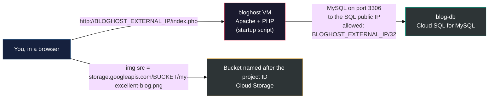
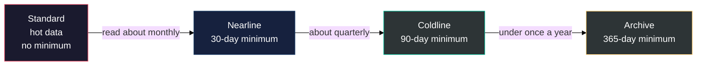
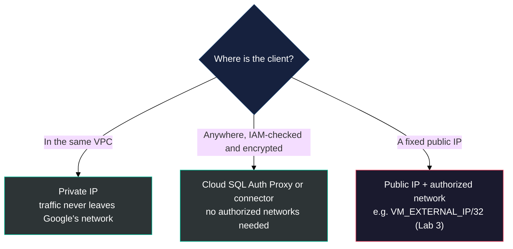
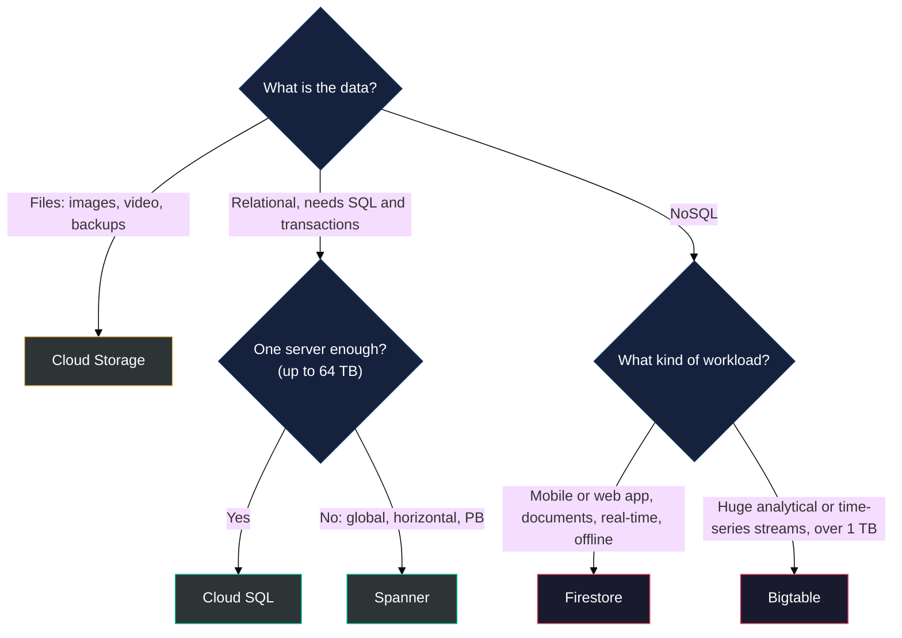

# Lab 3 Study Notes: M4 Storage in the Cloud

### Cloud Storage, Cloud SQL, Spanner, Firestore and Bigtable, condensed for Lab 3 and the ACE exam

> **As of:** 2026-10-19 · **Sources:** the M4 `_v2.md` study guide in [modules/](../modules/M4_Storage_in_the_Cloud/M4_Storage_in_the_Cloud_v2.md) and the [Lab 3 manual](../labs/03_Storage_and_Cloud_SQL.md) · **Synced with:** the Claude Doc of the same name, https://claude.ai/code/artifact/4a079069-fa0a-4dba-87a0-a738ba77e75d

---

## Table of Contents

- [PART 0 — What Lab 3 covers](#part-0)
- [What each service does (M4)](#part-roles)
- [PART 1 — Cloud Storage (≈ S3)](#part-1)
  - [1.1 Objects, buckets and locations](#part-1-1)
  - [1.2 Storage classes](#part-1-2)
  - [1.3 Versioning, lifecycle rules and Autoclass](#part-1-3)
  - [1.4 Access control: IAM, ACLs and public objects](#part-1-4)
  - [1.5 Encryption and getting data in](#part-1-5)
- [PART 2 — Cloud SQL (≈ RDS Postgres)](#part-2)
  - [2.1 What Google manages for you](#part-2-1)
  - [2.2 How a client connects](#part-2-2)
- [PART 3 — Spanner, Firestore and Bigtable](#part-3)
  - [3.1 Spanner](#part-3-1)
  - [3.2 Firestore (≈ DynamoDB)](#part-3-2)
  - [3.3 Bigtable](#part-3-3)
  - [3.4 Where BigQuery fits](#part-3-4)
- [PART 4 — Which storage do I pick?](#part-4)
- [PART 5 — The lab's shortcuts vs how you'd do it properly](#part-5)
- [PART 6 — M4 self-check quiz](#part-6)
- [PART 7 — Bridge to Lab 3: Cloud Storage and Cloud SQL](#part-7)
  - [7.1 What each step teaches](#part-7-1)
  - [7.2 Checklist](#part-7-2)
  - [7.3 Expected results and fixes](#part-7-3)
  - [7.4 The commands, explained, and the Console route](#part-7-4)
  - [7.5 Cloud Shell, Git Bash and the bloghost SSH window](#part-7-5)
- [PART 8 — Grill log: slips and the reasoning behind them](#part-8)
  - [8.1 Deep dives on the slips](#part-8-1)
  - [8.2 Picking a class when you read the data](#part-8-2)
  - [8.3 Grill round 1: pick the letter](#part-8-3)

---

<a id="part-0"></a>
## PART 0 — What Lab 3 covers

Lab 3 builds a tiny blog: a Compute Engine VM runs Apache and PHP, reads from a Cloud SQL MySQL database, and shows a banner image served from a Cloud Storage bucket.



Note that the image never passes through the VM: the page only holds its URL, and your browser fetches it straight from Cloud Storage.

Everything below keeps what Lab 3 or the Associate Cloud Engineer (ACE) exam needs. **Cut:** agenda slides, marketing ("$400B"), and the client tool names (Toad, SQL Workbench). **Kept:** storage classes with their minimum durations, access control, Cloud SQL limits and connection options, and the "which storage do I pick" comparison. Spanner, Firestore and Bigtable never appear in the lab, but the exam asks about them often.

> [!IMPORTANT]
> **Lessons that carry over:** from Lab 1, if a step fails with a permission error right after an API was enabled, wait a minute or two and retry. From Lab 2, traffic to a public IP arrives from the sender's **external** IP, which is why Cloud SQL must allow `bloghost`'s external IP, not its internal one.

---

<a id="part-roles"></a>
## What each service does (M4)

**≈ AWS** appears only where it matches a service you already know: S3, RDS Postgres or DynamoDB.

| Service | Role it plays | Familiar? |
| :--- | :--- | :--- |
| **Cloud Storage** | Stores files ("objects") of any size in buckets, reached by URL. Backups, media, website files, data for other services. Used in Lab 3 | ≈ **S3** |
| **Cloud SQL** | A managed relational database (MySQL, PostgreSQL or SQL Server). Google patches, backs up and replicates it; you use it like a normal database. Used in Lab 3 | ≈ **RDS Postgres** |
| **Spanner** | A relational SQL database that scales **horizontally**, across zones and regions, with strong consistency. For when one Cloud SQL server is not enough | Like RDS, but it grows by adding nodes |
| **Firestore** | A serverless NoSQL **document** database for mobile and web apps, with real-time sync and offline support | ≈ **DynamoDB** |
| **Bigtable** | A NoSQL **wide-column** database for huge, fast streams of data (IoT, time series, finance, ad tech), more than 1 TB | NoSQL like DynamoDB, but built for analytics at scale |
| **BigQuery** | A data warehouse for SQL analytics over huge datasets. Covered in other courses; not a storage choice in M4 | |

> **Key Idea:** M4 is one question asked five ways: *what shape is my data, and how big will it get?* Files go to Cloud Storage, relational data to Cloud SQL or Spanner, and NoSQL data to Firestore or Bigtable.

---

<a id="part-1"></a>
## PART 1 — Cloud Storage (≈ S3)

Cloud Storage is Google's **object storage**: you store whole files with their metadata under a unique name, and read them back by URL.

<a id="part-1-1"></a>
### 1.1 Objects, buckets and locations

| Storage type | How data is kept | Google Cloud example |
| :--- | :--- | :--- |
| **File** | Folders and files in a hierarchy | Filestore |
| **Block** | Raw chunks of a disk, used by an OS | Persistent Disk (a VM's boot disk) |
| **Object** | Whole objects: the data, its metadata and a unique key (a URL) | **Cloud Storage** |

- **Bucket:** the container for objects. Its name must be **globally unique** across all of Google Cloud, which is why the lab names it after your project ID. A bucket also has a **location**, fixed at creation.
- **Location types:** a **region** (one region, lowest latency for users there), a **dual-region**, or a **multi-region** (`US`, `EU`, `ASIA`). Dual-region and multi-region store copies in separate places (geo-redundancy). Lab 3 uses a multi-region: pick the one nearest the lab's region.
- **Objects are immutable.** You never edit an object in place: an upload with the same name replaces it with a new version.
- **Size:** no minimum object size, up to **5 TB per object**, and no limit on the bucket.
- **Durability** is 99.999999999% ("eleven nines") in every class. What changes with location is availability.
- "Folders" in the console are only name prefixes (`images/a.png`). Cloud Storage is not a file system, though tools such as Cloud Storage FUSE can mount a bucket like one.

> **Where you meet this in Lab 3:** Task 3 creates the bucket with `gcloud storage buckets create -l $LOCATION gs://$DEVSHELL_PROJECT_ID`.

<a id="part-1-2"></a>
### 1.2 Storage classes



| Class | Access pattern | Minimum storage duration | Typical use |
| :--- | :--- | :--- | :--- |
| **Standard** | Frequent ("hot"), or kept only briefly | None | Website content, streaming, working data |
| **Nearline** | About once a month or less | 30 days | Backups, long-tail media |
| **Coldline** | About once a quarter or less | 90 days | Disaster recovery copies |
| **Archive** | Less than once a year | 365 days | Regulatory archives |

The trade-off is always the same: the colder the class, the **cheaper it is to store** a GB per month and the **more it costs to read** it back (a retrieval fee per GB). Deleting an object before its minimum duration is charged as if it stayed the full period.

**Common to all four classes:** unlimited storage, worldwide access, low latency (Archive is not slow to read, only expensive), eleven-nines durability, and the same API, tools and security. That last point is why a quiz answer saying a class "is more secure" or "has a faster API" is always wrong.

> **Where you meet this in Lab 3:** the lab bucket uses the default, **Standard**, because a blog banner is read on every page view.

<a id="part-1-3"></a>
### 1.3 Versioning, lifecycle rules and Autoclass

- **Object Versioning (off by default):** when on, an overwrite or delete keeps the old copy as a **noncurrent version**. You can list versions, restore one, or delete one for good. When off, a new upload simply replaces the old object.
- **Lifecycle rules:** the bucket acts on objects for you. The two actions are **Delete** and **SetStorageClass**, triggered by conditions such as age, creation date or number of newer versions. The course's examples: delete objects older than 365 days, delete objects created before 1 January 2013, or keep only the 3 newest versions.
- **Autoclass:** moves each object to a colder class when it isn't read and back to Standard when it is, per object. Use it when you can't predict the access pattern; use lifecycle rules when you can.

> **Where you meet this in Lab 3:** nowhere. The lab doesn't turn these on, but they are common exam questions on cutting storage cost.

<a id="part-1-4"></a>
### 1.4 Access control: IAM, ACLs and public objects

| Mechanism | Granularity | Use it when |
| :--- | :--- | :--- |
| **IAM roles** | Project or bucket, inherited down to the objects | Almost always. Example: `roles/storage.objectViewer` on the bucket |
| **ACLs** (access control lists) | One object at a time. Each entry is a **scope** (who) plus a **permission** (READER, WRITER, OWNER) | Only when one object needs different access from its neighbours |
| **Signed URL** | One object, one link, for a limited time | Give someone without a Google account temporary access |

- **Uniform bucket-level access** turns ACLs off for a bucket so that only IAM applies. Google recommends it, and buckets created in the console use it by default. The other setting, **fine-grained**, keeps ACLs on.
- **Public access:** the special principal `allUsers` means anyone on the internet. Granting it read access makes an object reachable at `https://storage.googleapis.com/BUCKET/OBJECT`. **Public access prevention**, a bucket setting or an organization policy, blocks this entirely.

> **Where you meet this in Lab 3:** Task 3's `gsutil acl ch -u allUsers:R gs://$DEVSHELL_PROJECT_ID/my-excellent-blog.png` adds an ACL entry saying that `allUsers` (`-u`) gets Read (`:R`) on that one object. It works because a bucket created with `gcloud storage buckets create` and no extra flags keeps fine-grained access. [Part 5](#part-5) covers how you'd make the image public in a real project.

#### ACL vs IAM in detail

An **ACL** is a short list attached to one bucket or one object. Each entry is a **scope** (who) plus a **permission** (what). An **IAM** rule says "this member has this role on this resource", and it inherits downward from organization to folder, project, bucket and object.

| | ACL | IAM |
| :--- | :--- | :--- |
| Where it applies | One bucket or one object | Organization, folder, project or bucket, inherited downward |
| Who can be named | A user, a group, a domain, `allUsers`, `allAuthenticatedUsers` | Users, groups, service accounts, domains, `allUsers`, `allAuthenticatedUsers` |
| What it grants | 3 fixed permissions: `READER`, `WRITER`, `OWNER` | Hundreds of roles, plus conditions such as an expiry time |
| Works for | Cloud Storage only | Every Google Cloud service |
| Review and audit | Object by object, hard at scale | One place, with audit logs |
| Google's advice | Legacy: only for a one-off exception | The default for almost everything |

**Example, the same goal both ways:** "everyone on the internet may read `my-excellent-blog.png`".

- **ACL (the lab):** `gsutil acl ch -u allUsers:R gs://BUCKET/my-excellent-blog.png`. One entry on one object.
- **IAM:** grant `allUsers` the role `roles/storage.objectViewer` on the bucket. Every object in the bucket becomes public, so keep that bucket for public files only.
- **IAM, for one person:** grant a teammate `roles/storage.objectViewer` on the project, and they can read every object in every bucket, with no per-object setup.

**What happens when both apply: who wins?** Nobody wins, because access is **additive**:

| Situation | Result |
| :--- | :--- |
| IAM allows, ACL says nothing | ✅ Allowed |
| ACL allows, IAM says nothing | ✅ Allowed |
| Both allow | ✅ Allowed |
| Neither allows | ❌ Denied (the default) |
| ACL "denies"? | Not possible: an ACL can only grant, so there is no entry that denies |

A request is allowed if **any** one of them grants it. The consequence for security: removing a permission in IAM does not close access that an ACL still grants, so you must check both. These settings do override everything else:

- **Uniform bucket-level access** switches ACLs off for the bucket. Only IAM counts, which makes the picture simple. A bucket with ACLs on is called **fine-grained**.
- **Public access prevention** blocks `allUsers` and `allAuthenticatedUsers`, whether the grant comes from an ACL or from IAM.

> **Exam rule:** if a question asks how to control access to Cloud Storage, answer IAM, and uniform bucket-level access if it mentions turning ACLs off. Recognise ACLs in two cases: a question about access to a single object on a bucket where ACLs are still on, and `allUsers` in a command like the lab's.

<a id="part-1-5"></a>
### 1.5 Encryption and getting data in

- **Encryption at rest is always on**, at no extra cost: Google encrypts data on the server before writing it to disk. Data in transit between you and Google uses HTTPS/TLS. If you need to control the key, the options are a key you manage in Cloud KMS (**CMEK**), or a key you supply with each request (**CSEK**).
- **Pricing:** no minimum fee and nothing to provision; you pay for storage used, operations, retrieval (in the colder classes) and network egress.
- **Getting data in:**

| Amount and source | Tool |
| :--- | :--- |
| Files from your machine or Cloud Shell | `gcloud storage cp`, or drag and drop in the console |
| Terabytes online, from another cloud, another bucket or an HTTP(S) source, scheduled | **Storage Transfer Service** |
| Petabytes, offline: a server you lease, fill and ship back | **Transfer Appliance** (up to 1 PB each) |

- **Integrations:** Cloud SQL and BigQuery import and export tables through Cloud Storage. Compute Engine startup scripts and images, and App Engine logs and assets, can live there too.

> **Where you meet this in Lab 3:** both `gcloud storage cp` lines in Task 3. The first downloads the banner from Google's public `cloud-training` bucket into **Cloud Shell's own disk**, and the second uploads it from there into your bucket. Cloud Shell is a terminal that lives in Google Cloud, not on your computer, so the file never touches your laptop. [7.5](#part-7-5) explains what Cloud Shell is and how it differs from Git Bash.

---

<a id="part-2"></a>
## PART 2 — Cloud SQL (≈ RDS Postgres)

Cloud SQL runs **MySQL, PostgreSQL or SQL Server** for you. It's the same idea as RDS: you get a database endpoint, and Google runs the server underneath.

<a id="part-2-1"></a>
### 2.1 What Google manages for you

- **The chores Google takes over:** installing, patching and updating the database, managed backups, and replication.
- **Limits:** up to **128 vCPUs, 864 GB of RAM and 64 TB of storage** per instance. It scales **vertically**, meaning a bigger machine. **Read replicas** spread read traffic, but writes always go to the one primary.
- **Backups:** automated and on-demand backups. The instance price **covers 7 backups**. Point-in-time recovery uses the binary logs to restore to a moment between backups.
- **High availability:** a **regional** instance keeps a standby in a second zone and fails over automatically. A **single zone** instance, as in the lab, has no standby.
- **Security:** data is encrypted on Google's internal network, in tables, in temporary files and in backups. Each instance has its own network firewall: nothing can connect until you authorize it.
- **Editions:** Enterprise and Enterprise Plus (faster and with a higher SLA). The lab uses Enterprise with the **Sandbox** preset, the smallest and cheapest configuration.

<a id="part-2-2"></a>
### 2.2 How a client connects



| Option | How it works | When |
| :--- | :--- | :--- |
| **Public IP + authorized networks** | The instance gets a public IP, and you list the CIDR ranges allowed to connect. A `/32` is exactly one address | Labs, or a client with a fixed IP. Turn SSL on in real use |
| **Private IP** | The instance gets an internal IP inside your VPC, through private services access | Production apps on Compute Engine, GKE or Cloud Run in the same VPC |
| **Cloud SQL Auth Proxy, connectors** | A small client checks your IAM permission and opens an encrypted tunnel; no IP list to maintain | Recommended whenever you can install it |

- Put the database in the **same region, ideally the same zone, as the app**: every query crosses that gap, so distance adds latency to each one.
- Any app with a standard MySQL driver can connect, PHP's PDO in the lab included.

> **Where you meet this in Lab 3:** Task 4 creates `blog-db` with a public IP, adds user `blogdbuser`, and authorizes `BLOGHOST_EXTERNAL_IP/32` as the network "web front end". It must be the **external** IP: `bloghost` reaches the SQL public IP over the internet path, so its packets arrive from its external address (the same Lab 2 lesson). Task 5's `index.php` then connects with `new PDO("mysql:host=CLOUDSQLIP;dbname=mysql", ...)`.

---

<a id="part-3"></a>
## PART 3 — Spanner, Firestore and Bigtable

You won't meet any of these in Lab 3. Learn each one's niche and the keywords that point to it, because that is what the exam tests.

<a id="part-3-1"></a>
### 3.1 Spanner

- A fully managed **relational** database that **scales horizontally**: add nodes and it grows to petabytes, across zones or across regions.
- **Strongly (externally) consistent** worldwide, with SQL, joins and secondary indexes, and up to **99.999% availability** in multi-region configurations.
- **Pick it when** the question says relational or SQL **and** global, horizontal scale, petabytes, or tens of thousands of reads and writes per second. It's the next step when Cloud SQL's 64 TB or single primary is not enough.

<a id="part-3-2"></a>
### 3.2 Firestore (≈ DynamoDB)

- A serverless, horizontally scaling **NoSQL document** database for **mobile, web and server** apps.
- **Data model:** **documents** of key-value pairs (which can hold nested objects) grouped into **collections**, and a document can hold **subcollections**. Each document can be up to 1 MB.
- **Queries** can chain filters and sort. Every query is indexed, so its speed depends on the size of the **result**, not of the dataset.
- **Offline and real-time sync:** the app caches the data it uses, keeps reading and writing offline, and syncs changes when it reconnects. Connected devices get updates as they happen.
- Behind it: automatic multi-region replication, strong consistency, atomic batch operations and transactions.
- **Pick it when** the question says mobile or web app, real-time updates, offline, or a flexible schema.

<a id="part-3-3"></a>
### 3.3 Bigtable

- Google's **NoSQL wide-column** big-data database, the one behind Search, Analytics, Maps and Gmail. It offers consistent low latency at very high throughput.
- **Pick it when** you see more than **1 TB**, fast or rapidly changing data, **time series** or data with a natural order, **IoT**, financial or ad-tech data, or machine learning on the data.
- **It is not SQL:** no SQL queries and no multi-row transactions. Each row is looked up by its **row key**, so designing that key well is how you get fast reads. Limits are 10 MB per cell and 100 MB per row.
- **Data in and out:** through APIs (the HBase client, the HBase REST server), streaming (Dataflow, Spark Streaming, Storm), or batch jobs (Hadoop MapReduce, Dataflow, Spark).

<a id="part-3-4"></a>
### 3.4 Where BigQuery fits

BigQuery isn't in M4's comparison because it is a **data warehouse**: you put data there to run SQL analytics over it, not to serve an app. If a question says "analytics", "data warehouse" or "SQL over petabytes for reports", answer BigQuery. If it says "serve users with low-latency reads and writes", it's one of the five M4 services.

---

<a id="part-4"></a>
## PART 4 — Which storage do I pick?



| Service | Type | Best for | Capacity | Max unit size | Keywords in a question |
| :--- | :--- | :--- | :--- | :--- | :--- |
| **Cloud Storage** | Object | Immutable blobs over 10 MB: images, movies, backups | Petabytes | 5 TB per object | files, media, archive, backup, static website |
| **Cloud SQL** | Relational | Full SQL for online transactions (OLTP); web frameworks and existing apps (user accounts, orders) | Up to 64 TB | | MySQL, PostgreSQL, SQL Server, lift and shift |
| **Spanner** | Relational | Full SQL for OLTP **plus horizontal scale** | Petabytes | | global, horizontally scalable, strong consistency, 99.999% |
| **Firestore** | NoSQL document | Massive scale with real-time queries and offline support, for mobile and web apps | Terabytes | 1 MB per document | mobile, real-time sync, offline |
| **Bigtable** | NoSQL wide-column | Lots of structured objects, heavy reads and writes, analytics. No SQL, no multi-row transactions | Petabytes | 10 MB per cell, 100 MB per row | IoT, time series, ad tech, financial, HBase |

> **Key Idea:** read the question for two things: **does it need SQL?** and **how big, and how global?** Those two answers pick the service in nearly every case. One app can use several of them, as the lab does with Cloud SQL and Cloud Storage.

---

<a id="part-5"></a>
## PART 5 — The lab's shortcuts vs how you'd do it properly

The lab manual itself flags three shortcuts. Follow the lab exactly as written, because its checks expect these steps; just know what a real project does instead, since the exam asks for that version.

| Where in the manual | What the lab does | Why the lab does it | The proper way (exam answer) |
| :--- | :--- | :--- | :--- |
| **Task 3**, last step | `gsutil acl ch -u allUsers:R ...` makes one object public through an ACL | One command, no IAM setup, and it shows ACLs exist | Turn on **uniform bucket-level access** and grant `allUsers` the role `roles/storage.objectViewer` on a bucket kept only for public files, or give a **signed URL** if access should be temporary. For heavy traffic, put Cloud CDN in front. Also, `gsutil` is the legacy tool, and `gcloud storage` is its replacement |
| **Task 4**, Security | "Allow unencrypted network traffic (**not recommended**)" and a **public IP** with an authorized network `/32` | The PHP page connects with no SSL certificate, so the lab stays short | **Private IP** in the app's VPC, or the **Cloud SQL Auth Proxy** (IAM check plus an encrypted tunnel). If you need a public IP, require SSL/TLS |
| **Task 5**, the PHP comment | The database password sits in `index.php`, inside the web root | Keeps the lab to one file | Keep the password in **Secret Manager** and have the VM's service account read it at runtime, or use IAM database authentication and have no password at all |

> [!WARNING]
> In Task 4, authorize `bloghost`'s **external** IP followed by `/32`. Its internal IP, or the sample `35.192.208.2`, will leave the page stuck on "Database connection failed".

---

<a id="part-6"></a>
## PART 6 — M4 self-check quiz

Q1 to Q3 are the course's own module quiz.

<details>
<summary><strong>Q1.</strong> Which use case suits Cloud Storage best: a VM's root file system, unstructured data needing high durability and availability, an enterprise data warehouse, or a transactional RDBMS?</summary>

Unstructured data needing high durability and availability. A VM boots from Persistent Disk or Hyperdisk, which are block storage; the data warehouse is BigQuery; and transactional relational databases are Cloud SQL or Spanner.

</details>

<details>
<summary><strong>Q2.</strong> A company needs a relational database that scales horizontally to petabytes while staying highly available. Spanner, Cloud SQL, Bigtable or Firestore?</summary>

Spanner. Cloud SQL scales vertically and caps at 64 TB, and Bigtable and Firestore are NoSQL.

</details>

<details>
<summary><strong>Q3.</strong> What is the main reason to choose Coldline?</summary>

To keep monthly storage cost low for data read less than once a quarter. Coldline isn't more secure, and doesn't use a faster API: every class shares the same security and API. And it's a bad choice for frequently read data, because of its retrieval fees.

</details>

<details>
<summary><strong>Q4.</strong> Why does the lab name the bucket after the project ID?</summary>

Bucket names must be globally unique across all of Google Cloud, and a project ID already is.

</details>

<details>
<summary><strong>Q5.</strong> You put backups in Archive and delete them after 60 days. What do you pay for?</summary>

The full 365-day minimum storage duration: deleting early is charged as if the object stayed the whole year. With a 60-day life, Nearline (30-day minimum) is the better fit.

</details>

<details>
<summary><strong>Q6.</strong> Logs must move to Coldline after 90 days and be deleted after a year, with no one doing it by hand. Which feature?</summary>

A lifecycle rule with two actions: SetStorageClass to Coldline at age 90 days, and Delete at age 365 days. Autoclass is for unpredictable access; here the schedule is known.

</details>

<details>
<summary><strong>Q7.</strong> Someone overwrote an important object. What would have let you get the old copy back?</summary>

Object Versioning on the bucket. The overwrite would have kept the old copy as a noncurrent version, which you could restore.

</details>

<details>
<summary><strong>Q8.</strong> In Lab 3, why does <code>gsutil acl ch</code> work on your bucket, and when would it fail?</summary>

The bucket was created with <code>gcloud storage buckets create</code> and no extra flags, so it uses fine-grained access and ACLs apply. It fails if uniform bucket-level access is on, since that turns ACLs off, or if public access prevention blocks <code>allUsers</code>.

</details>

<details>
<summary><strong>Q9.</strong> A contractor without a Google account needs to download one file for the next 2 hours. What do you give them?</summary>

A signed URL that expires after 2 hours. No IAM change, and the object doesn't become public.

</details>

<details>
<summary><strong>Q10.</strong> Why does Lab 3 authorize <code>bloghost</code>'s external IP, and not its internal IP, on <code>blog-db</code>?</summary>

The VM connects to the database's public IP, so the connection leaves through the VM's external address and arrives from it. The internal <code>10.x</code> address is never what Cloud SQL sees on that path. Private IP would be the way to connect internally.

</details>

<details>
<summary><strong>Q11.</strong> A mobile app needs data that syncs between users' phones in real time and keeps working offline. Which database?</summary>

Firestore.

</details>

<details>
<summary><strong>Q12.</strong> Millions of IoT sensors write readings every second (many TB), and dashboards read recent values by sensor and time. Which database?</summary>

Bigtable: time series, high throughput, more than 1 TB, read by row key (sensor ID plus time). It has no SQL or multi-row transactions, which this workload doesn't need.

</details>

<details>
<summary><strong>Q13.</strong> You must move 2 PB from your data centre to Cloud Storage, and your link would take months. Which tool?</summary>

Transfer Appliance: lease it, fill it, ship it back. Storage Transfer Service is for online transfers, such as from another cloud or an HTTP source.

</details>

<details>
<summary><strong>Q14.</strong> An object's ACL gives <code>allUsers</code> read access, but nothing in IAM grants it. Can anyone on the internet read it? What if the bucket has uniform bucket-level access on?</summary>

Yes on a fine-grained bucket: access is additive, so any one grant is enough and an ACL alone allows it. With uniform bucket-level access on, ACLs are ignored, so only IAM counts and the object is not readable. Public access prevention would block it either way.

</details>

<details>
<summary><strong>Q15.</strong> In Task 3 you run <code>gcloud storage cp</code> in a terminal. Where does <code>my-excellent-blog.png</code> end up after the first copy?</summary>

In Cloud Shell's home directory, on a small Linux VM in Google Cloud, not on your computer. The second copy uploads it from there into your bucket.

</details>

---

<a id="part-7"></a>
## PART 7 — Bridge to Lab 3: Cloud Storage and Cloud SQL

About 45 minutes plus the wait for Cloud SQL, all in the Console except Task 3 (Cloud Shell). The lab shows you its region and zone: use the same ones for `bloghost` and `blog-db`.

<a id="part-7-1"></a>
### 7.1 What each step teaches

| In the lab you... | The theory behind it |
| :--- | :--- |
| Create `bloghost` with a **startup script** and **Allow HTTP traffic** | The script runs as root at boot and installs Apache and PHP. The checkbox adds the `http-server` network tag, which a firewall rule allowing `tcp:80` matches (Lab 2's tags) |
| Note both of the VM's IPs | You need the **external** one for Cloud SQL and for the browser |
| Create a bucket named after the project ID, in `US`, `EU` or `ASIA` | Globally unique names, multi-region location ([1.1](#part-1-1)) |
| `gcloud storage cp` twice | Download from a public bucket, upload to yours ([1.5](#part-1-5)) |
| `gsutil acl ch -u allUsers:R` | A per-object ACL makes one object public ([1.4](#part-1-4), [Part 5](#part-5)) |
| Create `blog-db`: MySQL, Enterprise, Sandbox, single zone, same zone as the VM | Managed MySQL, no HA standby, kept close to the app ([2.1](#part-2-1), [2.2](#part-2-2)) |
| Add the user `blogdbuser` and the authorized network `BLOGHOST_EXTERNAL_IP/32` | Cloud SQL's firewall allows no one until you list them ([2.2](#part-2-2)) |
| See "Database connection failed", then fill in the IP and password and get "Connected successfully" | The app, not the lab, holds the connection settings ([Part 5](#part-5)) |
| Add `` | The browser fetches the object straight from Cloud Storage by its public URL |

<a id="part-7-2"></a>
### 7.2 Checklist

- [ ] Read this M4 section and the lab manual
- [ ] Start the lab, open the console in an incognito window with the lab student account
- [ ] Task 2: Compute Engine > VM instances > Create instance: name `bloghost`, the lab's region and zone, `e2-standard-2`
- [ ] Task 2: OS and storage: Debian GNU/Linux 12 (bookworm); Networking: tick **Allow HTTP traffic**
- [ ] Task 2: Advanced > Automation > **Startup script** (the right field), paste the script, Create
- [ ] Task 2: note `bloghost`'s internal and external IP, then Check my progress
- [ ] Task 3: open Cloud Shell, `export LOCATION=` the multi-region nearest the lab region, create the bucket, copy the image down and up, run the ACL command, then Check my progress
- [ ] Task 4: Cloud SQL > Create instance > MySQL > **Enterprise**, preset **Sandbox**, ID `blog-db`, password `Passw0rd1!`, the lab's region, Single zone, primary zone = `bloghost`'s zone
- [ ] Task 4: Show configuration options > Security > **Allow unencrypted network traffic**, Create instance, then wait a few minutes
- [ ] Task 4: copy the SQL **Public IP address**; Users > Add user account `blogdbuser` / `Passw0rd1!`, wait until it's created
- [ ] Task 4: Connections > Networking > Add a network: name `web front end`, network `BLOGHOST_EXTERNAL_IP/32`, Done, **Save** (if "Another operation is in progress", wait), then Check my progress
- [ ] Task 5: SSH to `bloghost`, `cd /var/www/html`, `sudo nano index.php`, paste the PHP, save, `sudo service apache2 restart`
- [ ] Task 5: open `http://BLOGHOST_EXTERNAL_IP/index.php` and see "Database connection failed"
- [ ] Task 5: edit again, replace `CLOUDSQLIP` with the SQL public IP and `DBPASSWORD` with `Passw0rd1!` (keep the quotes), restart Apache, reload and see "Connected successfully"
- [ ] Task 6: Cloud Storage > Buckets > your bucket > copy the object's **Public link**
- [ ] Task 6: edit `index.php`, add `` on a new line just above the `<h1>` line, restart Apache, reload and see the banner
- [ ] All checks green, End Lab

<a id="part-7-3"></a>
### 7.3 Expected results and fixes

| Moment | You should see | If not |
| :--- | :--- | :--- |
| Right after creating `bloghost` | The VM running, with an external IP | Wait for the startup script, since installing Apache takes a minute or two |
| After the ACL command | The object's Public access column shows a link | Refresh the page. If there's still no link, rerun the command and read its error. "Uniform bucket-level access" in the error means the bucket wasn't created with the lab's command |
| Saving the authorized network | A green check on `blog-db` | "Another operation is in progress": wait for the instance or user creation to finish, then Save again |
| First page load | `Database connection failed: ...` | That's expected, since the placeholders aren't filled in yet. If the page doesn't load at all, check you used `http://` and the **external** IP, and that Allow HTTP was ticked |
| After filling in the IP and password | `Connected successfully` | Check the SQL **public** IP, the password (quotes kept), that the authorized network is the VM's external IP with `/32`, that unencrypted traffic is allowed, and that you restarted Apache |
| After adding the image | The banner above the heading | Use the URL from your own bucket, not the sample one, and keep both quote marks and the closing `>` |

> [!TIP]
> Start Cloud SQL (Task 4) as soon as you have `bloghost`'s external IP: it's the slowest step, and you can do Task 3 in Cloud Shell while it creates.

<a id="part-7-4"></a>
### 7.4 The commands, explained, and the Console route

**Method:** do everything in the **Console** wherever the lab lets you. Only Task 3 asks for commands, because the banner image sits in a Google bucket you copy from, and a command is the easiest way to do that copy. Here is each one, piece by piece.

**Reading any `gcloud` command.** They all follow the same pattern: `gcloud` (the tool), then a *what* (a group such as `storage` or `sql`), then a *noun* (`buckets`, `instances`), then a *verb* (`create`, `list`, `describe`), then the *target* and any `--flags` that change how it behaves. So `gcloud storage buckets create` reads as "tool, storage, buckets, create".

**Task 3, line by line** (pick `US`, `EU` or `ASIA`, whichever is nearest the lab region):

```bash
export LOCATION=US
gcloud storage buckets create -l $LOCATION gs://$DEVSHELL_PROJECT_ID
gcloud storage cp gs://cloud-training/gcpfci/my-excellent-blog.png my-excellent-blog.png
gcloud storage cp my-excellent-blog.png gs://$DEVSHELL_PROJECT_ID/my-excellent-blog.png
gsutil acl ch -u allUsers:R gs://$DEVSHELL_PROJECT_ID/my-excellent-blog.png
```

| Piece | What it means | Console equivalent |
| :--- | :--- | :--- |
| `export LOCATION=US` | Saves the word `US` in a variable called `LOCATION`, so you can write `$LOCATION` below instead of retyping it. `export` makes the variable available to the commands that follow | Nothing: the Console asks you in a dropdown |
| `gcloud storage buckets create` | Create a bucket | Cloud Storage > Buckets > **Create** |
| `-l $LOCATION` | `-l` is short for "location". The bucket goes in `US` | The Location type "Multi-region" and the choice `US` |
| `gs://` | The prefix that means "this is a Cloud Storage path", like `https://` for web pages | Not needed |
| `$DEVSHELL_PROJECT_ID` | A variable Cloud Shell already filled in with your project ID. The bucket gets that name because bucket names must be globally unique | You type the project ID as the name |
| `gcloud storage cp SOURCE DESTINATION` | **C**o**p**y. The first argument is where from, the second is where to | Upload / Download buttons |
| `gs://cloud-training/gcpfci/my-excellent-blog.png` | The image in Google's public training bucket (the source) | Not possible from the Console without downloading to your computer first |
| `my-excellent-blog.png` (as destination) | A file in the current folder of Cloud Shell | Not applicable |
| `gsutil acl ch -u allUsers:R ...` | `gsutil` is the older storage tool. `acl` means work with access control lists, `ch` means change. `-u` adds an entry for a user or group, and `allUsers:R` means "everyone, with Read permission". The last part is the object it applies to | Bucket > the object's `⋮` menu > **Edit access** > Add entry > `allUsers` > Reader. Only visible when the bucket is fine-grained |

> **Remember:** `gsutil` is the older tool and `gcloud storage` is its replacement. The lab still uses `gsutil` for the ACL line, and that is fine.

**Console route for Task 3 if you wanted it:** Cloud Storage > Buckets > Create > name = your project ID > Location type Multi-region, `US` > keep the defaults, but under "Choose how to control access to objects" pick **Fine-grained** if the Console offers it, since the ACL step needs it > Create > Upload files. The only snag is that the image is not on your computer, which is why the lab uses a command to copy it from Google's bucket.

**The optional checks, explained.** Only run these if something looks wrong:

| Command | What it does |
| :--- | :--- |
| `gcloud compute instances list` | Lists the VMs in the project and shows their IPs. Console: Compute Engine > VM instances |
| `gcloud storage ls -L gs://$DEVSHELL_PROJECT_ID/my-excellent-blog.png` | `ls` lists, `-L` means long format with all details of the object, including its size and class. Console: click the object in the bucket |
| `gcloud sql instances list` | Lists Cloud SQL instances and their status. Console: SQL page |
| `gcloud sql instances describe blog-db --format="value(...)"` | Shows the details of `blog-db`. `--format` picks just the fields we want, here the IP and the authorized networks. Console: the instance's Overview and Connections pages |
| `gcloud sql users list --instance=blog-db` | Lists the database users, so you can check `blogdbuser` exists. Console: instance > Users |
| `curl -s http://BLOGHOST_EXTERNAL_IP/index.php` | `curl` fetches a web page and prints it as text, like a browser without the graphics. `-s` means silent: no progress bar. Your browser does this job better |

On `bloghost`, if the page doesn't load:

| Command | What it does |
| :--- | :--- |
| `sudo systemctl status apache2 --no-pager` | `sudo` runs it as administrator, `systemctl status` asks Linux if a service is running, and `apache2` is the web server. `--no-pager` stops the output waiting for a keypress |
| `sudo journalctl -u google-startup-scripts --no-pager \| tail -20` | `journalctl` reads the system log, `-u` picks one service (the one that ran your startup script). `\| tail -20` passes the output to `tail`, which keeps only the last 20 lines. Console: VM instance > Logs |

Prompt to paste into the Gemini CLI agent before running anything:

```text
I'm doing Google Cloud Skills Boost lab "Getting Started with Cloud Storage and Cloud SQL" in Cloud Shell.
Lab region: <REGION>; zone: <ZONE>; project: <PROJECT_ID>; bloghost external IP: <IP>.
Check these commands against labs/03_Storage_and_Cloud_SQL.md in this repo.
Replace placeholders with my values, flag anything that won't work in
Cloud Shell, and explain in one line what each command does.
Do not run anything yourself.

<PASTE COMMANDS>
```

<a id="part-7-5"></a>
### 7.5 Cloud Shell, Git Bash and the bloghost SSH window

Lab 3 uses **two different terminals**. Mixing them up is the easiest way to get stuck.

**What Cloud Shell is:** a Linux command line that runs on a small virtual machine Google gives you, opened inside the browser. In the console it is the `>_` icon in the top right toolbar (Activate Cloud Shell). You type into it from your browser, and the commands run on Google's machine, not on your laptop.

- **Already set up:** `gcloud`, `gsutil`, `git`, `nano`, Python and more are installed. You are already signed in as the lab student user, and `$DEVSHELL_PROJECT_ID` already holds your project ID, which is why the lab names the bucket with it.
- **Disk:** a persistent home directory of about 5 GB. Files you put in it stay. The machine itself is temporary: it stops after a period of inactivity, and a fresh one starts next time, so anything you installed elsewhere is gone.
- **Cost:** free. In this lab it's part of the lab's allowance.
- **Not your computer:** downloading in Cloud Shell does not save anything on your laptop. Use the editor or the Download option in the Cloud Shell menu if you ever need a file out.

| | Git Bash (what you used so far) | Cloud Shell |
| :--- | :--- | :--- |
| Runs on | Your Windows computer | A Google Cloud VM, in your browser |
| Shell | bash, through a Windows emulation layer | Real Linux bash (Debian) |
| Your files | Your own folders (`/c/Users/...`) | Its own small home directory |
| `gcloud` | Not installed until you install it and run `gcloud auth login` | Installed and already signed in |
| Network | Your home connection | Google's network, so copies between Google Cloud services are fast |

The commands look the same in both, because both are bash. What changes is **where they run** and **who you're signed in as**.

**The two terminals in Lab 3:**

| Task | Terminal | Where it runs | Why |
| :--- | :--- | :--- | :--- |
| Task 3: bucket, `gcloud storage cp`, ACL | **Cloud Shell** (`>_` icon) | A Google-managed VM, signed in as the lab user | It has `gcloud` and permission to create buckets |
| Task 5 and 6: edit `index.php`, restart Apache | **SSH window on `bloghost`** (Compute Engine > VM instances > SSH) | Your `bloghost` VM, where Apache lives | The web files are on that VM, not in Cloud Shell |

If `sudo service apache2 restart` says the service doesn't exist, you're in Cloud Shell and need the `bloghost` SSH window. If `gcloud storage ...` says you aren't logged in, you're on the wrong machine. The prompt shows the name: `student_...@cloudshell:~` against `...@bloghost:~`.

**What happens in Task 3, step by step:**

1. `gcloud storage cp gs://cloud-training/gcpfci/my-excellent-blog.png my-excellent-blog.png` reads from Google's public bucket and writes the file into Cloud Shell's current directory.
2. `gcloud storage cp my-excellent-blog.png gs://$DEVSHELL_PROJECT_ID/my-excellent-blog.png` reads that local file and uploads it into your bucket.

Copying bucket to bucket directly would also work. The lab goes through Cloud Shell to show both a download and an upload.

---

<a id="part-8"></a>
## PART 8 — Grill log: slips and the reasoning behind them

You flagged Q5, Q6, Q8, Q9, Q10 and Q13 as shaky on 2026-10-19. Each deep dive below starts from the reason things work that way, not from the fact, and ends with where you'd click in the Console. The grill rounds and every question with its answer are added to this part as you answer them.

<a id="part-8-1"></a>
### 8.1 Deep dives on the slips

#### 1. Why an early delete is still charged (Q5)

The colder classes make a **deal**: Google gives you a lower price per GB each month, and in return you promise to leave the data there for a minimum time.

| Class | Monthly price per GB | The promise you make |
| :--- | :--- | :--- |
| Standard | Highest | None |
| Nearline | Lower | 30 days |
| Coldline | Lower still | 90 days |
| Archive | Lowest | 365 days |

Why Google asks for it: the cheap price only works out for Google if the data stays put for a long time. If you could put a file in Archive for a day and delete it, you'd get the cheap rate without the commitment.

So deleting early doesn't cancel the deal, it just **ends it early and bills the remaining days**. An object in Archive deleted at day 60 is charged as though it lived to day 365. That is what "minimum storage duration" means.

**Worked example (Q5):** backups are kept 60 days. Archive would charge you for 365 days of storage on each, which is the wrong choice. Nearline's promise is 30 days, which fits inside the 60, so Nearline is the cheapest option that doesn't waste a commitment.

**The rule of thumb:** pick the class whose minimum is **no longer than** how long you really keep the data.

**Console:** Cloud Storage > Buckets > your bucket > **Configuration** shows the default class. Each object also has its own class in the object list.

#### 2. Lifecycle rule vs Autoclass: who decides? (Q6)

Both move data between classes so you don't pay Standard prices for old data. The difference is **who makes the decision**.

| | Lifecycle rule | Autoclass |
| :--- | :--- | :--- |
| Who decides | **You**, with a rule | **Google**, by watching each object |
| Based on | Age, creation date, number of newer versions | Whether the object was read |
| Use it when | You **know** the pattern: "logs are never read after 90 days" | You **can't predict** the pattern: some files stay hot, some go cold |

Q6 says "move to Coldline after 90 days and delete after a year", which are **fixed times you already know**. That is a lifecycle rule with two actions:

1. Condition: age 90 days → action: **Set storage class** to Coldline.
2. Condition: age 365 days → action: **Delete**.

The only two actions a lifecycle rule has are **Set storage class** and **Delete**.

**Console:** Cloud Storage > Buckets > your bucket > **Lifecycle** tab > **Add a rule** > choose the action > set the condition (Age) > Create. Autoclass is a setting on the bucket's **Configuration** tab.

#### 3. Why the lab's ACL command works, and when it wouldn't (Q8)

A bucket can be in one of two **access modes**, chosen when it's created:

- **Fine-grained:** both IAM and ACLs work.
- **Uniform:** ACLs are switched off. Only IAM counts.

The lab creates the bucket with `gcloud storage buckets create` and no extra options, so it stays **fine-grained**. That means the ACL command, which adds one entry saying `allUsers` can read this single image, is accepted.

When it would fail:

1. **Uniform bucket-level access is on.** The bucket refuses ACL changes entirely, with an error that mentions uniform access.
2. **Public access prevention is on.** It blocks `allUsers` whatever way you grant it.

**Console:** open the bucket > **Permissions** tab. It shows the access mode (Fine-grained or Uniform) and a Public access prevention setting. In a fine-grained bucket, the object's `⋮` menu > **Edit access** is the ACL screen.

See [ACL vs IAM in detail](#part-1-4) for how the two combine.

#### 4. "Anyone who gets that URL will leak it": signed URLs (Q9)

You're right, and that is exactly the trade-off. A **signed URL** works like a **hotel key card for one door**: it carries the permission inside the link itself. The server doesn't ask who you are, only whether the signature on the link is valid and not expired. So:

- **Anyone who holds the link can use it** until it expires, including someone you didn't send it to.
- You **can't take it back** by removing a person, because it isn't tied to a person.

Compare the alternatives:

| Option | Tied to a person? | If the link leaks | Needs a Google account? |
| :--- | :--- | :--- | :--- |
| **Make the object public** (`allUsers`) | No | Everyone already has it | No |
| **Signed URL** | No: tied to a link and an expiry | Whoever has the link, until it expires | **No** |
| **IAM role** for the person | **Yes** | Useless to others: they'd have to sign in as that person | **Yes** |

Q9's contractor **has no Google account**, so IAM isn't possible, and public access is too wide for one file. A signed URL is the only option that is both private and works without an account.

How to limit the risk: make the expiry as short as the job needs (2 hours in Q9), send the link over a private channel, and sign for one object only. The link is limited to what the signer is allowed to read.

**Console note:** the Console can show an **Authenticated URL** for an object, but it only works for someone signed in to a Google account that has IAM access. Creating a true signed URL needs a command or a client library, so for the exam you only need to recognise the idea: *time-limited link, no account needed, anyone with the link can use it*.

#### 5. Why Cloud SQL needs the VM's external IP (Q10)

Cloud SQL's firewall works like a guest list at the door: it checks **the address the connection came from** and lets in only the addresses on its list. So the question is what address it sees.

1. `bloghost` has two addresses: an **internal** one (`10.x.x.x`, private to your VPC) and an **external** one (public).
2. Cloud SQL, as set up in the lab, has a **public IP**. To reach a public address, `bloghost`'s traffic leaves your VPC to the internet.
3. On the way out, Google swaps the internal source address for the VM's **external** one. This is called NAT (network address translation). The internal address never leaves your VPC.
4. Cloud SQL receives the connection with source = `bloghost`'s external IP.

So the list must contain the **external** IP. Adding the internal one would allow nothing, because Cloud SQL never sees it. The `/32` means "exactly this one address".

It's the same idea as Lab 2, where the external ping arrived from the sender's external address and not from its `10.x` one.

Private IP would remove all of this: both sides sit inside the VPC and see each other's internal addresses, with no public exposure.

**Why not just use the internal address?** You can, and in production you should: that is Cloud SQL's **private IP**. It isn't the lab default because Cloud SQL does not live inside your VPC. Google runs it in its own managed network, so the VM's `10.x` address can't reach it until you set up **Private Services Access**, a one-time connection (a VPC peering) between your VPC and Google's network with a reserved address range. The lab skips that and uses the public IP plus one allowed address. Exam shorthand: "most secure way for a VM to reach Cloud SQL" means private IP.

**Console:** SQL > `blog-db` > **Connections** > **Networking** tab > **Authorized networks** > Add a network.

#### 6. Online transfer vs Transfer Appliance: do the maths (Q13)

The deciding question is simple: **how long would the upload take?** Run the numbers for Q13, 2 PB over a typical 1 Gbps link, used at full speed:

- 2 PB = 2 × 10¹⁵ bytes = 1.6 × 10¹⁶ bits.
- At 1 Gbps (10⁹ bits a second), that is 1.6 × 10⁷ seconds.
- 1.6 × 10⁷ seconds ÷ 86,400 seconds in a day ≈ **185 days**, about six months, with the link doing nothing else.

That is why the question mentions "months". At that size the fastest route is a **courier**.

| Tool | How it moves data | Pick it when |
| :--- | :--- | :--- |
| **Upload in the Console, or `gcloud storage cp`** | Over the internet from your machine | Small to medium amounts: a few GB to a few TB |
| **Storage Transfer Service** | Google pulls the data **online** from another cloud, another bucket or a web address, on a schedule | Large amounts that **can** travel over a good link, and the source is reachable online |
| **Transfer Appliance** | Google ships you a storage server (up to about 1 PB each). You fill it and ship it back, and Google loads it into your bucket | The transfer would take **weeks or months** online, or your link is slow or unreliable |

The rule of thumb: if the online transfer would take longer than about a week, ask whether a shipped appliance is quicker.

**Console:** Storage Transfer Service is in the Console under Data Transfer. Transfer Appliance is ordered through the Console's Transfer Appliance page.


<a id="part-8-2"></a>
### 8.2 Picking a class when you read the data

Q1 of the grill showed the trap: the cheapest class is not just about **storage price**. Each class has two prices, and reads decide which wins.

| Class | Storage per GB per month | Read fee per GB | Minimum days billed |
| :--- | :--- | :--- | :--- |
| Standard | about $0.020 | $0 | none |
| Nearline | about $0.010 | about $0.01 | 30 |
| Coldline | about $0.004 | about $0.02 | 90 |
| Archive | about $0.0012 | about $0.05 | 365 |

These are rough list prices to show the shape, check the pricing page for real ones.

**Example A: logs kept exactly 20 days, never read.** Nearline bills its 30-day minimum, about $0.010 per GB. Standard for 20 days costs about $0.013. Coldline bills 90 days, about $0.012. **Nearline** wins. If you read them often, Standard wins because it has no read fee.

**Example B: 100 GB read in full every 40 days, kept 4 months (3 reads).**

| Class | Storage | Reads | Total |
| :--- | :--- | :--- | :--- |
| Standard | $8.00 | $0 | $8.00 |
| Nearline | $4.00 | 3 × 100 × $0.01 = $3.00 | **$7.00** |
| Coldline | $1.60 | 3 × 100 × $0.02 = $6.00 | $7.60 |

**Nearline** wins, narrowly. Coldline saves about $0.006 per GB each month but costs $0.01 more per GB read, so it only wins if you read less often than about **every 50 days**. Reading once a quarter favours Coldline.

**How the minimum works (the "floor"):**

- **Reading never resets the clock and never triggers the minimum.** You pay the read fee each time and nothing else.
- The minimum only bites if you **delete, overwrite or move the object to another class before the minimum days are up**. You are then charged storage for the remaining days (Coldline deleted on day 40 is billed for 50 more days).
- Once past the minimum, billing is just per day kept.

**Quick guide by how often you read:**

| Read about | Class | Example |
| :--- | :--- | :--- |
| Every day or week | Standard | Website images, app uploads |
| About monthly | Nearline | Last month's logs, monthly backups |
| About quarterly | Coldline | Quarterly reports, disaster-recovery copies |
| About yearly or less, kept for years | Archive | Compliance records, old tax or medical files |
| No idea | Autoclass | Mixed files nobody can predict |

**Console:** Cloud Storage > Create a bucket > **Choose a storage class**, or tick **Autoclass** to let Google decide.

<a id="part-8-3"></a>
### 8.3 Grill round 1: pick the letter

You answered 1 to 6 on 2026-10-19 and got 5 of 6. Answers are in the dropdowns.

**Q1.** Logs kept exactly 20 days, cheapest class? A. Standard B. Nearline C. Coldline D. Archive

<details>
<summary>Answer to Q1</summary>

**B, Nearline.** You answered Standard. Standard has no minimum, which looks safe, but Nearline's 30-day minimum costs about $0.010 per GB against about $0.013 for 20 days of Standard. Coldline and Archive bill 90 and 365 days. See [8.2](#part-8-2).

</details>

**Q2.** Nobody knows which logs will still be read. What fits best? A. A lifecycle rule moving everything to Coldline after 30 days B. Autoclass C. Keep everything in Archive D. Delete after 30 days

<details>
<summary>Answer to Q2</summary>

**B, Autoclass** (you got it). A lifecycle rule needs you to know the pattern in advance, and Autoclass watches each object and moves it for you.

</details>

**Q3.** `gsutil acl ch` fails with an error mentioning "uniform access". What is going on? A. Wrong bucket name B. The bucket uses uniform bucket-level access, so ACLs are off and you grant access with IAM C. Cloud Shell lacks permission D. The object is too large

<details>
<summary>Answer to Q3</summary>

**B** (you got it). Uniform access switches ACLs off, so only IAM counts. See [8.1 item 3](#part-8-1).

</details>

**Q4.** A signed URL was emailed to the wrong person. What can they do? A. Nothing B. Use it until it expires, because the link is the key C. Use it only with a Google account D. Use it once

<details>
<summary>Answer to Q4</summary>

**B** (you got it). A signed URL is not tied to a person, so anyone holding it can use it until the expiry.

</details>

**Q5.** A VM (`10.2.0.7`, external `34.1.2.3`) connects to a Cloud SQL public IP. Which address does Cloud SQL see and which goes in the authorized network? A. `10.2.0.7` B. `34.1.2.3` C. Either D. The Cloud SQL instance's own IP

<details>
<summary>Answer to Q5</summary>

**B** (you got it). Traffic leaving for a public address is NAT-ed to the VM's external IP, so `34.1.2.3/32` goes on the list. You asked why not the internal address: that is private IP, which needs Private Services Access set up. See [8.1 item 5](#part-8-1).

</details>

**Q6.** Move 500 TB from another cloud's bucket into Cloud Storage over a fast link? A. Transfer Appliance B. Storage Transfer Service C. Dragging files in the Console D. Cloud Shell `cp`

<details>
<summary>Answer to Q6</summary>

**B, Storage Transfer Service** (you got it). The source is online and the link is fast, so Google pulls the data directly. An appliance is for slow links or months-long uploads.

</details>
