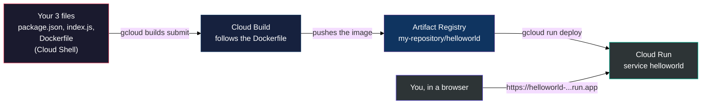
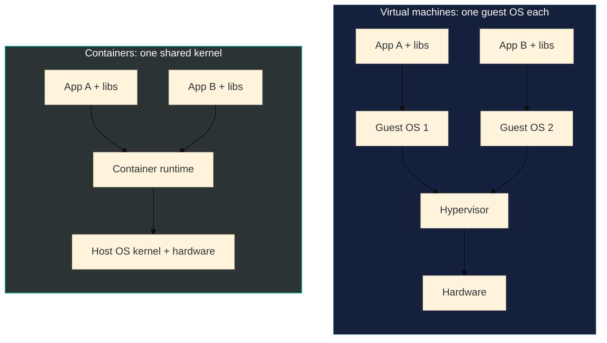
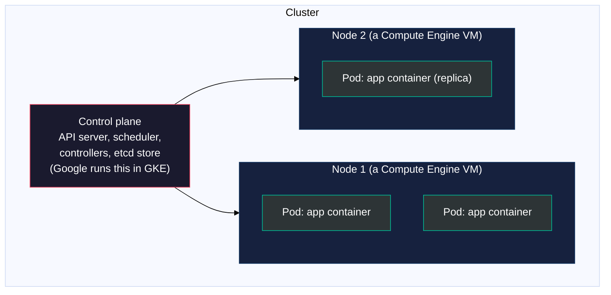
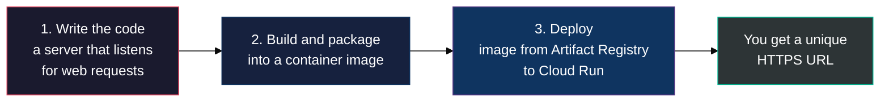

# Lab 4 Study Notes: M5 Containers and M6 Applications in the Cloud

### Containers, Kubernetes, GKE, Cloud Run and Cloud Run functions, condensed for Lab 4 and the ACE exam

> **As of:** 2026-10-19 · **Sources:** the M5 and M6 `_v2.md` study guides in [modules/](../modules/M5_Containers_in_the_Cloud/M5_Containers_in_the_Cloud_v2.md) and the [Lab 4 manual](../labs/04_Hello_Cloud_Run.md) · **Synced with:** the Claude Doc of the same name, https://claude.ai/code/artifact/f9804b10-fbcc-4abc-8797-2115c413fda1

---

## Table of Contents

- [PART 0 — What Lab 4 covers](#part-0)
- [What each service does (M5 and M6)](#part-roles)
- [PART 1 — Containers (M5)](#part-1)
  - [1.1 Container vs virtual machine](#part-1-1)
  - [1.2 Image, container, Dockerfile and registry](#part-1-2)
  - [1.3 Scaling with containers and microservices](#part-1-3)
- [PART 2 — Kubernetes](#part-2)
  - [2.1 The cluster: control plane and nodes](#part-2-1)
  - [2.2 Pods, Deployments and Services](#part-2-2)
  - [2.3 Declarative config, scaling and rolling updates](#part-2-3)
- [PART 3 — GKE](#part-3)
  - [3.1 Autopilot vs Standard](#part-3-1)
  - [3.2 What GKE adds and how you create a cluster](#part-3-2)
- [PART 4 — Cloud Run (M6)](#part-4)
  - [4.1 What it is and the three-step workflow](#part-4-1)
  - [4.2 Revisions, traffic, scaling and limits](#part-4-2)
  - [4.3 Billing](#part-4-3)
  - [4.4 Access: who can call your service](#part-4-4)
  - [4.5 Source-based deploys and Cloud Run jobs](#part-4-5)
- [PART 5 — Cloud Run functions](#part-5)
- [PART 6 — Which compute do I pick?](#part-6)
- [PART 7 — The lab's shortcuts vs how you'd do it properly](#part-7)
- [PART 8 — M5 and M6 self-check quiz](#part-8)
- [PART 9 — Bridge to Lab 4: Hello Cloud Run](#part-9)
  - [9.1 The big picture](#part-9-1)
  - [9.2 What each step teaches](#part-9-2)
  - [9.3 The three files, line by line](#part-9-3)
  - [9.4 Checklist](#part-9-4)
  - [9.5 Expected results and fixes](#part-9-5)
  - [9.6 The commands, explained, and the Console route](#part-9-6)

---

<a id="part-0"></a>
## PART 0 — What Lab 4 covers

Lab 4 takes a tiny web app you type yourself and puts it on the internet without touching a single server: you package it as a **container image**, store the image in **Artifact Registry**, and have **Cloud Run** run it behind a public HTTPS URL.



Everything below keeps what Lab 4 or the Associate Cloud Engineer (ACE) exam needs. Nothing from M5 and M6 is cut. Kubernetes and GKE take up half of M5 and **the lab never touches them**, but the exam asks about them often, so each such part carries a note saying so. Where a point *does* show up in the lab, a **Where you meet this in Lab 4** box tells you which task.

> [!IMPORTANT]
> **Lessons that carry over:** from Lab 1, if a step fails with a permission error right after an API was enabled, wait a minute or two and retry. From Lab 3, a Cloud Shell terminal is a Google-run Linux machine already signed in as the lab user, and `$GOOGLE_CLOUD_PROJECT` / `$DEVSHELL_PROJECT_ID` already hold your project ID.

---

<a id="part-roles"></a>
## What each service does (M5 and M6)

**≈ AWS** appears only where it matches a service you already know: EC2 or Lambda.

| Service | Role it plays | Familiar? |
| :--- | :--- | :--- |
| **Artifact Registry** | A private store for container images (and other packages). Cloud Run and GKE pull images from here. Used in Lab 4 | Like a private Docker Hub inside your project |
| **Cloud Build** | Builds your image on Google's machines from your Dockerfile and pushes it to the registry. Used in Lab 4 | |
| **Cloud Run** | Runs a stateless container that answers web requests, scales to zero and bills per request time. No servers to manage. Used in Lab 4 | A web server you never see; like Lambda, but for any container |
| **Cloud Run functions** | Runs one small function when an event happens (a file upload, a message, an HTTP call). You write the function, not a container | ≈ **Lambda** |
| **GKE** | Google-managed Kubernetes: runs and orchestrates many containers across a cluster of VMs | A fleet of EC2 machines with a container manager on top |
| **Kubernetes** | The open-source system GKE is built on: pods, deployments, services | |
| **Compute Engine** | Plain virtual machines (Lab 1 to 3). GKE nodes are Compute Engine VMs | ≈ **EC2** |

> **Key Idea:** M5 and M6 are one question asked five ways: *how much of the machine do I want to manage?* A VM: all of it. GKE: the containers and the cluster rules. Cloud Run: only the container. Cloud Run functions: only a function.

---

<a id="part-1"></a>
## PART 1 — Containers (M5)

<a id="part-1-1"></a>
### 1.1 Container vs virtual machine

A **container** is a box around your code and everything it needs to run (libraries, runtime), with its own limited view of the file system and hardware. Many containers share the **host's operating system kernel**; each VM instead carries a whole guest OS.



| | Virtual machine | Container |
| :--- | :--- | :--- |
| Contains | App, libraries **and a full guest OS** | App and libraries only |
| Start time | Minutes (the OS must boot) | Seconds or less (it starts like a process) |
| Size | GBs | Usually MBs |
| Portability | Tied to the VM image format | "Code once, run anywhere": laptop, Cloud Shell, GKE, Cloud Run, unchanged |
| Isolation | Strong (separate kernels) | Lighter (shared kernel) |
| Scales like | IaaS (you size the machines) | PaaS (just add copies), with nearly IaaS flexibility |

> **Key Idea:** a container gives you "the best of two worlds": it scales like a platform service (PaaS) yet keeps nearly the flexibility of infrastructure (IaaS). The OS and hardware become a black box you don't care about.

<a id="part-1-2"></a>
### 1.2 Image, container, Dockerfile and registry

Four words you must keep apart, because the lab uses all four:

| Word | What it is | Lab 4 example |
| :--- | :--- | :--- |
| **Dockerfile** | A text recipe: start from this base, copy these files, run these commands, start with this command | The file you create with `nano Dockerfile` |
| **Image** | The finished, read-only package built from the recipe. A template, not running | `.../my-repository/helloworld` in Artifact Registry |
| **Container** | A **running** instance of an image. Many containers can run from one image | The one `docker run` starts in Cloud Shell, and every instance Cloud Run starts |
| **Registry** | A store for images, so other machines can pull them | **Artifact Registry** |

- **Artifact Registry** stores container images (format `docker`) and other packages (Maven, npm, Python, apt and more). It lives in a **location** (a region or multi-region) and an image path looks like this:

```text
us-central1-docker.pkg.dev / my-project-id / my-repository / helloworld : latest
 LOCATION-docker.pkg.dev       PROJECT          REPOSITORY      IMAGE       TAG
```

- The older **Container Registry** (`gcr.io` paths) has been replaced by Artifact Registry. If an exam question mentions `gcr.io`, treat it as the previous generation of the same idea.
- **Cloud Build** is a service that runs build steps, each in its own container, on Google's machines. With `--tag` it reads your Dockerfile, builds the image and pushes it to the registry in one command. Your laptop (or Cloud Shell) does no building.
- **Docker** is the tool that builds and runs container images. In Lab 4 Cloud Shell has it preinstalled and you use it once, to test the image before deploying.
- **Layers and caching:** each Dockerfile instruction becomes a layer. Copying `package.json` and installing dependencies *before* copying the rest of the code means that a code change doesn't reinstall everything: the dependency layer is reused from cache.

> **Where you meet this in Lab 4:** Task 3 creates the registry, Task 4 writes the Dockerfile and builds with Cloud Build ([9.3](#part-9-3) explains every line).

<a id="part-1-3"></a>
### 1.3 Scaling with containers and microservices

- **Scale one container:** a web server in a container can be duplicated in seconds, dozens or hundreds of copies on a single host, as demand grows.
- **Microservices:** real applications are usually several containers, each doing one job (login, payments, search), connected over the network. Each can be deployed and scaled **independently**, across a group of hosts. Hosts can come and go as demand changes or as they fail.
- Running that group by hand is a lot of work (placing containers, restarting failed ones, rolling out new versions). That job is called **orchestration**, and Kubernetes does it.

---

<a id="part-2"></a>
## PART 2 — Kubernetes

> [!NOTE]
> **Not in Lab 4.** You won't create a cluster or type `kubectl`. This part and Part 3 are exam material, and they are the best place to lose marks by mixing up the words.

<a id="part-2-1"></a>
### 2.1 The cluster: control plane and nodes

**Kubernetes** is an open-source platform for orchestrating many containers on many hosts: it deploys them, scales them, and does rollouts and rollbacks. At the highest level it's a set of APIs to deploy containers onto a set of machines called a **cluster**. You describe what you want; Kubernetes works out how.



- **Control plane:** the brain. It holds the cluster's desired state and decides where things run.
- **Node:** a machine that runs containers. In Kubernetes "node" means a machine in the cluster; in GKE every node is a **Compute Engine VM**. The course warns that this is a different use of the word than a node elsewhere.

<a id="part-2-2"></a>
### 2.2 Pods, Deployments and Services

| Object | What it is | Remember |
| :--- | :--- | :--- |
| **Pod** | A wrapper around **one or more containers**, the smallest thing you create or deploy. It gets its own IP and ports; containers inside share networking and storage | Usually one container per pod. Several only with a hard dependency |
| **Deployment** | A group of **replicas** of the same pod. It keeps the right number running even when a node fails, and handles updates | "I want 3 copies of this pod" |
| **Service** | A **stable fixed IP and name** in front of a changing set of pods. Pods are created and destroyed and get new IPs each time; the Service doesn't change | Frontend pods talk to the backend *Service*, never to backend pods |
| **Load balancer** | For a Service of type `LoadBalancer`, GKE creates a Google Cloud **network load balancer** with a public IP that sends clients to a pod behind the Service | How the outside world reaches the cluster |

Service types you may meet: `ClusterIP` (default, reachable only inside the cluster), `NodePort` (opens a port on each node), and `LoadBalancer` (external IP through a Google load balancer).

> **Key Idea:** pod IPs are not stable, and that is exactly why Services exist.

<a id="part-2-3"></a>
### 2.3 Declarative config, scaling and rolling updates

Two ways to tell Kubernetes what to do:

- **Imperative:** you issue commands one by one (`expose`, `scale`). Good for learning and quick tests.
- **Declarative:** you write a **configuration file** (YAML) saying what the desired state looks like, and Kubernetes makes it so. This is the real strength of Kubernetes and the recommended way. To change anything, edit the file and `kubectl apply` it again.

| `kubectl` command | What it does |
| :--- | :--- |
| `kubectl get pods` | Lists the pods running in the cluster |
| `kubectl get deployments` / `describe deployments` | Shows (or details) each deployment and how many replicas are ready |
| `kubectl get services` | Lists Services, including the **external IP** to reach the app |
| `kubectl scale deployment NAME --replicas=3` | Changes the number of pods now |
| `kubectl apply -f FILE.yaml` | Makes the cluster match the file (create or update). To go from 3 to 5 replicas, edit the file and apply |
| `kubectl rollout ...` | Starts, watches or undoes a rolling update |

- **Autoscaling:** a deployment can scale itself on a measure such as CPU utilization (for example, add pods when CPU passes a limit).
- **Rolling update:** replacing everything at once is risky, so the update strategy creates new-version pods one at a time, waiting for each to be available before removing an old one. Users never see downtime, and you can roll back.

---

<a id="part-3"></a>
## PART 3 — GKE

**Google Kubernetes Engine (GKE)** is Google's managed Kubernetes. The cluster is built from **Compute Engine** instances, so it inherits Compute Engine and VPC features. The big difference from running Kubernetes yourself: **GKE runs the control plane for you** (you still get one API IP address to send requests to) and, depending on the mode, the nodes too.

<a id="part-3-1"></a>
### 3.1 Autopilot vs Standard

| | **Autopilot** (recommended) | **Standard** |
| :--- | :--- | :--- |
| Who manages the nodes | **GKE**: node configuration, autoscaling, auto-upgrades, baseline security and networking | **You**: you configure, manage and optimize the cluster and its nodes |
| What you think about | Your workloads | Node pools, machine types, sizing |
| Billing | By the CPU, memory and storage your **pods request** | By the **nodes** (VMs) you run, used or not |
| Fits | Most production work: strong security posture, less operations effort | When you need node-level control Autopilot doesn't give |

The course's rule: *unless you need the control Standard offers, use Autopilot.*

<a id="part-3-2"></a>
### 3.2 What GKE adds and how you create a cluster

What a GKE cluster gives you beyond plain Kubernetes:

- Google Cloud **load balancing** for Compute Engine instances.
- **Node pools:** subsets of nodes with the same configuration, so one cluster can hold different machine types.
- **Automatic scaling** of the number of nodes, **automatic upgrades** of node software and **node auto-repair** to keep nodes healthy.
- **Logging and monitoring** through Google Cloud Observability.

Creating a cluster is one command or a few Console clicks (Kubernetes Engine > Clusters > Create). Clusters can be customized: machine types, number of nodes, network settings.

```bash
# Create an Autopilot cluster named k1 in a region (CLUSTER_REGION is a variable you set first)
gcloud container clusters create-auto k1 --region $CLUSTER_REGION
```

- `gcloud container clusters` is the group for GKE clusters, `create-auto` creates an **Autopilot** one, `k1` is its name, and `--region` says where. After creating, you point `kubectl` at it and deploy with the commands in [2.3](#part-2-3).

---

<a id="part-4"></a>
## PART 4 — Cloud Run (M6)

<a id="part-4-1"></a>
### 4.1 What it is and the three-step workflow

**Cloud Run** is a managed compute platform that runs **stateless containers** that answer web requests (or Pub/Sub events). It is **serverless**: no infrastructure to manage. It is built on **Knative**, an open API and runtime on top of Kubernetes, so the same workloads can also run on GKE or anywhere Knative runs.



**The container contract**: for Cloud Run to run your container, it must:

- Be a **Linux 64-bit** binary or program (any language: Java, Python, Node.js, PHP, Go, C++, even Cobol or Perl) that starts an **HTTP server**.
- Listen on the port in the **`PORT` environment variable** (default `8080`), on all interfaces.
- Be **stateless**: any instance can be created or destroyed at any moment, and instances don't share a disk. Anything that must survive goes to Cloud Storage, a database or a similar service. The in-container file system is temporary.

> **Where you meet this in Lab 4:** `index.js` reads `process.env.PORT` (falls back to 8080), which is the contract. The "Hello World" is the whole app.

<a id="part-4-2"></a>
### 4.2 Revisions, traffic, scaling and limits

- **Service and revision:** a **service** is the thing with a name and a URL (`helloworld`). Every deploy creates a new immutable **revision** (`helloworld-00001-xit`). The service sends traffic to one or more revisions.
- **Traffic splitting:** send percentages of traffic to different revisions (for example 90/10 for a canary release), or roll back by sending 100% to the previous revision. This is the "traffic management" the lab's exam anchor mentions.
- **Autoscaling:** Cloud Run adds instances as requests arrive and **scales down to zero** when idle ("almost instantaneously"). You can set **minimum instances** (keeps some warm, avoiding cold starts, but costs money while idle) and **maximum instances** (caps scale and cost).
- **Concurrency:** one instance can handle many requests at once (default 80, up to 1000). A higher setting means fewer instances for the same traffic.
- **Resources and limits:** you choose CPU and memory per instance (the course quotes up to 4 vCPU and 8 GB, and the limits have grown since, so check the current docs). A request has a timeout (default 5 minutes, configurable up to 60).
- **Configuration at deploy time:** environment variables (`--set-env-vars NAME=Abdo` would make the lab app say "Hello Abdo!") and secrets from Secret Manager.

<a id="part-4-3"></a>
### 4.3 Billing

Cloud Run's pricing is unusual, and the exam likes it:

- You pay for CPU and memory **only while a container handles requests**, plus while it **starts up and shuts down**, in steps of **100 ms**. When no request is being served you pay **nothing** for compute.
- A small fee per **million requests** applies, and a free tier covers light use.
- A bigger instance (more vCPU and memory) costs more per second.
- Other compute products, such as Compute Engine, bill while running even if idle. That is the key difference.
- Two exceptions to "nothing when idle": **minimum instances** (idle but kept warm) and the **instance-based billing** option (CPU always allocated), which bills for the whole instance lifetime.
- Separately, the **stored image** in Artifact Registry costs storage. That is why the lab's last task deletes it.

<a id="part-4-4"></a>
### 4.4 Access: who can call your service

- By default a new service is **private**: callers need the IAM role **Cloud Run Invoker** (`roles/run.invoker`).
- `--allow-unauthenticated` (or "Allow public access" in the Console) grants that role to **`allUsers`**, making the service public. That is what the lab does, so you can open the URL in a browser.
- For a private service, a caller sends an identity token. For example `gcloud auth print-identity-token` prints one, and `curl` can send it in an `Authorization: Bearer` header.
- The **ingress** setting controls where requests may come from (anywhere, internal only, or internal plus a load balancer).
- The service runs as a **service account** (by default the Compute Engine default one). Give it only the roles the app needs.
- To deploy, you need Cloud Run admin rights **and** permission to act as the runtime service account.

<a id="part-4-5"></a>
### 4.5 Source-based deploys and Cloud Run jobs

- **Container-based workflow** (the lab): you write the Dockerfile and build the image. Full transparency and flexibility.
- **Source-based workflow:** you deploy **source code** directly and Cloud Run builds the container for you using **Buildpacks**, an open-source project, so the image is secure, well-configured and built the same way each time. In the CLI that is `gcloud run deploy --source .`.
- **Cloud Run jobs** run a container **to completion** (a batch task, a migration) rather than serving requests. Services answer requests; jobs run and finish.

---

<a id="part-5"></a>
## PART 5 — Cloud Run functions

Many apps have event-driven parts. Take an image upload: it should create a thumbnail, convert the format and save the results. You could code that into the app, but then you must provide compute for it whether it happens every millisecond or once a day.

**Cloud Run functions** (the newer name for Cloud Functions) is a lightweight, event-based, asynchronous compute solution:

- You write a small **single-purpose function**. You don't manage a server, a runtime or a container.
- It is billed to the nearest **100 ms**, and **only while your code runs**.
- Languages: Node.js, Python, Go, Java, .NET Core, Ruby and PHP.
- **Triggers:** events from **Cloud Storage** and **Pub/Sub** run it asynchronously, or you call it by **HTTP** for synchronous use. (Not HTTP only: that is a quiz favourite.)
- It is integrated with Cloud Logging and Monitoring, and can be used to **connect and extend other cloud services**.
- Newer functions run on Cloud Run underneath.

| | **Cloud Run** | **Cloud Run functions** |
| :--- | :--- | :--- |
| You provide | A container (or source for buildpacks) | A single function |
| Best for | A whole web app, an API, several routes, any language or binary | One small reaction to an event: thumbnail on upload, email on a new file |
| Triggered by | HTTP requests (and Pub/Sub events) | Events (Cloud Storage, Pub/Sub) or HTTP |
| Familiar | Like a web server | ≈ **Lambda** |

---

<a id="part-6"></a>
## PART 6 — Which compute do I pick?

Ordered from "most control" to "least to manage":

| Service | You manage | Pick it when the question says... |
| :--- | :--- | :--- |
| **Compute Engine** | The whole VM: OS, patches, software, scaling | Lift-and-shift, a specific OS or kernel, license or hardware needs, full control (Labs 1 to 3) |
| **GKE** | Containers and cluster rules (Autopilot also hands you the nodes) | Many containers, microservices, you want the Kubernetes API or portability, long-running or stateful workloads |
| **App Engine** | Just your source code | A web app on a managed platform, no containers needed (covered earlier in the course) |
| **Cloud Run** | Just one container | A stateless HTTP service, scale to zero, pay per request, no cluster |
| **Cloud Run functions** | Just a function | Small event-driven code: react to a file upload or a Pub/Sub message |

Clue words:

| The question says... | Think |
| :--- | :--- |
| "Kubernetes", "orchestrate", "pods", "multi-container" | **GKE** |
| "stateless container", "scale to zero", "pay only when handling requests" | **Cloud Run** |
| "when a file is uploaded", "on a message", "single-purpose", "respond to an event" | **Cloud Run functions** |
| "I need to install a custom OS or driver" | **Compute Engine** |
| "no clusters or servers to manage" | **Cloud Run** (or functions) |

---

<a id="part-7"></a>
## PART 7 — The lab's shortcuts vs how you'd do it properly

The lab is built for speed. These are fine for a sandbox and each is an exam angle.

| In the lab | Why it's a shortcut | The proper way |
| :--- | :--- | :--- |
| `--allow-unauthenticated` | The URL is open to the entire internet | Only for public sites. Otherwise leave the service private and grant `roles/run.invoker` to the callers that need it |
| No tag on the image (`.../helloworld`) | It gets the `latest` tag, which changes under you | Tag images with a version or commit (`:v1`) so each deploy is repeatable and rollbackable |
| The service runs as the default Compute Engine service account | That account is broadly privileged | Create a dedicated service account with only the roles the app needs |
| Settings are plain environment variables | Fine for `NAME`, but not for passwords | Use Secret Manager for secrets |
| `docker run -d` leaves a container running in Cloud Shell | A leftover test container | `docker ps` to find it, `docker stop ID` to end it (Cloud Shell resets itself eventually, so it's harmless) |
| The image stays in Artifact Registry | It costs storage until deleted | Delete it (Task 6), or set a cleanup policy on the repository |

---

<a id="part-8"></a>
## PART 8 — M5 and M6 self-check quiz

Q1 to Q5 are the course's own module quizzes. Where a question asks you to pick between options, they are lettered. Click a question to see the answer.

<details>
<summary><strong>Q1.</strong> What is a Kubernetes pod?<br/>A. A group of clusters<br/>B. A group of nodes<br/>C. A group of VMs<br/>D. A group of containers</summary>

**D.** A pod is one or more containers deployed together: started, stopped and replicated as a group. The simplest workload is a pod with a single container.

</details>

<details>
<summary><strong>Q2.</strong> Where do the resources used to build GKE clusters come from?<br/>A. Compute Engine<br/>B. App Engine<br/>C. Bare-metal servers<br/>D. Cloud Storage</summary>

**A.** GKE nodes are Compute Engine VMs, so GKE gets to use Compute Engine's and VPC's capabilities.

</details>

<details>
<summary><strong>Q3.</strong> Which scenario suits Cloud Run rather than Cloud Run functions?<br/>A. Email whenever a new document lands in a Cloud Storage folder<br/>B. Hosting a dynamic web app where users upload and share photos<br/>C. Resizing images on demand when a user asks through a web interface<br/>D. Generating thumbnails for images uploaded to a bucket</summary>

**B.** A whole web application with user interactions fits a container on Cloud Run. A, C and D are single-purpose, event-driven jobs, which functions handle well, triggered by the upload.

</details>

<details>
<summary><strong>Q4.</strong> Which three statements about Cloud Run functions are correct?<br/>A. A scalable functions-as-a-service platform<br/>B. Can be used to extend Cloud services<br/>C. Requires servers or VMs to be provisioned<br/>D. Integrated with Cloud Logging<br/>E. Can only be invoked by HTTP requests</summary>

**A, B and D.** C is wrong because it is serverless. E is wrong because functions are triggered by HTTP **or** by events from your cloud infrastructure, such as Cloud Storage and Pub/Sub.

</details>

<details>
<summary><strong>Q5.</strong> Why would a customer choose Cloud Run functions?<br/>A. Event-driven code they don't want to provision compute for<br/>B. It is the primary way to run C++ applications<br/>C. It is a free service<br/>D. To split a legacy monolith into microservices</summary>

**A.** Functions run only when the event happens and you pay only while the code runs. It's not free, it isn't specific to C++, and splitting a monolith into services points to containers (Cloud Run or GKE).

</details>

<details>
<summary><strong>Q6.</strong> A container starts in about a second and a VM takes minutes. What is the reason?</summary>

A container doesn't boot an operating system. It shares the host's kernel and starts like a process, whereas a VM must boot a full guest OS.

</details>

<details>
<summary><strong>Q7.</strong> You wrote a Dockerfile and ran a build. What did you produce, and what is a running copy called?<br/>A. A container; a running copy is an image<br/>B. An image; a running copy is a container<br/>C. A registry; a running copy is a repository<br/>D. A pod; a running copy is a node</summary>

**B.** The Dockerfile is the recipe, the build produces an **image** (a read-only template), and each running copy of it is a **container**.

</details>

<details>
<summary><strong>Q8.</strong> Where do you store the container images that Cloud Run and GKE will pull?<br/>A. Cloud Storage's Archive class<br/>B. Cloud SQL<br/>C. Artifact Registry<br/>D. Persistent Disk</summary>

**C.** Artifact Registry is the managed store for images. It replaced the older Container Registry.

</details>

<details>
<summary><strong>Q9.</strong> Which port must a Cloud Run container listen on?<br/>A. Always port 80<br/>B. The port in the <code>PORT</code> environment variable (default 8080)<br/>C. Any port, Cloud Run scans for it<br/>D. Only 443</summary>

**B.** Cloud Run tells your container which port to use through `PORT`. Your app reads it (`process.env.PORT`), and Cloud Run handles HTTPS for you at the URL.

</details>

<details>
<summary><strong>Q10.</strong> A Cloud Run service gets no traffic for a day. What do you pay for compute, with default settings?<br/>A. The same as when busy<br/>B. Half<br/>C. Nothing<br/>D. A flat hourly fee for one VM</summary>

**C.** It scales to zero and bills only while requests are handled (plus start-up and shutdown), in 100 ms steps. Minimum instances or instance-based billing would change that.

</details>

<details>
<summary><strong>Q11.</strong> A new revision has a bug. What is the quickest safe fix on Cloud Run?<br/>A. Delete the project<br/>B. Send 100% of traffic back to the previous revision<br/>C. Recreate the Artifact Registry repository<br/>D. Resize the instance</summary>

**B.** Revisions are immutable, so the old one is still there. Traffic splitting lets you shift traffic back (and also run canaries, for example 90/10).

</details>

<details>
<summary><strong>Q12.</strong> Which is true of GKE Autopilot compared to Standard?<br/>A. You manage the nodes in Autopilot<br/>B. GKE manages the nodes in Autopilot, and you are billed for the resources your pods request<br/>C. Autopilot has no control plane<br/>D. Autopilot needs no containers</summary>

**B.** In Autopilot, GKE handles node configuration, scaling, upgrades and baseline security. In Standard you manage the nodes and pay for them.

</details>

<details>
<summary><strong>Q13.</strong> Pod IPs change every time pods are recreated. What gives other pods a stable address?<br/>A. A Deployment<br/>B. A Node pool<br/>C. A Service<br/>D. A Namespace</summary>

**C.** A Service is a stable IP and name in front of a changing set of pods. A Deployment keeps the right number of pods running but doesn't give a stable address.

</details>

<details>
<summary><strong>Q14.</strong> You need 3 replicas, then 5 later, and want it reproducible and reviewable in version control. What do you use?<br/>A. A series of manual <code>kubectl scale</code> commands<br/>B. A declarative Deployment config file, changed and re-applied with <code>kubectl apply</code><br/>C. Editing pods by hand in the Console<br/>D. Recreating the cluster</summary>

**B.** Declarative config states the desired state in a file Kubernetes then enforces. Change `replicas`, apply again.

</details>

<details>
<summary><strong>Q15.</strong> Pick the service for each: (1) a stateless HTTP API that should scale to zero; (2) a multi-service app that needs Kubernetes; (3) a custom OS with a kernel module; (4) resize a photo when it lands in a bucket.<br/>A. 1 Cloud Run, 2 GKE, 3 Compute Engine, 4 Cloud Run functions<br/>B. 1 GKE, 2 Cloud Run, 3 Cloud Run functions, 4 Compute Engine<br/>C. 1 Compute Engine, 2 Cloud Run, 3 GKE, 4 Cloud Run<br/>D. 1 Cloud Run functions, 2 Compute Engine, 3 GKE, 4 Cloud Run</summary>

**A.** Each follows the clue words in [Part 6](#part-6).

</details>

<details>
<summary><strong>Q16.</strong> In Lab 4, what does <code>--allow-unauthenticated</code> do?<br/>A. Disables HTTPS<br/>B. Grants the Cloud Run Invoker role to <code>allUsers</code>, making the service public<br/>C. Skips the build<br/>D. Lets the service write to Cloud Storage</summary>

**B.** Without it the deploy asks you, or the URL answers 403 Forbidden to anyone without the Invoker role.

</details>

<details>
<summary><strong>Q17.</strong> Your Cloud Run app saves uploaded files to the container's local disk. What happens?<br/>A. They are safe forever<br/>B. They are lost when the instance is replaced or scaled to zero, so use Cloud Storage or a database<br/>C. Cloud Run backs them up daily<br/>D. They are shared across instances</summary>

**B.** Cloud Run containers must be stateless. Local disk is temporary and per instance.

</details>

<details>
<summary><strong>Q18.</strong> What can trigger a Cloud Run function?<br/>A. Only HTTP requests<br/>B. Only Cloud Storage events<br/>C. HTTP requests and events such as Cloud Storage and Pub/Sub<br/>D. Only a cron schedule</summary>

**C.** Events run it asynchronously, HTTP gives synchronous use.

</details>

<details>
<summary><strong>Q19.</strong> After Task 6 (image and service deleted), what is still in your project?<br/>A. Nothing from the lab<br/>B. The empty <code>my-repository</code> repository and the source bucket Cloud Build created<br/>C. The running container<br/>D. The Cloud Run service</summary>

**B.** Task 6 deletes the **image** and the **service**, not the repository. The lab project is deleted when you End Lab, but in a real project you'd remove those too.

</details>

<details>
<summary><strong>Q20.</strong> You ran <code>gcloud config set compute/region</code> in Task 1, yet <code>gcloud run deploy</code> still gets <code>--region=$LOCATION</code>. Why?</summary>

`compute/region` is the default for **Compute Engine** commands. `gcloud run` has its own setting (`run/region`), so it needs the region on the command line, unless you set that property too. The lab sets `compute/region` out of habit and passes the region explicitly where it matters.

</details>

---

<a id="part-9"></a>
## PART 9 — Bridge to Lab 4: Hello Cloud Run

About 45 minutes, almost all in **Cloud Shell**. Your recorded walkthrough shows the steps. Use these notes for the *why* and for what to do when a step goes wrong.

<a id="part-9-1"></a>
### 9.1 The big picture

You are doing four things, in this order:

1. **Write** a tiny web app (3 files) that answers "Hello World!".
2. **Package** it: the Dockerfile describes the box, Cloud Build builds it and Artifact Registry keeps it.
3. **Test** it in Cloud Shell with Docker, so you know the box works before you ship it.
4. **Deploy** the same box to Cloud Run and open the HTTPS URL.

Then you **clean up** so nothing keeps costing money. The point of the lab is the Cloud Run workflow from [4.1](#part-4-1), end to end, with no server ever created.

<a id="part-9-2"></a>
### 9.2 What each step teaches

| In the lab you... | The theory behind it |
| :--- | :--- |
| Enable `run.googleapis.com` and `artifactregistry.googleapis.com` | Services must be switched on per project first ([Lab 1](../study-notes/Lab1_M0-M2_Study_Notes.md) lesson: wait a minute if a permission error follows) |
| Create `package.json` and `index.js` | Step 1 of the workflow: a server that listens on `PORT` ([4.1](#part-4-1)) |
| Create the Artifact Registry repository `my-repository` (format Docker) | Where the image will live ([1.2](#part-1-2)) |
| `gcloud auth configure-docker` | Lets Docker in Cloud Shell sign in to Artifact Registry to pull your image |
| Write the `Dockerfile` | The recipe for the image ([1.2](#part-1-2)) |
| `gcloud builds submit --tag ...` | Cloud Build builds and pushes the image: step 2 of the workflow |
| `docker run -d -p 8080:8080 ...` and Web preview | Test the **container** locally before deploying |
| `gcloud run deploy ... --allow-unauthenticated` | Step 3: Cloud Run creates a service and the first revision, and makes it public ([4.4](#part-4-4)) |
| Delete the image and the service | Avoid storage charges; Cloud Run itself is free when idle ([4.3](#part-4-3)) |

<a id="part-9-3"></a>
### 9.3 The three files, line by line

**`package.json`**: tells Node what the project is and how to start it.

| Part | What it means |
| :--- | :--- |
| `"name"`, `"description"`, `"version"`, `"author"`, `"license"` | Labels about the project. Not used to run it |
| `"main": "index.js"` | The main file |
| `"scripts": { "start": "node index.js" }` | **The important one.** `npm start` runs `node index.js`. The Dockerfile's last line calls it |
| `"dependencies": { "express": "^4.17.1" }` | The one library needed, Express (a web framework). `^4.17.1` means "4.17.1 or any later 4.x" |

**`index.js`**: the whole app.

| Line | What it means |
| :--- | :--- |
| `const express = require('express'); const app = express();` | Load Express and create the app |
| `const port = process.env.PORT \|\| 8080;` | Use the `PORT` environment variable, or 8080 if it isn't set. This is the Cloud Run contract |
| `app.get('/', (req, res) => { ... })` | When someone requests the home page `/`, run this function |
| `const name = process.env.NAME \|\| 'World'; res.send(\`Hello ${name}!\`);` | Say "Hello" plus an environment variable called `NAME`, or "World". Deploying with `--set-env-vars NAME=Abdo` would change the greeting without touching the code |
| `app.listen(port, () => console.log(...))` | Start the web server on that port and print a line to the log |

**`Dockerfile`**: the recipe (the lab page prints the exact `FROM` image; the manual file here shows only a placeholder).

| Line | What it means |
| :--- | :--- |
| `FROM <node image>` | Start from an official, lightweight Node.js image: Linux plus Node already installed |
| `WORKDIR /usr/src/app` | Create this folder in the image and work from it |
| `COPY package*.json ./` | Copy `package.json` (and a lock file if any) into the image. `*` is a wildcard. **Done first on purpose** so the next step can be cached |
| `RUN npm install --only=production` | Install the dependencies (Express) inside the image. `RUN` happens at **build** time |
| `COPY . ./` | Copy the rest of your files (`index.js`) in |
| `CMD [ "npm", "start" ]` | What the container does when it **starts** at run time: `npm start`, which runs `node index.js` |

<a id="part-9-4"></a>
### 9.4 Checklist

- [ ] Read this section and watch the walkthrough video
- [ ] Start the lab, open the console in an incognito window with the lab student account, open Cloud Shell
- [ ] Task 1: enable the Cloud Run and Artifact Registry APIs, approve the authorization prompt if asked
- [ ] Task 1: `gcloud config set compute/region` with the lab's region, then `LOCATION="the same region"`
- [ ] Task 2: `mkdir helloworld && cd helloworld`, then create `package.json` and `index.js` with `nano` (paste, then `CTRL+X`, `Y`, `Enter`)
- [ ] Task 3: create the Docker repository `my-repository` in your region, then `gcloud auth configure-docker $LOCATION-docker.pkg.dev` (answer `Y`), Check my progress
- [ ] Task 4: create the `Dockerfile` (use the `FROM` image the lab page shows), save
- [ ] Task 4: `gcloud builds submit --tag ...` from inside `helloworld`, wait for SUCCESS (say yes if asked to enable Cloud Build)
- [ ] Task 4: `docker run -d -p 8080:8080 ...`, then Web preview on port 8080 shows "Hello World!", Check my progress
- [ ] Task 5: `gcloud run deploy helloworld ...`, answer `Y` to enabling APIs, open the Service URL, check the service in the Cloud Run page, Check my progress
- [ ] Task 6: delete the image (`Y`), then the service (`Y`)
- [ ] All checks green, End Lab

<a id="part-9-5"></a>
### 9.5 Expected results and fixes

| Moment | You should see | If not |
| :--- | :--- | :--- |
| Enabling the APIs | `Operation ... finished successfully` | A permission error right after: wait a minute, retry (the Lab 1 lesson) |
| Inside the build log, the `npm install` step | Lines about installing Express | A `npm WARN` or deprecation notice is **only a warning**: `--only=production` is an older flag spelling, and the build still succeeds |
| Creating the repository | No error; it appears in Artifact Registry | "already exists": fine, it is there. "Permission denied" right after enabling the API: wait and retry |
| `gcloud builds submit` | Lines of build output ending in `SUCCESS` and the image name | "Dockerfile not found": you are not in `helloworld`, or the file name is wrong (capital D, no extension). A "repository not found" error means the repository name or region in the path doesn't match what you created |
| `docker run -d ...` | A long container ID printed and nothing else | "Unauthorized": rerun `gcloud auth configure-docker`. It runs in the background (`-d`), so the prompt returns at once |
| Web preview on 8080 | A page saying `Hello World!` | Make sure you chose port **8080**, not the default. Or `curl localhost:8080` |
| `gcloud run deploy` | `Service [helloworld] revision [helloworld-00001-...] has been deployed and is serving 100 percent of traffic` and a Service URL | If asked to allow unauthenticated invocations, answer `y`. If asked to enable an API, answer `Y` |
| Opening the Service URL | `Hello World!` over HTTPS | `403 Forbidden`: the service isn't public, so rerun the deploy with `--allow-unauthenticated`. `Service Unavailable` right after deploy: wait a few seconds and reload |
| Cleanup | The image and service gone | The prompts need `Y` and `Enter`. Deleting the service needs the same `--region` you deployed to |

> [!TIP]
> If a **Check my progress** fails, read which objective it names (repository, image, service) and look at that resource in the Console: Artifact Registry or Cloud Run lists them. Most fails are a mismatched region between steps.

<a id="part-9-6"></a>
### 9.6 The commands, explained, and the Console route

**Method:** you have to write three files and run a build, so Cloud Shell is the natural place. Everything else has a Console route that I list next to it. **Reading a command:** `gcloud` (the tool), a group (`run`, `artifacts`, `builds`), a noun, a verb, then the target and `--flags`. For example `gcloud run deploy helloworld` reads "tool, Cloud Run, deploy, the service named helloworld".

| Command piece | What it means | Console equivalent |
| :--- | :--- | :--- |
| `gcloud services enable run.googleapis.com artifactregistry.googleapis.com` | Switches on the two APIs in the project. `run.googleapis.com` is Cloud Run, `artifactregistry.googleapis.com` is Artifact Registry | APIs & Services > Library > search each > **Enable** |
| `gcloud config set compute/region REGION` | Stores a default region for **Compute Engine** commands. Cloud Run commands don't read it | Not applicable |
| `LOCATION="REGION"` | Saves the region in a variable so later commands use `$LOCATION` | Not applicable |
| `mkdir helloworld && cd helloworld` | `mkdir` makes a folder, `&&` means "and then, if that worked", `cd` moves into it | Not applicable |
| `nano package.json` | `nano` is a small terminal text editor. This opens (or creates) the file. `CTRL+X`, `Y`, `Enter` saves and quits | The Cloud Shell **Open Editor** button (a point-and-click editor) |
| `gcloud artifacts repositories create my-repository` | Creates a repository named `my-repository` | Artifact Registry > **Create repository** |
| `--repository-format=docker` | This repository holds container images | The "Format" dropdown |
| `--location=$LOCATION` | The region of the repository | The "Region" dropdown |
| `--description="Docker repository"` | A label | The "Description" box |
| `gcloud auth configure-docker $LOCATION-docker.pkg.dev` | Edits Docker's config so it uses your Google credentials for that registry host. Needed because `docker run` must pull the image | Not applicable |
| `gcloud builds submit --tag IMAGE` | Zips the current folder, sends it to Cloud Build, which follows the `Dockerfile` and pushes the result as `IMAGE`. Run it from the folder with the Dockerfile | Cloud Build can also be triggered from the Console, but this is simplest as a command |
| `$LOCATION-docker.pkg.dev/$GOOGLE_CLOUD_PROJECT/my-repository/helloworld` | The image path ([1.2](#part-1-2)): region host, your project ID (preset in Cloud Shell), repository, image name. No tag, so it's `latest` | The path is shown on the image in Artifact Registry |
| `docker run -d -p 8080:8080 IMAGE` | Starts a **container** from the image. `-d` runs it in the background. `-p 8080:8080` connects port 8080 of Cloud Shell to port 8080 in the container | Not applicable |
| Web preview > Preview on port 8080 | Cloud Shell opens a browser tab to its own port 8080 | The Web preview button in the Cloud Shell toolbar |
| `gcloud run deploy helloworld` | Creates (or updates) a Cloud Run service named `helloworld` | Cloud Run > **Create service** |
| `--image IMAGE` | Which image to run | "Deploy one revision from an existing container image" > Select |
| `--allow-unauthenticated` | Makes the service public ([4.4](#part-4-4)) | Authentication: **Allow public access** |
| `--region=$LOCATION` | Where the service runs | The "Region" dropdown |
| `gcloud artifacts docker images delete IMAGE` | Deletes the image (all its versions of that path) from the registry. Asks to confirm | Artifact Registry > repository > the image > **Delete** |
| `gcloud run services delete helloworld --region=...` | Deletes the Cloud Run service. Asks to confirm | Cloud Run > tick the service > **Delete** |

**Console route for the deploy, if you want to try it later** (it is the same result): Cloud Run > Create service > "Deploy one revision from an existing container image" > Select > Artifact Registry > `my-repository` > `helloworld` > service name `helloworld` > Region > Authentication "Allow public access" > Create.

**Optional checks.** Only if something looks wrong:

| Command | What it does |
| :--- | :--- |
| `gcloud run services list` | Lists your services, regions and URLs. Console: the Cloud Run page |
| `gcloud artifacts docker images list $LOCATION-docker.pkg.dev/$GOOGLE_CLOUD_PROJECT/my-repository` | Lists the images in the repository. Console: Artifact Registry |
| `docker ps` | Lists running containers on Cloud Shell, with their IDs |
| `docker stop CONTAINER_ID` | Stops the test container from `docker run` |
| `curl localhost:8080` | Fetches the page from Cloud Shell's own port 8080 and prints it as text |

Prompt to paste into the Gemini CLI agent before running anything:

```text
I'm doing Google Cloud Skills Boost lab "Hello Cloud Run" in Cloud Shell.
Lab region: <REGION>; project: <PROJECT_ID>.
Check these commands against labs/04_Hello_Cloud_Run.md in this repo.
Replace placeholders with my values, flag anything that won't work in
Cloud Shell, and explain in one line what each command does.
Do not run anything yourself.

<PASTE COMMANDS>
```

---
*Scope: M5 Containers in the Cloud and M6 Applications in the Cloud, plus the Lab 4 bridge · Sources: the course study guides and the Lab 4 manual*
